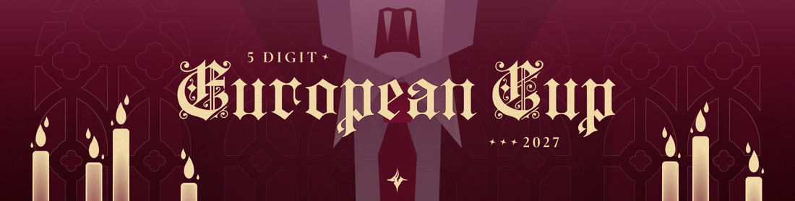

Deep within an abandoned castle, an ancient hatred stirs, awakened by the footsteps of those who dare to enter. Only the strongest will survive its wrath, and only one country shall emerge victorious.

    <iframe width="95%" style="aspect-ratio: 16 / 9;" src="https://www.youtube.com/embed/z4s5QH8g8d8" frameborder="0" allowfullscreen></iframe>

The 5 Digit European Cup (5EC) returns for its third iteration, uniting 5-digit players from across Europe in a World Cup–style tournament.

With a strong focus on original music, custom maps and community involvement, 5EC'27 aims to deliver a unique experience for the European playerbase, with physical prizes for the top three countries, alongside giveaways and awards for other participants!

## What's new?

This year, 5EC will be hosted by *Astrum*, a new hosting group led by ::{ flag=UA }:: [Filoxen](https://osu.ppy.sh/users/24454271), ::{ flag=BA }:: [alisha-](https://osu.ppy.sh/users/29031839), ::{ flag=RO }:: [BeZonaurul](https://osu.ppy.sh/users/11068604), ::{ flag=CH }:: [MirageFire](https://osu.ppy.sh/users/5316973) and ::{ flag=NL }:: [Timper](https://osu.ppy.sh/users/11955929), that aims to make European tournaments an even better experience for players across the region.

The biggest change is the tournament format! After two iterations featuring a Swiss Stage, 5EC'27 is introducing a Group Stage format, following the direction taken by other World Cup–style tournaments inspired by OWC.

However, rather than simply adopting the standard OWC format, 5EC'27 will introduce its own unique variation.

To view the full format and other relevant details, check out the forum post or the [5EC'27 rulebook](https://docs.google.com/document/d/1SbkkvKndL8x5cyXDDY8Wz56hKuSJTG215WiIR2hno5w/edit?usp=sharing).

## Tournament schedule

| Event | Dates |
| --: | :-- |
| Player registrations | November 2nd – November 15th 23:59 UTC |
| Tryouts phase | November 16th – November 29th |
| Team Submissions | November 23rd – November 29th |
| Screening | November 30th – December 13th |
| Qualifiers | December 14th – December 20th |
| Group Stage | December 21st – January 10th |
| Round of 16 | January 11th – January 17th |
| Quarterfinals | January 18th – January 24th |
| Semifinals | January 25th – January 31st |
| Finals | February 1st – February 7th |
| Grand Finals | February 8th – February 14th |

## How do I register?

The deadline to register for this tournament is November 15, 2026 (23:59 UTC)

Players who sign up and meet the following criteria will be eligible to participate:

- You must not have violated the osu! community rules within the past 12 months.
- You must be within global rank #10,000–99,999 after [BWS](/wiki/Tournaments/Badge-weighted_seeding) until the start of the Screening period on November 30, 2026.

All countries with at least 4 eligible registrants will be allowed to appoint one player as a captain. Captains will be responsible for selecting and submitting a roster of 4–8 players to represent their country in the tournament. Countries with more than 8 candidates are encouraged to host tryouts to determine the best players for their team.

Joining the official [5EC Discord server](https://discord.com/invite/hDhj6Jb45k) is mandatory for all players selected for a team. Everyone else, including spectators, are encouraged to join to keep up with important announcements and tournament livestream notifications.

You can also check the [forum post](https://osu.ppy.sh/community/forums/topics/2258351) for additional information and links!

# Prize pool

| # | Prize |
| :-: | :-- |
| 1st | Physical prizes, team banner and a profile badge (pending) |
| 2nd | Physical prizes and a team banner |
| 3rd | Physical prizes and a team banner |

Throughout the tournament, we will also host giveaways and present awards to recognise other participants and community members, so stay tuned for more opportunities to get involved!

We can only imagine what Europe's finest have in store for us this iteration and the castle awaits its challengers.

Good luck to all players, may the strongest country conquer the undead and emerge victorious!

—Filoxen, alisha-
