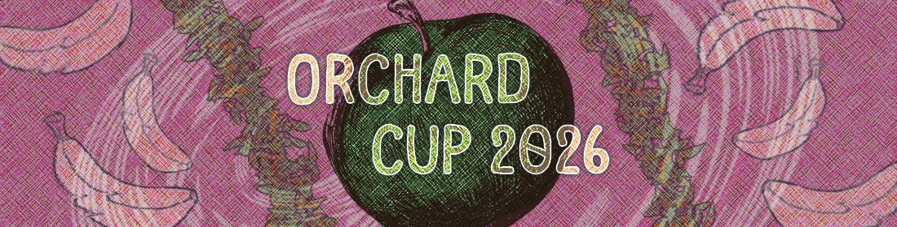

The first iteration of the freshly sown Orchard Cup (OC) is coming to an end and now it's time for contestants to harvest the fruits of their labour!

OC 2026 [started about 2 months ago](https://osu.ppy.sh/home/news/2026-08-31-orchard-cup-2026) at the end of August, drawing heavy inspiration from the renowned Newspaper Cup. It aimed to bring new motivated osu!catch mappers to the scene, tasking them with mapping any song from the Featured Artist library to compete.

Even though osu!catch is usually the smallest community out of the 4 modes, we received an overwhelming number of entries, with a total of 56 valid submissions, many of them amazing. Without further ado, let's now take a look at our top 3 entries as deemed by our judges!

## 1st place: "TWC Sound Team "FLiPFORCE" - ON.UR.MARKS..." by [Jezse](https://osu.ppy.sh/users/11390632)

    <video width="95%" controls>
        <source src="https://assets.ppy.sh/media/news/2026-11-08-orchard-cup-1st.mp4" type="video/mp4" preload="none">
    </video>

<a class="news-chat-quote__colour-bn" href="https://osu.ppy.sh/users/8266817">Natsuko</a>

I'm honestly speechless after playing this map. Everything is so well done, from the way every sound is emphasized to the creativity behind every single pattern. Even the smallest movements feel interesting and there's never a moment where the gameplay feels boring or repetitive.

The execution is on a completely different level, and it's honestly hard to believe how much effort went into this. Everything feels so well put together and I genuinely can't find anything to complain about except the stacks section which is akward on some spots but wow.

I absolutely love seeing this kind of creativity and quality in contests, especially when the effort put into the map is this obvious!

## 2nd place: "Cansol - Jazz Invasion" by [yuugura](https://osu.ppy.sh/users/14710683)

    <video width="95%" controls>
        <source src="https://assets.ppy.sh/media/news/2026-11-08-orchard-cup-2nd.mp4" type="video/mp4" preload="none">
    </video>

<a class="news-chat-quote__colour-gmt" href="https://osu.ppy.sh/users/318565">Deif</a>

You definitely need to rank more maps. This is so cool!

## 3rd place: "glass beach - glass beach" by [Cuayo](https://osu.ppy.sh/users/17745759)

    <video width="95%" controls>
        <source src="https://assets.ppy.sh/media/news/2026-11-08-orchard-cup-3rd.mp4" type="video/mp4" preload="none">
    </video>

<a class="news-chat-quote__colour-bn" href="https://osu.ppy.sh/users/8386591">sxy62146214</a>

The second half build-up part is actually genius. I was literally being awaken by the design and vibe.

---

The winners will receive the following prizes:

| Placement | Prize |
| :-: | :-- |
|  | 8 months of osu!supporter, badge (pending), contest points (pending) |
|  | 6 months of osu!supporter, contest points (pending) |
|  | 4 months of osu!supporter, contest points (pending) |

If you are hungry for more breathtaking submissions, head over to the [contest listing](https://osu.ppy.sh/community/contests/295) to take a look at all the submissions in addition to the judges' comments for each entry.

Even though we had some ups and downs along the way, we feel like we had a great reception for the first iteration of this contest, making it a tremendous success! We owe a huge thanks to all judges, sponsors, helpers and, most importantly, to all participants.

We hope to see you all again next year with some new fruit for us to catch!

—Daletto & ZiRoX
