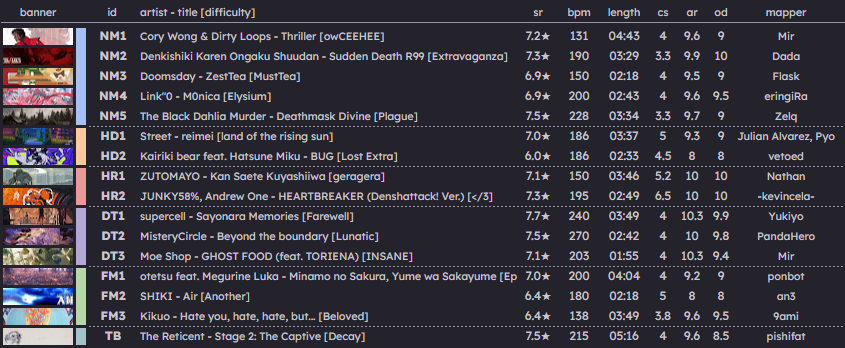

top text

bottom text

## Mappool recap

**[Download the pool here! (101 MB)](https://osu.ppy.sh/beatmaps/packs/P340)**

TODO: replace with 2026 showcase video once up on youtube

    <iframe width="95%" style="aspect-ratio: 16 / 9;" src="https://www.youtube.com/embed/LV2AzL3ghpg?start=8086" frameborder="0" allowfullscreen></iframe>

pool desc

---

original intro

    <audio controls>
        <source src="https://assets.ppy.sh/artists/425/Songs/Doomsday_-_ZestTea.mp3">
    </audio>

zesttea desc

## Group Stage results

### Group A

| # | Team | Wins | Losses | PF | PA | PD | Seed |
| :-: | :-- | :-: | :-: | :-: | :-: | :-: | :-: |
| #1 | ::{ flag=HK }:: Hong Kong | **2** | 1 | 12 | 5 | **+7** | 9 |
| #2 | ::{ flag=NO }:: Norway | **2** | 1 | 14 | 8 | **+6** | 13 |
| #3 | ::{ flag=ID }:: Indonesia | **2** | 1 | 10 | 13 | **-3** | 18 |
| #4 | ::{ flag=AR }:: Argentina | **0** | 3 | 5 | 15 | **-10** | 23 |

group a desc

**Highlight match:** tbd

**Group MVP:** tbd

### Group B

| # | Team | Wins | Losses | PF | PA | PD | Seed |
| :-: | :-- | :-: | :-: | :-: | :-: | :-: | :-: |
| #1 | ::{ flag=DE }:: Germany | **3** | 0 | 15 | 7 | **+8** | 10 |
| #2 | ::{ flag=NZ }:: New Zealand | **2** | 1 | 13 | 9 | **+4** | 15 |
| #3 | ::{ flag=NL }:: Netherlands | **1** | 2 | 8 | 14 | **-6** | 20 |
| #4 | ::{ flag=TW }:: Taiwan | **0** | 3 | 9 | 15 | **-6** | 21 |

group b desc

**Highlight match:** tbd

**Group MVP:** tbd

### Group C

| # | Team | Wins | Losses | PF | PA | PD | Seed |
| :-: | :-- | :-: | :-: | :-: | :-: | :-: | :-: |
| #1 | ::{ flag=CN }:: China | **3** | 0 | 15 | 4 | **+11** | 12 |
| #2 | ::{ flag=FR }:: France | **2** | 1 | 11 | 8 | **+3** | 17 |
| #3 | ::{ flag=SE }:: Sweden | **1** | 2 | 8 | 14 | **-6** | 14 |
| #4 | ::{ flag=TH }:: Thailand | **0** | 3 | 7 | 15 | **-8** | 22 |

group c desc

**Highlight match:** tbd

**Group MVP:** tbd

### Group D

| # | Team | Wins | Losses | PF | PA | PD | Seed |
| :-: | :-- | :-: | :-: | :-: | :-: | :-: | :-: |
| #1 | ::{ flag=BR }:: Brazil | **3** | 0 | 15 | 9 | **+6** | 11 |
| #2 | ::{ flag=FI }:: Finland | **2** | 1 | 13 | 10 | **+3** | 19 |
| #3 | ::{ flag=AT }:: Austria | **1** | 2 | 11 | 10 | **+1** | 16 |
| #4 | ::{ flag=PH }:: Philippines | **0** | 3 | 5 | 15 | **-10** | 24 |

group d desc

**Highlight match:** tbd

**Group MVP:** tbd

### Group E

| # | Team | Wins | Losses | PF | PA | PD | Seed |
| :-: | :-- | :-: | :-: | :-: | :-: | :-: | :-: |
| #1 | ::{ flag=SA }:: Saudi Arabia | **3** | 0 | 15 | 6 | **+9** | 30 |
| #2 | ::{ flag=TR }:: Türkiye | **2** | 1 | 11 | 10 | **+1** | 27 |
| #3 | ::{ flag=DK }:: Denmark | **1** | 2 | 9 | 10 | **-1** | 33 |
| #4 | ::{ flag=UY }:: Uruguay | **0** | 3 | 6 | 15 | **-9** | 37 |

group e desc

**Highlight match:** tbd

**Group MVP:** tbd

### Group F

| # | Team | Wins | Losses | PF | PA | PD | Seed |
| :-: | :-- | :-: | :-: | :-: | :-: | :-: | :-: |
| #1 | ::{ flag=JP }:: Japan | **3** | 0 | 15 | 8 | **+7** | 28 |
| #2 | ::{ flag=MY }:: Malaysia | **2** | 1 | 14 | 10 | **+4** | 29 |
| #3 | ::{ flag=SK }:: Slovakia | **1** | 2 | 11 | 12 | **-1** | 40 |
| #4 | ::{ flag=GR }:: Greece | **0** | 3 | 5 | 15 | **-10** | 34 |

group f desc

**Highlight match:** tbd

**Group MVP:** tbd

### Group G

| # | Team | Wins | Losses | PF | PA | PD | Seed |
| :-: | :-- | :-: | :-: | :-: | :-: | :-: | :-: |
| #1 | ::{ flag=UA }:: Ukraine | **3** | 0 | 15 | 5 | **+10** | 31 |
| #2 | ::{ flag=RO }:: Romania | **2** | 1 | 13 | 8 | **+5** | 26 |
| #3 | ::{ flag=BE }:: Belgium | **1** | 2 | 9 | 13 | **-4** | 39 |
| #4 | ::{ flag=CZ }:: Czechia | **0** | 3 | 4 | 15 | **-11** | 35 |

group g desc

**Highlight match:** tbd

**Group MVP:** tbd

### Group H

| # | Team | Wins | Losses | PF | PA | PD | Seed |
| :-: | :-- | :-: | :-: | :-: | :-: | :-: | :-: |
| #1 | ::{ flag=ES }:: Spain | **3** | 0 | 15 | 6 | **+9** | 25 |
| #2 | ::{ flag=SG }:: Singapore | **2** | 1 | 11 | 8 | **+3** | 38 |
| #3 | ::{ flag=PT }:: Portugal | **1** | 2 | 8 | 10 | **-2** | 32 |
| #4 | ::{ flag=PE }:: Peru | **0** | 3 | 5 | 15 | **-10** | 36 |

group h desc

**Highlight match:** tbd

**Group MVP:** tbd

---

end text

—authors
