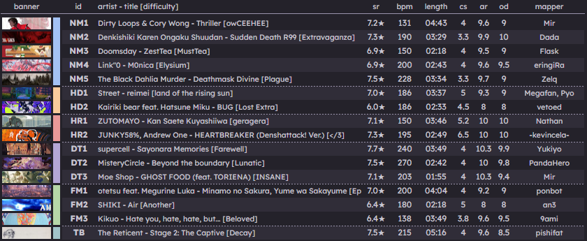

It's that time of the year again. The most anticipated tournament of the year is already in full swing, with the return of the Group Stage providing no shortage of exciting action.

The most captivating two weeks of the osu! calendar have once again provided a compelling experience for fans and players alike. In 2025, the Group Stage was reintroduced to the osu! World Cup and instantly proved its worth as the teams taking part fought tooth and nail to the death, seeking the rarefied air of the bracket stage.

A year later, the stage was again set for the marathon that is 48 matches in a two-week stage to excite and amaze. Once the fast and furious set of reschedules were finalized resulting in 22 matches in the final eight hours of the fortnight, it was time for the matches to begin. Who would reach the winners' bracket and set themselves up for their best shot at World Cup glory? Who would battle their way through to the final few slots in the first round of the losers' bracket? Read on to find out!

## Mappool recap

**[Download the pool here! (101 MB)](https://osu.ppy.sh/beatmaps/packs/P340)**

    <iframe width="95%" style="aspect-ratio: 16 / 9;" src="https://www.youtube.com/embed/gB-jf4OaSDc" frameborder="0" allowfullscreen></iframe>

The Group Stage pool, as a concept, is unique in multiple ways: it's the most played yet smallest pool in the whole tournament, and the only pool to be played for two whole weekends. By the end of the stage, every player, caster, and many a spectator would get to know the pool better than they know their own house. Every map in the stage was played a dozen or more times, and in a sense, the uniqueness of it is that a lot of the audience gets to know the maps in much more detail than usual, through sheer exposure. To all of those who couldn't catch the matches live, however, here's a quick rundown of some of the more popular maps these past two weeks.

By far the most contested map, when accounting for the sum of bans and picks in this stage was the low AR Hidden map [BUG](https://osu.ppy.sh/beatmapsets/1796464#osu/3682480) by [vetoed](https://osu.ppy.sh/users/10909373), a community tournament staple with lots of overlaps and slider velocity hijinks. In terms of just picks, however, the classic Double Time offering of [Sayonara Memories](https://osu.ppy.sh/beatmapsets/525260#osu/1114754) by [Yukiyo](https://osu.ppy.sh/users/4541873) was the most popular, being a relatively standard aim-centric pick with some faster streams near the end of the map. The only map not to be banned in any match was [M0nica](https://osu.ppy.sh/beatmapsets/2643242#osu/5963972) by [eringiRa](https://osu.ppy.sh/users/16383529), the No Mod slider tech option which also happens to bring an osu!catch World Cup original to OWC. Some other popular picks included the Free Mod customs of [Air](https://osu.ppy.sh/beatmapsets/2643264#osu/5964023) by [an3](https://osu.ppy.sh/users/11954090) and [Hate you, hate, hate, but...](https://osu.ppy.sh/beatmapsets/2643265#osu/5964024) by [9ami](https://osu.ppy.sh/users/1499997), the former a classic low AR or precision pick, depending on the choice of mods, and the latter a tough mixture of funky sliders and alt flow.

---

There was one new [osu! original](/wiki/Community/Bespoke_music) debuting in this year's Group Stage too, made by none other than the legendary osu! player, caster and community figure turned producer, [Doomsday](https://osu.ppy.sh/beatmaps/artists/425)! He blessed this No Mod pool with ZestTea.

    <audio controls>
        <source src="https://assets.ppy.sh/artists/425/Songs/Doomsday_-_ZestTea.mp3">
    </audio>

A rhythmically intensive, tricky alt map with an upbeat, yet intense composition, [Flask](https://osu.ppy.sh/users/959763)'s map of this original was one of the toughest offerings of this entire stage, which already has a full set for players of all skill levels to appreciate. [Make sure to check it out](https://osu.ppy.sh/beatmapsets/2643238#osu/5963955)!

## Group Stage results

### Group A

| # | Team | Wins | Losses | PF | PA | PD | Seed |
| :-: | :-- | :-: | :-: | :-: | :-: | :-: | :-: |
| #1 | ::{ flag=HK }:: Hong Kong | **2** | 1 | 12 | 5 | **+7** | 9 |
| #2 | ::{ flag=NO }:: Norway | **2** | 1 | 14 | 8 | **+6** | 13 |
| #3 | ::{ flag=ID }:: Indonesia | **2** | 1 | 10 | 13 | **-3** | 18 |
| #4 | ::{ flag=AR }:: Argentina | **0** | 3 | 5 | 15 | **-10** | 23 |

Despite what seemed like a predictable outcome, Group A turned into a battleground between three teams in three incredible matches. The opening matches of the group started off with two clean sweeps from Hong Kong against [Argentina](https://osu.ppy.sh/community/matches/122101541) and [Indonesia](https://osu.ppy.sh/community/matches/122128189), the latter of which managed to improve their seeding by a significant margin. As the closing day of the Group Stage approached, we were greeted immediately with a tiebreaker between [Norway and Indonesia](https://osu.ppy.sh/community/matches/), where the first seeding upset of the group was demonstrated, and Indonesia took their first victory. With the bittersweet taste of defeat, Norway headed straight into Hong Kong's flawless run, but despite the earlier loss, the Norwegians managed to [secure a confident victory against Hong Kong](https://osu.ppy.sh/community/matches/122134504) with a score of 5–2, marking the second upset of the group.

With no breaks in sight, Indonesia, riding the wave of their [victory over Norway](https://osu.ppy.sh/community/matches/122134178), squeezed out yet another hard-fought victory with a score of 5–4 against the [immense resistance of Argentina](https://osu.ppy.sh/community/matches/122134793). As the curtains were closing on Group A, Norway beat [Argentina 5–1](https://osu.ppy.sh/community/matches/122135989). With three teams tied at 2 wins, the point differential was the deciding factor, and the results of the group ended up reflecting the teams' earlier Qualifier seeding.

**Highlight match:** [Norway vs. Indonesia](https://osu.ppy.sh/community/matches/122134178) ([VOD](https://www.youtube.com/watch?v=qLWuAkehuc0)) was a rollercoaster from start to finish, ending with a climactic tiebreaker and an underdog victory. An honorable mention must be given to two other matches, with another upset. Namely, [Hong Kong vs. Norway](https://osu.ppy.sh/community/matches/122134504) ([VOD](https://www.youtube.com/watch?v=JQI1BjJ9MUQ)) that followed right after the previous match, resulting in another triumph for the underdogs, and [Indonesia vs. Argentina](https://osu.ppy.sh/community/matches/122134793) ([VOD](https://www.youtube.com/watch?v=_rrAhtHDHKA)) with yet another tiebreaker played in this group.

**Group MVP:** Even this category was a toss-up since the group had the best-performing two players of the entire stage. Despite that, the MVP of this group has to be ::{ flag=HK }:: [mcy4](https://osu.ppy.sh/users/2165650) with an incredible comeback to the tournament scene this year with 15 of 17 maps played. This performance shows the stellar consistency in multiple skillsets as his average score was a whopping 892,615 along with a performance score of 2.899. An honorable mention must go out to ::{ flag=NO }:: [NINERIK](https://osu.ppy.sh/users/10549880), who played in 20 of 22 maps and got an average score of 810,764 with the second-highest performance score of the stage.

### Group B

| # | Team | Wins | Losses | PF | PA | PD | Seed |
| :-: | :-- | :-: | :-: | :-: | :-: | :-: | :-: |
| #1 | ::{ flag=DE }:: Germany | **3** | 0 | 15 | 7 | **+8** | 10 |
| #2 | ::{ flag=NZ }:: New Zealand | **2** | 1 | 13 | 9 | **+4** | 15 |
| #3 | ::{ flag=NL }:: Netherlands | **1** | 2 | 8 | 14 | **-6** | 20 |
| #4 | ::{ flag=TW }:: Taiwan | **0** | 3 | 9 | 15 | **-6** | 21 |

Group B turned out to be a tale of two matchups: [Germany vs. New Zealand](https://osu.ppy.sh/community/matches/122095113) and [Netherlands vs. Taiwan](https://osu.ppy.sh/community/matches/122101187). The former two teams were the standout favorites to exit the group, while the latter two entered the tournament with much improved rosters looking to play spoiler. While the overall outcome ended up being in line with Qualifier seeding, how it played out was nothing short of nail-biting. Germany came out on top at 3–0, but New Zealand and Taiwan were both able to take 3 points off of them. New Zealand got the job done against [Taiwan](https://osu.ppy.sh/community/matches/122127359) and the [Netherlands](https://osu.ppy.sh/community/matches/122133518), but the two lower seeds were always in position to pounce had they stolen an upset in the second week with the points gained in their own marquee matchup in week 1.

**Highlight match:** [Netherlands vs. Taiwan](https://osu.ppy.sh/community/matches/122101187) ([VOD](https://www.youtube.com/watch?v=TrDydc6Fkss)) has a great case for being the highlight match of the entire group stage. If you haven't watched it, click on the VOD right now before coming back to this article. You won't regret it!

**Group MVP:** Despite getting second place in the group, the MVP certainly has to go to ::{ flag=NZ }:: [saiyku](https://osu.ppy.sh/users/13767572), who played 20 of New Zealand's 22 maps and got the fifth highest performance score out of all Group Stage players. An additional shoutout has to go to ::{ flag=DE }:: [criller](https://osu.ppy.sh/users/8116659) though, who was eighth overall and reinforced his stature as one of the best tournament players in the world.

### Group C

| # | Team | Wins | Losses | PF | PA | PD | Seed |
| :-: | :-- | :-: | :-: | :-: | :-: | :-: | :-: |
| #1 | ::{ flag=CN }:: China | **3** | 0 | 15 | 4 | **+11** | 12 |
| #2 | ::{ flag=FR }:: France | **2** | 1 | 11 | 8 | **+3** | 17 |
| #3 | ::{ flag=SE }:: Sweden | **1** | 2 | 8 | 14 | **-6** | 14 |
| #4 | ::{ flag=TH }:: Thailand | **0** | 3 | 7 | 15 | **-8** | 22 |

Group C opened up with a dominating set of three consecutive wins by China, placing them firmly at the number one spot before any other matches even had the chance to be played out. The second ticket into the winners' bracket saw more contestion after [France](https://osu.ppy.sh/community/matches/122128337) and [Sweden](https://osu.ppy.sh/community/matches/122134184) both took down Thailand, but it was ultimately France who came on top off of a [5–2 seed upset against Sweden](https://osu.ppy.sh/community/matches/122135541).

**Highlight match:** [Sweden vs. Thailand](https://osu.ppy.sh/community/matches/122134184) ([VOD](https://www.youtube.com/watch?v=oJJoERANt5I)) saw a whopping three of the top 20 closest maps of the entire Group Stage all in one match, with Thailand threatening a massive seed upset up 4–3 off of a few last-minute steals before letting it slip away and allowing Sweden to breathe a sigh of relief.

**Group MVP:** ::{ flag=SE }:: [scylla](https://osu.ppy.sh/users/9405745), despite falling short of the winners' bracket spot, showed yet again what a force to be reckoned with he is. An average score of 752,140 across each and every one of Sweden's 22 played maps as well as the [only SS score in the Group Stage](https://www.youtube.com/watch?v=oJJoERANt5I&t=1544) — nothing short of incredible.

### Group D

| # | Team | Wins | Losses | PF | PA | PD | Seed |
| :-: | :-- | :-: | :-: | :-: | :-: | :-: | :-: |
| #1 | ::{ flag=BR }:: Brazil | **3** | 0 | 15 | 9 | **+6** | 11 |
| #2 | ::{ flag=FI }:: Finland | **2** | 1 | 13 | 10 | **+3** | 19 |
| #3 | ::{ flag=AT }:: Austria | **1** | 2 | 11 | 10 | **+1** | 16 |
| #4 | ::{ flag=PH }:: Philippines | **0** | 3 | 5 | 15 | **-10** | 24 |

Group D was a battleground until the very end, with 3 teams just 8 seeds apart the outcome could have ended in any number of ways. Brazil as the top seed did their part securing a perfect 3–0 record to top the group, albeit shaky in execution. They concluded their matches with just a +6 point differential, the lowest of any top seeded team in all 8 groups, but they got the job done. The real story of this group was Finland. They came in as the 19th seed out of qualifiers but punched far above their weight class, finishing the group stage ranked 5th in performance out of all 32 teams. They beat both bottom teams handedly and lost only to the top seeded Brazil in a [close 5-3](https://osu.ppy.sh/community/matches/122129109). This win came at the expense of Austria, who came in seeded second in the group and easily could have made the top 2 going to winners bracket, decided by only a singular map, they were an anomaly alongside brazil, being the only team to place 3rd in a group with a positive point differential.

Last but certainly not least in this group was the Philippines; they came in as the bottom seed and finished winless. They shouldn't hang their heads though, with the 13th overall team performance, well above their final placement, and took three maps off [Finland](https://osu.ppy.sh/community/matches/122133984) and two off [Brazil](https://osu.ppy.sh/community/matches/122134505) in the process. If you only look at their 0–5 against Austria, you'll underrate them.

**Highlight match:** [Brazil vs. Austria](https://osu.ppy.sh/community/matches/122135425) ([VOD](https://www.youtube.com/watch?v=UlqLB5sdQ2k)) and it isn't particularly close. The top two seeds in the group met in the final match, the only one to see a tiebreaker. Austria played as if their entire bracket was on the line, because it was! They led the match 4–3 and were just one map away from a 5–3 win that would have completely rewritten the standings. Three teams would have finished 2–1, and Austria would have gotten first on point differential. Brazil had other plans. After being down 3–1 at one point, they clawed their way back to a 4–4 scoreline, this meant that even if Austria won the tiebreaker and the match, they would have still been left in third. Deciding to have some fun with the situation, both teams opted for an 8-way HR showdown on tiebreaker for the match win!

**Group MVP:** This was one was tough to call. Finland's ::{ flag=FI }:: [savilju](https://osu.ppy.sh/users/8059468) has the best performance score of the group at 2.124, along with the highest average score and accuracy, but ::{ flag=BR }:: [Exxotl](https://osu.ppy.sh/users/15225729) gets the final nod. He finished just behind at 2.116, while pling 21 of Brazil's 24 maps and was MVP five times. Brazil's run in the group was a close one, and they could lean on him almost every time, being an almost permanent fixture in the lobby and still performing at the top of the group.

### Group E

| # | Team | Wins | Losses | PF | PA | PD | Seed |
| :-: | :-- | :-: | :-: | :-: | :-: | :-: | :-: |
| #1 | ::{ flag=SA }:: Saudi Arabia | **3** | 0 | 15 | 6 | **+9** | 30 |
| #2 | ::{ flag=TR }:: Türkiye | **2** | 1 | 11 | 10 | **+1** | 27 |
| #3 | ::{ flag=DK }:: Denmark | **1** | 2 | 9 | 10 | **-1** | 33 |
| #4 | ::{ flag=UY }:: Uruguay | **0** | 3 | 6 | 15 | **-9** | 37 |

Usually when a team qualifies for OWC for the first time, people don't expect much of them past their qualification. While this is true most of the time, Saudi Arabia became the exception of that rule with how Group E played out. They lost only six points over the course of their 3 matches, including a stunning [5–1 upset over Türkiye](https://osu.ppy.sh/community/matches/122127961) ([VOD](https://www.youtube.com/watch?v=H4iE_HzcmQQ)), a team that has historically been very successful in early stages. That win all but secured them the top of the group. The race for second came down to the wire between Türkiye and Denmark, but Türkiye was able to remain in front after [defeating the Danes 5–2](https://osu.ppy.sh/community/matches/122134181) ([VOD](https://www.youtube.com/watch?v=EpnHceIcLSs)). Uruguay proved themselves to be great fighters too this year, taking 3 points off both Türkiye and Saudi Arabia, but once again fell short of winning any matches.

**Highlight match:** [Türkiye vs. Uruguay](https://osu.ppy.sh/community/matches/122096482) ([VOD](https://www.youtube.com/watch?v=uj95jCo0eaI)) is my highlight match of this group mostly because of how insane the final map was in this match. ::{ flag=UY }:: [Alyra](https://osu.ppy.sh/users/11113213) put up a heroic performance on the FM3 to try and drag Uruguay to a tiebreaker against Türkiye, but was shut down at the last second by a strong combo from ::{ flag=TR }:: [Raikouhou](https://osu.ppy.sh/users/8007528) on the HR. It was definitely one of the most intense moments in the first weekend!

**Group MVP:** Surprising absolutely nobody, it's ::{ flag=TR }:: [Raikouhou](https://osu.ppy.sh/users/8007528). He played 20 out of 21 maps for Türkiye with an average score of 758,487, landing at the 7th highest performance score out of anyone in the Group Stage. He proved once again why he is considered one of the strongest tournament players in the game.

### Group F

| # | Team | Wins | Losses | PF | PA | PD | Seed |
| :-: | :-- | :-: | :-: | :-: | :-: | :-: | :-: |
| #1 | ::{ flag=JP }:: Japan | **3** | 0 | 15 | 8 | **+7** | 28 |
| #2 | ::{ flag=MY }:: Malaysia | **2** | 1 | 14 | 10 | **+4** | 29 |
| #3 | ::{ flag=SK }:: Slovakia | **1** | 2 | 11 | 12 | **-1** | 40 |
| #4 | ::{ flag=GR }:: Greece | **0** | 3 | 5 | 15 | **-10** | 34 |

While the outcome of group F was in line with most people's expectations, nobody could have predicted how the matches in this group actually played out. The source of variance happened to be the bottom seed: qualifying by the skin of their teeth at 40th, Slovakia won 11 points in the Group Stage. To put it another way, they were 4 map wins away from being 3–0 in this group. It was incredible to watch, although, admittedly, it was a bit nerve wracking for me (M I L E S) when they almost upset Malaysia after I foolishly made a bet on the Full Circle podcast that I would shave my head if Slovakia beat Japan. But luckily for my luscious head of hair, Japan got the job done with a 5–2 victory. Malaysia was one of two teams to play tiebreaker twice this round, defeating Slovakia on it while falling short against Japan. Greece did a great job qualifying for the tournament again, but continue to look for an elusive group stage match victory. We wish them the best of luck with that next year.

**Highlight match:** Both [Japan vs. Malaysia](https://osu.ppy.sh/community/matches/122128332) ([VOD](https://www.youtube.com/watch?v=1_CFDNu25-Q)) and [Malaysia vs. Slovakia](https://osu.ppy.sh/community/matches/122096229) ([VOD](https://www.youtube.com/watch?v=5uAejfkJ6uw)) deserve this spot. The former showed two teams separated by 1 seed play like it. Both squads had a dominant skillset that they won by huge margins (speed for Japan, Hidden for Malaysia), but outside of those, several maps had score differences under 100,000 (as low as 6,777!). And that's not to mention both matches going to tiebreaker, which is always a plus. The latter match saw the emergence of Slovakia, who had strong performances on speed and Hard Rock to force tiebreaker in a match against a team 11 seeds higher than them.

**Group MVP:** Despite not having the highest performance score on his team, ::{ flag=JP }:: [ChocoPafe](https://osu.ppy.sh/users/8856806) stood out as the MVP of this group to me. Perma-lobby players have a special place in my heart, and he filled this role to a T—performing excellently on a wide range of skillsets, taking HDHR on several Free Mod picks, while flexing his muscles on the tiebreaker against Malaysia, getting the top score in the lobby by a margin of about 200,000 points.

### Group G

| # | Team | Wins | Losses | PF | PA | PD | Seed |
| :-: | :-- | :-: | :-: | :-: | :-: | :-: | :-: |
| #1 | ::{ flag=UA }:: Ukraine | **3** | 0 | 15 | 5 | **+10** | 31 |
| #2 | ::{ flag=RO }:: Romania | **2** | 1 | 13 | 8 | **+5** | 26 |
| #3 | ::{ flag=BE }:: Belgium | **1** | 2 | 9 | 13 | **-4** | 39 |
| #4 | ::{ flag=CZ }:: Czechia | **0** | 3 | 4 | 15 | **-11** | 35 |

Group G was a two-horse race from start to finish, with neither of the bottom two seeds getting more than two points against either of the top seeds. And you can't really blame Belgium or Czechia for this, since the top seeded teams of Romania and Ukraine have both historically been successful units in the World Cup. Romania was looking to make a statement, with former super-carry ::{ flag=RO }:: [badeu](https://osu.ppy.sh/users/1473890) returning to the roster, that they could once again go far in the tournament. Ukraine was also hungry for success this year, since their previous run was derailed by external factors. The stage was set for an eastern European showdown between these two squads, which ended up in favor of Ukraine with a [5–3 scoreline](https://osu.ppy.sh/community/matches/122135435) ([VOD](https://www.youtube.com/watch?v=-bvUhoOjHBY)) and several maps ending up excruciatingly close. This determined the top 2 pairing, but Czechia and Belgium had a [banger matchup of their own](https://osu.ppy.sh/community/matches/122135294) ([VOD](https://www.youtube.com/watch?v=DSTLH0c3SNM)), which Belgium narrowly took 5–3, closing it out on HR2 with only a 59,657 point difference.

**Highlight match:** [Romania vs. Ukraine](https://osu.ppy.sh/community/matches/122135435) ([VOD](https://www.youtube.com/watch?v=-bvUhoOjHBY)) felt like one of the higher stakes matches to come out of the contender groups. Both squads put up impressive scores, such as the Romanians putting up the 4th highest overall score on NM3, and the Ukrainians closing the match out with the 4th highest overall score on NM4. There were also several close picks to keep everyone on the edge of their seat.

**Group MVP:** ::{ flag=RO }:: [badeu](https://osu.ppy.sh/users/1473890) completely popped off in the Group Stage, with an incredible average score of 838,585, playing 13 out of 21 maps for Romania and scoring the highest single score on NM3.

### Group H

| # | Team | Wins | Losses | PF | PA | PD | Seed |
| :-: | :-- | :-: | :-: | :-: | :-: | :-: | :-: |
| #1 | ::{ flag=ES }:: Spain | **3** | 0 | 15 | 6 | **+9** | 25 |
| #2 | ::{ flag=SG }:: Singapore | **2** | 1 | 11 | 8 | **+3** | 38 |
| #3 | ::{ flag=PT }:: Portugal | **1** | 2 | 8 | 10 | **-2** | 32 |
| #4 | ::{ flag=PE }:: Peru | **0** | 3 | 5 | 15 | **-10** | 36 |

Group H featured 3 teams duking it out for the 2nd spot in the group, with Portugal, Peru and Singapore all vying for a spot in the bracket stage. Spain were the heavy hitters of Group H, starting with 2 decisive wins against [Singapore](https://osu.ppy.sh/community/matches/122096268) and [Portugal](https://osu.ppy.sh/community/matches/122135723) ([VOD](https://www.youtube.com/watch?v=IVf8MQM8T30)). They had a closer match with [Peru](https://osu.ppy.sh/community/matches/122136450) ([VOD](https://www.youtube.com/watch?v=DbCrUvpgADA)), but ultimately prevailed to secure the top spot after ::{ flag=ES }:: [\[dekori\]](https://osu.ppy.sh/users/17465075) put up 747,207 points on HR1 to close out the match.

Portugal got off to a strong start by sweeping [Peru](https://osu.ppy.sh/community/matches/122103638) ([VOD](https://www.youtube.com/watch?v=Tlzch8St8tk)), setting the stage to battle it out with Singapore for 2nd place. Despite being the lowest seed in the group, Singapore has had a long history of preforming in the early stages. Ultimately, Portugal couldn't keep up, losing 5–1 to [Singapore](https://osu.ppy.sh/community/matches/122128741) ([VOD](https://www.youtube.com/watch?v=m5tYPQ8-SjI)) with a very strong showing from ::{ flag=SG }:: [hollowknees](https://osu.ppy.sh/users/15195364), leaving just Peru standing between Singapore and the bracket stage. Singapore got off to a strong start, quickly going up 4–0 before Peru fought back to make it 4–2. ::{ flag=SG }:: [Mekeyo](https://osu.ppy.sh/users/10270787) then put up an FC on NM2 to win the match ([VOD](https://www.youtube.com/watch?v=fhohA2RUgVM)) and secure bracket stage for Singapore, making them the only team to get top 2 as the bottom seed in their group. 

**Highlight match:** Spain vs. Peru ([VOD](https://www.youtube.com/watch?v=DbCrUvpgADA)) was the final match in the group, with Peru looking to play spoiler and give Singapore a shot at first seed with a win. Peru started the match by winning their FM2 pick and followed that up with an incredible 4.1 million team score to breakpoint Spain and go up 2–0. Spain got right back on track, winning the next 4 maps, with ::{ flag=ES }:: [A L E P H](https://osu.ppy.sh/users/6735738) top scoring each one. ::{ flag=PE }:: [Arnold24x24](https://osu.ppy.sh/users/2291265) put up an FC on FM1 with Hidden to keep Peru's hopes alive, before Spain closed out the match 5–3 on HR1, securing the top spot in the group.

**Group MVP:** ::{ flag=ES }:: [A L E P H](https://osu.ppy.sh/users/6735738) was the clear standout of Group H, playing every map for Spain and getting top scores on 11 of the 21 maps played. He had a number of strong scores, including the 3rd and 4th best scores on HR2 and FCs on HD2 and NM5. With a performance score of 2.147, A L E P H was the 14th best player of the Group Stage, always there when Spain needed a bit of extra push to get over the finish line.

---

The bracket stage kicked off this past weekend with the Round of 16 and losers' bracket round 1, where we were finally joined by our eight Legends teams after their free ticket through the Group Stage. If you missed any of it, full videos of each match are available on our [YouTube](https://www.youtube.com/@osugamearchive). The action continues this weekend with the Quarterfinals and losers' bracket rounds 2 and 3! Make sure to have a look at the [wiki](/wiki/Tournaments/OWC/2026) or [information sheet](https://docs.google.com/spreadsheets/d/136yKaeBtlxHo7o7TQxHflLOw1T67ahn8vF2FTJ0IjFc?rm=minimal) for all schedules and other details, so you don't miss a match. See you all on stream!

—ChillierPear, Dada, I-Flame, Lightin, M I L E S, shdewz & this1neguy
