The anticipated Grand Finals weekend of the 4 Digit World Cup has come to an end!

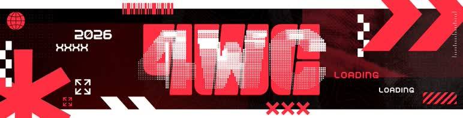

This iteration of 4WC [brought together](https://osu.ppy.sh/home/news/2026-06-04-4-digit-world-cup-2026-registrations-now-open) an incredibly competitive pool of players and countries, bringing about an unpredictability where no one could foresee the winning nation. In this news post, find out how the tournament played out, from the beginning to the final stages, the brand-new 4WC originals and a variety of interviews to give you a first-hand look at the tournament! Join us for the ride!

## Summary

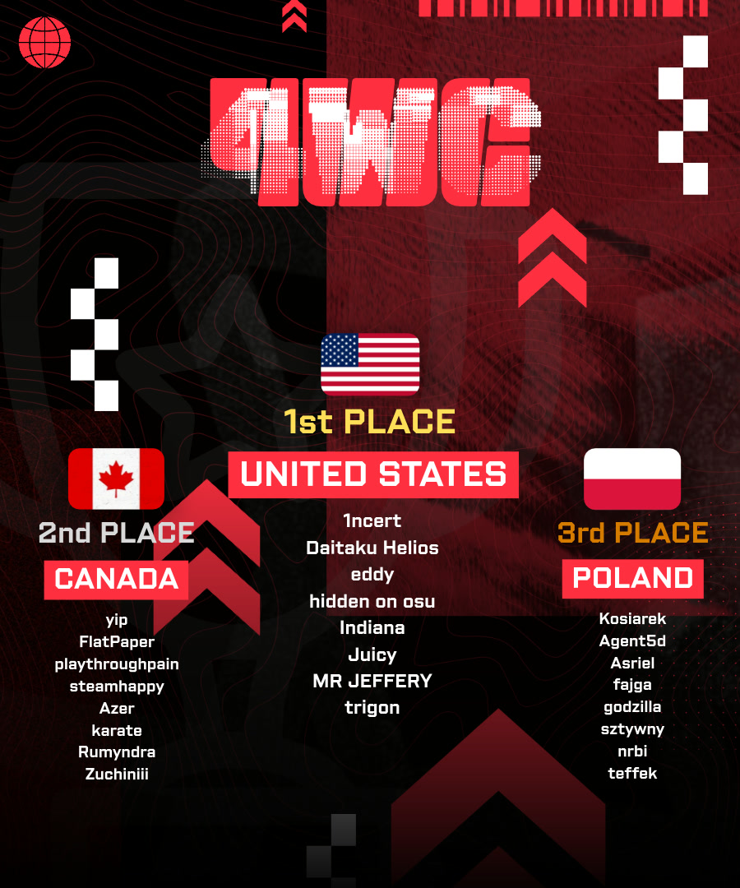

This year, the United States took the title once again, becoming your 4 Digit World Cup champions for the fourth year in a row!

The United States may have entered the tournament as favourites, but after losing to Canada in the Semifinals, an exciting race for the title was on. Despite the intrigue, they bounced back by defeating Poland 7–6 and then beating Canada twice to claim their title. Coming from the losers' bracket to face Canada once again in the Grand Finals, it seemed that Canada could threaten their long-reigning position on the throne. Instead, the United States defeated Canada with a 7–4 scoreline, and did it once again with a 7–3 in the bracket reset.

The top 3 remained unchanged from last year, with the United States, Canada and Poland taking 1st, 2nd and 3rd respectively. History has repeated itself!

A detailed review of the Grand Finals and other memorable matches can be found below.

## Grand Finals recap

### ::{ flag=PL }:: Poland vs. ::{ flag=US }:: United States

    <iframe width="95%" style="aspect-ratio: 16 / 9;" src="https://www.youtube.com/embed/T0FWoyvPzls" frameborder="0" allowfullscreen></iframe>

Team Poland, having achieved bronze last year, found itself in the same position once again, with none other than the reigning champions, the United States, standing standing between them and a new record. The United States immediately got off to a hot start, taking 3 points consecutively. But ::{ flag=PL }:: [sztywny](https://osu.ppy.sh/users/9091312) and ::{ flag=PL }:: [godzilla](https://osu.ppy.sh/users/4740837) were able to halt their momentum with a break point of their own on [DT3](https://osu.ppy.sh/beatmapsets/2311744#osu/4946251). Following up with another convincing victory on [HR2](https://osu.ppy.sh/beatmapsets/2616962#osu/5869753), spearheaded by ::{ flag=PL }:: [godzilla](https://osu.ppy.sh/users/4740837) and ::{ flag=PL }:: [Kosiarek](https://osu.ppy.sh/users/9086565), Poland was able to shrink the score deficit.

The match score was 3–2 and the Polish were beginning to light their fire; however, it was rapidly extinguished on the [NM2](https://osu.ppy.sh/beatmapsets/2616991#osu/5869810), the United States just about clinching a win by 82,380 points. Little did they know what was coming for them.

On the [NM5](https://osu.ppy.sh/beatmapsets/2534753#osu/5605046) (*Hideki Taniuchi - L no Theme*) the dynamic duo of ::{ flag=PL }:: [Kosiarek](https://osu.ppy.sh/users/9086565) and ::{ flag=PL }:: [sztywny](https://osu.ppy.sh/users/9091312) wrote the opponents' names in the Death Note and put the match back on equal terms. The United States then tried to return the favour by picking [HD1](https://osu.ppy.sh/beatmapsets/2086198#osu/4371079), but even their top score in the form of ::{ flag=US }:: [hidden on osu](https://osu.ppy.sh/users/10626955), with 540,638 score, was not enough to counter the charge of ::{ flag=PL }:: [fajga](https://osu.ppy.sh/users/10590281) and ::{ flag=PL }:: [godzilla](https://osu.ppy.sh/users/4740837). The bad news for the U.S. didn't stop there, as Poland's players were able to consolidate their break point in [FM4](https://osu.ppy.sh/beatmapsets/2068869#osu/4328691), gaining the lead.

Now 1 point down, the reigning champions found their saving grace in [NM1](https://osu.ppy.sh/beatmapsets/2539873#osu/5621820) with ::{ flag=US }:: [Indiana](https://osu.ppy.sh/users/12967296) descending from the sky, proving key in their conquest in helping them ensure a point difference of over 150k. With the match now tied up, Poland's players established their last pick — [NM3](https://osu.ppy.sh/beatmapsets/2616999#osu/5869835). Unfortunately, they weren't quite ready for ::{ flag=US }:: [eddy](https://osu.ppy.sh/users/17917574)'s earth-shattering performance, bringing USA to match point.

Poland is now in a dire situation, having to win the opponent's point to stay in the world cup, and the United States opted into the [DT1](https://osu.ppy.sh/beatmapsets/2346103#osu/5045056) pick, what seemed to be a highly favoured pick for them. What no one saw coming was ::{ flag=PL }:: [godzilla](https://osu.ppy.sh/users/4740837)'s gargantuan combo which opened the curtains for an orchestral spectacle of a tiebreaker. The first half of the rhapsody was neck-and-neck with Poland and the United States constantly trading breaks blow for blow. As the competitive ensemble grew forte, everyone started to fall apart, but one name, ::{ flag=US }:: [eddy](https://osu.ppy.sh/users/17917574), stood tall among the rest. Along with ::{ flag=US }:: [MR JEFFERY](https://osu.ppy.sh/users/16036374), ::{ flag=US }:: [Indiana](https://osu.ppy.sh/users/12967296) and ::{ flag=US }:: [Juicy](https://osu.ppy.sh/users/13097638)'s support, the United States emerged victorious, securing their spot in the Grand Finals.

### ::{ flag=CA }:: Canada vs. ::{ flag=US }:: United States

    <iframe width="95%" style="aspect-ratio: 16 / 9;" src="https://www.youtube.com/embed/eUKfeCnaKXs" frameborder="0" allowfullscreen></iframe>

The long-awaited winners' bracket Grand Finals match was a repetition of last year's rivalry, where Canada suffered a 0–7 sweep. This time, however, everyone had high hopes for Canada: they sent the United States into the losers' bracket in the Semifinals, and with the winners' bracket Advantage, it was looking optimistic for Canada.

The match began with a break point bonanza, with Canada taking 2 break points for the USA's singular break point. Flying into a 4–2 lead, Canada looked strong on the early picks made by the US. However, the United States had made it this far, and they were not going down without a fight, which is when the United States shifted into fifth gear and showcased their strengths on anything Canada had to offer, closing the first match with 5 straight points into the bracket reset.

To kick off the bracket reset, the United States decided to completely flip the match on its head by opting for Canada's final pick as their own first pick, which led to another FC from ::{ flag=US }:: [Daitaku Helios](https://osu.ppy.sh/users/16538717). Canada didn't back down and had their own answers to what the United States were putting up, where an especially exciting moment in the [FM4](https://osu.ppy.sh/beatmapsets/2068869#osu/4328691) pick came down to a nail-biting 6,287-point difference.

The ping-pong affair continued until the scoreline hit 3–3, when the United States began to pick up the pace, with the first break point of the match being theirs to take. Canada's pick of [Redolent Shape](https://osu.ppy.sh/beatmapsets/2617006#osu/5869855) seemed to favour them. However, the United States was able to quickly turn the tides of the match by narrowly stealing it away by 46,344 points, thanks to ::{ flag=US }:: [MR JEFFERY](https://osu.ppy.sh/users/16036374) and ::{ flag=US }:: [hidden on osu](https://osu.ppy.sh/users/10626955)'s outstanding performance. From this point onwards, the United States never softened their grip on the match, once more securing themselves as the champion of 4WC, for their fourth consecutive and fifth overall title.

## Match highlights

### ::{ flag=CA }:: Canada vs. ::{ flag=CL }:: Chile (Round of 16)

    <iframe width="95%" style="aspect-ratio: 16 / 9;" src="https://www.youtube.com/embed/5XeKyyxUg8w" frameborder="0" allowfullscreen></iframe>

If you're looking for one single match that almost completely shattered the tournament standings, one would need to look no further than the Round of 16 match between Canada vs. Chile. Nobody thought that Canada, coming in as seed #2, would drop many points early in the tournament, but they could not be more wrong.

While the match started expectedly with a Canadian win on [FM4](https://osu.ppy.sh/beatmapsets/2494044#osu/5480936), Chile's next pick was... [HD2](https://osu.ppy.sh/beatmapsets/2333542#osu/5044576)? Yeah, you read correctly: Chile, against one of the strongest Hidden and reading teams, was unafraid to pick the AR 8 map against them. While Canada may have won the map convincingly, and consolidated it straight away, this shaky, unexpected start only foretold the rest of the match.

This is when Chile REALLY ramped up their performances, getting three points in a row off the backs of ::{ flag=CL }:: [6Nusu9](https://osu.ppy.sh/users/20501126)'s triple FC and bringing the scoreline to a 3–3 tie.

A double FC on [NM3](https://osu.ppy.sh/beatmapsets/2434984#osu/5307420) from ::{ flag=CA }:: [steamhappy](https://osu.ppy.sh/users/7802400) and ::{ flag=CA }:: [Zucchiniii](https://osu.ppy.sh/users/13959253) seemed to halt Chile's momentum, but Chile responded back with ::{ flag=CL }:: [Eunha](https://osu.ppy.sh/users/7701428)'s 953,699 score on [DT1](https://osu.ppy.sh/beatmapsets/1126545#osu/2353845), bringing both teams just one point away from match point. Yet another set of even exchanges later, Chile was able to bring Canada to an unexpected early-round [tiebreaker](https://osu.ppy.sh/beatmapsets/1824439#osu/3743620)!

The map started off rough, with only ::{ flag=CA }:: [Azer](https://osu.ppy.sh/users/2155578), ::{ flag=CL }:: [xXChokgamerXx](https://osu.ppy.sh/users/7748891) and ::{ flag=CL }:: [tfge](https://osu.ppy.sh/users/11207004) holding onto FCs. For a moment, Chile held the lead, but as the map continued on, Canada only took back the score lead more and more. Finally concluding this nail-biting match with a 519k score lead by the efforts of ::{ flag=CA }:: [Zucchiniii](https://osu.ppy.sh/users/13959253) and ::{ flag=CA }:: [Azer](https://osu.ppy.sh/users/2155578)'s 807k and 674k respectively. Despite losing, Chile made it clear that no one is safe from them.

### ::{ flag=DE }:: Germany vs. ::{ flag=SG }:: Singapore (Quarterfinals)

    <iframe width="95%" style="aspect-ratio: 16 / 9;" src="https://www.youtube.com/embed/FjxrtxXLD0s" frameborder="0" allowfullscreen></iframe>

Germany vs. Singapore was one of those matches where it seemed *everyone* knew the result, where seed #17 faced seed #31 in what was a typical early-round match-up. Yet as the match went on, it seemed that neither team could confidently secure a win.

While Germany began with a predictable win on [HR2](https://osu.ppy.sh/beatmapsets/2501810#osu/5525959), the team was only able to take Singapore's next pick by the skin of their teeth. Yet in the blink of an eye, their advantage was lost, with Singapore taking back the break point on [FM3](https://osu.ppy.sh/beatmapsets/2226102#osu/4722227), as well as ::{ flag=SG }:: [hollowknees](https://osu.ppy.sh/users/15195364) and ::{ flag=SG }:: [Bronya](https://osu.ppy.sh/users/5407620) putting up an incredible performance on [DT1](https://osu.ppy.sh/beatmapsets/1351335#osu/2797662) and [FM4](https://osu.ppy.sh/beatmapsets/2039589#osu/4254423) respectively. Germany fired right back with a double FC from ::{ flag=DE }:: [-lion](https://osu.ppy.sh/users/24270105) and ::{ flag=DE }:: [vin](https://osu.ppy.sh/users/13223964) on [NM4](https://osu.ppy.sh/beatmapsets/1769710#osu/3622662), a break point to put the brakes on Singapore's miraculous momentum.

The score now at 4–3, only *slightly* on the side of Germany, Singapore nevertheless took back control of the match with a decisive win on [HD1](https://osu.ppy.sh/beatmapsets/2364103#osu/5097165), immediately followed by an FC on [NM2](https://osu.ppy.sh/beatmapsets/1970703#osu/4088922) by ::{ flag=SG }:: [Bronya](https://osu.ppy.sh/users/5407620) to put themselves at match point. Germany, not wanting to back down without a fight, took back a break point on [DT2](https://osu.ppy.sh/beatmapsets/1919054#osu/4650513) to bring the match to a [tiebreaker](https://osu.ppy.sh/beatmapsets/2482545#osu/5447401).

The first third of the map was held in a complete standstill, with both teams having 3 FCs each. However, this stalemate was shattered when 2 of Singapore's FCs fell. As ::{ flag=SG }:: [GSBlank](https://osu.ppy.sh/users/2312106) tried desperately to hold off the bleeding for Singapore, they needed nothing short of a miracle to bring it back. And a miracle is exactly what they got, as Germany's entire frontline fell apart in the preceding kiai with the sole exception of ::{ flag=SG }:: [hollowknees](https://osu.ppy.sh/users/15195364)' recovery. Thus Singapore closed out their upset against Germany and gave us the Cinderella story of the tournament.

### ::{ flag=KR }:: South Korea vs. ::{ flag=TW }:: Taiwan (Semifinals)

    <iframe width="95%" style="aspect-ratio: 16 / 9;" src="https://www.youtube.com/embed/FmQm29O1qMc" frameborder="0" allowfullscreen></iframe>

The Semifinals was where we saw some of the fiercest competition between teams: half of the eight Semifinals matches featured a tiebreaker. Amongst these, South Korea vs. Taiwan deserves a place in the history books.

Right off the bat, with one of their key players, ::{ flag=TW }:: [Flyer](https://osu.ppy.sh/users/9767342), missing, the situation was not looking promising for Taiwan. Taiwan, however, refused to be counted out and took an early break point on [DT2](https://osu.ppy.sh/beatmapsets/2533953#osu/5616732) thanks to ::{ flag=TW }:: [GAO HAO](https://osu.ppy.sh/users/8964050)'s phenomenal FC. South Korea returned the favour on [NM3](https://osu.ppy.sh/beatmapsets/2547498#osu/5646149), with their own carry from ::{ flag=KR }:: [ch0co](https://osu.ppy.sh/users/9737185), and securing yet another point on [FM3](https://osu.ppy.sh/beatmapsets/2085296#osu/4368472).

However, Taiwan was not thrown off their game, taking three consecutive points on [HR2](https://osu.ppy.sh/beatmapsets/2609234#osu/5841678), [FM4](https://osu.ppy.sh/beatmapsets/2235501#osu/5263398) and [DT4](https://osu.ppy.sh/beatmapsets/2609265#osu/5841744). Thus whispers of doubt began to swirl around South Korea, but they shut those down with a dominant victory on [HD2](https://osu.ppy.sh/beatmapsets/2523175#osu/5571783). Following that up with another point on [FM2](https://osu.ppy.sh/beatmapsets/2468926#osu/5406573) thanks to ::{ flag=KR }:: [ch0co](https://osu.ppy.sh/users/9737185) and ::{ flag=KR }:: [Hayasaka Ai](https://osu.ppy.sh/users/10592853)'s double EZ overmod.

The match now at 5–4, Taiwan bet everything on [NM4](https://osu.ppy.sh/beatmapsets/2609056#osu/5841185), producing one of the greatest duels of the tournament. With ::{ flag=TW }:: [GAO HAO](https://osu.ppy.sh/users/8964050) and ::{ flag=KR }:: [Nopekjk](https://osu.ppy.sh/users/4585186) matching neck and neck throughout the entire map. The point came down to the supporting combos, where it just narrowly went to the side of Taiwan.

On the tiebreaker ([RD-Sounds feat. Meramipop - enemy of the society](https://osu.ppy.sh/beatmapsets/1176404#osu/2453659)), South Korea started off strong, holding onto the score lead for the first half of the map, but then misses started flying left and right. Taiwan's recovery combos were able to make up the score deficit and then some, yet a quadruple miss collapsed the Taiwanese dream, allowing South Korea to retake the lead in the final moments and create one of the most heart-wrenching matches of the tournament.

### ::{ flag=PH }:: Philippines vs. ::{ flag=CN }:: China (Finals)

    <iframe width="95%" style="aspect-ratio: 16 / 9;" src="https://www.youtube.com/embed/7GBE2OMWUaE" frameborder="0" allowfullscreen></iframe>

The Finals of 4WC 2026 was filled with the titans of the rank range, and the country that stood against the Philippines was none other than China, with key players like ::{ flag=CN }:: [Crystal](https://osu.ppy.sh/users/1646397) leading the charge. They were looking to recreate their top 3 performances from years prior, but the Philippines were not going to back down so easily.

The Philippines got off to an amazing start by clinching a win on their first pick of [FM1](https://osu.ppy.sh/beatmapsets/2278195#osu/4855574), then taking an early break point with a double FC from ::{ flag=PH }:: [Jitterish](https://osu.ppy.sh/users/16940378) and ::{ flag=PH }:: [GuardiaN](https://osu.ppy.sh/users/11001039), consolidating that break point with another win on [NM5](https://osu.ppy.sh/beatmapsets/2613390#osu/5855237).

China, not one to give up so easily, answered by closing out a series of picks on the HR pool. The score line was still favouring the Philippines, but they were not ready for China's next trick up their sleeve. With a [DT1](https://osu.ppy.sh/beatmapsets/1931236#osu/3989633) pick, China decimated the Philippines with an earth-shattering 3,561,042 team score.

As they continued into the latter half of the match, the Philippines were able to hold onto their early advantage as they narrowly took yet another break point on [NM1](https://osu.ppy.sh/beatmapsets/2048763#osu/5524945) to bring the scoreline to 6–4. Yet the pressure didn't seem to affect the Chinese players at all, as they answered back with a break point of their own on [DT3](https://osu.ppy.sh/beatmapsets/2414413#osu/5245954). Following that up with a confident [NM4](https://osu.ppy.sh/beatmapsets/2613192#osu/5854438) win, the match was now taken to a [tiebreaker](https://osu.ppy.sh/beatmapsets/2613176#osu/5854390).

[Radian Lunacy](https://osu.ppy.sh/beatmapsets/2613176#osu/5854390) was a gruelling battlefield of misses being traded left and right, all the way until the last third of the map. The score lead was only a measly 7,000 points, and ::{ flag=PH }:: [GabberSS](https://osu.ppy.sh/users/14388839)' recovery combo looked to bring the lead towards the Philippines, but a slow slider struck down ::{ flag=PH }:: [GabberSS](https://osu.ppy.sh/users/14388839)' combo and the Filipino dream. With China building an overall stronger combo, they ended the Philippines' incredible run in 4WC.

## 4WC originals

This 4WC, we had the pleasure of working with an unprecedented variety of composers and designers for a total of **eleven** 4WC originals. Hear all about them from our composers!

::: alert-tip
**Tip**
You can click on any of the banners to view a showcase video on YouTube.
:::

[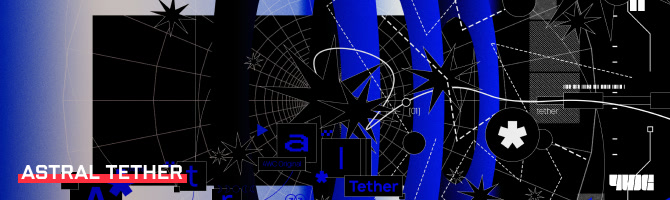](https://www.youtube.com/watch?v=KAMOwKrriQY)

[CryoChem](https://osu.ppy.sh/users/38269492) & [sugosugiii](https://osu.ppy.sh/users/15118952) - [Astral Tether](https://osu.ppy.sh/beatmapsets/2589083#osu/5776219) \[Netnekyai's Liminality\]\
Design by [Z419](https://osu.ppy.sh/users/9912966) | Mapped by [netnesanya](https://osu.ppy.sh/users/6017901) and [Kyairie](https://osu.ppy.sh/users/10910405)\
BPM: 175 | Length: 2:47 | ★ 6.63

> Hi! My name is sugosugiii and I make music in Japan! I've been wanting to collab with CryoChem for a while and I finally got the opportunity to do so for 4WC! Hope you will all enjoy the song! I wanted to create something with a "cold" yet beautiful atmosphere, but also with a bit of mysterious vibes as well.

---

[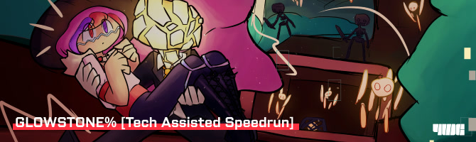](https://www.youtube.com/watch?v=vSyOrBN6sFk)

[XaverXD](https://osu.ppy.sh/users/12448575) - [Glowstone% [Tech-Assisted Speedrun]](https://osu.ppy.sh/beatmapsets/2605170#osu/5828632) \[6:50:359\]\
Illustration by [kyermaniac](https://osu.ppy.sh/users/32859564), design & video by [Aracium](https://osu.ppy.sh/users/15882740)\
Mapped by [Basherman](https://osu.ppy.sh/users/10133455) and [Wispy](https://osu.ppy.sh/users/11106929)\
BPM: 180 | Length: 3:24 | ★ 7.00

> Hi there! I'm XaverXD and I make music for rhythm games (mostly for osu! tournaments). This song is actually my first Hi-Tech release featuring my good friend and graphic designer Aracium, who has been there for me from the start of my journey as an artist. I had an absolute blast making the song and want to thank both kyermaniac for the amazing cover artwork and Aracium for the banger GFX and VFX :^)

---

[Febbs!](https://ivaadenfebbs.carrd.co/) - [Meet Your Demise](https://osu.ppy.sh/beatmapsets/2609056#osu/5841185) \[hi hello\]\
Illustration, design & motion by [Febbs!](https://ivaadenfebbs.carrd.co/)\
Mapped by [6pXgEj3hc7Umj5H](https://osu.ppy.sh/users/18130046)\
BPM: 175 | Length: 2:30 | ★ 6.90

> Owlahh!! I'm Febbie! or Febbs! I do music and multimedia! Apart of Yobimo, I'm here to overload the sugar, from the evil within. 💛 🧡 💜 Meet your Demise was based on an inside joke within Yobimo. As for the song itself, it was a bass-filled experiment on making the most heaviest song I can do with the idea of it being aggressive and loud. (I'm surprised the team liked it.)

---

[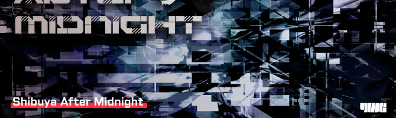](https://www.youtube.com/watch?v=CLpUY9S1DgQ)

[Project NVII](https://ffm.to/thank-you-my-friends-memory-replay) x [Febbs!](https://ivaadenfebbs.carrd.co/) - [Shibuya After Midnight (feat. Dazuko)](https://osu.ppy.sh/beatmapsets/2609234#osu/5841678) \[Extreme\]\
Design by [Project NVII](https://ffm.to/thank-you-my-friends-memory-replay), motion by [Febbs!](https://ivaadenfebbs.carrd.co/)\
Mapped by [Pyo](https://osu.ppy.sh/users/6641784)\
BPM: 180 | Length: 3:14 | ★ 6.49

> My name is Project NVII. I wrote this song using a laptop I borrowed the day after I found a new place to stay. I guess you can say it was my comeback track. I wanted to make an artcore song with neuro elements. But I forgot how to make neuro as its been 8 months since I last made a song at the time.

---

[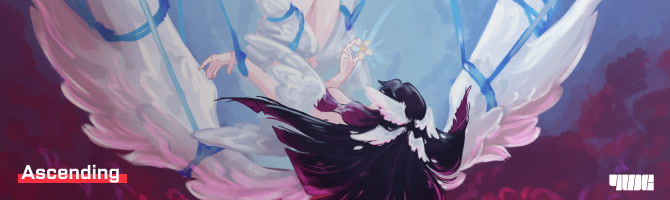](https://www.youtube.com/watch?v=6TaS3jkZTtw)

[Halgoh](https://osu.ppy.sh/users/4109923) - [Ascending](https://osu.ppy.sh/beatmapsets/2613192#osu/5854438) \[Halgoh x Maestro\]\
Illustration by [Windwolfy](https://cara.app/kenddrakai), design by Isha.\
Mapped by [Halgoh](https://osu.ppy.sh/users/4109923) & [MaestroSplinter](https://osu.ppy.sh/users/6707918)\
BPM: 178 | Length: 3:50 | ★ 7.18

> Hey, I'm Halgoh, a French electronic music producer exploring Experimental Drum & Bass and Color Bass — for now — though some of you might remember me as an osu!standard tech mapper. As my first original track for an international osu! tournament, I wanted Ascending to carry as much of my musical universe as possible, so I structured it as a narrative triptych combining colourful stabs and heavily processed vocals with the story of a being awakening into an ethereal dimension — a metaphor for my desire for spiritual emancipation from a fragmented society and the absurd, in the Camusian sense, born from our search for meaning in a world with no definitive answers.
> 
> Ascending was a first for me in two ways: my first time mapping one of my own tracks and my first collaboration with MaestroSplinter — long overdue since he wiped the floor with me during OBWC 2020, when his Space Angel inspired me to learn hitsounding. Working with Maestro was a genuine revelation — our styles mesh incredibly well together. I think we found a great balance between our shared love for weird, unconventional patterning and a heavily structured approach, allowing us to preserve that weirdness while making it genuinely playable and fitting for a tournament setting.

---

[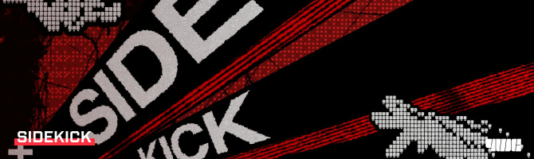](https://www.youtube.com/watch?v=QKEchuR4gIY)

[SJ68](https://linktr.ee/SJ68_Ent) - [SIDEKICK](https://osu.ppy.sh/beatmapsets/2613174#osu/5854384) \[///STILL KICKING///\]\
Design & motion by motionless.\
Mapped by [Phten02](https://osu.ppy.sh/users/16678364)\
BPM: 200 | Length: 2:21 | ★ 6.94

> Hello people! it is I SJ68, I make music for Yobimo since 2020 I think...
> 
> I made sidekick with the initial goal of making a song for a really difficult map so my girlfriend cant play it, that was the original idea and I think it still held up since she currently cannot play the map hewhehehhehehehhe if you're curious the sample is from underscores - your favorite sidekick, I found this artist months prior to making of the song! their music tickles my brain right so thats a fun fact for you.

---

[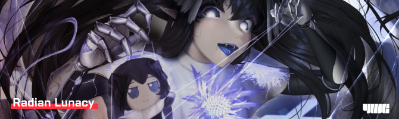](https://www.youtube.com/watch?v=in8JlvrhL1Y)

[jeko](https://jekoofficial.straw.page/) (w/ [Syuenn](https://syuenn.straw.page/) & [Krasper2](https://www.youtube.com/@Krasper2)) - [Radian Lunacy](https://osu.ppy.sh/beatmapsets/2613176#osu/5854390) \[FOUR DIMENSIONS\]\
Illustration by [Nightingale](https://twitter.com/kaisoushiroune), design by [Aracium](https://osu.ppy.sh/users/15882740), video by [Aquatic_3](https://osu.ppy.sh/users/22711091).\
Mapped by [Timevid](https://osu.ppy.sh/users/9125335), [ameponzu](https://osu.ppy.sh/users/12763959), [iLyne](https://osu.ppy.sh/users/13924533) and [eringiRa](https://osu.ppy.sh/users/16383529)\
BPM: 205 | Length: 5:45 | ★ 8.02

> hey im jeko, i've been a producer for about 5 years now and have focused on bass heavy genres like dnb and 200step. i've worked on this song in collaboration with Syuenn, whose hyperflip style is very defined and recognisable, and Krasper2 who makes rhythm game music aswell, however makes excels in making high quality mainstream bass stuff. this song has been quite a journey to work on with a lot of struggles throughout, but overall one of the best finished products i could've asked for. the main idea we had for this tiebreaker was to be as energetic and hard hitting as possible at the same time, so t+pazolite was one of our biggest inspirations to encapsulate the kind of energy that we wanted. overall, i think we did it pretty well, and i hope that you enjoy the song!

---

[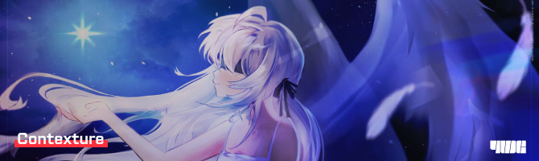](https://www.youtube.com/watch?v=PowXh8XF2a0)

[they](https://linktr.ee/th3y) - [Contexture](https://osu.ppy.sh/beatmapsets/2616999#osu/5869835) \[Dazzling Occurrence\]\
Illustration by [kawaizem](https://osu.ppy.sh/users/13843101), design by [mochasan](https://osu.ppy.sh/users/23804364), video by [Iskas](https://osu.ppy.sh/users/16816551).\
Mapped by [Timevid](https://osu.ppy.sh/users/9125335), [Blacky Design](https://osu.ppy.sh/users/11540165) and [Yumerios](https://osu.ppy.sh/users/11681430)\
BPM: 150 | Length: 5:23 | ★ 7.42

> hello o/ i'm they, the creator of 構成 (Kousei/Contexture)! once again, i'd like to thank the 4WC team for kindly welcoming me to this tournament.
> 
> on its own, i'd say this song is quite unforgiving and abrupt, even for its medium 150BPM. it's also one of my favorite compositions with vocals. the title, contexture represents a idea i had the idea of distorting and reframing parts of yourself to welcome and love the parts of the one you love. i hope you enjoy playing it. thank you!

---

[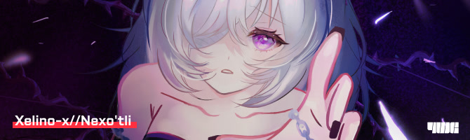](https://www.youtube.com/watch?v=eGIj7nAN4Hw)

[Xomaryu](https://www.youtube.com/channel/UCckzpT_heaLSyQoi_gQHyYQ) - [Xelino-x//Nexo'tli](https://osu.ppy.sh/beatmapsets/2616998#osu/5869834) \[PROJECT:VOID\]\
Illustration by [nabi](https://x.com/nabie0x), design by [Kanomi](https://osu.ppy.sh/users/37694048), video by kyo.\
Mapped by [captin1](https://osu.ppy.sh/users/689997) and [Aeril](https://osu.ppy.sh/users/4334976)\
BPM: 230 | Length: 3:04 | ★ 8.28

> Greetings, Circle Clickers :3, i'm Xomaryu, A producer from méxico that loves making music,  Xelino-x//Nexo'tli, is the culmination of several ideas mixed into a crazy tournament entry, with the idea of Representing Hopeless Eternal Unvoluntary movement along space and time, i hope you all can enjoy my newest tune :D

---

[OfficialAz3](https://youtube.com/@OfficialAz3) feat. DawMii - [Ridiculous Rhythmic Tester (osu ver)](https://osu.ppy.sh/beatmapsets/2617012#osu/5869878) \[\<(@_@)\>\]\
Illustration, design & motion by [Febbs!](https://ivaadenfebbs.carrd.co/)\
Mapped by [Callionet](https://osu.ppy.sh/users/3072921)\
BPM: 176 | Length: 2:52 | ★ 6.73

> Hello! I'm OfficialAz3, and I'm usually a BMS artist but I've been getting along with doing works such as this one, Ridiculous Rhythmic Tester. Originally, I've been interested in trying to make lots of varieties and subverting expectations to the player by changing how the rhythm plays whilst being on a rhythmically simple genre like Drum and Bass, hence the metric modulation that can be heard at the second half of the track. And, I'm really proud of the result! I hope you can enjoy my song!

---

[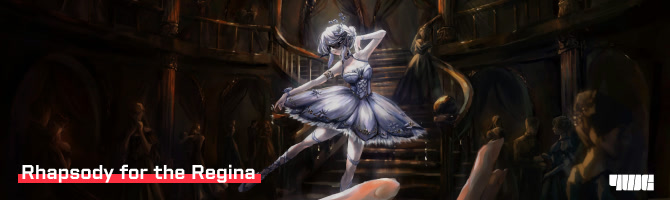](https://www.youtube.com/watch?v=o3z3ND4W0aM)

[THE BEAT WIZARD](https://www.youtube.com/@THE_BEAT_WIZARD) - [Rhapsody for the Regina in C minor, Op. 10](https://osu.ppy.sh/beatmapsets/2617039#osu/5869935) \[Masquerade\]\
Illustration by [kawaizem](https://osu.ppy.sh/users/13843101) & pigeonbait, design by [kae1](https://osu.ppy.sh/users/27779868), video by [Aquatic_3](https://osu.ppy.sh/users/22711091), storyboard by [Pho](https://osu.ppy.sh/users/3624692) & [darkos](https://osu.ppy.sh/users/5969271).\
Mapped by [Lince Cosmico](https://osu.ppy.sh/users/6070370), [Julian Alvarez](https://osu.ppy.sh/users/6632605), [MaestroSplinter](https://osu.ppy.sh/users/6707918), [YeLing](https://osu.ppy.sh/users/14726718) and [Alty](https://osu.ppy.sh/users/16407988)\
BPM: 200 | Length: 8:38 | ★ 8.36

> Hey! This is THE BEAT WIZARD, I like wandering the world of music. Alongside being the GFTB, Rhapsody for the Regina in C minor, Op. 10 is my 10th tournament original, so I took this as a chance to go all out and show everything that I've learned both as a self-taught producer and as a classically trained composition major! This piece takes inspiration from a wide range of periods. From Bach from the Baroque era, Beethoven from Classical, Liszt and Rachmaninoff from Romantic, and Sakuzyo and Laur for the modern era. All combined with my own twist :)

## Interviews

### skiatzo

::{ flag=GB }:: [skiatzo](https://osu.ppy.sh/users/16774872) (a.k.a. saim) captained Team United Kingdom and was one of the tournament's strongest players, finishing first in the individual statistics in both Quarterfinals and Semifinals. He later joined the staff team as a playtester.

---

<a class="news-chat-quote__colour-no-group" href="https://osu.ppy.sh/users/24454271">Filoxen</a>

How would you introduce yourself to someone who is not very familiar with the tournament scene?

<a class="news-chat-quote__colour-no-group" href="https://osu.ppy.sh/users/16774872">skiatzo</a>

Heya, I'm Saim (known as skiatzo), and I'm the United Kingdom's captain for the 4 Digit World Cup! I've now taken part in three osu! World Cups, and I've been playing tournaments since 2023, so I've experienced the tournament scene in nearly every rank range.

<a class="news-chat-quote__colour-no-group" href="https://osu.ppy.sh/users/24454271">Filoxen</a>

You had a unique experience this year, competing as a player during the first half of the tournament and then joining the playtesting team for the second half. How would you describe your experience in both roles?

<a class="news-chat-quote__colour-no-group" href="https://osu.ppy.sh/users/16774872">skiatzo</a>

Being on both sides, as a player and as staff, helped me appreciate the time and effort that goes into pooling and into every other part of running a tournament that players tend to overlook. I can confidently say at least 1000 hours went into producing this year's 4WC, and it shows. There were a lot of questions and complaints from the player side (myself included), but the finale proved the tournament a tremendous success. Staying involved and giving input from my side to support the pools was an incredible experience. The biggest thing I've learnt is never to judge a book by its cover. Give something the chance to succeed and you might find something fantastic on the other side.

<a class="news-chat-quote__colour-no-group" href="https://osu.ppy.sh/users/24454271">Filoxen</a>

You had quite a weekend during the semifinals, playing two back-to-back tiebreaker matches while also being without some of your key players. What were your expectations going into the round, and how did you manage to keep going? Looking back, is there anything you would have done differently?

<a class="news-chat-quote__colour-no-group" href="https://osu.ppy.sh/users/16774872">skiatzo</a>

The semifinals were always going to be stressful. We had just lost 6-1 to Canada, and although we were managing, the team was at an all-time low. As captain I tried my best to motivate everyone, but then we got the unfortunate news that we'd be missing [Fwuffy](https://osu.ppy.sh/users/7374212) (aka Dream Journey), a key core player who boosts nearly every mechanical skillset. That left me asking whether we should settle for celebrating a top 12 placement, our highest since 2020, or put in double the effort and show the world we wouldn't go down without a fight. We chose to fight.

Our first match against Australia was stressful, especially after we found out we'd also be missing [lystia](https://osu.ppy.sh/users/11042418), our gimmick carry and the second OWC player on our team. With only six players we fought hard. I carried us through the first half, [SinqHD](https://osu.ppy.sh/users/15887523) stepped up in the second, and we scraped a tiebreaker win against the unstoppable force that was [Dumb-Andy](https://osu.ppy.sh/users/20963631) to move on to our second semifinals match against the Philippines.

The Philippines had a much more confident first match and a full team, while we were down to five. [Lystia](https://osu.ppy.sh/users/11042418)'s computer was having trouble running the game, and [Wiggler](https://osu.ppy.sh/users/12130363) couldn't make it due to personal commitments. This gave us an interesting dynamic: we'd almost given up and were just playing for the sake of it, with open mic and having fun. That relaxed our nerves and actually improved our gameplay, and we came back from 5-2 down to force a tiebreaker. There we couldn't overcome an incredible [GabberSS](https://osu.ppy.sh/users/14388839), who shone throughout the match.

Looking back, I'd have tried to build more depth in tapping, and I'd have encouraged that relaxed, have-fun mindset from the start instead of only once we had nothing to lose.

<a class="news-chat-quote__colour-no-group" href="https://osu.ppy.sh/users/24454271">Filoxen</a>

The UK finished 7th–8th this year, its highest placement in the last six years. What do you think was different about this year's team that helped you achieve that result, and how do you see the future of team UK in 4WC?

<a class="news-chat-quote__colour-no-group" href="https://osu.ppy.sh/users/16774872">skiatzo</a>

I think my return to 4 Digit this year made a real difference. Placing first individually in both the quarterfinals and the semifinals is something I'm still incredibly proud of.

That said, there's no doubt the whole team stepped up this year, because we had the confidence of knowing we could go far. [Lystia](https://osu.ppy.sh/users/11042418) returning to 4 Digit from OWC and [Wiggler](https://osu.ppy.sh/users/12130363) ranking up after shining in 5WC were two brilliant additions. They balanced our skillsets and meant we could now pick gimmick and hidden.

I can't forget the rest of the team either. [matt4132](https://osu.ppy.sh/users/11706972), [SinqHD](https://osu.ppy.sh/users/15887523), [Fwuffy](https://osu.ppy.sh/users/7374212) and [Falnt](https://osu.ppy.sh/users/15760163), along with myself, formed a core strong enough to play nearly every mechanical pick. [Mystrality](https://osu.ppy.sh/users/14452800) was as consistent as ever as our only speed/tapping player. It's just a shame they had no one to share that skillset with.

With all of these players together we had a shot at going much further. But as I said, a lack of tapping depth and the missing players in the semifinals meant we couldn't push as far as we'd have liked.

As for the future, it depends on who stays. From the looks of things, everyone except [lystia](https://osu.ppy.sh/users/11042418) is hoping to play again, unless they rank up (I'm looking at you, [Mystrality](https://osu.ppy.sh/users/14452800) and [SinqHD](https://osu.ppy.sh/users/15887523)). The same goes for me. I'm not sure whether I've overstayed my welcome in this rank range and it's time to move on. All will be revealed next year!

### Pezz

::{ flag=US }:: [Pezz](https://osu.ppy.sh/users/10651106) is a two-time 4WC champion who transitioned into mappooling in 2025. Continuing his involvement this year, he returns as a head pooler.

---

<a class="news-chat-quote__colour-no-group" href="https://osu.ppy.sh/users/10157694">-felicia</a>

Hello Pezz! As one of the main mappoolers of this 4WC iteration, could you tell us what you found most enjoyable/easy and what you found particularly challenging whilst working on the pools?

<a class="news-chat-quote__colour-no-group" href="https://osu.ppy.sh/users/10651106">Pezz</a>

Pooling happens in a few phases. Setting up the team, organizing 4WC originals and finding mappers, sourcing other customs, slotting things into pools, and finally (and typically concurrently to the last two), pooling around them. The last part is the thing most people picture, but every part has its own headaches. This year's biggest challenge was something I'd never dealt with before though.

Early on I was still deep into Rescup pooling, so I was probably one of the least involved poolers on the team (though I still checked in helping w/ quals and groups). Around the time groups released, our original head pooler, [imokora](https://osu.ppy.sh/users/2472609), stepped away. The rest of the team was too busy with other projects or less familiar with the management side, so I took over mid-tournament and spent a rough transition period picking up the pieces to keep things on schedule. [Byd](https://osu.ppy.sh/users/6398464) and [arthRo](https://osu.ppy.sh/users/21663721) (Kodai) were huge helps in getting me more familiar with QA and hitsound management, and our incredibly passionate playtesting team made sure the pools never fell behind.

After that came everything else. Customs would miss a piece, there was a management system I was still learning, late playtester feedback, and constant balancing changes, but it can all come down to one thing.

The hardest thing about pooling is caring. Caring a lot. When you care, every minor issue and every mistake jumps out at you, and that's draining. You're constantly making changes, sometimes faster than anyone else can keep up.

Pooling doesn't pay, every pool individually took upwards of 30-40 hours a week, and things still slipped through the cracks.

But it was worth it. Seeing the maps get played, seeing players actually have fun, seeing testers, mappers, and staff happy with the work, and most selfishly, being proud of what we put out. Nothing gives you those hours back, but the proof that the effort was spent will always stand. That's what made it worth it.

<a class="news-chat-quote__colour-no-group" href="https://osu.ppy.sh/users/10157694">-felicia</a>

Last year you were also a pooler, are there any changes you've noticed/implemented in your pooling style this iteration compared to the last one?

<a class="news-chat-quote__colour-no-group" href="https://osu.ppy.sh/users/10651106">Pezz</a>

The biggest change is confidence. Last year the work was split more or less evenly between Chiv and me, but past groups this year, most of the maps and pools were done by me. A lot of that confidence comes from being able to recognize my own mistakes and being incredibly picky with map selection. Last year I was constantly trying to appease what the players wanted. This year I cared more about what I'd want to see in a pool. The aim maps in grands and finals, for example, were maps I'd personally really enjoy, and I think the pools were better off for it.

<a class="news-chat-quote__colour-no-group" href="https://osu.ppy.sh/users/10157694">-felicia</a>

What are some of your favourite maps that you pooled or helped work on in this iteration?

<a class="news-chat-quote__colour-no-group" href="https://osu.ppy.sh/users/10651106">Pezz</a>

My personal favorite custom was the Final TB. It's my favorite skillset in the game and is made by a handful of mappers who are personal favorites as well. I worked closely on this map and QA'd it for days, so it means a lot to me. I can't talk about this year without talking about the absolutely generational lineup of HD3's we had. [Glowstone%](https://osu.ppy.sh/beatmapsets/2605170#osu/5828632) into [Birdie Song](https://osu.ppy.sh/beatmapsets/2609229#osu/5841667) into [Snow Fairies](https://osu.ppy.sh/beatmapsets/2613780#osu/5856501) into [Redolent Shape](https://osu.ppy.sh/beatmapsets/2617006#osu/5869855) is an absolute monster of a lineup. And outside of customs, I'm quite fond of the RO16 pool's [DT4](https://osu.ppy.sh/beatmapsets/2241525#osu/4764120), [HR1](https://osu.ppy.sh/beatmapsets/102282#osu/270490) and [HR2](https://osu.ppy.sh/beatmapsets/44807#osu/140390) (INVISIBLE by Mismagius, Terminal by Ulysses, and Blue Amber by -Upari). I had these slotted before the tournament even began, so they're very close to my heart.

---

Last but not least, 4WC would not have been possible without our massive staff team of 159 members working behind the scenes for 1,066 players who signed up to compete.


We hope to see all of you again in 4WC 2027!

—Filoxen, pericrayola, -felicia, Liliana & Aquatic_3
