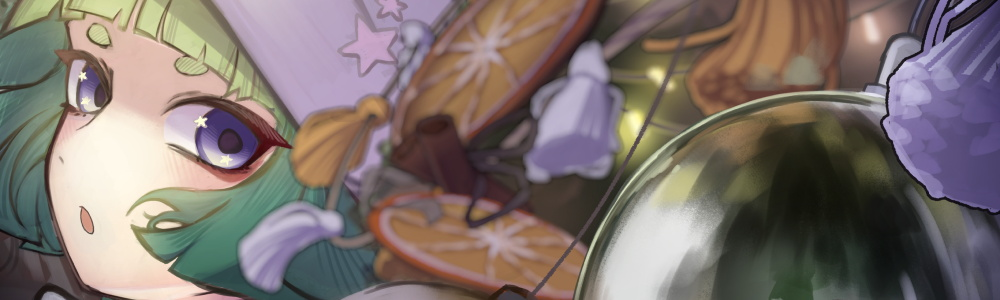

Snow is on its way, and so is the last fanart contest of the year!

With the Halloween decorations packed away, it's time to dust off your pens, grab a warm drink and bring some winter cheer to the main menu. This time around, your mission is simple:

**Draw the osu! (or community) [mascots](/wiki/Mascots) in a winter theme or setting!**

The end-of-year holidays are just around the corner, which means (some of) the world will be painted white, and rain will come as sparkles from the sky. If you had warm vacation scenery in mind, you might have stumbled upon this contest at the wrong time.

If you get sparkly-eyed from the anticipation of winter, but have yet to experience a lightbulb moment on what to draw, here are some simple ideas to get started:

- Tama and Taikonator building snowmen at the top of a mountain... maybe too many snowmen.
- Mani and Mari helping locals decorate a huge Christmas tree with baubles and lights.
- Yuzu and Chirou enjoying hot chocolate and donuts on a train trip to a ski resort.
- Mocha baking cookies, Aiko roasting a huge turkey and Tama wrapping presents.
- pippi and Alisa skiing down a gentle slope, with stray snowballs not-so-gently hurtling past.

Feel free to run with any of these, mash a few of them together, or set them aside entirely for an idea of your own. As long as it's plausibly winter in your drawn scenery, you're good to go!

## Rewards

As always, your frosty creations won't go unrewarded:

- A selection of the top-voted finalists will be **featured on the main menu** and receive **3 months of osu!supporter**.
- The top 3 will receive bespoke **profile badges** made from their own creations.
- The top 4 will be featured as [**limited-time selection of default profile banners**](https://osu.ppy.sh/home/news/2024-07-15-aerial-antics-art-results#new-profile-customisations).

Speaking of profile banners, be sure to grab any of the existing [Halloween 2026 Fanart Contest](https://osu.ppy.sh/home/news/2026-10-20-halloween-2026-fanart-contest-results) banners before they disappear forever!

## Rules

- **By submitting your artwork to this contest, you grant us permission to use your artwork in the main menu client should it win, and to use it in promotional material for both the game (osu!) and the contest (Winter 2026 Fanart Contest).** You retain all rights to your creation and you can sell it and distribute it however you like — it's your work, after all. We're just saying here that if you submit your piece to this contest, you should be okay with us using it.
- **All entries MUST follow the contest theme and contain AT LEAST one of the osu! official or community mascots.** Otherwise, it's not an osu! contest, is it?
- **All entries MUST be suitable for all-ages viewing.** Keep it cozy — the holidays are for everyone to enjoy!
- **SUBMIT ONLY YOUR OWN WORK. REDRAWING AND COMPOSITE WORKS ARE NOT ALLOWED.** Plagiarism sucks. Don't do it. Someone in the comments will call you out for it as has happened every other time someone's tried and they're going to do more damage to your reputation than us removing your entry from the voting will do. Use only your own work — brushes and the like are fine, but that's it! Don't redraw or trace someone else's work.
- **Generative art programs or methods (such as AI) are NOT allowed.** This includes any kind of software that has you supply a written or visual prompt and fills in large amounts of details for you. We will know if you do this. If we somehow miss it, the community won't. Don't sully your legacy as an artist!
- **Participants must keep a full file containing all of their entry's layers available.** We'll only ask you for this if we think it's needed to ascertain any claims regarding plagiarism or the use of generative art tools. If you don't/can't provide us this within a timely manner when we ask, we'll have no choice but to pull your listing from the contest, sorry!
- **Artist attribution (names, social media handles, etc.) must be limited to no more than three lines total and confined to any corner of your entry.** Being proud of your work is good, just do it in a reasonably small spot of your work. One thing unique to osu!'s history is that we really don't like forced advertisement, and attribution that is too large can come across like it.
- **Entries MUST meet the resolution requirements for a main-menu piece — namely 2732x1536**. This is automatically checked via the website, and the contest listing won't let you submit an entry even if it's off by ONE pixel. Export your creations at the correct resolution!
- **Artists should use the custom templates provided ([PSD template](https://assets.ppy.sh/events/fanart/templates/osu%21%20main%20menu%202732x1536.psd?2017) / [PNG template](https://assets.ppy.sh/events/fanart/templates/osu%21%20main%20menu%202732x1536.png?2017)) when composing their piece as a guideline to understand where the osu! cookie will be placed on the main menu and during the voting process.** The circular spot in the middle shows where the main-menu cookie will be when inside the game. Factor this in when designing your piece, as anything inside it is likely not going to be seen. This doesn't mean leaving a big circular hole full of nothing in the middle! Be creative. *Make sure you don't leave it visible in your end result.*
- **Do NOT leave the dotted osu! cookie template visible in your submission.**
- **If you're using characters from other intellectual properties, do so sparingly.** All the official osu! mascots and the community mascots are fair game, but please avoid using excessive representations of characters from other worlds or franchises in your work — the contest is about osu! foremost, after all. Remember also that the community mascots are someone else's treasured creation, so please treat them with the same respect that you'd treat your own OCs and work.

::: alert-notice
**Notice**
In response to the rising number of AI-assisted submissions, we are introducing stricter measures. Starting from this iteration, users found submitting such entries will be temporarily barred from entering future fanart contests. Repeat offenders will be barred indefinitely.
:::

Got any questions, or any urgent matters that need to be looked at? Don't hesitate to [send Hivie a message](https://osu.ppy.sh/community/chat?sendto=14102976) for any inquiries regarding this contest!

---

*Header and promotional artwork by finalist [SuperSSun](https://osu.ppy.sh/users/6972778) from the [Winter 2025 Art Contest](https://osu.ppy.sh/community/contests/269)!*

Once your masterpiece is ready, head over to the [Winter 2026 Fanart Contest listing](https://osu.ppy.sh/community/contests/297) and drag-and-drop your entry into the box with the plus sign in it.

You may reupload your entry to your heart's content if you want to make any adjustments, but you only have **21 days** to do so before the doors close off forever (11 December 2026, 18:00 UTC), so don't spend too long figuring out how many snowmen is too many snowmen.

Don't forget to also tag your social media posts with `#osufanart` for the world to see!

Stay cozy, and happy drawing!

—Hivie & Walavouchey
