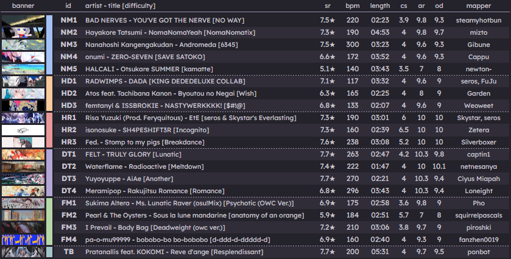

With the Group Stage out of the way, the bracket of the osu! World Cup 2026 is finally underway.

After an excruciating two weeks of sitting on their heels, the top 8 seeds of the year finally got to flex their muscle in the Round of 16 of the bracket stage. Their opponents had sharpened their skills in the three matches all played over the course of the two weeks of the Group Stage, but each would come up against an entirely new tier of opponent as the world's best were finally given the opportunity to show their skills off to the world.

Not to be overlooked, though, were the teams making their way to the first round of the losers' bracket; though they may not have topped their groups, these sixteen were likewise battle-tested across the previous round and were looking to prove their worth and stay alive for another week of play. From Argentina and Australia to Ukraine and the United States, it was time for the 32 teams in this year's OWC bracket to be put to the test as they jockeyed for position in the Quarterfinals week.

## Mappool recap

**[Download the pool here! (163 MB)](https://osu.ppy.sh/beatmaps/packs/P341)**

    <iframe width="95%" style="aspect-ratio: 16 / 9;" src="https://www.youtube.com/embed/1tMDbOIzXPU" frameborder="0" allowfullscreen></iframe>

pool desc

---

original intro

    <audio controls>
        <source src="https://assets.ppy.sh/artists/211/Songs/Risa_Yuzuki_Prod._Feryquitous_-_EtE.mp3">
    </audio>

ete desc

    <audio controls>
        <source src="https://assets.ppy.sh/artists/175/Songs/Pratanallis_feat._KOKOMI_-_Reve_dange.mp3">
    </audio>

reve d'ange desc

## Round of 16 summary

| Blue Team |  |  | Red Team |
| --: | :-: | :-: | :-- |
| **Australia** ::{ flag=AU }:: | **6** | 0 | ::{ flag=NZ }:: New Zealand |
| **South Korea** ::{ flag=KR }:: | **6** | 2 | ::{ flag=CN }:: China |
| **United Kingdom** ::{ flag=GB }:: | **6** | 1 | ::{ flag=HK }:: Hong Kong |
| Singapore ::{ flag=SG }:: | 0 | **6** | ::{ flag=ID }:: **Indonesia** |
| **Poland** ::{ flag=PL }:: | **6** | 1 | ::{ flag=FR }:: France |
| Romania ::{ flag=RO }:: | 0 | **6** | ::{ flag=NL }:: **Netherlands** |
| Saudi Arabia ::{ flag=SA }:: | 2 | **6** | ::{ flag=PH }:: **Philippines** |
| Malaysia ::{ flag=MY }:: | 0 | **6** | ::{ flag=SE }:: **Sweden** |
| Japan ::{ flag=JP }:: | 5 | **6** | ::{ flag=TH }:: **Thailand** |
| Russian Federation ::{ flag=RU }:: | 3 | **6** | ::{ flag=DE }:: **Germany** |
| **Türkiye** ::{ flag=TR }:: | **6** | 3 | ::{ flag=AT }:: Austria |
| Ukraine ::{ flag=UA }:: | 2 | **6** | ::{ flag=TW }:: **Taiwan** |
| **Chile** ::{ flag=CL }:: | **6** | 0 | ::{ flag=NO }:: Norway |
| **United States** ::{ flag=US }:: | **6** | 0 | ::{ flag=FI }:: Finland |
| **Spain** ::{ flag=ES }:: | **6** | 3 | ::{ flag=AR }:: Argentina |
| **Canada** ::{ flag=CA }:: | **6** | 5 | ::{ flag=BR }:: Brazil |

ro16 desc

### ::{ flag=JP }:: Japan vs. ::{ flag=TH }:: Thailand

    <iframe width="95%" style="aspect-ratio: 16 / 9;" src="https://www.youtube.com/embed/YdxBI-DxN48" frameborder="0" allowfullscreen></iframe>

jp th desc

### ::{ flag=RU }:: Russian Federation vs. ::{ flag=DE }:: Germany

    <iframe width="95%" style="aspect-ratio: 16 / 9;" src="https://www.youtube.com/embed/GYSddZFaoys" frameborder="0" allowfullscreen></iframe>

ru de desc

### ::{ flag=CA }:: Canada vs. ::{ flag=BR }:: Brazil

    <iframe width="95%" style="aspect-ratio: 16 / 9;" src="https://www.youtube.com/embed/zZAtCXrJ0UA" frameborder="0" allowfullscreen></iframe>

Canada vs. Brazil was a match for the ages. Heading into the final match of the Round of 16, no one expected it to be the nail biter of a match that it turned out to be. Between some of the closest points of the entire weekend, incredible team scores, and some masterful individual performances, this match had everything you could ask for if not more. If you haven't seen it, the [VOD](https://www.youtube.com/watch?v=zZAtCXrJ0UA) for this one is well worth the watch!

To set the stage, Canada came in as the heavy favourites, having not lost a Round of 16 match since *2017*, where the team that beat them was none other than Brazil. The Brazilians, on the other hand, looking to recapture the magic from 9 years ago, narrowly got out of their group in first place after a number of close matches against the other Group D teams.

Brazil started by banning out both of the low AR reading maps, HD2 and NM5. Canada opted to ban out the precision pick HR2, alongside the stream-focused NM2. Brazil narrowly escaped their first pick of NM1, with a strong 829,043 by ::{ flag=BR }:: [Yuichi](https://osu.ppy.sh/users/12932016) securing the point by a margin of 78,318. The tensions only rose from there with Brazil stealing Canada's first pick of HD3 by a jaw-dropping 9,524 points, the closest map of the weekend, putting them up 2–0. Canada, not to be deterred, struck back with a breakpoint of their own on FM3, thanks to a double FC from ::{ flag=CA }:: [xootynator](https://osu.ppy.sh/users/3717598) and ::{ flag=CA }:: [Zucchiniii](https://osu.ppy.sh/users/13959253). 

The razor thin margins continued as Canada won FM1 by 23,059 points off the back of yet another FC from ::{ flag=CA }:: [xootynator](https://osu.ppy.sh/users/3717598), tying the match at 2–2. The teams teams then traded 2 more incredibly close picks, with Canada winning Brazil's HR3 pick by 41,861 thanks to, you guessed it, another ::{ flag=CA }:: [xootynator](https://osu.ppy.sh/users/3717598) FC, followed by Brazil taking Canada's HD1 pick by 188,272 in large part due to an FC from ::{ flag=BR }:: [Kurumiw](https://osu.ppy.sh/users/11415687) and a near-FC from ::{ flag=BR }:: [shwq](https://osu.ppy.sh/users/22536015). The teams traded points yet again with Brazil winning their HR3 pick and Canada their FM2 pick. With one pick remaining and the options dwindling, Brazil took a chance on DT1. Canada set the 5th best team score of the weekend with 3,784,912, but it was no match for Brazil's crushing performance, obliterating the DT1 leaderboard at 4,269,650 points, with a 3-way FC from ::{ flag=BR }:: [Exxotl](https://osu.ppy.sh/users/15225729), ::{ flag=BR }:: [-Hirata](https://osu.ppy.sh/users/10188022) , and ::{ flag=BR }:: [Yuichi](https://osu.ppy.sh/users/12932016).

With Brazil on match point, Canada used their last pick on FM4, one of the harder maps in the pool testing a variety of skillsets. With a third of the map remaining, the score difference balanced on a knife's edge with Canada leading by a mere 26,765 points going into the final section of the map. As the map came to a close, who else but ::{ flag=CA }:: [xootynator](https://osu.ppy.sh/users/3717598) would be the last one standing, securing the best FM4 score of the weekend with a 969,560 Hidden full combo, sending the match to tiebreaker.

With how close the rest of the match had been, expectations were high going into [Reve d'ange](https://osu.ppy.sh/beatmapsets/2650854#osu/5991904), an osu! original by Pratanallis feat. KOKOMI, and these teams did not disappoint. After many early misses on both sides, Brazil found themselves up 90,227 points halfway through the map, with ::{ flag=BR }:: [Exxotl](https://osu.ppy.sh/users/15225729) as the only player in the lobby still holding an FC. A tragic miss at 1,330 combo soon changed that, and with ::{ flag=CA }:: [xootynator](https://osu.ppy.sh/users/3717598) and ::{ flag=CA }:: [puppy](https://osu.ppy.sh/users/6304246) having rebuilt their combos, the match was back neck and neck, with only 2,197 points separating the two teams heading into the final kiai. The heroic duo of Canada managed to hold their combos through most of the ending, finishing with 741,978 and 564,527 points respectively and sending Brazil to recompose themselves in the losers' bracket. Despite being just a Round of 16 match, Canada vs. Brazil might just go down as one of the best matches of OWC 2026.

---

ending paragraph

—ChillierPear, Dada, I-Flame, Lightin, M I L E S, shdewz & this1neguy
