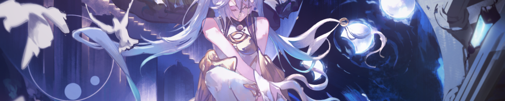
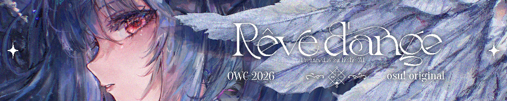
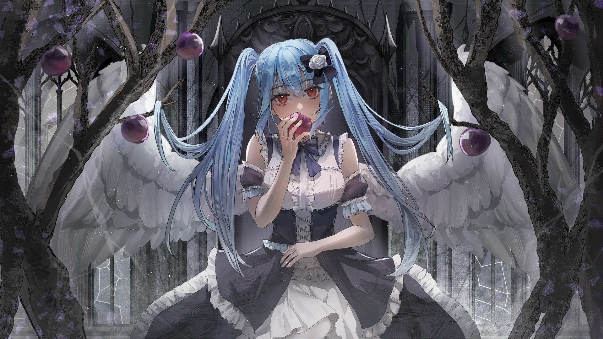
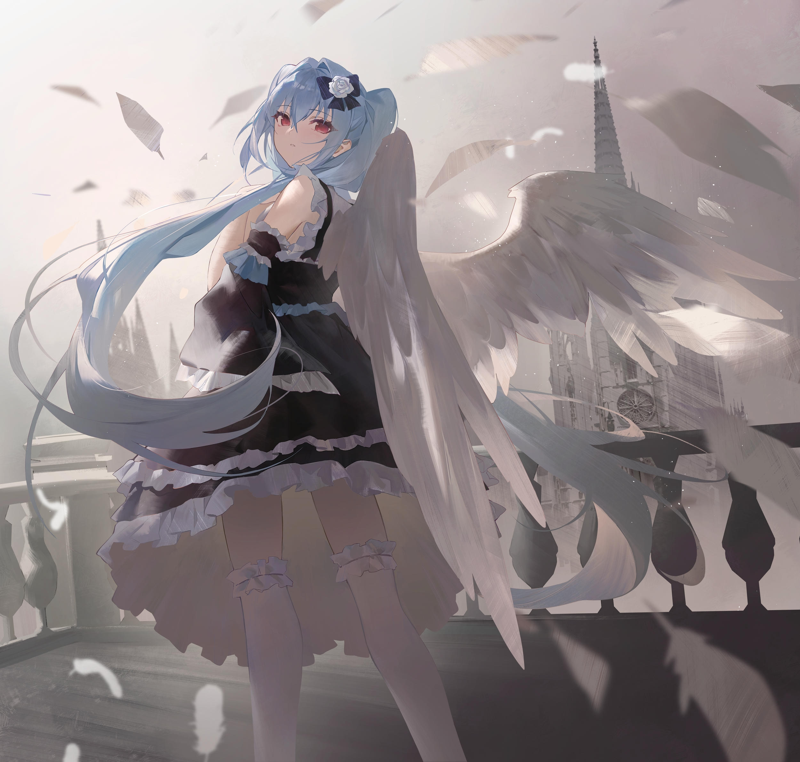
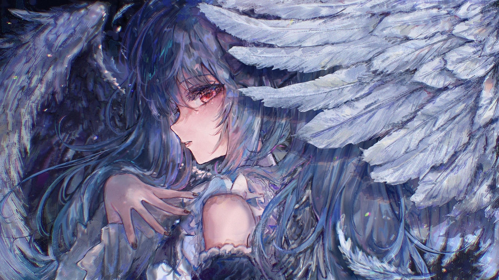
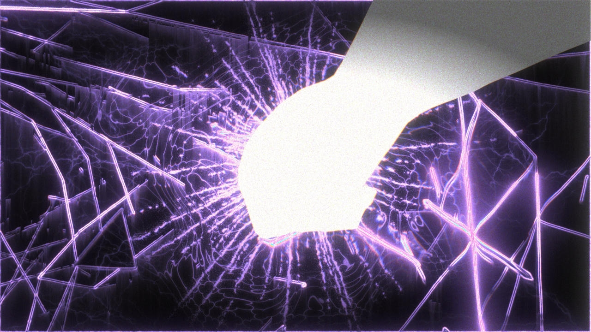
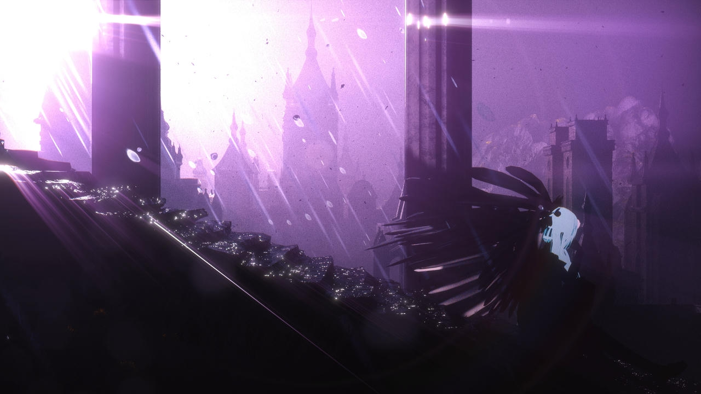

With the Group Stage out of the way, the bracket of the osu! World Cup 2026 is finally underway.

After an excruciating two weeks of sitting on their heels, the top 8 seeds of the year finally got to flex their muscle in the Round of 16 of the bracket stage. Their opponents had sharpened their skills in the three matches all played over the course of the two weeks of the Group Stage, but each would come up against an entirely new tier of opponent as the world's best were finally given the opportunity to show their skills off to the world.

Not to be overlooked, though, were the teams making their way to the first round of the losers' bracket; though they may not have topped their groups, these sixteen were likewise battle-tested across the previous round and were looking to prove their worth and stay alive for another week of play. From Argentina and Australia to Ukraine and the United States, it was time for the 32 teams in this year's OWC bracket to be put to the test as they jockeyed for position in the Quarterfinals week.

## Mappool recap

**[Download the pool here! (163 MB)](https://osu.ppy.sh/beatmaps/packs/P341)**

    <iframe width="95%" style="aspect-ratio: 16 / 9;" src="https://www.youtube.com/embed/1tMDbOIzXPU" frameborder="0" allowfullscreen></iframe>

The Round of 16 pool had some interesting picks. Being the first pool to be expanded, there's one extra map per mod pool (excluding No Mod), so there's room for more variety than in the previous week, and it allows for some more niche skillsets to also shine through. Maps such as [Otsukare Summer](https://osu.ppy.sh/beatmapsets/2650813#osu/5991803) by [newton-](https://osu.ppy.sh/users/5875419) and [Sous la lune mandarine](https://osu.ppy.sh/beatmapsets/2650841#osu/5991860) by [squirrelpascals](https://osu.ppy.sh/users/6151332) are examples of the reading side of this expanded format, both being quite popular throughout the weekend, while a map like [Stomp to my pigs](https://osu.ppy.sh/beatmapsets/2128425#osu/4474940) by [Silverboxer](https://osu.ppy.sh/users/2166762) was a popular offering on the speedier, mechanical side.

The Free Mod pool, generally, also showcased some of the musical diversity of the pool, with [bobobo-bo bo-bobo](https://osu.ppy.sh/beatmapsets/2650845#osu/5991868) by [fanzhen0019](https://osu.ppy.sh/users/418699) being arguably the biggest example, being an extremely unique, chaotic footwork track with an equally chaotic map accompanying it. Meanwhile, Double Time attracted the most bans this week, as [Radioactive](https://osu.ppy.sh/beatmapsets/2650806#osu/5991788) and [AiAe](https://osu.ppy.sh/beatmapsets/257793#osu/589969), respectively the stamina and speed picks of the pool, both were banned in over half the matches, as these skillsets are usually lynchpins when strategizing in early stages.

---

We also had two originals debuting this week, with the first one being [EtE](https://osu.ppy.sh/beatmapsets/2650828#osu/5991834), by our beloved [Risa Yuzuki](https://osu.ppy.sh/beatmaps/artists/211) with production by the great Feryquitous!

    <audio controls>
        <source src="https://assets.ppy.sh/artists/211/Songs/Risa_Yuzuki_Prod._Feryquitous_-_EtE.mp3">
    </audio>

With a harrowing, yet beautiful and captivating composition, the light tech map by [seros](https://osu.ppy.sh/users/10562853) and [Skystar](https://osu.ppy.sh/users/873961) helped the Hard Rock pool feel truly special, with a map equal parts pretty and menacing giving players a real challenge.

And to cap off the pool, the tiebreaker: [Reve d'ange](https://osu.ppy.sh/beatmapsets/2650854#osu/5991904) by the fine folk at [Pratanallis](https://osu.ppy.sh/beatmaps/artists/175)!

    <audio controls>
        <source src="https://assets.ppy.sh/artists/175/Songs/Pratanallis_feat._KOKOMI_-_Reve_dange.mp3">
    </audio>

A gothic, energetic piece full of drama and with vocals by the angelic KOKOMI, the tiebreaker offered an extremely tough test of aim and stream mechanics provided by the Japanese duo of [ponbot](https://osu.ppy.sh/users/8939857) and [Satellite](https://osu.ppy.sh/users/1661227), which decided matches this week and gave us some real nail-biters.

As usual, both originals have full spreads for players of all levels to enjoy, so make sure to give them a try!

## Round of 16 summary

| Blue Team |  |  | Red Team |
| --: | :-: | :-: | :-- |
| **Australia** ::{ flag=AU }:: | **6** | 0 | ::{ flag=NZ }:: New Zealand |
| **South Korea** ::{ flag=KR }:: | **6** | 2 | ::{ flag=CN }:: China |
| **United Kingdom** ::{ flag=GB }:: | **6** | 1 | ::{ flag=HK }:: Hong Kong |
| Singapore ::{ flag=SG }:: | 0 | **6** | ::{ flag=ID }:: **Indonesia** |
| **Poland** ::{ flag=PL }:: | **6** | 1 | ::{ flag=FR }:: France |
| Romania ::{ flag=RO }:: | 0 | **6** | ::{ flag=NL }:: **Netherlands** |
| Saudi Arabia ::{ flag=SA }:: | 2 | **6** | ::{ flag=PH }:: **Philippines** |
| Malaysia ::{ flag=MY }:: | 0 | **6** | ::{ flag=SE }:: **Sweden** |
| Japan ::{ flag=JP }:: | 5 | **6** | ::{ flag=TH }:: **Thailand** |
| Russian Federation ::{ flag=RU }:: | 3 | **6** | ::{ flag=DE }:: **Germany** |
| **Türkiye** ::{ flag=TR }:: | **6** | 3 | ::{ flag=AT }:: Austria |
| Ukraine ::{ flag=UA }:: | 2 | **6** | ::{ flag=TW }:: **Taiwan** |
| **Chile** ::{ flag=CL }:: | **6** | 0 | ::{ flag=NO }:: Norway |
| **United States** ::{ flag=US }:: | **6** | 0 | ::{ flag=FI }:: Finland |
| **Spain** ::{ flag=ES }:: | **6** | 3 | ::{ flag=AR }:: Argentina |
| **Canada** ::{ flag=CA }:: | **6** | 5 | ::{ flag=BR }:: Brazil |

Typical for the first round of any bracket stage, this week saw a majority of the matches end up rather one-sided. What the scoreboard doesn't tell though are the individual picks, and we were certainly not spared of any suspense with a whole 18 maps ending with a score difference below 100,000 across the week. Of course, between all of that, we did have some absolute gems too, of which you can read more about below!

### ::{ flag=JP }:: Japan vs. ::{ flag=TH }:: Thailand

    <iframe width="95%" style="aspect-ratio: 16 / 9;" src="https://www.youtube.com/embed/YdxBI-DxN48" frameborder="0" allowfullscreen></iframe>

jp th desc

### ::{ flag=RU }:: Russian Federation vs. ::{ flag=DE }:: Germany

    <iframe width="95%" style="aspect-ratio: 16 / 9;" src="https://www.youtube.com/embed/GYSddZFaoys" frameborder="0" allowfullscreen></iframe>

ru de desc

### ::{ flag=CA }:: Canada vs. ::{ flag=BR }:: Brazil

    <iframe width="95%" style="aspect-ratio: 16 / 9;" src="https://www.youtube.com/embed/zZAtCXrJ0UA" frameborder="0" allowfullscreen></iframe>

Canada vs. Brazil was a match for the ages. Heading into the final match of the Round of 16, no one expected it to be the nail biter of a match that it turned out to be. Between some of the closest points of the entire weekend, incredible team scores, and some masterful individual performances, this match had everything you could ask for if not more. If you haven't seen it, the [VOD](https://www.youtube.com/watch?v=zZAtCXrJ0UA) for this one is well worth the watch!

To set the stage, Canada came in as the heavy favourites, having not lost a Round of 16 match since *2017*, where the team that beat them was none other than Brazil. The Brazilians, on the other hand, looking to recapture the magic from 9 years ago, narrowly got out of their group in first place after a number of close matches against the other Group D teams.

Brazil started by banning out both of the low AR reading maps, HD2 and NM5. Canada opted to ban out the precision pick HR2, alongside the stream-focused NM2. Brazil narrowly escaped their first pick of NM1, with a strong 829,043 by ::{ flag=BR }:: [Yuichi](https://osu.ppy.sh/users/12932016) securing the point by a margin of 78,318. The tensions only rose from there with Brazil stealing Canada's first pick of HD3 by a jaw-dropping 9,524 points, the closest map of the weekend, putting them up 2–0. Canada, not to be deterred, struck back with a breakpoint of their own on FM3, thanks to a double FC from ::{ flag=CA }:: [xootynator](https://osu.ppy.sh/users/3717598) and ::{ flag=CA }:: [Zucchiniii](https://osu.ppy.sh/users/13959253). 

The razor thin margins continued as Canada won FM1 by 23,059 points off the back of yet another FC from ::{ flag=CA }:: [xootynator](https://osu.ppy.sh/users/3717598), tying the match at 2–2. The teams teams then traded 2 more incredibly close picks, with Canada winning Brazil's HR3 pick by 41,861 thanks to, you guessed it, another ::{ flag=CA }:: [xootynator](https://osu.ppy.sh/users/3717598) FC, followed by Brazil taking Canada's HD1 pick by 188,272 in large part due to an FC from ::{ flag=BR }:: [Kurumiw](https://osu.ppy.sh/users/11415687) and a near-FC from ::{ flag=BR }:: [shwq](https://osu.ppy.sh/users/22536015). The teams traded points yet again with Brazil winning their HR3 pick and Canada their FM2 pick. With one pick remaining and the options dwindling, Brazil took a chance on DT1. Canada set the 5th best team score of the weekend with 3,784,912, but it was no match for Brazil's crushing performance, obliterating the DT1 leaderboard at 4,269,650 points, with a 3-way FC from ::{ flag=BR }:: [Exxotl](https://osu.ppy.sh/users/15225729), ::{ flag=BR }:: [-Hirata](https://osu.ppy.sh/users/10188022) , and ::{ flag=BR }:: [Yuichi](https://osu.ppy.sh/users/12932016).

With Brazil on match point, Canada used their last pick on FM4, one of the harder maps in the pool testing a variety of skillsets. With a third of the map remaining, the score difference balanced on a knife's edge with Canada leading by a mere 26,765 points going into the final section of the map. As the map came to a close, who else but ::{ flag=CA }:: [xootynator](https://osu.ppy.sh/users/3717598) would be the last one standing, securing the best FM4 score of the weekend with a 969,560 Hidden full combo, sending the match to tiebreaker.

With how close the rest of the match had been, expectations were high going into [Reve d'ange](https://osu.ppy.sh/beatmapsets/2650854#osu/5991904), an osu! original by Pratanallis feat. KOKOMI, and these teams did not disappoint. After many early misses on both sides, Brazil found themselves up 90,227 points halfway through the map, with ::{ flag=BR }:: [Exxotl](https://osu.ppy.sh/users/15225729) as the only player in the lobby still holding an FC. A tragic miss at 1,330 combo soon changed that, and with ::{ flag=CA }:: [xootynator](https://osu.ppy.sh/users/3717598) and ::{ flag=CA }:: [puppy](https://osu.ppy.sh/users/6304246) having rebuilt their combos, the match was back neck and neck, with only 2,197 points separating the two teams heading into the final kiai. The heroic duo of Canada managed to hold their combos through most of the ending, finishing with 741,978 and 564,527 points respectively and sending Brazil to recompose themselves in the losers' bracket. Despite being just a Round of 16 match, Canada vs. Brazil might just go down as one of the best matches of OWC 2026.

## Interviews

There are countless different ways you can narrate a story in animation design, and the classic music video style featuring illustrations and motion graphics is one of them. In this design project, [Kafaka](https://osu.ppy.sh/users/9148291) and [Secondoverthree](https://osu.ppy.sh/users/13432062) were tasked with creating parts of the storyboard and visual effects design (VFX) respectively.

<a class="news-chat-quote__colour-no-group" href="https://osu.ppy.sh/users/14547127">Kuroise</a>

Welcome to the interview! It's good to see you in another World Cup Design Team project. However, many don't know about your previous endeavors. Could each of you introduce yourselves and share a bit about your design backgrounds?

<a class="news-chat-quote__colour-no-group" href="https://osu.ppy.sh/users/9148291">Kafaka</a>

Hello, good day everyone, my name is Kafaka. Some people may know me as a storyboarder and an osu!standard mapper. I have made plenty of personal project storyboards from around 2023 until now, for example [Countdown](https://osu.ppy.sh/beatmapsets/2443994#osu/5333286). I'm a fairly new member here in the World Cup Design Team, only joining in early 2026, though I have contributed to some originals, for example the Grand Finals Tiebreaker for the osu!mania 4K World Cup 2026, [Twin Bloom](https://osu.ppy.sh/beatmapsets/2623957#mania/5893787), and the Finals MM1 for the osu!catch World Cup 2026, [Ginkyo Sekai](https://osu.ppy.sh/beatmapsets/2577241#fruits/5741418).

<a class="news-chat-quote__colour-no-group" href="https://osu.ppy.sh/users/13432062">Secondoverthree</a>

Hello! I am so honored to be interviewed this time around. My name is Secondoverthree. I have been into rhythm games for as long as I can remember. I got into osu!mania during my early years of playing rhythm games, which without realizing it, was kind of a turning point for my life. The people I have met through osu! have shaped me a bit of course, however I believe charting for osu!mania and Etterna were one of my main sparks for eventually going into 3D Computer Graphics production. One of my earliest design works was in BOF:NT around 2023, where I got invited to make an MV for the amazing artist NIKANON, despite having very little Blender knowledge. From then on I had made Music/Promotional Videos for smaller rhythm tournaments and events. I joined the World Cup Design Team in early 2025, where I became both a Graphic Designer and a Visual Effects Designer, working on projects such as the Finals MM1 for the osu!catch World Cup 2026, [Ginkyo Sekai](https://osu.ppy.sh/beatmapsets/2577241#fruits/5741418), and the Semifinals tiebreaker for the osu!mania 4K World Cup 2025, [Ankh Natron Collider](https://osu.ppy.sh/beatmapsets/2432016#mania/5298404).

<a class="news-chat-quote__colour-no-group" href="https://osu.ppy.sh/users/14547127">Kuroise</a>

This story follows a girl who has achieved a certain level of success but continues to struggle with the reality of her circumstances. Despite her accomplishments, she questions the meaning of her achievements and whether they reflect what she truly wanted to become. How did each of you interpret the narrative in your way while making the design? Did you take inspiration from previous designs?

<a class="news-chat-quote__colour-no-group" href="https://osu.ppy.sh/users/9148291">Kafaka</a>

We planned the entire design to feature more flexible illustrations to be reused in various scenes while trying to keep the original narrative. The final product features 3 main backgrounds that represent how she progressed through the story:

One of the main inspirations was [Lies Playing Truth](https://osu.ppy.sh/beatmapsets/2271658#osu/4838793), storyboarded by [Lowgraphics](https://osu.ppy.sh/users/5383942). The general visual aspect coincided with what we wanted to go for, and the flexible reuse of one singular illustration piece throughout the storyboard helped us create different scenes for all the illustrations we had.

<a class="news-chat-quote__colour-no-group" href="https://osu.ppy.sh/users/13432062">Secondoverthree</a>

My initial goal was to create a striking first impression along with establishing the setting/perspective of the narrative we received, as well as introducing the main (and only) character. In my third main scene, I depicted our main character crushing her own "self". This scene was an attempt to depict how she was essentially destroying another version of herself, possibly one that she regrets, or one she never wanted to become.

The following scene shows our main character gazing out in the distance in solitude as she sits down on a flight of stone stairs in the rain. Possibly despairing about why she is still struggling despite her success. Or maybe she is gazing out in hopes of revitalizing a new spark — that sort of feeling!

In terms of inspiration, I had taken quite a bit of it from the designs of our amazing illustrators working on this tiebreaker. During the early parts of production, [Minerva Rin](https://osu.ppy.sh/users/34699930) had shared a character reference with the team. Using this as the primary reference, I had prepared a 3D model silhouette of her that I could use in the video. I tried to add some emphasis on some of her more defining features like the camellia/bow in her hair, as well as her wings. I had also gotten a from using a few of my own gathered references & notes I put in a personal moodboard as well. There were some sparks of inspiration from eavesdropping on some of the conversations between the storyboarders/illustrators in the Discord chat as well. It's honestly pretty cool how ideas can sprout from small, seemingly unimportant remarks people say.

<a class="news-chat-quote__colour-no-group" href="https://osu.ppy.sh/users/14547127">Kuroise</a>

Working on a tiebreaker project is no easy task. They require a high level of skills and coordination between all members involved. Based on previous experience working on different originals, how did you manage your work with your fellow designers?

<a class="news-chat-quote__colour-no-group" href="https://osu.ppy.sh/users/9148291">Kafaka</a>

One thing that I can get behind and understand after working on several originals, especially tiebreakers, is that communication is the key to keeping everything on track. From my experience on this project alone, having a general idea of everyone's progress along the way gives us a general understanding of each other's accomplishments and struggles, allowing us to help each other whenever necessary. By looking at early sketches made by our illustrators [Minerva Rin](https://osu.ppy.sh/users/34699930), [Shalink](https://osu.ppy.sh/users/13554207) and [Akariimia](https://osu.ppy.sh/users/17084594), I could envision my sections of the storyboard better, while looking at the storyboard sections of [Tarantemo](https://osu.ppy.sh/users/10060797) and [Mune](https://osu.ppy.sh/users/8500334) gave me another point of view on the design.

<a class="news-chat-quote__colour-no-group" href="https://osu.ppy.sh/users/13432062">Secondoverthree</a>

This was my first time working together with another VFX designer on an osu! original. This time, I was working with the VFX artist [dimavh](https://osu.ppy.sh/users/15056040), who had done an absolutely amazing job on his part. Before production started, I thought it would've been a good idea to work on specific sections designed for each of us. After giving some timestamp suggestions, we had settled on one then started work accordingly. From there, it was smooth sailing. After we had both finished our parts, I had compiled them and did some final editing/transitional stuff, and then did the final export shortly after.

---

ending paragraph

—Dada, I-Flame, Kuroise, Lightin, shdewz & this1neguy
