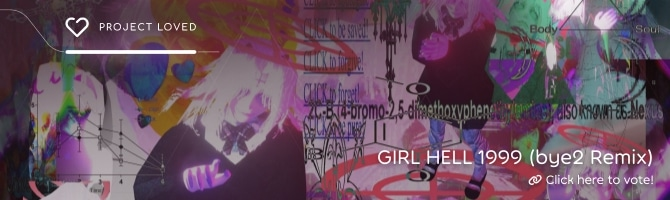

Not enough maps with leaderboards? We're here to make more.

We got another Loved wave before GTA6 — wait, what!? Oh well, we're here anyway! The days are short, the temperatures low (for our Southern friends: the days are long, the temperatures high) and Loved is back! What is this? Who are you? If these are questions you have, let me explain. Project Loved hosts community voting polls each month to decide which beatmaps get added to the [Loved category](https://osu.ppy.sh/beatmapsets?s=loved). All of the maps are chosen by the [Loved captains](https://loved.sh/team) of their respective game modes. Each beatmap banner in this news post will redirect you to the respective poll. Alternatively you can view them all directly on the [Project Loved forum](https://osu.ppy.sh/community/forums/120). The voting process lasts for 10 days, so don't forget to vote! More info can be found on the [wiki page](/wiki/Community/Project_Loved) and [website](https://loved.sh/).

Regarding last round, you can view the results here:

- [Results for osu!](https://osu.ppy.sh/community/forums/topics/2257861?n=2)
- [Results for osu!taiko](https://osu.ppy.sh/community/forums/topics/2257853?n=2)
- [Results for osu!catch](https://osu.ppy.sh/community/forums/topics/2257846?n=2)
- [Results for osu!mania](https://osu.ppy.sh/community/forums/topics/2257835?n=2)

And finally, here are the November 2026 picks. As always, remember that you can test them out in our osu!(lazer) playlists pinned in the comments below!

### Navigation

- **[osu!](#osu!)** ([Download pack](https://packs.ppy.sh/LR116%20-%20Project%20Loved:%20November%202026%20(osu!).zip))
- **[osu!taiko](#osu!taiko)** ([Download pack](https://packs.ppy.sh/LR115%20-%20Project%20Loved:%20November%202026%20(osu!taiko).zip))
- **[osu!catch](#osu!catch)** ([Download pack](https://packs.ppy.sh/LR114%20-%20Project%20Loved:%20November%202026%20(osu!catch).zip))
- **[osu!mania](#osu!mania)** ([Download pack](https://packs.ppy.sh/LR113%20-%20Project%20Loved:%20November%202026%20(osu!mania).zip))

## osu!

The osu! Loved candidates were chosen by [BATBALL](https://osu.ppy.sh/users/15173952), [Chaoslitz](https://osu.ppy.sh/users/3621552), [chiv](https://osu.ppy.sh/users/6701656), [momoyo](https://osu.ppy.sh/users/12469536), [Petal](https://osu.ppy.sh/users/7354729), [Plasma](https://osu.ppy.sh/users/10077431), [Riot](https://osu.ppy.sh/users/4256461), [seros](https://osu.ppy.sh/users/10562853), and [Wispy](https://osu.ppy.sh/users/11106929)!

**[Click here to download all of this round's osu! picks!](https://packs.ppy.sh/LR116%20-%20Project%20Loved:%20November%202026%20(osu!).zip)**

  <video width="95%" controls>
    <source src="https://assets.ppy.sh/project-loved/2026/2026-11-osu-web.mp4" type="video/mp4" preload="none">
  </video>

---

[Sleeping Pola - live on kaeps](https://osu.ppy.sh/beatmapsets/1616052#osu) by [DeviousPanda](https://osu.ppy.sh/users/4966334)\
131 BPM, 3:31 | 6.57★\
*description written by [BATBALL](https://osu.ppy.sh/users/15173952)*

Vote YES if you want to see this map in Loved, [DeviousPanda](https://osu.ppy.sh/users/4966334)'s [live on kaeps](https://osu.ppy.sh/beatmapsets/1616052#osu/3299412)!

This month's pick is no shy of a rhythm map, featuring tons of aim control and finger control patterns, along with a rhythmically challenging song from Sleeping Pola that constantly oscillates between 3/4 and 7/4 time signatures while also providing many different rhythmic subdivisions. Be sure to check this map out if you'd like to improve your finger control skills!

Anyway, this year I'm thankful for rhythm maps, especially after a [certain Canadian mappooler](https://osu.ppy.sh/users/6701656) game-ended this skill set from all tournaments in the last 3 years! Thanks!

Hey guys... Welcome to November, I hope you guys are excited for your monthly mandated OWC map... [osu! World Cup 2021](/wiki/Tournaments/OWC/2021) btw... (sorry for not being ORIGINAL pls dont fire me)

---

)em erif tnod slp LANIGIRO gnieb ton rof yrros (...wtb 1202 puC dlroW !uso ...pam CWO detadnam ylhtnom ruoy rof deticxe era syug uoy epoh I ,rebmevoN ot emocleW ...syug yeH

!sknahT !sraey 3 tsal eht ni stnemanruot lla morf teslliks siht dedne-emag relooppam naidanaC niatrec a retfa yllaicepse ,spam mhtyhr rof lufknaht m'I raey siht ,yawynA

!slliks lortnoc regnif ruoy evorpmi ot ekil d'uoy fi tuo pam siht kcehc ot erus eB .snoisividbus cimhtyhr tnereffid ynam gnidivorp osla elihw serutangis emit 4/7 dna 4/3 neewteb setallicso yltnatsnoc taht aloP gnipeelS morf gnos gnignellahc yllacimhtyhr a htiw gnola ,snrettap lortnoc regnif dna lortnoc mia fo snot gnirutaef ,pam mhtyhr a fo yhs on si kcip s'htnom sihT

 s'adnaPsuoiveD ,devoL ni pam siht ees ot tnaw uoy fi SEY etoV

[cosMo@BousouP - Sekai no Owari ni Aimashou](https://osu.ppy.sh/beatmapsets/472250#osu) by [captin1](https://osu.ppy.sh/users/689997)\
201 BPM, 3:28 | 7.58★\
*description written by [Chaoslitz](https://osu.ppy.sh/users/3621552)*

👋👋 Hey everyone!

[captin1](https://osu.ppy.sh/users/689997) needs no introduction, and cosMo@BousouP needs no introduction either. My pick for this month, [Sekai no Owari ni Aimashou](https://osu.ppy.sh/beatmapsets/472250#osu), mapped by [captin1](https://osu.ppy.sh/users/689997), is a 3-minute, 201 BPM stream map that will definitely burn your tapping fingers. Expect heavy stream density and barely any breaks once the song picks up!

It was submitted 10 years ago, yet it hasn't aged a day. It's still a legitimately challenging stamina test. I gotta be honest here, this completely gaps my tapping skill, but trust me, it's a banger and the leaderboard will be super spicy. Vote YES! 😎

[MikitoP feat. Rib - Tsukiakari](https://osu.ppy.sh/beatmapsets/1569879#osu) by [xLolicore-](https://osu.ppy.sh/users/4525153)\
200 BPM, 3:52 | 7.20★\
*description written by [chiv](https://osu.ppy.sh/users/6701656)*

Corsace Open 2021 | Yaz's Summer Cup 2022 | Australian States Cup 2022 | North American Duo Tournament 2022 | Bangin' osu! Beatdown | Wonderful Everydraft Tournament | 4 Digit World Cup 2024 | mahloola regional cup 3 | Lazer Grand Arena 2025 | osu! Collegiate League: 10th Edition Tier 1

What a beautiful list of tournaments. Wonder what they all have in common? They've selected the greatest NM1 for 7.0★ ever created, [xLolicore-](https://osu.ppy.sh/users/4525153)'s [MikitoP feat. Rib - Tsukiakari](https://osu.ppy.sh/beatmapsets/1569879#osu). This map is *exactly* what you want from this slot — none of this ["Sounan"](https://docs.google.com/spreadsheets/d/136yKaeBtlxHo7o7TQxHflLOw1T67ahn8vF2FTJ0IjFc/edit?rm=minimal&gid=1075626328#gid=1075626328) nonsense we're about to see this week in OWC. It's really #nothingbutjumps and sometimes that's exactly what we all want.

Please rise and vote YES for the greatest aim map of all time.

[LV.4 - Angel dust (2016 Radio Mix)](https://osu.ppy.sh/beatmapsets/2189473#osu) by [Yue Cat](https://osu.ppy.sh/users/12936947)\
170 BPM, 2:17 | 8.82★\
*description written by [chiv](https://osu.ppy.sh/users/6701656)*

Ladies and gentlemen... give a warm welcome to a new king in the Loved scene.

[Yue Cat](https://osu.ppy.sh/users/12936947) makes his debut in Project Loved this month with his take on [LV.4 - Angel dust (2016 Radio Mix)](https://osu.ppy.sh/beatmapsets/2189473#osu). If you haven't seen this map yet, let the CEO of clipfarm, [decaten](https://osu.ppy.sh/users/5645231), show you some [magic](https://www.youtube.com/watch?v=K70ZxPF6zag). There really isn't much else to be said, but just some insane patterns at a ridiculous level for you to enjoy from a glance... or if you wanna get active. 😈

Vote yes for more real maps in Loved!

[frederic - Rererepeat](https://osu.ppy.sh/beatmapsets/1589017#osu) by [n0ah](https://osu.ppy.sh/users/3086393)\
180 BPM, 4:41 | 6.13★, 7.28★\
*description written by [momoyo](https://osu.ppy.sh/users/12469536)*

Hehehello everyone!

[frederic - Rererepeat](https://osu.ppy.sh/beatmapsets/1589017#osu/3245623) is the latest entry in [n0ah](https://osu.ppy.sh/users/3086393)'s iconic map series, with all of its other mapsets already featured in the Loved section!

As per usual, this map features questionable difficulty settings, wacky patterns which are extremely difficult to read, an extremely catchy song, and a beautiful yellow flower in the background — as it is almost like a tradition at this point.

Don't let the relatively slow BPM fool you though: the combination of low AR, unconventional rhythm choice, and perfect stacks is bound to have you miss when you least expect it! This is especially considering the song's agonizingly long 4:32 drain time — it's a true test of the player's consistency and reading.

And if you find yourself not quite up to the challenge yet, don't worry: the mapper's added a difficulty just for you, with higher AR and simplified patterns to get you accustomed to reading-intensive mapping.

To wrap the whole package up nicely, the map also features an awesome custom storyboard created by [Dalibor](https://osu.ppy.sh/users/6886572) and [BramboraSK](https://osu.ppy.sh/users/8543258).

That's all from me, be sure to vote Yes-Yes-YEEEEES if you want your local reading player to eat good this month!!

[Amane (Rolling Contact) - Technical Master](https://osu.ppy.sh/beatmapsets/620081#osu) by [Akali](https://osu.ppy.sh/users/2127359)\
160 BPM, 1:50 | 7.65★\
*description written by [Petal](https://osu.ppy.sh/users/7354729)*

Hello Cats,

Welcome back to November! I haven't decided why yet, but November is the best month to play aim control tech maps, which is why we will be welcoming [Akali](https://osu.ppy.sh/users/2127359) back onto the Loved stage with their map [Amane (Rolling Contact) - Technical Master](https://osu.ppy.sh/beatmapsets/620081#osu/1306932)! 💥

[Akali](https://osu.ppy.sh/users/2127359) is a mapper who needs no introduction to the Loved category. With an overwhelming 18 Loved maps so far, they dominate the community voting every time with their difficult, fun, and innovative maps. This one in particular features a lot of *Technical* cut streams and flow-heavy aim control patterns that are very difficult to *Master*. (I'm sorry.)

Please vote yes if you wish to become a *Technical Master* as well... *plasse vote yes I needd thjis*.

[DJ SHARPNEL - Mmmmmmm](https://osu.ppy.sh/beatmapsets/189971#osu) by [Lokovodo](https://osu.ppy.sh/users/2154081)\
192.9 BPM, 4:23 | 9.41★, 9.93★\
*description written by [Plasma](https://osu.ppy.sh/users/10077431)*

For this month, I've chosen to delve back into the mid-2010s, with [Lokovodo](https://osu.ppy.sh/users/2154081)'s mapset of [DJ SHARPNEL -  Mmmmmmm](https://osu.ppy.sh/beatmapsets/189971#osu)!

Back then, maps of this astounding difficulty were few and far between, with the best of the best getting FCs on only a few 7★ maps around the time this map got uploaded. Despite this, Lokovodo's "BERZERK" series was a hit with maps like [TRIGGER\*HAPPY (Hommarju Remix)](https://osu.ppy.sh/beatmapsets/171815#osu) getting lots of attention throughout the years.

*Mmmmmmm* is the second installment of this series, and it hits you just as hard with plenty of corner jumps as well as spacing that progressively increases as the map plays out, capping out with triples and streams that span across your entire screen consistently.

With plays like [Cookiezi](https://www.youtube.com/watch?v=8JimXSBCNmc)'s and [Doomsday](https://www.youtube.com/watch?v=7pEOthhllB0)'s giving this map a spotlight over 10 years ago, it's about time this map gets to settle in the Loved section after so long. If you want to see how players nowadays fare with a classic like this, be sure to vote Yes!

[Femtanyl - GIRL HELL 1999 (bye2 Remix)](https://osu.ppy.sh/beatmapsets/2468634#osu) by [oatmilk](https://osu.ppy.sh/users/16516525)\
172 BPM, 3:51 | 7.41★\
*description written by [Riot](https://osu.ppy.sh/users/4256461)*

Genius mapper [oatmilk](https://osu.ppy.sh/users/16516525) is back with another one of their crazy creations, this time bringing us [femtanyl - GIRL HELL 1999 (bye2 Remix)](https://osu.ppy.sh/beatmapsets/2468634#osu/5405861)!

This big-circle, 7/4 alt-tech monstrosity is probably one of the most interesting takes on dense mapping I've seen in a long time. Between the constant streams of notes, unusual rhythms, and patterns that somehow manage to make sense despite how ridiculous they look, [oatmilk](https://osu.ppy.sh/users/16516525) has put together something that really stands out. The map is incredibly demanding on your reading, especially with how much is going on at once, but that's also what makes it so satisfying when you actually manage to hit everything. Pair that with a song that's already pretty insane on its own, and you've got a map that feels like nothing else out there.

This map was also featured in **[OWC 2025](/wiki/Tournaments/OWC/2025)**. Despite November already having its monthly mandated OWC map nominated for Loved (thanks, BATBALL), I do think this beatmap is unique and deserves its nomination.

If you think this chaotic masterpiece deserves a spot in the Loved section, make sure to cast your vote for **YES**!

[kiraku - connection](https://osu.ppy.sh/beatmapsets/1317565#osu) by [Halgoh](https://osu.ppy.sh/users/4109923)\
175 BPM, 2:21 | 6.19★\
*description written by [seros](https://osu.ppy.sh/users/10562853)*

*Wooowwww*, you again?

Well, yes, [Halgoh](https://osu.ppy.sh/users/4109923) does deserve more spots here, this time with a hood classic: [kiraku - connection](https://osu.ppy.sh/beatmapsets/1317565#osu)!

Ahead of his time and arguably creating a style of his own, [Halgoh](https://osu.ppy.sh/users/4109923) is back this month with an awe-inspiring slider-only tech map.

Some say this map marked the moment he solidified his style. Known for distinctive slider shapes that incorporate movement and slider velocity so neatly that you feel silky-smooth dancing through them, [Halgoh](https://osu.ppy.sh/users/4109923) is in a league of his own. Not to mention his incredible hitsounding capabilities, providing an extra layer of enjoyment above this drum & bass track. Be aware that the abnormal rhythm at the end of the song may throw you off, but let's see that as a challenge!

Let's give one of our game's tech mapping greats some love (vote YES)!!!!

[Junko Ohashi - In Your Lovin'](https://osu.ppy.sh/beatmapsets/1096881#osu) by [Lesjuh](https://osu.ppy.sh/users/44308)\
176.75 BPM, 3:08 | 5.35★\
*description written by [Wispy](https://osu.ppy.sh/users/11106929)*

Do you yearn for the older generations of beatmaps on this game? I've got you covered with a blast from the past tune, charted by someone familiar with the antiquated eras of this game, but in a modern era...

Please welcome [Lesjuh](https://osu.ppy.sh/users/44308)'s map of [Junko Ohashi - In Your Lovin'](https://osu.ppy.sh/beatmapsets/1096881#osu/2292051) to the stage! You will be met with their signature style upon playing through the map, except for some key differences. The presence of more slider velocity changes throughout the map makes parsing some of the patterns tricky, on top of the somewhat large aim requirement that's needed for a lot of the tricky jumps and angles. There can also be a few stacks here and there strewn about, ready to test your reading and cursor control at a moment's notice!

Give the love some love by voting this into Loved status through Project Loved! ❤️

## osu!taiko

The osu!taiko Loved candidates were chosen by [Eriha](https://osu.ppy.sh/users/16320311), [Horiiizon](https://osu.ppy.sh/users/8071438), [nevqr](https://osu.ppy.sh/users/14269506), [rloseise](https://osu.ppy.sh/users/6793778), and [YonGin](https://osu.ppy.sh/users/7109317)!

**[Click here to download all of this round's osu!taiko picks!](https://packs.ppy.sh/LR115%20-%20Project%20Loved:%20November%202026%20(osu!taiko).zip)**

  <video width="95%" controls>
    <source src="https://assets.ppy.sh/project-loved/2026/2026-11-drums-web.mp4" type="video/mp4" preload="none">
  </video>

---

[Shiggy Jr. - Oyasumi (cexiria remix)](https://osu.ppy.sh/beatmapsets/1668584#taiko) by [KMYK\_](https://osu.ppy.sh/users/9687503)\
230 BPM, 2:13 | 5.97★\
*description written by [Eriha](https://osu.ppy.sh/users/16320311)*

Since its upload four years ago, [Shiggy Jr. - Oyasumi (cexiria remix)](https://osu.ppy.sh/beatmapsets/1668584#taiko) mapped by [KMYK\_](https://osu.ppy.sh/users/9687503) has been a favorite among players who love multi-game and high-BPM tracks. It has gained popularity for its addictive combination of music and note placement.

At first glance, it might seem like just another high-BPM map, but the doublets timed to the beep sounds and the finisher spam in the latter half present a level of difficulty that holds up even in today's competitive scene, making this map particularly well suited for practicing those elements!

To all of you playing late at night, why not vote **yes** and then play *Oyasumi* to say goodnight to the game client? ...Zzz

[Aire - Get Down](https://osu.ppy.sh/beatmapsets/2362517#taiko) by [Waribashi](https://osu.ppy.sh/users/2250574) and [layxa](https://osu.ppy.sh/users/14800030)\
150 – 210 BPM, 2:34 | 7.14★, 7.76★, 8.34★, 8.85★, 9.60★\
*description written by [rloseise](https://osu.ppy.sh/users/6793778)*

For this month, here's one of taiko's most wanted beatmaps!

[Aire - Get Down](https://osu.ppy.sh/beatmapsets/2362517#taiko/5092985) is two of the biggest names in speedtech, [Waribashi](https://osu.ppy.sh/users/2250574) and [layxa](https://osu.ppy.sh/users/14800030), coming together and mapping at their best. This map's addictive bursts and flow make it incredibly memorable and a favourite of many players. Try to perfect your accuracy or push your fingers to their limits with rates from 150 up to 210 BPM!

If you want to see this map Loved as much as I do, get down to the voting page and hit "Yes" now!

[403 - Southern Cross](https://osu.ppy.sh/beatmapsets/1914925#taiko) by [6\_9](https://osu.ppy.sh/users/2998248)\
171.12 BPM, 3:38 | 5.61★\
The \[Jal hae bo ryum ^\_^;; (drain time under 3:00 zz)\] difficulty is *not* being nominated for Loved.\
*description written by [YonGin](https://osu.ppy.sh/users/7109317)*

What is it like when you turn on the [Random mod](/wiki/Gameplay/Game_modifier/Random_(lazer)) on osu!(lazer)? Here is a perfect Random mod simulator! [Southern Cross](https://osu.ppy.sh/beatmapsets/1914925#taiko/3950563) is the origin of the toxic stream series by various Korean players, including [6\_9](https://osu.ppy.sh/users/2998248) and [NaNaHiDa](https://osu.ppy.sh/users/30114023). It features stream patterns that you will never expect, and it has its own aura and charm that can only be found in this series — a perfect map for anyone who is into awkward pattern reading.

**Vote yes NOW** if you want to see this style of maps in Loved!

[Various Artists - Thugpiece Black Pack](https://osu.ppy.sh/beatmapsets/1909975#taiko) by [Alsael](https://osu.ppy.sh/users/13938746)\
98 – 291 BPM, 2:51 | 2.27★ – 6.72★\
The \[Magic Handshake\] difficulty is *not* being nominated for Loved.\
*description written by [nevqr](https://osu.ppy.sh/users/14269506)*

**CLIP MJ 82 BACK IN HIS PRIME**

For this month's Project Loved, [Alsael](https://osu.ppy.sh/users/13938746) brings you a full spread of hip-hop and rap songs to chew on!

Offering 8 diffs from 1 to almost 7 stars, everyone will find a difficulty tailored to their skill level and even favourite skill set. Streams, speed, short bursts? This set's got it all. Accessibility is key in Loved maps and there's a reason why this pack has racked up a playcount just shy of 2 thousand!

Make sure to vote **yes** if you'd like to see this map Loved!

[Amanogawa Converter - Never play me](https://osu.ppy.sh/beatmapsets/2354618#taiko) by [ZTH](https://osu.ppy.sh/users/5258461)\
170 BPM, 2:50 | 6.51★\
*description written by [Horiiizon](https://osu.ppy.sh/users/8071438)*

Please ignore the title of this map, as you are definitely going to want to play [Amanogawa Converter - Never play me](https://osu.ppy.sh/beatmapsets/2354618#taiko/5069528) mapped by [ZTH](https://osu.ppy.sh/users/5258461), mapped for the gimmick slot in the [osu!taiko World Cup 2025 Finals](/wiki/Tournaments/TWC/2025#finals). *Never play me* features extreme and varied SVs that test reading on all fronts, including fast SV increases and decreases, extreme overlaps and cut streams made especially difficult to read due to intricate and difficult patterns including a constant mix of 1/6 and 1/8!

Definitely play me and vote yes if you enjoyed! 🐱💣

## osu!catch

The osu!catch Loved candidates were chosen by [Jakkubon](https://osu.ppy.sh/users/3396013), [LaviSorrow](https://osu.ppy.sh/users/9966768), [MILK\_16](https://osu.ppy.sh/users/9137627), and [Natsuko](https://osu.ppy.sh/users/8266817)!

**[Click here to download all of this round's osu!catch picks!](https://packs.ppy.sh/LR114%20-%20Project%20Loved:%20November%202026%20(osu!catch).zip)**

  <video width="95%" controls>
    <source src="https://assets.ppy.sh/project-loved/2026/2026-11-fruit-web.mp4" type="video/mp4" preload="none">
  </video>

---

[Hyadain - Enemy Appearance!](https://osu.ppy.sh/beatmapsets/1915794#fruits) by [Enjuxx](https://osu.ppy.sh/users/10727985)\
170 BPM, 1:07 | 10.14★\
*description written by [MILK\_16](https://osu.ppy.sh/users/9137627)*

Hyperwalks, hard or easy?

This month, we bring you one of [Enjuxx](https://osu.ppy.sh/users/10727985)'s most fun and popular maps in the Loved section.

For the hyperwalk lovers, the name [Enemy Appearance!](https://osu.ppy.sh/beatmapsets/1915794#fruits/3952444) will be familiar to you. This map focused on hyperwalks boasts fun and demanding patterns which will put your stamina and precision to the test. It will make you eager to try again and improve your score on the leaderboard.

Enough talk, go play the map! If you'd like to see more maps like this, please support it with a positive rating.

[Juggernaut. - Revenant](https://osu.ppy.sh/beatmapsets/1457736#fruits) by [Jemzuu](https://osu.ppy.sh/users/7890134)\
210 BPM, 3:05 | 7.16★\
*description written by [Natsuko](https://osu.ppy.sh/users/8266817)*

Does [Revenant](https://osu.ppy.sh/beatmapsets/1457736#fruits/2995853) even need an introduction at this point?

If you've been around the osu!catch tournament scene for a while, you've probably seen this map more times than you can count. [Revenant](https://osu.ppy.sh/beatmapsets/1457736#fruits/2995853) has been picked in so many tournaments over the years that it's honestly hard to keep track of them all!

Mapped by [Jemzuu](https://osu.ppy.sh/users/7890134) back in 2021, [Revenant](https://osu.ppy.sh/beatmapsets/1457736#fruits/2995853) is a tech map with plenty of mechanical patterns, made around the time he was starting to develop the mapping style he's known for today. It's a pretty challenging map that really shows what his tech mapping is all about.

It even has over 4,000 playcount despite being a Graveyard map, which says a lot about how popular it is.

After all these years of tournament picks, let's finally get it into Loved!

[tn-shi - Cyberfantasia](https://osu.ppy.sh/beatmapsets/2355203#fruits) by [GiGas](https://osu.ppy.sh/users/7300747)\
212 BPM, 2:38 | 7.68★\
*description written by [Natsuko](https://osu.ppy.sh/users/8266817)*

Wanna reach the stars? 🌠

Here's [Cyberfantasia](https://osu.ppy.sh/beatmapsets/2355203#fruits/5071138), mapped by [GiGas](https://osu.ppy.sh/users/7300747)!

[GiGas](https://osu.ppy.sh/users/7300747) is pretty well known for his smooth flow and tight patterns, and you can really see that in this map. [Cyberfantasia](https://osu.ppy.sh/beatmapsets/2355203#fruits/5071138) is all about speed control, with patterns that feel really nice to play, but can be quite tricky to handle.

There's just something about the way [GiGas](https://osu.ppy.sh/users/7300747) maps that makes his stuff so enjoyable, and [Cyberfantasia](https://osu.ppy.sh/beatmapsets/2355203#fruits/5071138) is no different.

Now let's get this one a spot in Loved, shall we... 🌟?

[Chroma - sink to the deep sea world](https://osu.ppy.sh/beatmapsets/1695393#fruits) by [Story](https://osu.ppy.sh/users/8172283)\
185 BPM, 3:58 | 7.97★\
*description written by [MILK\_16](https://osu.ppy.sh/users/9137627)*

*Brine*..... We all remember that iconic map that for more than a whole generation was seen and played all around the multiplayer lobbies, from which osu!catch legends managed to get amazing scores and conquer said map. Sadly, such an iconic map disappeared.

But today, [Story](https://osu.ppy.sh/users/8172283) comes back to the Loved section bringing un a tribute to [sink to the deep sea world](https://osu.ppy.sh/beatmapsets/1695393#fruits/3464138) from the FA [Chroma](https://osu.ppy.sh/beatmaps/artists/215), inspired by [Rocma](https://osu.ppy.sh/users/566276)'s set, it features a 7.96★ star rating and a versatile playability in which you must be precise, consistent and possess stamina to conquer it. Wiggles, streams, anti-flow, and L-shaped patterns are some of the patterns this masterpiece presents to us, aside from a high AR and a length of almost 4 minutes, you will need nerves of steel if you want to manage an FC.

What are you waiting for to download and try this map? If you liked it and want to see it in the Loved section soon, please give us a positive vote on the survey.

[Crim Nanakusa - Dialnote](https://osu.ppy.sh/beatmapsets/1935722#fruits) by [Sololiquy](https://osu.ppy.sh/users/4350087)\
260 BPM, 1:57 | 4.05★\
The \[hs\] difficulty is *not* being nominated for Loved.\
*description written by [LaviSorrow](https://osu.ppy.sh/users/9966768)*

One of the most recognizable AR 8 slider reading test maps is finally getting its chance to be Loved! [Crim Nanakusa - Dialnote](https://osu.ppy.sh/beatmapsets/1935722#fruits/4000779), originally created as an HD2 pick for the [AxS 8 tournament](https://osu.ppy.sh/community/forums/topics/1689014?n=1), remains one of the biggest accuracy challenges among low-approach-rate beatmaps to this day. Its star rating might be only 4.05★, but don't let that fool you — this map is incredibly difficult to SS, especially with the Hidden mod.

While its patterns might seem relatively simple at first glance, a lot of work went into manually adjusting the droplets appearing throughout the sliders, making this map a truly unique challenge.

A huge shoutout to the creator, [Sololiquy](https://osu.ppy.sh/users/4350087)! We love the unique approach you bring to every beatmap you create!

[TERRA - Alfarshear](https://osu.ppy.sh/beatmapsets/33989#fruits) by [Kuzino](https://osu.ppy.sh/users/158552)\
170 BPM, 1:50 | 5.57★\
*description written by [Jakkubon](https://osu.ppy.sh/users/3396013)*

Any old mapping enjoyers here?

I want to present to you [Alfashear](https://osu.ppy.sh/beatmapsets/33989#fruits/110597) mapped by [Kuzino](https://osu.ppy.sh/users/158552). Known for his old mapsets that are named 4Q or 2Q, mostly from 2011 era (some of which are already Loved). These maps feature tight spacing combined with micromovements such as triples and wiggles. This map is no exception.

Long story short, this map has relatively low density and consistently edgy spacing throughout, in conjunction with triplets and wiggles that require movement rather than standing still. If you thought the rhythm is the usual 1/2 with 1/4s like most of these maps, then you are wrong! This map contains one 2B slider and a few 1/4 triplets with 1/8 repeaters, so be aware of that.

If you really want to play this nostalgic map with leaderboards, don't forget to vote yes during voting!

## osu!mania

The osu!mania Loved candidates were chosen by [BKwind](https://osu.ppy.sh/users/8900975), [Carpihat](https://osu.ppy.sh/users/10085090), [elexire](https://osu.ppy.sh/users/9206093), [ExNeko](https://osu.ppy.sh/users/7590894), [myucchii](https://osu.ppy.sh/users/10072733), [Nepijin](https://osu.ppy.sh/users/11734610), [Oceanus](https://osu.ppy.sh/users/9164100), [Paturages](https://osu.ppy.sh/users/1375479), [Silhoueska Elze](https://osu.ppy.sh/users/11517895), and [Yuiesta](https://osu.ppy.sh/users/13953619)!

**[Click here to download all of this round's osu!mania picks!](https://packs.ppy.sh/LR113%20-%20Project%20Loved:%20November%202026%20(osu!mania).zip)**

  <video width="95%" controls>
    <source src="https://assets.ppy.sh/project-loved/2026/2026-11-mania-web.mp4" type="video/mp4" preload="none">
  </video>

---

[DJ Majokko Mirakurun - Wine House](https://osu.ppy.sh/beatmapsets/1509132#mania) by [denzeljr](https://osu.ppy.sh/users/14335907)\
175 BPM, 2:39 | 4.45★\
*description written by [Paturages](https://osu.ppy.sh/users/1375479)*

Eeny, meeny, miny, moe. [For](https://osu.ppy.sh/beatmapsets/1716820) which [set](https://osu.ppy.sh/beatmapsets/1613512) of [*WYNEHOUSE*](https://osu.ppy.sh/beatmapsets/1509132) should I go?

Many SV mappers either draw inspiration from or straight up come from [other games](https://store.steampowered.com/app/980610/Quaver/). That inspiration has brought us this style of nightcore maps, which went through a phase of strong popularity. One might argue that the nightcore style is still popular to this day.

To be honest, I get it. They're incredibly catchy, both in terms of how visually flashy they are and how the strong nightcore beats sound at this very specifically chosen 175 BPM.

So, why this one set in particular among the 3 popular ones?

All 3 sets do have pretty much the same general approach, but vary in patterns and execution. [denzeljr](https://osu.ppy.sh/users/14335907)'s rendition was the one I liked the most, and raw statistics also seemed to follow my lead. Or maybe I was led by statistics to think that. I don't really know.

Anyways, *WYNEHOUSE (Nightcore Mix)* is a pretty interesting reading challenge: lots of stutters, lots of repetitive and intuitive denormalization, and fairly physical patterning as far as SV usually goes. I think a lot of people should be able to grasp the concepts in a run or two. Getting good accuracy, however, is another type of grind that requires you to anchor yourself both visually and aurally to keep the necessary stability to execute the map properly.

Insert the usual call to vote in the thread here! But also, if you have anything to say not only about this set, but also about the *other* candidate sets of the same song, feel free to share it. Merging all 3 sets into one Loved set is not something I'd personally be against, but it would require proper coordination... For now, let's push for this one.

[Jeff Williams feat. Casey Lee Williams - Armed and Ready](https://osu.ppy.sh/beatmapsets/1530510#mania) by [wolfyou](https://osu.ppy.sh/users/12565254)\
125 – 156.25 BPM, 5:12 | 5.60★ – 6.83★\
*description written by [Nepijin](https://osu.ppy.sh/users/11734610)*

You feel that pulse? The stadium is shaking. I'll get out of your way and hope that you're [Armed and Ready](https://osu.ppy.sh/beatmapsets/1530510#mania/3148459) to play some trilly jumpstreams charted by none other than [wolfyou](https://osu.ppy.sh/users/12565254)!

Although [wolfyou](https://osu.ppy.sh/users/12565254) has been around for a while, it seems as though his well-deserved recognition is only starting to surface as of recent with his appearances in [Abstraction Cup](https://osu.ppy.sh/community/forums/topics/2186038?n=1) and the [MWC 4K 2026](/wiki/Tournaments/MWC/2026_4K)!

To be honest, I'm stoked about him gaining traction! He charts songs like [Armed and Ready](https://osu.ppy.sh/beatmapsets/1530510#mania/3148459) into such bangers that when you first play it, you'll quickly realize that it's far from a conventional, straightforward jumpstream chart. Ranging from 250-312 BPM with rates lasting over four minutes, I strongly advise that your finger control and stamina be in prime form to navigate the littered anchors and heavy trills that make up this stamina gauntlet.

Personally, I can't manip jumpstreams. Even if I try, I just can't. But this chart, since its creation, has made the playing field feel level enough that I feel empowered to say, "If I can't manip, then nobody can."

I think that says a lot, so I'm not sure if I can say anything more.

So, the stage is set and the strength to grow so much more is yet to be found. Let's take a step forward and vote for this map!

[Camellia - S.A.T.E.L.L.I.T.E. (Cut Ver.)](https://osu.ppy.sh/beatmapsets/2033611#mania) by [ade\_maine](https://osu.ppy.sh/users/14814632)\
127.5 – 172.5 BPM, 2:54 | 6.24★ – 8.09★\
*description written by [Oceanus](https://osu.ppy.sh/users/9164100)*

Chordjack patterns have long been loved by the osu!mania 4K community for their overwhelming density built around intuitive rhythms. Despite their high density, even slight adjustments to note placement can change how much strain they put on your hands, creating a different kind of sensory enjoyment through the way each pattern feels to play.

Among the many chordjack mappers, I'm really happy to introduce [Camellia - S.A.T.E.L.L.I.T.E.](https://cametek.bandcamp.com/track/s-a-t-e-l-l-i-t-e) by [ade\_maine](https://osu.ppy.sh/users/14814632), one of the mappers particularly well-known in the community for his distinctive style.

[S.A.T.E.L.L.I.T.E.](https://cametek.bandcamp.com/track/s-a-t-e-l-l-i-t-e) is a track from [heart of android](https://cametek.bandcamp.com/album/heart-of-android), an acclaimed album by [Camellia](https://cametek.jp/), a vocaloid producer and composer who has contributed countless songs to the osu! community.

This EDM Hardcore track revolves around a story in which humanity, now living on a planet where stars are no longer visible, has come to wish upon the very concept of stars, while androids instead make their wishes upon satellites that blink with signals, rather than invisible entities.

The song has also been featured in the rhythm game Phigros and is included in the [osu! Featured Artist list](https://osu.ppy.sh/beatmaps/artists/31).

The song's overall composition follows a three-beat, waltz-like rhythm, combining drums and vocals.

[ade\_maine](https://osu.ppy.sh/users/14814632)'s chart faithfully follows this musical structure, expressing the prominent three-beat rhythm alongside the drums throughout the map. What I find particularly unique is how the sections emphasizing vocals are distinguished not through changes in density, but through the use of anchor patterns.

Despite the high pattern density, this approach gives each section a clearly distinguishable identity.

Additionally, the occasional unconventional Technical sounds characteristic of [Camellia](https://cametek.jp/)'s music are represented through alternating minijack and jumptrill patterns, adding variety to the map. Much like how lyrical music can evoke a wide range of emotional changes, the subtle differences in pattern composition allow players to experience a variety of sensations even within such extremely dense patterns. Considering these qualities, I personally think this is a really well-crafted chordjack chart.

If you'd like to experience more new and delightful varieties of chordjack in Loved, why not consider voting for this map?

[Camellia - overcomplexification ("Quaternion" Long ver.)](https://osu.ppy.sh/beatmapsets/2058875#mania) by [0DZ0](https://osu.ppy.sh/users/28156707)\
171 – 228 BPM, 2:54 | 4.87★ – 6.19★\
*description written by [Silhoueska Elze](https://osu.ppy.sh/users/11517895)*

[0DZ0](https://osu.ppy.sh/users/28156707) has been a staple of technical charts as of recent. Coming from the FFR scene, there has been many charts that showcase their technical ability, and [overcomplexification ("Quaternion" Long ver.)](https://osu.ppy.sh/beatmapsets/2058875#mania/4925392) is certainly no exception.

Right off the bat, you are already thrown with technical bursts and rolls that can throw you off. Now imagine that, but add minijacks and anchors into the mix, making everything significantly more challenging, especially since these patterns mixed altogether can really make your hands be very unstable, leading to either a string of bad judgments, or worse, misses. This chart really tests how good your technical fundamentals are, and it goes to show why this was selected for the [MWC 4K 2023 Finals round](https://osu.ppy.sh/beatmapsets/2058875#mania/4925388), being slotted in for RC7, which is reserved for mixed technical charts.

If 1.0x is too hard for you, rates up to 0.9x are present, so that you can practice hitting the difficult patterns that are present in this chart. However, if you want a more difficult challenge, there are also rates up to 1.2x, in which difficulties with increments of 0.5x above (and below, actually), are there. One thing's for sure though, regardless of the rate, accuracy will be extremely difficult, as an OD of 8.1 means that you need to really hit those notes properly, otherwise you will lose your accuracy due to bad judgments.

Overall, this chart is a great showcase of [0DZ0](https://osu.ppy.sh/users/28156707)'s ability to create tech charts that really test you from start to finish. Breaks are present, but are scarce, and you still have to nail those parts if you really want to keep a very high score.

Let's not overcomplicate and overthink our vote in this, shall we? Vote yes, and support more charts like this in return!

[Spire - Libidinem](https://osu.ppy.sh/beatmapsets/2055280#mania) by [\[Crz\]FolAH1217](https://osu.ppy.sh/users/6232458)\
150 BPM, 3:54 | 5.67★, 6.10★\
*description written by [elexire](https://osu.ppy.sh/users/9206093)*

Despite how well known [\[Crz\]FolAH1217](https://osu.ppy.sh/users/6232458) is for their HB3 charts, this is somehow the first of theirs to go up for Loved.

Much different and more abrasive than their last two nominations, [Libidinem](https://osu.ppy.sh/beatmapsets/2055280#mania/4514522) was, as you could guess from the last sentence, an HB3 in the [4K MWC 2023](/wiki/Tournaments/MWC/2023_4K) Semifinals on the cut difficulty. It's safe to say that this chart can speak for a good majority of the HB3 charts FolAH has charted for both MWC and other tournaments, consisting of patterns nothing short of brutal, paired with tough LN graces and bursts all over. It really feels as if you don't get any breathing room with how demanding it gets, which is possibly one of the big reasons why it was considered one of the harder maps in the pool.

It's also worth mentioning that shortly after, the full version of the song was charted, so those looking for something even more stamina-draining are welcome to give their fingers a run for their money. Ultimately, if you're a fan of unorthodox charting, it's in your best interest to give one of the greatest to ever do it your vote.

[aran - L.F.O](https://osu.ppy.sh/beatmapsets/1375934#mania) by [stupud man](https://osu.ppy.sh/users/2141612)\
180.02 – 234.03 BPM, 2:00 | 4.37★, 4.55★, 4.73★, 5.08★, 5.41★\
*description written by [Silhoueska Elze](https://osu.ppy.sh/users/11517895)*

[stupud man](https://osu.ppy.sh/users/2141612) is known to create charts for various skillsets, whether it is RC, LN, or even HB. Seeing that this was featured in the [Quarterfinals Mappool for MWC 4K 2021](/wiki/Tournaments/MWC/2021_4K#quarterfinals) as the LN1 (density at the time) pick, it is no surprise that his charts are of good quality.

[L.F.O.](https://osu.ppy.sh/beatmapsets/1375934#mania/3173028) is a chart that tests your skills on LN density. When we say LN density, these charts tend to not be technical in nature; however, they require your ability to play straightforward LN patterns with varying lengths (some long, some short) in an accurate and consistent manner. [L.F.O.](https://osu.ppy.sh/beatmapsets/1375934#mania/3173028) exemplifies that very well, as it does not have many grace notes or minijacks, but instead, has a lot of LN patterns that mimic jumpstream, meaning that you should expect a lot of your trilling ability to be tested in here as well.

However, unlike regular jumpstream, you also have to consider your releases, since that this is still an LN chart at the end of the day. What makes this chart challenging is the amount of focus you need to have all throughout, as even in the break sections, there are LNs that can still throw you off and force you to drop bad judgments. As for the LN density sections, as mentioned before, expect a mix of long and short LNs, where you have to read them carefully so that you can keep your accuracy afloat. Not to mention, there are a couple of sections where you have to make sure that you hit the rolls properly, as those sneaky parts could give you a miss or two if you are not careful.

There are different kinds of approaches here, one of which where you try to get lesser 200s but sacrifice ratio, or get a better ratio but get more 200s and other bad judgments. Obviously, the ideal is getting a great ratio and no bad judgments at all; however, these kinds of scores are reserved for the best of the best players. Thankfully, this chart is at OD 7, which was the standard for LN charts in tournaments at the time. This means that it is a little forgiving when it comes to 200s, but it does not mean that you shouldn't focus anymore. With the nature of this chart, you really need to make sure that you can keep a consistent rhythm, hit the patterns correctly, and release at the right moment.

Knowing how much the playerbase has evolved, I know that we are going to see crazy performances all around. Starting from 1.0x up to 1.3x, players have a wide range of rates to see which one they could challenge themselves among the rest of the world. LN continues to become a skill set that more people are getting the hang of, and players will definitely be able to sharpshoot this to the best of their abilities.

Do you think you have what it takes to reach the top of the top on LN density charts like this? Do you want to see more charts like this? Then I think you should show your support for this chart and give this a favorable vote!

[Jeff Williams feat. Casey Lee Williams and Lamar Hall - Ignite](https://osu.ppy.sh/beatmapsets/2253770#mania) by [MyZterioN-](https://osu.ppy.sh/users/8521723) and [\[Crz\]Crysarlene](https://osu.ppy.sh/users/5492871)\
291 BPM, 4:01 | 6.42★\
*description written by [Nepijin](https://osu.ppy.sh/users/11734610)*

Bros, I don't know if I can admit this in public, but I think I found my theme song. Yet it's so much more notable watching [MyZterioN-](https://osu.ppy.sh/users/8521723) and [\[Crz\]Crysarlene](https://osu.ppy.sh/users/5492871) team up and [Ignite](https://osu.ppy.sh/beatmapsets/2253770#mania/4793964)!

Charted for the LN1 slot of the [MWC 4K 2024](/wiki/Tournaments/MWC/2024_4K) Grand Finals, this map gained such an infamous reputation upon release. Speaking of releases, I think we all know what this map is known for by now! Much like [the other RWBY song](https://osu.ppy.sh/beatmapsets/1530510#mania/3148459) in this month's loved pool, this one is seriously really unconventional in the sense that it's way different from the LN1 grand finals charts we've seen coming out of MWC.

If we deconstruct the chart down to the pure hit notes, we stray away from broken streams and welcome in some tricky bursts! But the changes don't stop there, (un)fortunately. Taking the releases back into account, we find 1/12 flams scattered within staggers and what I like to call references; those releases that occur on the same snap as other hit notes, yet doesn't exactly play like density patterning.

With the presence of this pattern, you can "reference" the release timing with the hit notes and physically snap to the correct timing like you can with LN2 maps. Since they usually follow up staggers in this particular chart, it gives rise to the classic timing hell feel, forcing you to read these changes and adjust your finger control on the spot. But with the aforementioned changes above, it feels like this classic feel has been revised. Yet I can't say this is a bad thing at all! These changes are so creative that it results in such a fun and unique chart! But if you don't have insanely strong long note fundamentals, you'll watch yourself suffer and watch your accuracy [Ignite](https://osu.ppy.sh/beatmapsets/2253770#mania/4793964) (into flames).

Whether you annihilate charts or charts usually devastate you, it doesn't matter if you can't adjust to these timing flames. If you feel ruthless, give [Ignite](https://osu.ppy.sh/beatmapsets/2253770#mania/4793964) a highly anticipated shot into Loved and vote!

[Suzuki Konomi - One day sky](https://osu.ppy.sh/beatmapsets/1922188#mania) by [Enie](https://osu.ppy.sh/users/11976455) and [Emida](https://osu.ppy.sh/users/11937683)\
185 BPM, 4:38 | 10.07★\
*description written by [ExNeko](https://osu.ppy.sh/users/7590894)*

More 10-star maps are coming our way, but this time they're not the brutal kind. They're the kind that everybody can actually enjoy!

[Enie](https://osu.ppy.sh/users/11976455) and [Emida](https://osu.ppy.sh/users/11937683) are both mappers with serious street cred in the 7K community, so chances are you've already played some of their other maps. Even so, trust me, you do not want to sit this one out. It's built from a whole bunch of LN rolls, sprinkled with some easy chordstreams and a dash of inverse patterns. These simple, straightforward patterns won't pose too much of a challenge, and they all have a really comfortable flow. On top of that, the map sits at OD 0, which means you get to kick back and soak it all in instead of battling to nail every LN release. Honestly? This might just be the kind of map people dream of seeing in the Loved category.

So, if you're worn out from all those tough maps lately and you're craving something to chill with, then let's see your votes!

[Lily Chen - GG Bond](https://osu.ppy.sh/beatmapsets/2248110#mania) by [tangjinxi](https://osu.ppy.sh/users/2270126)\
140 BPM, 3:26 | 6.24★, 7.97★\
*description written by [BKwind](https://osu.ppy.sh/users/8900975)*

Guess who's back? This month, our old friend [tangjinxi](https://osu.ppy.sh/users/2270126) returns with another LN treat: [Lily Chen - GG Bond](https://osu.ppy.sh/beatmapsets/2248110#mania), featuring two difficulties!

If you have a soft spot for 7K LN maps, chances are you're already familiar with tangjinxi's mapping style. That nostalgic O2Jam flavor never loses its charm, and it's always a pleasure to see it return for another round. With two difficulties to choose from, there's more than one way to get your LN fix!

For me, the nostalgia goes beyond the patterns. GG Bond was part of my childhood, and hearing this song again brings those memories right back. Whether you're here for tangjinxi's maps, the O2Jam nostalgia, or just for *GG Bond*, give this set a try and VOTE YES!!!

[Laur - Chimi Moryo -Bakko-](https://osu.ppy.sh/beatmapsets/2134141#mania) by [Leeju](https://osu.ppy.sh/users/18219603)\
200 BPM, 4:17 | 7.52★\
*description written by [Carpihat](https://osu.ppy.sh/users/10085090)*

[Leeju](https://osu.ppy.sh/users/18219603)'s patterns are well known for their distinctive structure and flow. It's been a while since we last nominated one of his maps, so this month we're bringing [魑魅魍魎 -跋扈-](https://osu.ppy.sh/beatmapsets/2134141#mania/4490010) (*Chimi Moryo -Bakko-*) into the spotlight!

This map consists almost entirely of rice, with chordstreams as its main pattern. It also features a fair amount of burst delays and trills. These patterns flow naturally with the song's arrangement. In particular, when Laur's signature repeating 1/4 synths kick in, Leeju makes excellent use of repetitive patterns to turn them into something that feels both intuitive and perfectly suited to the music.

If you enjoy this map, love the music, or are simply a fan of Leeju's mapping, please vote yes!

---

From all of us in the [Project Loved Team](https://loved.sh/contributors), we hope you enjoy the picks from this month! All the beatmaps that pass voting will reach the [Loved beatmap listing](https://osu.ppy.sh/beatmapsets?s=loved) soon™ after the polls end.
 
More info about Project Loved can be found on its [wiki page](/wiki/Community/Project_Loved) and [website](https://loved.sh/). Stop by the new official [forum thread](https://osu.ppy.sh/community/forums/topics/2214637?n=1) or any of the community servers listed at the bottom of the [wiki page](/wiki/Community/Project_Loved) if you have any questions, concerns, or are interested in helping out.

Cheers!

—kadoen
