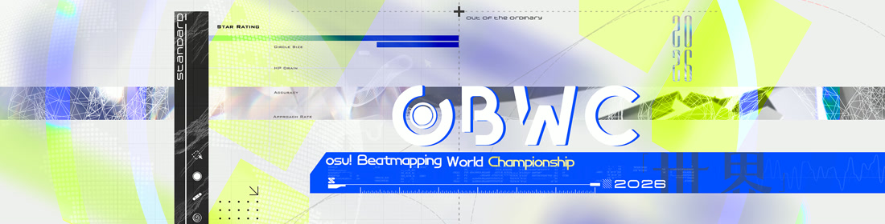
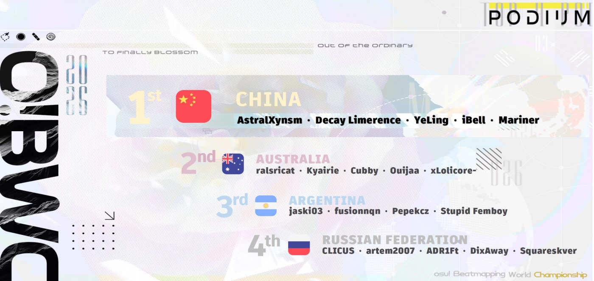
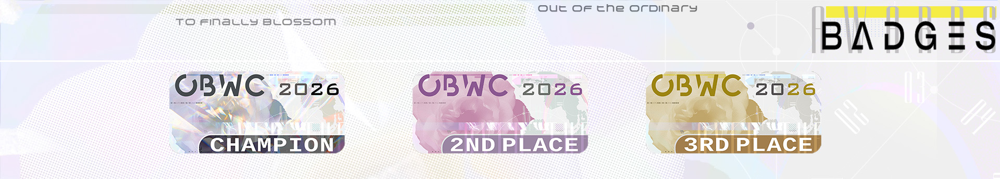
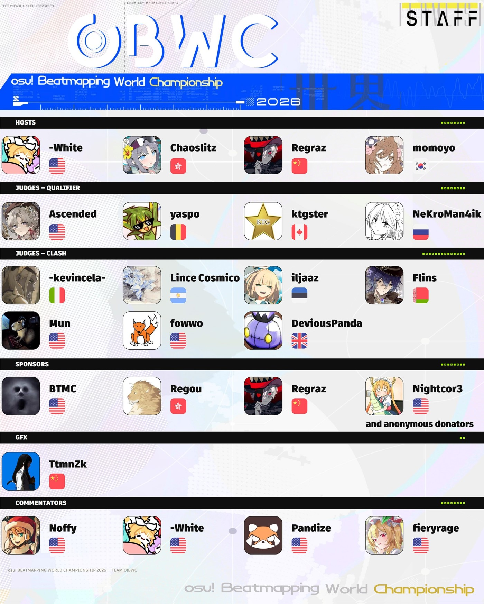

Greetings, osu! community! The [osu! Beatmapping World Championship (o!bwc)](https://osu.ppy.sh/community/forums/topics/2196621) officially [kicked off](https://osu.ppy.sh/home/news/2026-04-18-osu-beatmapping-world-championship-2026) earlier this year. After months of fierce battles, we finally have our winners!

## Summary

o!bwc started, like many competitions, with a qualifier round, in which all registered teams competed for 16 spots in the clash stage. These were followed by four clash rounds: The Round of 16, Quarterfinal, Semifinal and Final. Each clash round consisted of intense head-to-head matchups where only the winners advanced. For full details on the matchups, check out the [o!bwc bracket on Challonge](https://challonge.com/obwc2026) and the [livestream recordings](https://www.youtube.com/@osubwc8023) of each round.

The final stage featured two thrilling matches among the top four teams: ::{ flag=CN }:: China vs. ::{ flag=AU }:: Australia for the championship and ::{ flag=AR }:: Argentina vs. ::{ flag=RU }:: Russian Federation for third place. In a close vote by the judges, Team China triumphed over Team Australia to claim the o!bwc 2026 championship. In another hard-fought battle, Team Argentina defeated Team Russian Federation for third place.

## Map highlights

The o!bwc teams have brought an incredible variety of maps to the community, and who better to share the stories behind these creations than the team members themselves? Let's hear from them about the inspirations and challenges behind these amazing maps!

### [Street - reimei](https://osu.ppy.sh/beatmapsets/2612783) by ::{ flag=CN }:: Team China

    <iframe width="95%" style="aspect-ratio: 16 / 9;" src="https://www.youtube.com/embed/DEsqU3g_vU4" frameborder="0" allowfullscreen></iframe>

<a class="news-chat-quote__colour-no-group" href="https://osu.ppy.sh/users/16022233">AstralXynsm</a>

To be honest, the song for the Semifinals, *[Street](https://osu.ppy.sh/beatmaps/artists/89) - Reimei*, really gave us a headache — a long track with a tight deadline. Because of this, early on we made a deliberate call to build the map around symmetry, gaining efficiency without cutting corners. We also felt the track leaned toward an 8-bit flavor, which axis-aligned patterns suit naturally, and it ended up being the most symmetrical entry we submitted for the entire contest. For the theme, we went back to the album cover the song came from (*Iroha*) — the clouds and mountains led us toward traditional Japanese imagery.

::{ flag=CN }:: [iBell](https://osu.ppy.sh/users/4298072) laid down the symmetric foundation first, and the rest of us built on top of it — the same division of labor we used in the Finals, where we assigned sections based on each member's strengths. Partway through, we found strict horizontals and verticals were growing monotonous, so we brought in arrangements at other angles. Since we're a team that reads and writes Chinese characters, we spelled "明" out of sliders in the middle of the map — the character for "bright", which is one of the two characters in the song title *黎明* (liming). It splits into "日" and "月" (the sun and the moon), bringing us right back to where we started. It was a brilliant experience, and I want to thank all of my teammates — without their hard work, we never would have gotten this far.

### [Otsukisama Koukyoukyoku - Chiriyuku Hana ni Hanamuke o](https://osu.ppy.sh/beatmapsets/2600533) by ::{ flag=AU }:: Team Australia

    <iframe width="95%" style="aspect-ratio: 16 / 9;" src="https://www.youtube.com/embed/zEoFfu8y0yM" frameborder="0" allowfullscreen></iframe>

<a class="news-chat-quote__colour-no-group" href="https://osu.ppy.sh/users/12318332">ralsricat</a>

When we first heard *Chiriyuku*, Cubby immediately took charge in drafting our initial concept of heaven/hell, drawing a lot of inspiration from maimai's *Regulus* and its [MV](https://www.youtube.com/watch?v=klO5qc_Oznw), which was also composed by [Otsukisama Koukyoukyoku](https://osu.ppy.sh/beatmaps/artists/553). With a solid concept in mind, our team decided it would be more interesting to take a chance on this song rather than choosing the likely safer Bitpop / Hi-tech pick. During the mapping phase, ::{ flag=AU }:: [Ouijaa](https://osu.ppy.sh/users/11512824) and ::{ flag=AU }:: [Cubby](https://osu.ppy.sh/users/10914582) collaborated on the map's slider design, focusing mainly on the "heaven" side, while I took on more of the "hell" aspects and some of the larger slider art.

::{ flag=AU }:: [Kyairie](https://osu.ppy.sh/users/10910405) went insane with the hitsounding, even isolating a scream from [another song](https://www.youtube.com/watch?v=ivXQ21xDHfE) for the "jumpscare" spider lily slider at 02:25:494. Meanwhile, ::{ flag=KR }:: [LoliCore](https://osu.ppy.sh/users/6532691) supported us with advice and modding from an outside perspective as we developed the map. Overall, we put a ton of effort into crafting and shaping this map into what it is now, and I'm proud to call it one of our favorite maps this OBWC. See you next year!

### [Frums (unknown "lambda") - 19ZZ](https://osu.ppy.sh/beatmapsets/2623921) by ::{ flag=AR }:: Team Argentina

    <iframe width="95%" style="aspect-ratio: 16 / 9;" src="https://www.youtube.com/embed/sqJJkJ2xch4" frameborder="0" allowfullscreen></iframe>

<a class="news-chat-quote__colour-no-group" href="https://osu.ppy.sh/users/28579947">jaski03</a>

Regarding map 19ZZ, right from the start, we couldn't imagine mapping the opening sections any other way than by maximizing the synthesizer. That's why the sliders seen at the beginning were the very first elements to shape the map; these, along with the "broken clock" pattern (inspired by the song's album art), served as our starting point. We also gravitated (pun intended) toward concepts derived from the lambda constant (half-life), which inspired us to represent space, time, and their infinity. In our minds, Team Russia's map was going to be intensely thematic, and another concept we had tossed around was radiation and nuclear bombs, so we included references to those throughout the map as well.

In the kiai, you can see several of the map's concepts integrated, like the "vector" arrows and the black hole pattern with clock hands (which can also be interpreted as an eye). The beginning and the end are the same, referencing cyclical time — something we tried to represent throughout the map (for instance, in the kiai's second "hourglass", which represents the past and the future, as well as with the infamous flower pattern). We couldn't make it as technically flawless as our opponents did, but we gave it everything we had to put up a fight. Honestly, we were deeply surprised by the outcome, both in terms of the map itself and the final results. We definitely believe we can do better, so we'll keep fighting in the future!

### [Annabel - helical symmetry](https://osu.ppy.sh/beatmapsets/2569925) by ::{ flag=RU }:: Team Russian Federation

    <iframe width="95%" style="aspect-ratio: 16 / 9;" src="https://www.youtube.com/embed/Jg9xR7qM-iw" frameborder="0" allowfullscreen></iframe>

<a class="news-chat-quote__colour-no-group" href="https://osu.ppy.sh/users/12338810">CLICUS</a>

Hello! Here are our comments about "[Annabel](https://osu.ppy.sh/beatmaps/artists/234) - helical symmetry" from qualifiers. The main concept of the map was to give each musical section its own visual language and shape design. The electronic bass is represented by rectangular shapes, the synth by waves, glitches by circles, and the bass guitar by Catmull-based sliders. Each color change in the map also marks a distinct musical concept, helping separate sections while keeping the overall design coherent.

The hitsounds were designed to support the increasing intensity of the map, becoming more prominent as the music builds. As the song progresses, these individual concepts gradually interact with one another to create a more complex visual structure. The final kiai brings all of these concepts together, combining the different shapes and designs into a cohesive final section. Overall, we wanted the map to feel like a visual representation of the song itself, where every musical element has its own identity while remaining part of the same unified composition.

## Prizes

This year, we received a total of **$1,150 USD** of donations from a wide range of sponsors! The top 4 teams get a share of the prize pool, and in addition to cash prizes, badge and contest points are also awarded as detailed below.

| Placement | Team | Awards |
| :-: | :-- | :-- |
| 1st | ::{ flag=CN }:: China | **40% of the prize pool**, profile badge, 3 [contest points](/wiki/Contests/Contest_points) |
| 2nd | ::{ flag=AU }:: Australia | **30% of the prize pool**, profile badge, 2 [contest points](/wiki/Contests/Contest_points) |
| 3rd | ::{ flag=AR }:: Argentina | **20% of the prize pool**, profile badge, 1 [contest point](/wiki/Contests/Contest_points) |
| 4th | ::{ flag=RU }:: Russian Federation | **10% of the prize pool** |

## Closing remarks

Over the course of the contest, more than 50 teams contributed almost 100 beatmaps, all sourced from the osu! Featured Artist library. If you'd like to explore more of these awesome creations, feel free to [browse the beatmap listing](https://osu.ppy.sh/beatmapsets?q=obwc26&s=any)! As we look ahead to the next o!bwc, we'd love to hear from you. Share your thoughts, suggestions, or ideas through our [feedback form](https://docs.google.com/forms/d/e/1FAIpQLSd4yTPa5JHnILVT9EEvMhCEhvtFfXwugYtqSonofOxGMnYQTA/viewform), and don't forget to join our [Discord server](https://discord.com/invite/QGzz3n655u) for future updates!

Congratulations once again to the winning teams! We also extend our heartfelt thanks to all participants for their creativity and passion, as well as to the judges, helpers and generous sponsors who made this contest possible.

---

See you again next time!

—momoyo, Chaoslitz, -White & Mafumafu
