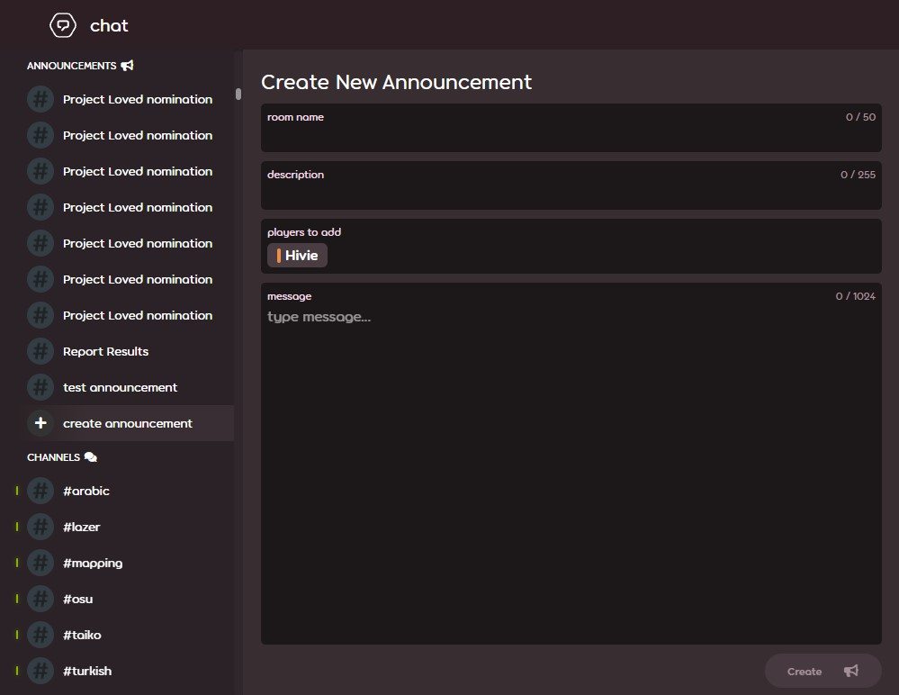

---
tags:
  - announce
  - announce usergroup
  - announce user group
  - объявления
---

# Объявления

**Объявление** — это особый тип сообщений, предназначенный для массовой рассылки. К их ключевым отличиям от обычных сообщений в чате можно отнести:

- Ограничение длины в 1024 символа вместо 450
- Поддержка синтаксиса Markdown[^note-images] для форматирования текста
- Массовая рассылка
- Способность обходить настройку `игнорировать личные сообщения не от друзей`
- Возможность ответить есть только у пользователей, имеющих права на создание объявлений

## Требования

Отправка и возможность отвечать на объявления через веб-сайт доступна [модераторам](/wiki/People/Global_Moderation_Team), участникам [команды оценки номинаций](/wiki/People/Nomination_Assessment_Team), а также [отдельной группе](/wiki/People/User_group) пользователей с правами отправки объявлений. Для создания объявлений через [osu! API v2](https://osu.ppy.sh/docs/index.html#create-channel) обязательно состоять в последней группе.

### Подача заявки

Попросить о доступу к создании объявлений можно, отправив письмо на [accounts@ppy.sh](mailto:accounts@ppy.sh) с темой `Announce Usergroup Request` (заявка на вступление в группу рассылки объявлений). Письмо нужно отправить с адреса электронной почты, привязанного к вашему аккаунту osu!.

В содержание электронного письма должны входить:

- Ваш ник в osu!
- Обоснование для рассылки объявлений и предполагаемая частота их использования.

[Служба поддержки](/wiki/People/Account_support_team) рассмотрит заявку и сообщит о своём решении.

## Отправка объявлений

Для отправки объявления откройте [страницу чата](https://osu.ppy.sh/community/chat) и нажмите на кнопку `создать объявление`. Укажите название канала, описание[^note-desc], список получателей и текст сообщения для рассылки. Чтобы отправить объявление, нажмите на кнопку `создать`.

## Факты

- Объявления были добавлены как замена старым [форумным](/wiki/Community/Forum) сообщениям.
- [Первоначальная версия](https://github.com/ppy/osu-web/pull/8418) системы объявлений была добавлена 26 января 2022 года и включала в себя группу для отправки объявлений и возможность их рассылки через API. Визуальный интерфейс для отправки объявлений вместе с выдачей модераторам прав на их рассылку [появился позднее](https://github.com/ppy/osu-web/pull/8747), 1 июня 2022 года.
- ID группы рассылки объявлений — 47, она не имеет ни значка, ни отдельного цвета группы, а список её участников скрыт.

## Заметки

[^note-images]: В объявления нельзя вставлять изображения.
[^note-desc]: Описание, в отличие от других полей, является необязательным.
