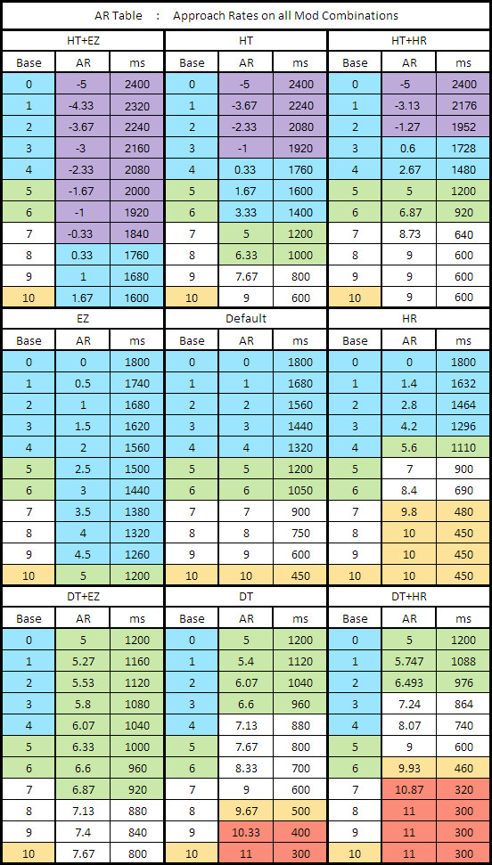

---
tags:
  - approach time
  - AR
  - reading
---

# Approach rate

::: alert-note
**Note:** Para valores sugeridos de AR, consulte [Critérios de classificação](/wiki/Ranking_criteria)
:::

**Approach rate** (***AR***) é uma configuração de dificuldade do [beatmap](/wiki/Beatmap) que define quando os [hit objects](/wiki/Gameplay/Hit_object) começam a aparecer em relação ao momento em que devem ser atingidos ou coletados. Esta mecânica existe apenas no [osu!](/wiki/Game_mode/osu!) e [osu!catch](/wiki/Game_mode/osu!catch).

Os valores de AR variam de 0 a 10. Valores de AR mais altos significam que os hit objects serão exibidos por um período de tempo menor, deixando menos tempo para o jogador reagir. Por outro lado, valores de AR menores permitem mais tempo de reação, mas podem resultar em uma quantidade excessiva de hit objects aparecendo na tela simultaneamente.

Em [osu!taiko](/wiki/Game_mode/osu!taiko) e [osu!mania](/wiki/Game_mode/osu!mania), a configuração da taxa de aproximação não tem efeito. A velocidade de rolagem em ambos os modos é controlada por [slider velocity](/wiki/Gameplay/Hit_object/Slider/Slider_velocity), que depende do [BPM](/wiki/Music_theory/Tempo) e do multiplicador de velocidade de slider. Além disso, no osu!mania é possível personalizá-lo [pelo própio jogador](/wiki/Game_mode/osu!mania#speed-change).

## Tempo de animação

A duração pela qual um hit object permanece visível na tela (sem mods) varia de 1800 ms no AR0 a 450 ms no AR10. Os níveis de AR variam em intervalos de 120 ms para valores abaixo de AR5 e de 150 ms para valores acima de AR5.

Veja o infográfico e as fórmulas abaixo para uma visão geral:

```
               p r e e m p t             X = hit/collect
0%                        66%            ↓
├──────────────────────────┬────────────────┤
    surgimento gradual       opacidade total 
```

O hit object começa a surgir gradualmente em `X - preempt` com:

- AR < 5: `preempt = 1200ms + 120ms * (5 - AR)`
- AR = 5: `preempt = 1200ms`
- AR > 5: `preempt = 1200ms - 150ms * (AR - 5)`

O hit object atinge a opacidade final (total) em 2/3 do tempo de pré-exibição.

### Tabela de comparação



## Efeitos de mod

Existem quatro mods que alteram a approach rate quando ativados:

- [Easy](/wiki/Gameplay/Game_modifier/Easy): Reduz o valor de AR pela metade.
- [Hard Rock](/wiki/Gameplay/Game_modifier/Hard_Rock): Multiplica o valor de AR por 1.4 até um máximo de 10.
- [Double Time](/wiki/Gameplay/Game_modifier/Double_Time): O valor de AR não é afetado, mas, devido ao aumento de 50% na velocidade de jogo, os hit objects a serem clicados permanecem na tela por 33% menos tempo.
- [Half Time](/wiki/Gameplay/Game_modifier/Half_Time): O valor de AR não é afetado, mas, devido à redução de 25% na velocidade de jogo, os hit objects a serem clicados permanecem na tela por 33% mais tempo.

Embora os mods Half Time (HT) e Double Time (DT) não alterem o valor de AR, a diferença de velocidade resulta em uma mudança aparente no AR. Os valores de AR com HT ou DT são comumente referidos com base no seu valor percebido. Por exemplo, "AR 8 + DT" também pode ser expresso como "AR 9.6".
