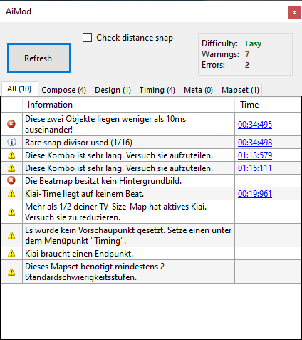

# AiMod

**AiMod** ist ein Tool im [Beatmap-Editor](/wiki/Client/Beatmap_editor), das Probleme in einer [Beatmap](/wiki/Beatmap) erkennen kann. Es lässt sich über `Datei` > `AiMod öffnen` oder das [Tastenkürzel](/wiki/Client/Keyboard_shortcuts) `Strg` + `Shift` + `A` öffnen.

Während AiMod nützlich sein kann, um grundlegende Probleme einer Beatmap zu erkennen, ersetzt es nicht den [Modding](/wiki/Modding)-Prozess, der von echten Menschen durchgeführt wird. AiMod kann die Qualität einer Beatmap nicht beurteilen und komplexe Probleme wie schlechte [Patterns](/wiki/Beatmap/Pattern) oder inkorrektes [Timing](/wiki/Guides/How_to_time_songs) können nicht erkannt werden. Es wird empfohlen, beim [Erstellen einer Beatmap](/wiki/Beatmapping) zunächst die AiMod-Warnungen zu beheben und anschließend andere [Modder](/wiki/Modding/Modder) um Hilfe zu bitten.

Die Entwicklung von AiMod entspricht nicht mehr den Standards der Mapping-Community und der [Ranking-Kriterien](/wiki/Ranking_criteria), weswegen [einige Ausgaben als fehlerhaft gelten](#mängel).

## Tabs

- **All:** Hier werden die Meldungen aller anderen Tabs angezeigt.
- **Compose:** Diese Probleme haben in der Regel mit der Platzierung der Objekte zu tun. Du musst möglicherweise einen Haken bei "Check distance snap" setzen, damit diese Warnungen angezeigt werden (da diese Überprüfungen abhängig von der Größe/Länge der Beatmap Verzögerungen verursachen können).
- **Design:** Diese Probleme beziehen sich in der Regel auf die Oberfläche, wie z. B. der Hintergrund, das Storyboard, etc.
- **Timing:** Falls diese Probleme auftreten, sollte die Zeitleiste überprüft werden, denn vermutlich ist ein Objekt falsch platziert.
- **Meta:** Falls diese Probleme auftreten, sollte das Song-Setup überprüft werden.
- **Mapset:** Diese Probleme betreffen das gesamte Beatmapset.

## Meldungen

::: alert-notice
**Hinweis**
Zahlen in geschweiften Klammern (z. B. `{0}`) sind Platzhalter für eine Zahl oder ein Wort.
:::

### Informativ

#### All

| Meldung | Erklärung | Lösung | Anmerkungen |
| :-- | :-- | :-- | :-- |
| Es wurden keine Probleme mit dieser Map gefunden! | *Selbsterklärend* | Deine Beatmap ist bereit! Du kannst sie [über das BSS hochladen](/wiki/Beatmapping/Beatmap_submission), um es Moddern zu ermöglichen, andere Fehler und Probleme in deiner Beatmap zu finden. |  |

#### Meta

| Meldung | Erklärung | Lösung | Anmerkungen |
| :-- | :-- | :-- | :-- |
| Die empfohlende HP-Rate für Easy und Normal liegt bei mindestens 4. | *Selbsterklärend* | Setze die `HP Drain Rate` im `Difficulty`-Tab des [Song-Setups](/wiki/Client/Beatmap_editor/Song_setup) auf 4 oder höher. |  Nur osu!mania-Beatmaps |
| Die empfohlende HP-Rate für Hard und schwerer liegt bei mindestens 7. | *Selbsterklärend* | Setze die `HP Drain Rate` im `Difficulty`-Tab des [Song-Setups](/wiki/Client/Beatmap_editor/Song_setup) auf 7 oder höher. |  Nur osu!mania-Beatmaps |
| Die empfohlende OD-Rate liegt bei mindestens 5. | *Selbsterklärend* | Setze die `Overall Difficulty` im `Difficulty`-Tab des [Song-Setups](/wiki/Client/Beatmap_editor/Song_setup) auf 5 oder höher. |  Nur osu!mania-Beatmaps. Diese Warnung kann getrost ignoriert werden, wenn die Verwendung der niedrigen allgemeinen Schwierigkeit beabsichtigt ist. |
| Die empfohlende OD-Rate für Maps mit wenigen Holds liegt bei mindestens 7. | *Selbsterklärend* | Setze die `Overall Difficulty` im `Difficulty`-Tab des [Song-Setups](/wiki/Client/Beatmap_editor/Song_setup) auf 7 oder höher. |  Nur osu!mania-Beatmaps. Diese Warnung kann getrost ignoriert werden, wenn die Verwendung der niedrigen allgemeinen Schwierigkeit beabsichtigt ist. |
| Die empfohlende OD-Rate für Maps mit sehr wenigen Holds liegt bei mindestens 8. | *Selbsterklärend* | Setze die `Overall Difficulty` im `Difficulty`-Tab des [Song-Setups](/wiki/Client/Beatmap_editor/Song_setup) auf 8 oder höher. |  Nur osu!mania-Beatmaps. Diese Warnung kann getrost ignoriert werden, wenn die Verwendung der niedrigen allgemeinen Schwierigkeit beabsichtigt ist. |
| Die Slidergeschwindigkeit sollte 1,4 oder 1,6 betragen. | Die Basis-Slidergeschwindigkeit ist auf einen anderen Wert als 1,40 oder 1,60 eingestellt, was einer Richtlinie der [Ranking-Kriterien für osu!taiko](/wiki/Ranking_criteria/osu!taiko) bezüglich des optimalen Abstands zwischen den Noten widerspricht. | Öffne den Tab `Timing` und setze den Basiswert des `Slidertempo`s auf entweder 1,40 oder 1,60. |  Nur osu!taiko-Beatmaps |

### Fehler

#### Compose

| Meldung | Erklärung | Lösung | Anmerkungen |
| :-- | :-- | :-- | :-- |
| Diese zwei Objekte liegen weniger als 10ms auseinander! | Zwei Objekte befinden sich auf der Zeitleiste sehr nah beieinander, wodurch der Spieler beide Objekte fast gleichzeitig anklicken muss. | Finde die beiden Objekte und verschiebe oder lösche eins davon. |  |
| Diese zwei Objekte liegen auf dem selben Zeitpunkt. | Zwei Objekte befinden sich auf der Zeitleiste an derselben Position, wodurch der Spieler beide Objekte gleichzeitig anklicken muss. | Finde die beiden Objekte und verschiebe oder lösche eins davon. |  |
| There are no hitsounds on any objects. Hitsounds are required for rankable beatmaps. | Es befinden sich auf keinen Objekten Hitsounds. Hitsounds sind erforderlich, damit die Beatmap gerankt werden kann. | Füge der Beatmap Hitsounds hinzu, indem du Whistles, Claps und Finishes verwendest. |  |
| Dieser Spinner erscheint, nachdem die späteren Objekte bereits sichtbar sind. | Objekte erscheinen während des aktiven Spinners. Dies könnte an einer niedrigen AR liegen und/oder daran, dass Objekte auf der Zeitleiste zu nah an dem Spinner platziert sind. | Ändere die Länge des Spinners und/oder entferne die darauffolgenden Objekte. |  |
| This hold note is less than 10ms long! | Eine Hold-Note ist viel zu kurz (kürzer als 10 ms), wodurch es unmöglich ist, die Note SS auf der Beatmap zu erzielen. | Verlängere die Hold-Note oder entferne sie. |  Nur osu!mania-Beatmaps |
| Dieses Objekt überlappt mit einem anderem Objekt. | Zwei Objekte in derselben Spalte überlappen sich zeitlich, wodurch es unmöglich ist, die Note SS auf der Beatmap zu erzielen. | Entferne eins der sich überlappenden Objekte. |  Nur osu!mania-Beatmaps |
| Dieses Objekt liegt über einem anderen Objekt. | Zwei Objekte in derselben Spalte befinden sich zeitlich an derselben Position, wodurch es unmöglich ist, die Note SS auf der Beatmap zu erzielen. | Finde die entsprechenden Tasten oder Hold-Notes und verschiebe oder lösche eine davon. |  Nur osu!mania-Beatmaps |
| Mehr als 6 Noten gleichzeitig sind nicht erlaubt. | Mindestens ein Pattern in der Beatmap erfordert, dass der Spieler mehr als 6 Tasten gleichzeitig drückt. In bestimmten Fällen raten die [Ranking-Kriterien für osu!mania](/wiki/Ranking_criteria/osu!mania) davon ab, da die meisten Tastaturen aufgrund des Phänomens [Ghosting](https://nelson-miller.com/what-is-keyboard-ghosting-and-how-do-you-prevent-it/) nur 6 Tastenanschläge gleichzeitig zulassen. | Überprüfe deine Beatmap, um sicherzustellen, dass niemals mehr als 6 Objekte zur selben Zeit platziert sind. |  Nur osu!mania-Beatmaps |

#### Design

| Meldung | Erklärung | Lösung | Anmerkungen |
| :-- | :-- | :-- | :-- |
| Die Beatmap besitzt kein Hintergrundbild. | *Selbsterklärend* | Finde ein passendes Bild und verwende es als Hintergrundbild für den Schwierigkeitsgrad. | Videos zählen nicht als Hintergrundbilder, da der Nutzer sie nicht herunterladen muss. |
| Fehlende Dateien:{0} | Deiner Beatmap fehlen bestimmte Dateien. | Stelle die fehlenden Dateien wieder her oder stelle sicher, dass die Beatmap nicht versucht, auf Dateien zuzugreifen, die nicht existieren. |  |

#### Timing

| Meldung | Erklärung | Lösung | Anmerkungen |
| :-- | :-- | :-- | :-- |
| Alle Timing-Sektionen haben eine Lautstärke von unter 5%. | *Selbsterklärend* | Setze die Lautstärke der Hitsounds in mindestens einem Timing-Abschnitt auf 5 % oder höher. |  |

#### Meta

| Meldung | Erklärung | Lösung | Anmerkungen |
| :-- | :-- | :-- | :-- |
| Drain time should be over 30 seconds. | Die Länge deiner Beatmap von Anfang bis Ende, ohne Pausen, beträgt weniger als 30 Sekunden. | Versuche am Ende der Beatmap einen Spinner einzusetzen, falls es dein Song unterstützt. Andernfalls ist er möglicherweise zu kurz. Versuche in diesem Fall, deine `.mp3`-Datei zu verlängern, um eine Länge von 30 Sekunden zu erreichen. | AiMod erkennt keine Spinner, die sich über die 30-sekündige Drain-Zeit erstrecken. |

### Warnungen

#### Compose

| Meldung | Erklärung | Lösung | Anmerkungen |
| :-- | :-- | :-- | :-- |
| Dieser Slider bewegt sich auf eine abnormale Art und Weise. | Der Slider überlappt sich selbst, indem er direkt wieder in die Richtung verläuft aus der er gekommen ist (auch bekannt als [Burai-Slider](/wiki/Beatmapping/Mapping_techniques/Unrankable#burai-sliders)). | Stelle sicher, dass der Slider sich auf seinem Pfad nicht perfekt selbst überlappt. |  |
| Slider has an absurdly large amount of points! | Der Slider enthält eine absurd große Anzahl an Sliderpunkten. | Entferne einige der Sliderpunkte aus deinem Slider. | Diese Warnung kann getrost ignoriert werden, wenn die Vielzahl an Sliderpunkten beabsichtigt ist oder aus einem anderen Grund für den Slider erforderlich ist, beispielsweise bei komplexen [Slider-Arts](http://osu.ppy.sh/community/forums/topics/689531). |
| Diese Kombo ist sehr lang. Versuch sie aufzuteilen. | *Selbsterklärend* | Unterteile die lange Combo in mehrere Combo-Gruppen. Es ist erwünscht, dass jede Combo höchstens 15 bis 18 Objekte umfasst. | Besonders zu beachten in  osu!catch-Beatmaps, da sich die Fruits auf dem Teller des Catchers immer weiter stapeln, solange die Combo intakt ist (was sich auf die Sichtbarkeit auswirken könnte). Diese Warnung kann getrost ignoriert werden, wenn die Verwendung der langen Combo beabsichtigt ist. |
| Das Ende dieses Objekts befindet sich außerhalb\ndes Bildschirms! | Das Ende des Objekts befindet sich bei 4:3-Auflösungen (vollständig oder teilweise) nicht auf dem Bildschirm. | Entferne das Objekt oder verschiebe die Position seines Endes. | AiMod erkennt das obere Ende des Spielfelds nicht immer richtig, d.h. du solltest hin und wieder überprüfen, ob sich das Ende des betreffenden Objekts tatsächlich außerhalb des Bildschirms befindet. |
| Das Objekt befindet sich außerhalb des Bildschirms! | Das Objekt befindet sich bei 4:3-Auflösungen (vollständig oder teilweise) nicht auf dem Bildschirm. | Entferne oder verschiebe das Objekt. | AiMod erkennt das obere Ende des Spielfelds nicht immer richtig, d.h. du solltest hin und wieder überprüfen, ob sich das betreffende Objekts tatsächlich außerhalb des Bildschirms befindet. |
| Dieses Objekt liegt zu nah am vorherigen Objekt. | *Selbsterklärend* | Bewege das Objekt weiter vom vorherigen weg. | Wird nur angezeigt, wenn die Option `Check distance snap` aktiviert ist. |
| Dieses Objekt ist zu weit vom vorherigen Objekt entfernt. | *Selbsterklärend* | Bewege das Objekt näher an das vorherige heran. | Wird nur angezeigt, wenn die Option `Check distance snap` aktiviert ist. |
| Dieser Spinner ist zu kurz. Auto muss mindestens 1000 Bonuspunkte auf Spinnern erreichen. | Der angegebene Spinner ist zu kurz, weswegen er seine Funktion als Spinner nicht erfüllen kann. | Verlängere den Spinner. |  |
| Spinner müssen eine neue Kombo sein. | *Selbsterklärend* | Füge dem Spinner manuell eine neue Combo hinzu. |  |
| Dieses Objekt liegt auf keinem Beat! | Das angegebene Objekt ist auf der Zeitleiste nicht richtig ausgerichtet. | Verschiebe das Objekt auf der Zeitleiste so, dass es an seiner beabsichtigten Position einrastet. Falls du zuvor Änderungen am Timing des Songs vorgenommen hast, musst du möglicherweise alle Objekte neu ausrichten, indem du auf `Timing` > `Alle Noten neu ausrichten` klickst. | Diese Warnung kann getrost ignoriert werden, wenn das Objekt auf einen [Taktteiler](/wiki/Client/Beatmap_editor/Beat_snap_divisor) ausgerichtet sein soll, der derzeit vom Editor nicht unterstützt wird (z. B. 1/10). |
| Das Ende dieses Objekts liegt auf keinem Beat! | Das Ende des angegebenen Objekts ist auf der Zeitleiste nicht richtig ausgerichtet. | Verschiebe das Ende des Objekts auf der Zeitleiste so, dass es an seiner beabsichtigten Position einrastet. Falls du zuvor Änderungen am Timing des Songs vorgenommen hast, musst du möglicherweise alle Objekte neu ausrichten, indem du auf `Timing` > `Alle Noten neu ausrichten` klickst. | Diese Warnung kann getrost ignoriert werden, wenn das Objekt auf einen [Taktteiler](/wiki/Client/Beatmap_editor/Beat_snap_divisor) ausgerichtet sein soll, der derzeit vom Editor nicht unterstützt wird (z. B. 1/10). |

#### Design

| Meldung | Erklärung | Lösung | Anmerkungen |
| :-- | :-- | :-- | :-- |
| Das Hintergrundbild ist größer als 2560x1440. | *Selbsterklärend* | Ändere die Größe des Hintergrundbildes oder ersetze es. |  |
| Diese Map benötigt unter Umständen eine Epilepsiewarnung, da sie viele schnelle kurze Storyboardelemente besitzt. | Das Storyboard enthält Elemente, die innerhalb sehr kurzer Zeit wiederholt erscheinen, was möglicherweise schädlich für unvorbereitete Spieler ist, die zu [Krampfanfällen](https://de.wikipedia.org/wiki/Krampfanfall) neigen. | Aktiviere die Option `Display epilepsy warning (storyboard has quick strobing)` im `Design`-Tab des [Song-Setups](/wiki/Client/Beatmap_editor/Song_setup). |  |
| {0}s Größe darf nicht über {1}x{1} liegen. | Die Abmessungen des angegebenen Elements stimmen nicht mit dem vorgesehenen Standard überein. | Ändere die Größe des entsprechenden Elements auf die korrekte Auflösung. |  |
| Das Video darf im 4:3-Format keine Auflösung von über 1024x768 haben. | *Selbsterklärend* | Ändere die Größe des Hintergrundvideos oder ersetze es. |  |
| Das Video darf im 16:9-Format keine Auflösung von über 1280x720 haben. | *Selbsterklärend* | Ändere die Größe des Hintergrundvideos oder ersetze es. |  |

#### Timing

| Meldung | Erklärung | Lösung | Anmerkungen |
| :-- | :-- | :-- | :-- |
| Die Beatmap ist über 6 Minuten lang. Versuche, sie zu kürzen, falls es sich nicht um einen Marathon handelt. | *Selbsterklärend* | Füge der Beatmap mehr Pausen hinzu oder kürze den Song. | Diese Warnung kann getrost ignoriert werden, wenn die Länge der Beatmap beabsichtigt ist. |
| Deine Beatmap ist kürzer als 45 Sekunden. Versuche, sie länger zu machen. | *Selbsterklärend* | Ergänze die Beatmap um weitere Abschnitte des Songs. | Diese Warnung kann getrost ignoriert werden, wenn die Länge der Beatmap beabsichtigt ist. |
| Die Audiobitrate liegt über 192kbit/s. Versuche, sie auf CBR 192kbit oder VBR ~1.0 zu komprimieren. | Die `.mp3`-Datei der Beatmap ist in einer höheren [Bitrate](https://de.wikipedia.org/wiki/Bitrate) als 192 kbit/s kodiert, was den Wert überschreitet, der von den [Ranking-Kriterien](/wiki/Ranking_criteria) zugelassen wird. | Kodiere die `.mp3`-Datei so, dass ihre Bitrate zwischen 128 kbit/s und 192 kbit/s liegt (wobei 192 kbit/s der empfohlene Wert ist). | Obwohl diese Warnung im Spiel existiert, zeigt AiMod sie aufgrund technischer Einschränkungen nie an. |
| Die Audiobitrate liegt unter 128kbit/s. Versuche, eine Audiodatei mit besserer Qualität zu finden. | Die `.mp3`-Datei der Beatmap ist in einer niedrigeren [Bitrate](https://de.wikipedia.org/wiki/Bitrate) als 128 kbit/s kodiert, was den Wert unterschreitet, der von den [Ranking-Kriterien](/wiki/Ranking_criteria) erfordert wird. | Verwende eine `.mp3`-Datei mit einer höheren Bitrate. | Obwohl diese Warnung im Spiel existiert, zeigt AiMod sie aufgrund technischer Einschränkungen nie an. |
| Kiai-Time ist für weniger als 15 Sekunden aktiviert. | *Selbsterklärend* | Verlängere die Dauer der Kiai-Zeit auf mehr als 15 Sekunden. | Diese Warnung kann getrost ignoriert werden, wenn die entsprechende Nutzung der Kiai-Zeit beabsichtigt ist. |
| Die mp3, die du verwendest, ist deutlich länger als das, was du gemapped hast. Du solltest entweder mehr mappen oder die Datei schneiden, um Speicherplatz zu sparen. | *Selbsterklärend* | Verlängere die Beatmap oder kürze den Song. |  |
| Kiai braucht einen Endpunkt. | *Selbsterklärend* | Füge einen neuen vererbten Timing-Punkt hinzu, der als Endpunkt der Kiai-Zeit dient. |  |
| Es wurde kein Vorschaupunkt gesetzt. Setze einen unter dem Menüpunkt "Timing". | *Selbsterklärend* | Lege für die Beatmap einen Vorschaupunkt fest, indem du auf `Timing` > `Aktuelle Position als Vorschaupunkt festlegen` klickst. |  |
| Zwei Timing-Punkte liegen auf dem selben Zeitpunkt. | *Selbsterklärend* | Entferne einen der beiden Timing-Abschnitte, die in Konflikt stehen. |  |
| {0} von {1} Timing-Sektionen haben eine Lautstärke von unter 5%. | *Selbsterklärend* | Setze die Lautstärke der Hitsounds in den ruhigen Timing-Abschnitten auf 5 % oder höher. |  |
| Mehr als 1/3 deiner Map hat aktives Kiai. Du solltest dies reduzieren. | *Selbsterklärend* | Reduziere die Verwendung der Kiai-Zeit in der ganzen Beatmap. | Diese Warnung kann getrost ignoriert werden, wenn die Nutzung der entsprechenden Kiai-Zeit beabsichtigt ist. |
| Mehr als 1/2 deiner TV-Size-Map hat aktives Kiai. Versuch sie zu reduzieren. | *Selbsterklärend* | Reduziere die Verwendung der Kiai-Zeit in der ganzen Beatmap. | Diese Warnung kann getrost ignoriert werden, wenn die Nutzung der entsprechenden Kiai-Zeit beabsichtigt ist. |
| Kiai-Time liegt auf keinem Beat. | Der Anfangspunkt der angegebenen Kiai-Zeit ist auf der Zeitleiste nicht richtig ausgerichtet. | Verschiebe den Anfangspunkt der Kiai-Zeit auf der Zeitleiste so, dass er an seiner beabsichtigten Position einrastet. |  |
| Das Ende der Kiai-Time liegt auf keinem Beat. | Der Endpunkt der angegebenen Kiai-Zeit ist auf der Zeitleiste nicht richtig ausgerichtet. | Verschiebe den Endpunkt der Kiai-Zeit auf der Zeitleiste so, dass er an seiner beabsichtigten Position einrastet. |  |
| Pausen werden für osu!mania-Maps nicht empfohlen. | *Selbsterklärend* | Vervollständige die Beatmap, indem du in der entsprechenden Pause Objekte platzierst. |  Nur osu!mania-Beatmaps. Diese Warnung kann getrost ignoriert werden, wenn die Nutzung der entsprechenden Pause beabsichtigt ist, oder wenn der Abschnitt des Songs in der Beatmap nicht umgesetzt werden kann. |
| Diese Easy-/Normal-Schwierigkeitsstufe enthält zu viele Geschwindigkeitsänderungen. | Der Schwierigkeitsgrad Easy/Normal enhält häufige Änderungen der Slidergeschwindigkeit, wovon die [Ranking-Kriterien](/wiki/Ranking_criteria) abraten. | Reduziere die Anzahl der Slidergeschwindigkeitsänderungen auf dem entsprechenden Easy/Normal-Schwierigkeitsgrad. |  |
| Kiai wird zu oft aktiviert! | *Selbsterklärend* | Reduziere die Anzahl der Kiai-Zeiten in der ganzen Beatmap. | Auch bekannt als *Kiai-Effekte*. Diese Warnung kann getrost ignoriert werden, wenn die Nutzung der entsprechenden Kiai-Zeit beabsichtigt ist. |

#### Meta

| Meldung | Erklärung | Lösung | Anmerkungen |
| :-- | :-- | :-- | :-- |
| Die [Stack-Leniency](/wiki/Beatmap/Stack_leniency) ist größer als 0,9 oder kleiner als 0,3. | Der `Stack Leniency`-Schieberegler im `Advanced`-Tab des [Song-Setups](/wiki/Client/Beatmap_editor/Song_setup) ist auf weniger als 3 oder mehr als 9 eingestellt. | Stelle den `Stack Leniency`-Schieberegler auf einen Wert zwischen 3 und 9. | Diese Warnung kann getrost ignoriert werden, wenn die Nutzung der entsprechenden Stackzuordnung beabsichtigt ist. |
| Der romanisierte Interpret enthält Unicode. | Das Feld `Romanised Artist` im `General`-Tab des [Song-Setups](/wiki/Client/Beatmap_editor/Song_setup) enthält [nicht-standardmäßige Unicode-Zeichen](https://en.wikipedia.org/wiki/List_of_Unicode_characters). | Romanisiere den Namen des Künstlers im Feld `Romanised Artist` entsprechend der [Regeln zur Standardisierung der Metadaten in den Ranking-Kriterien](/wiki/Ranking_criteria/Metadata). |  |
| Der romanisierte Titel enthält Unicode. | Das Feld `Romanised Title` im `General`-Tab des [Song-Setups](/wiki/Client/Beatmap_editor/Song_setup) enthält [nicht-standardmäßige Unicode-Zeichen](https://en.wikipedia.org/wiki/List_of_Unicode_characters). | Romanisiere den Titel des Songs im Feld `Romanised Title` entsprechend der [Regeln zur Standardisierung der Metadaten in den Ranking-Kriterien](/wiki/Ranking_criteria/Metadata). |  |
| Countdowns sind im osu!mania-Modus nicht erlaubt. | *Selbsterklärend* | Deaktiviere die Option `Enable countdown` im `Design`-Tab des [Song-Setups](/wiki/Client/Beatmap_editor/Song_setup). |  Nur osu!mania-Beatmaps |
| Letterboxing ist im osu!mania-Modus nicht erlaubt. | *Selbsterklärend* | Deaktiviere die Option `Letterbox during breaks` im `Design`-Tab des [Song-Setups](/wiki/Client/Beatmap_editor/Song_setup). |  Nur osu!mania-Beatmaps |
| Countdowns sind im Taiko-Modus nicht erlaubt. | *Selbsterklärend* | Deaktiviere die Option `Enable countdown` im `Design`-Tab des [Song-Setups](/wiki/Client/Beatmap_editor/Song_setup). |  Nur osu!taiko-Beatmaps. Obwohl diese Warnung im Spiel existiert, zeigt AiMod sie nie an, da osu!taiko keinen Countdown unterstützt. |
| Epilepsiewarnungen im Taiko-Modus nicht erlaubt. | *Selbsterklärend* | Deaktiviere die Option `Display epilepsy warning (storyboard has quick strobing)` im `Design`-Tab des [Song-Setups](/wiki/Client/Beatmap_editor/Song_setup). |  Nur osu!taiko-Beatmaps. Diese Warnung basiert auf einer veralteten Regel der Ranking-Kriterien, die mittlerweile überholt ist. Daher kann sie getrost ignoriert werden, da die aktuellen [Ranking-Kriterien](/wiki/Ranking_criteria) vorschreiben, dass eine Epilepsiewarnung für Beatmaps mit schnell pulsierenden Videos oder Storyboards erforderlich ist. |
| Letterboxing ist im Taiko-Modus nicht erlaubt. | *Selbsterklärend* | Deaktiviere die Option `Letterbox during breaks` im `Design`-Tab des [Song-Setups](/wiki/Client/Beatmap_editor/Song_setup). |  Nur osu!taiko-Beatmaps |

#### Mapset

| Meldung | Erklärung | Lösung | Anmerkungen |
| :-- | :-- | :-- | :-- |
| Der Unicode-Interpret stimmt nicht mit dem der Schwierigkeitsstufe {0} überein. | Das Feld `Artist` im `General`-Tab des [Song-Setups](/wiki/Client/Beatmap_editor/Song_setup) unterscheidet sich zwischen zwei Schwierigkeitsgraden. | Stelle sicher, dass das Feld `Artist` in allen Schwierigkeitsgraden einheitlich ist. |  |
| Der Interpret simmt nicht mit dem der Schwierigkeitsstufe {0} überein. | Das Feld `Romanised Artist` im `General`-Tab des [Song-Setups](/wiki/Client/Beatmap_editor/Song_setup) unterscheidet sich zwischen zwei Schwierigkeitsgraden. | Stelle sicher, dass das Feld `Romanised Artist` in allen Schwierigkeitsgraden einheitlich ist. |  |
| Der Unicode-Titel stimmt nicht mit dem der Schwierigkeitsstufe {0} überein. | Das Feld `Title` im `General`-Tab des [Song-Setups](/wiki/Client/Beatmap_editor/Song_setup) unterscheidet sich zwischen zwei Schwierigkeitsgraden. | Stelle sicher, dass das Feld `Title` in allen Schwierigkeitsgraden einheitlich ist. |  |
| Der Titel stimmt nicht mit dem der Schwierigkeitsstufe {0} überein. | Das Feld `Romanised Title` im `General`-Tab des [Song-Setups](/wiki/Client/Beatmap_editor/Song_setup) unterscheidet sich zwischen zwei Schwierigkeitsgraden. | Stelle sicher, dass das Feld `Romanised Title` in allen Schwierigkeitsgraden einheitlich ist. |  |
| Die Quelle stimmt nicht mit der der Schwierigkeitsstufe {0} überein. | Das Feld `Source` im `General`-Tab des [Song-Setups](/wiki/Client/Beatmap_editor/Song_setup) unterscheidet sich zwischen zwei Schwierigkeitsgraden. | Stelle sicher, dass das Feld `Source` in allen Schwierigkeitsgraden einheitlich ist. |  |
| Die Tags stimmen nicht mit denen der Schwierigkeitsstufe {0} überein. | Das Feld `Tags` im `General`-Tab des [Song-Setups](/wiki/Client/Beatmap_editor/Song_setup) unterscheidet sich zwischen zwei Schwierigkeitsgraden. | Stelle sicher, dass das Feld `Tags` in allen Schwierigkeitsgraden einheitlich ist. |  |
| Uninherited timing points conflict with {0} diff. | Die Positionen der nicht-vererbten Timing-Punkte ([rote Linien](/wiki/Client/Beatmap_editor/Timing#uninherited-timing-point)) unterscheiden sich zwischen zwei Schwierigkeitsgraden. | Stelle sicher, dass die Positionen aller nicht-vererbten Timing-Punkte in allen Schwierigkeitsgraden einheitlich sind. |  |
| Die Audiodatei stimmt nicht mit der der Schwierigkeitsstufe {0} überein. | Die `.mp3`-Datei der Beatmap unterscheidet sich zwischen zwei Schwierigkeitsgraden. | Stelle sicher, dass alle Schwierigkeitsgrade dieselbe `.mp3`-Datei als Basis verwenden. |  |
| Audio-Lead-In stimmt nicht mit {0} überein. | Die Länge der Einleitung des Audios unterscheidet sich zwischen zwei Schwierigkeitsgraden. | Öffne alle Schwierigkeitsgrade separat im Texteditor (indem du auf `Datei` > `.osu im Editor öffnen` klickst) und stelle sicher, dass der Wert `AudioLeadIn` in allen Schwierigkeitsgraden einheitlich ist. | Jetzt veraltet, da die Länge der Einleitung des Audios nicht mehr manuell bestimmt werden kann. |
| Der Countdown stimmt nicht mit dem der Schwierigkeitsstufe {0} überein. | Die Option `Enable countdown` im `Design`-Tab des [Song-Setups](/wiki/Client/Beatmap_editor/Song_setup) unterscheidet sich zwischen zwei Schwierigkeitsgraden. | Stelle sicher, dass die Option `Enable countdown` in allen Schwierigkeitsgraden einheitlich eingestellt ist. |  |
| Die Letterbox während den Pausen stimmt nicht mit der Schwierigkeitstufe {0} überein. | Die Option `Letterbox during breaks` im `Design`-Tab des [Song-Setups](/wiki/Client/Beatmap_editor/Song_setup) unterscheidet sich zwischen zwei Schwierigkeitsgraden. | Stelle sicher, dass die Option `Letterbox during breaks` in allen Schwierigkeitsgraden einheitlich eingestellt ist. |  |
| Der Vorschaupunkt stimmt nicht mit dem der Schwierigkeitsstufe {0} überein. | Der Audio-Vorschaupunkt unterscheidet sich zwischen zwei Schwierigkeitsgraden. | Lege den Vorschaupunkt in allen Schwierigkeitsgraden manuell fest, indem du auf `Timing` > `Aktuelle Position als Vorschaupunkt festlegen` klickst, sodass sich diese in allen Schwierigkeitsgraden an derselben Stelle befinden. |  |
| Beatmap exceeds allowed upload size ({0}kb allowed) | Die komprimierte `.osz`-Datei ist zu groß (maximal {0}kb erlaubt). | Entferne alle nicht verwendeten Dateien aus dem Beatmap-Ordner und komprimiere alle Bilder, Videos, Hitsounds, etc., die übermäßig groß sind. | Siehe [diesen Artikel](/wiki/Beatmapping/Beatmap_submission#limitierungen) für mehr Informationen zu den Limitierungen bei der Veröffentlichung von Beatmaps in osu!. |
| This mapset needs an easier difficulty. | Dieses Mapset benötigt eine leichtere Schwierigkeitsstufe. | Erstelle einen leichteren Schwierigkeitsgrad für das Beatmapset. | Diese Warnung basiert auf einer veralteten Regel der Ranking-Kriterien, die mittlerweile überholt ist. Daher kann sie getrost ignoriert werden, solange die Beatmap die [Anforderungen zur Verteilung der aktuellen Ranking-Kriterien](/wiki/Ranking_criteria#rules.1) einhält. |
| Dieses Mapset benötigt mindestens eine Easy-/Normal-Schwierigkeitsstufe. | *Selbsterklärend* | Erstelle einen Easy/Normal-Schwierigkeitsgrad für das Beatmapset. | Diese Warnung basiert auf einer veralteten Regel der Ranking-Kriterien, die mittlerweile überholt ist. Daher kann sie getrost ignoriert werden, solange die Beatmap die [Anforderungen zur Verteilung der aktuellen Ranking-Kriterien](/wiki/Ranking_criteria#rules.1) einhält. |
| This mapset cannot have an Insane diff without a Hard diff. | Dieses Mapset darf keine Insane-Schwierigkeitsstufe ohne eine Hard-Schwierigkeitsstufe enthalten. | Erstelle einen Hard-Schwierigkeitsgrad für das Beatmapset. | Diese Warnung basiert auf einer veralteten Regel der Ranking-Kriterien, die mittlerweile überholt ist. Daher kann sie getrost ignoriert werden, solange die Beatmap die [Anforderungen zur Verteilung der aktuellen Ranking-Kriterien](/wiki/Ranking_criteria#rules.1) einhält. |
| This mapset is missing diff: {0} | Dem Mapset fehlt die Schwierigkeitsstufe {0}. | Erstelle den entsprechenden Schwierigkeitsgrad, um die Lücke zwischen den Schwierigkeitsstufen zu füllen. | Diese Warnung basiert auf einer veralteten Regel der Ranking-Kriterien, die mittlerweile überholt ist. Daher kann sie getrost ignoriert werden, solange die Beatmap die [Anforderungen zur Verteilung der aktuellen Ranking-Kriterien](/wiki/Ranking_criteria#rules.1) einhält. |
| Dieses Mapset benötigt mindestens 2 Standardschwierigkeitsstufen. | *Selbsterklärend* | Erstelle einen zweiten Schwierigkeitsgrad für das Beatmapset. |  Nur osu!-Beatmaps. Diese Warnung basiert auf einer veralteten Regel der Ranking-Kriterien, die mittlerweile überholt ist. Daher kann sie getrost ignoriert werden, solange die Beatmap die [Anforderungen zur Verteilung der aktuellen Ranking-Kriterien](/wiki/Ranking_criteria/osu!#spread) einhält. |
| Dieses Mapset benötigt mindestens 2 Taiko-Schwierigkeitsstufen. | *Selbsterklärend* | Erstelle einen zweiten Schwierigkeitsgrad für das Beatmapset. |  Nur osu!taiko-Beatmaps. Diese Warnung basiert auf einer veralteten Regel der Ranking-Kriterien, die mittlerweile überholt ist. Daher kann sie getrost ignoriert werden, solange die Beatmap die [Anforderungen zur Verteilung der aktuellen Ranking-Kriterien](/wiki/Ranking_criteria/osu!taiko#verteilung) einhält. |
| This mapset needs at least 2 osu!catch diffs. | Dieses Mapset benötigt mindestens 2 osu!catch-Schwierigkeitsstufen. | Erstelle einen zweiten Schwierigkeitsgrad für das Beatmapset. |  Nur osu!catch-Beatmaps. Diese Warnung basiert auf einer veralteten Regel der Ranking-Kriterien, die mittlerweile überholt ist. Daher kann sie getrost ignoriert werden, solange die Beatmap die [Anforderungen zur Verteilung der aktuellen Ranking-Kriterien](/wiki/Ranking_criteria/osu!catch#spread) einhält. |
| Dieses Mapset benötigt mindestens 2 osu!mania-Schwierigkeitsstufen. | *Selbsterklärend* | Erstelle einen zweiten Schwierigkeitsgrad für das Beatmapset. |  Nur osu!mania-Beatmaps. Diese Warnung basiert auf einer veralteten Regel der Ranking-Kriterien, die mittlerweile überholt ist. Daher kann sie getrost ignoriert werden, solange die Beatmap die [Anforderungen zur Verteilung der aktuellen Ranking-Kriterien](/wiki/Ranking_criteria/osu!mania#verteilung) einhält. |

## Mängel

- **AiMod kann eine Vielzahl von Problemen nicht erkennen**, die laut den [Ranking-Kriterien](/wiki/Ranking_criteria) dafür sorgen, dass die Beatmap nicht gerankt werden kann. Dazu gehören potenziell falsch ausgerichtete Objekte, verzögerte Hitsounds, Hintergründe mit einer Dateigröße von mehr als 2,5 MB, etc.
- **AiMod warnt möglicherweise vor Problemen, die keine sind**, wie beispielsweise, dass [Marathon](/wiki/Beatmap/Marathon)-Beatmapsets zwei Standard-Schwierigkeitsgrade benötigen und dass die [Kiai-Zeit](/wiki/Gameplay/Kiai_time) für weniger als 15 Sekunden eingeschaltet ist.
- **Falls `Check distance snap` aktiviert ist, überprüft AiMod nicht den Abstand zwischen Objekten aus verschiedenen Combos.**
- **Falls sich mehrere MP3-Dateien im Beatmap-Ordner befinden, weist AiMod möglicherweise auf mehrere Songdateien hin**, allerdings können MP3-Dateien auch für Soundeffekte wie Applaus verwendet werden.

Es wird empfohlen, zusätzlich zu AiMod andere Programme wie den [Mapset-Verifier](https://github.com/Naxesss/MapsetVerifier/releases) von ::{ flag=SE }:: [Naxess](https://osu.ppy.sh/users/8129817) zu verwenden, wenn du möchtest, dass deine Beatmap [gerankt](/wiki/Beatmap/Category#ranked) wird. Andere Programme entsprechen einem aktuelleren Stand der Ranking-Kriterien und können viel mehr Probleme als AiMod erkennen. Jedoch sollte AiMod nicht komplett ignoriert werden, da einige Regeln der Ranking-Kriterien davon abhängig sind.
