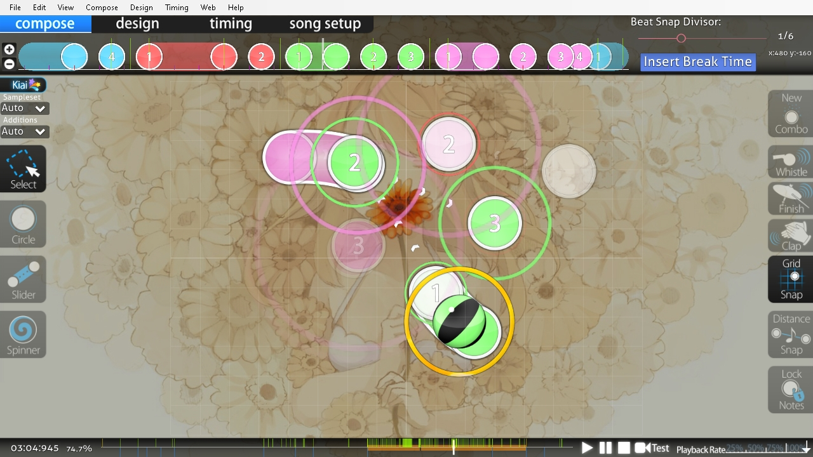

# Trình chỉnh sửa beatmap

<!-- TODO: needs to be revisited when the articles under Beatmap editor no longer match what's written here -->

::: alert-note
**Lưu ý:** Để biết các phím tắt của trình chỉnh sửa beatmap, hãy xem [Tham khảo các phím tắt § Trình chỉnh sửa beatmap](/wiki/Client/Keyboard_shortcuts#beatmap-editor)
:::

**Trình chỉnh sửa beatmap** là giao diện đồ họa trong trò chơi của osu! dùng để tạo [beatmap](/wiki/Beatmap). [Beatmapping](/wiki/Beatmapping) là quá trình tạo ra các beatmap cho osu!.

Trình chỉnh sửa beatmap được chia thành bốn tab, có thể thấy ở góc trên bên trái của trình chỉnh sửa:

- Soạn thảo
- Thiết kế
- Căn nhịp
- Cài đặt bài hát

## Soạn thảo

Tab [Soạn thảo](/wiki/Client/Beatmap_editor/Compose) là nơi tạo ra tất cả các [nốt](/wiki/Gameplay/Hit_object) và các yếu tố liên quan đến lối chơi khác. Hầu hết các mapper dành thời gian ở tab này nhiều nhất.

## Thiết kế

Tab [Thiết kế](/wiki/Client/Beatmap_editor/Design) cung cấp cách để tạo [storyboard](/wiki/Storyboard), tức các hiệu ứng hình ảnh đi kèm với beatmap. Vì storyboard thường có các hiệu ứng phức tạp đòi hỏi phải sử dụng nhiều câu lệnh storyboard, các mapper thường [viết mã storyboard](/wiki/Storyboard/Scripting) trực tiếp thay vì dùng tab “Thiết kế”.

## Timing

Tab [Timing/Căn Nhịp](/wiki/Client/Beatmap_editor/Timing) quản lý các điểm căn nhịp (timing) của bài hát và điều khiển hitsound của beatmap. Đây là những thứ rất quan trọng vì một beatmap cần được căn nhịp chính xác và có độ trễ âm thanh phù hợp để trải nghiệm chơi khớp với tiết tấu của bài hát.

## Cài đặt bài hát

Tab [Cài đặt bài hát](/wiki/Client/Beatmap_editor/Song_setup) là nơi để điền [siêu dữ liệu](/wiki/Client/Beatmap_editor/Song_setup#general) của beatmap và những thông tin chung mà mọi [beatmap](/wiki/Beatmap) đều có, bao gồm tên bài hát, nghệ sĩ, tên độ khó, màu sắc combo, v.v.

## Khác

Các thành phần khác của trình chỉnh sửa beatmap bao gồm:

- [AiMod](AiMod): Hệ thống tự động báo cáo các lỗi hoặc vấn đề trong beatmap
- [Độ chia nhịp](Beat_snap_divisor): Xác định cách các đối tượng bám vào dòng thời gian
- [Căn khoảng cách](Distance_snap): Hệ số ảnh hưởng đến khoảng cách giữa các đối tượng khi đặt
- [Kiai time](/wiki/Gameplay/Kiai_time): Các phân đoạn nhịp điệu đặc biệt giúp nhấn mạnh một phần cao trào của beatmap
- [Menu](Menu): Giúp bạn điều hướng trong trình chỉnh sửa beatmap
- [SB load](SB_load): Chỉ số cho biết mức độ đòi hỏi tài nguyên của storyboard
- [Dòng thời gian](Timelines): Hiển thị các đối tượng đã đặt, khoảng nghỉ và nhiều thông tin khác
