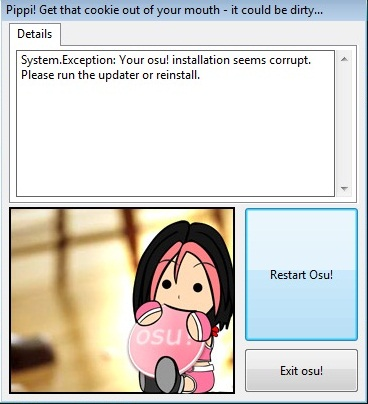

# Логотип osu!

::: alert-note
**См. также:** [Фирменный стиль osu!](/wiki/Brand_identity_guidelines)
:::

**Логотип osu!** в сообществе называют *печенькой* (англ. *cookie*) из-за его формы. В игре он встречается повсюду: на заставке, в главном меню, в одиночной игре, а раньше его можно было увидеть и в окне с ошибкой после вылета игры.

## История

### osu!(stable)

Ниже — все логотипы, которые когда-либо использовались в osu!(stable):

| Логотип | Год | Примечания |
| :-: | :-: | :-- |
|  | 2007 | Шрифт Verdana. |
|  | 2008 | Шрифт Verdana. |
|  | 2009 | Шрифт Verdana. |
|  | 2011 | Шрифт Verdana. |
|  | 2011 | Шрифт Verdana. |
|  | 2014 | Шрифт Aller. |
|  | с 2016 | Шрифт Aller. |

### osu!(lazer)

Ниже — все логотипы, которые когда-либо использовались в osu!(lazer):

| Логотип | Год | Примечания |
| :-: | :-: | :-- |
|  | 2019 | Шрифт Aller. Сам логотип — временный дизайн, чтобы отличать osu!(lazer) от osu!(stable). |
|  | январь — май 2024 | Шрифт Torus. Продержался недолго из-за критики. |
|  | с мая 2024 | Шрифт Torus. |
