# 多人游戏

::: alert-note
**注:** 对于多人游戏的原理，参见[多人游戏](/wiki/Gameplay/Multiplayer)
:::

::: alert-note
**另见:** [快速匹配](/wiki/Gameplay/Quick_play)与[每日挑战](/wiki/Gameplay/Daily_challenge)
:::

本文涵盖 osu!(stable) 客户端用于[多人游戏](/wiki/Gameplay/Multiplayer)的部分：多人大厅、比赛配置与游戏机制。

[osu! 学院](/wiki/Community/Video_series/osu!academy)的[第 6 集 (YouTube)](https://www.youtube.com/watch?v=QPTLyG7O8ak) 视频中包括了这部分内容，除此之外还介绍了[在线用户面板](/wiki/Client/Interface/Chat_console#扩展聊天面板)的相关内容。

## 大厅

::: alert-notice
**注意**
当使用`测试版（不定期更新）`版本时，需要活跃的 [osu! 支持者](/wiki/osu!supporter)标签来进入多人游戏大厅。
:::

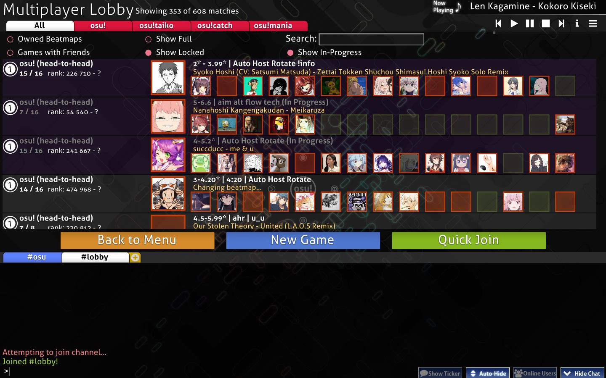

在主菜单中，可以通过点击 `Play` 按钮（或者按 `P` 键），然后点击 `Multi` 按钮（或者按 `M` 键）进入大厅。在此之后，玩家会看到目前所有可用的比赛房间。

### 筛选器设置

可以使用界面左上方的设置项，对列出的比赛房间进行筛选。

| 名称 | 描述 |
| :-: | :-- |
| `全部` / `osu!` / `osu!taiko` / `osu!catch` / `osu!mania` | 只显示选中[游戏模式](/wiki/Game_mode)的房间，也可以显示所有游戏模式的房间。 |
| `只显示已有图的房间` | 只显示玩家拥有已选中[谱面](/wiki/Beatmap)的房间。 |
| `显示满员房间` | 显示无可用空位的房间。 |
| `搜索` | 使用搜索栏搜索选中的某个谱面或房主用户名。当搜索时，除`显示已开始游戏的房间`外的所有筛选器都会被临时禁用。 |
| `只显示有好友的房间` | 只显示玩家好友所在的房间。此筛选器在启用时，会覆盖所有其他的筛选器。 |
| `显示上锁房间` | 显示需要密码进入的房间。 |
| `显示已开始游戏的房间` | 显示目前正在游戏中的房间。如果房间有空位，则仍然可以进入。这类房间的名称为灰色，在游玩结束前末尾都会显示`（游戏中）`。 |

### 比赛

屏幕中部列出了可用的比赛房间。

大多数房间的背景是白色的，说明它们[正常使用游戏界面建立](#建立新房间)。带紫色背景的房间则是通过[房间管理聊天命令](/wiki/osu!_tournament_client/osu!tourney/Tournament_management_commands)（如 `!mp make` 或 `!mp makeprivate`）建立的[锦标赛房间](/wiki/Gameplay/Multiplayer#matches)。

每个房间会显示多种信息。比如，房间右侧的玩家槽位可以显示三种不同颜色：

| 颜色 | 描述 |
| :-: | :-- |
| 红色 | 此槽位有玩家占用。 |
| 绿色 | 此槽位可用。 |
| 无色 | 此槽位已被锁定。 |

点击任一比赛房间即可加入其中。尝试加入已满的房间则会显示错误。

### 常规选项

[聊天面板](/wiki/Client/Interface/Chat_console)上方的三个按钮提供了大厅的主要导航选项：

| 名称 | 描述 |
| :-: | :-- |
| `返回主菜单` | 离开大厅并回到主菜单。 |
| `建立新房间` | 建立新房间，细节请见下文。 |
| `快速加入` | 以玩家目前的[表现分排名](/wiki/Ranking#performance-points-ranking)为基准，*随机*加入可用比赛。 |

## 建立新房间

::: Infobox
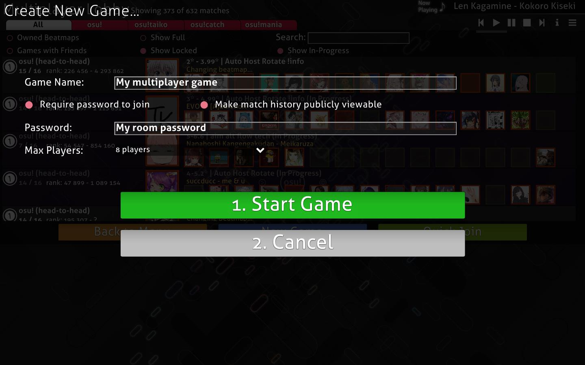
:::

| 名称 | 描述 |
| :-: | :-- |
| `Game Name（房间名称）` | 比赛房间名称，默认值是 `{账户名}'s game`。 |
| `Require password to join（加入时需要密码）` | 创建私密房间。 |
| `Password（密码）` | 设置房间密码，仅在启用 `Require password to join（加入时需要密码）` 时出现。 |
| `Make match history publicly viewable（比赛记录公开可见）` | 让未参加比赛的玩家可以通过直链浏览[比赛历史](/wiki/Gameplay/Multiplayer#match-history)。仅在启用 `Require password to join（加入时需要密码）` 时出现。 |
| `Max Players（最大玩家数）` | 允许进入房间的玩家总数（包括房主），范围在 2 到 16 之间，默认值是 8。建立房间后可以通过锁定、解锁槽位来调整。 |

按下 `1. Start Game（开始游戏）` 按钮会建立比赛房间，将正在播放的歌曲谱面用作房间谱面。`2. Cancel（取消）` 按钮会将玩家带回到大厅。

## 比赛配置页

::: Infobox
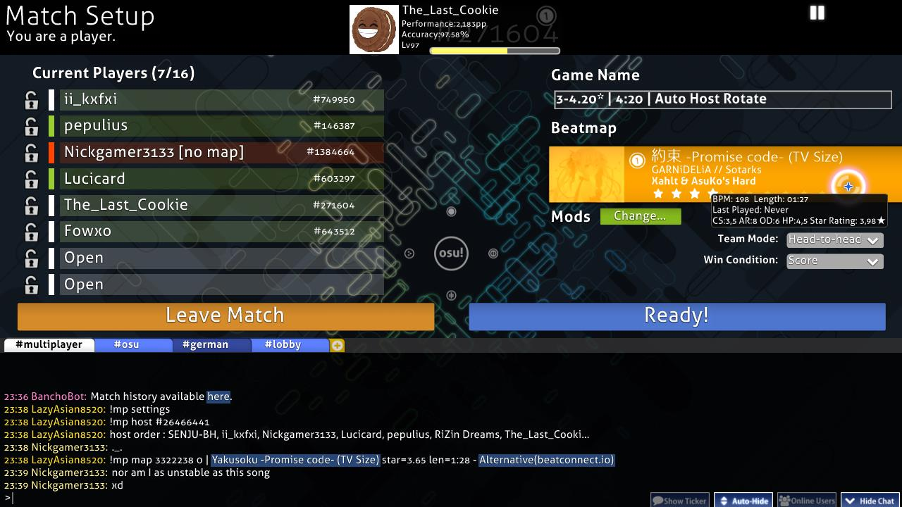
:::

在创建或进入比赛房间后，会显示比赛配置页。下文会按从上到下、从左到右的顺序，着重讲解此页面的各个部分。

在比赛房间里没有可以直接打开[设置菜单](/wiki/Client/Options)的按钮，但仍然可以按 `Ctrl` + `O` 打开它。

### 头栏

头栏左上角的文字会指出玩家的身份（房主或普通玩家）；中间部分有个玩家框，显示与[表现分](/wiki/Performance_points/Total_performance_points)、[整体准确率](/wiki/Gameplay/Accuracy)、[等级](/wiki/Gameplay/Score/Total_score#等级)、[排名](/wiki/Ranking#performance-points-ranking)以及所选[游戏模式](/wiki/Game_mode)相关的信息；右侧还有一个按钮，用来暂停目前正在播放的歌曲。

### 当前玩家列表

::: Infobox
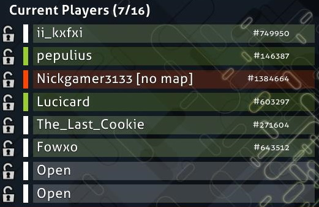
:::

玩家列表会显示房间的所有槽位。`当前玩家` 右侧的括号中会显示房间里的玩家数与已解锁槽位总数。

点击可用槽位即可进行移动，但无法移动到带有上锁图标的槽位。[房主](/wiki/Gameplay/Multiplayer#host)可以通过点击槽位左侧的图标将其上锁、解锁，也可以踢走槽位中的玩家。如果要转移房主权限，可以右击目标玩家，然后按下 `将房主交给此玩家` 按钮。在 Team VS 模式中可以将队伍颜色改为蓝色或红色。

光标悬停在表中玩家上时，会显示对应玩家的等级、国家或地区和[整体准确率](/wiki/Gameplay/Accuracy)。

取决于玩家状态，列表中的玩家栏会使用四种颜色之一进行高亮：

| 颜色 | 描述 |
| :-: | :-- |
| **红色（没有此图）** | 玩家没有谱面，在下载好谱面之前都会显示 `[没有此图]` 。 |
| **白色（未准备好）** | 玩家拥有此谱面但还没准备好。在此状态下可以更改[游戏模组](/wiki/Gameplay/Game_modifier)选择。 |
| **绿色（已准备好）** | 玩家已准备好，此时不能更改模组选择。房主准备好后就可以开始比赛，所有已准备好的玩家都会开始游玩。 |
| **浅蓝色（游玩中）** | 玩家正在游玩，在比赛结束前都会显示 `[游玩中]` 。 |

### 比赛设置

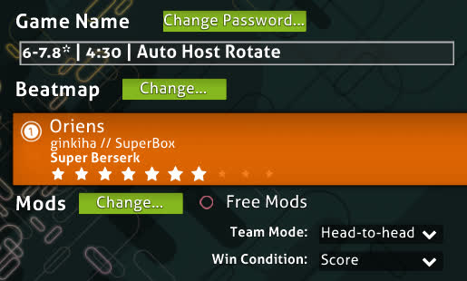

这些设置仅可由房主更改，但对所有人可见。

#### 比赛名称与密码

`Game Name` 指的是房间名称，在游戏内的房间列表与网页上都可见。给房间设置密码有助于将房间限制于好友或锦标赛玩家访问。可以使用比赛名称上方的 `更改密码` 按钮修改密码。

#### 谱面

::: Infobox
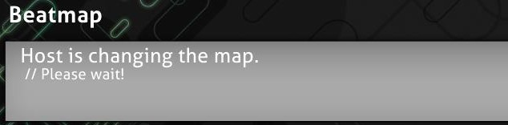
:::

::: Infobox
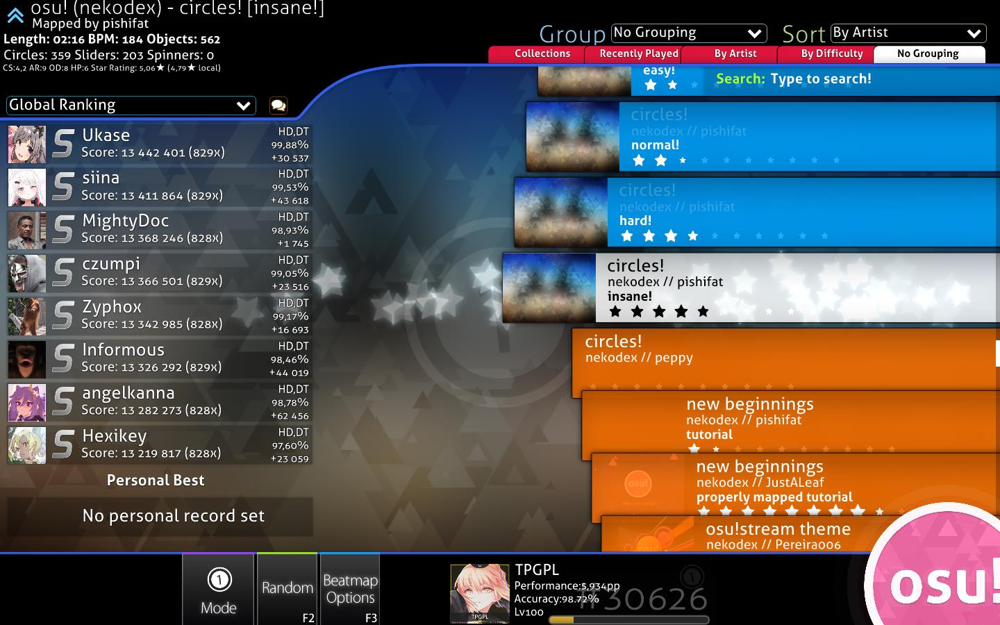
:::

谱面区会显示比赛房间将要游玩的谱面。点击谱面卡片会打开选歌页面，用于切换谱面。

谱面卡片会展示所选谱面的背景图片、游戏模式图标、歌曲的标题与艺术家、制图者、选中的[难度](/wiki/Beatmap/Difficulty)与[星数评价](/wiki/Beatmap/Star_rating)。

::: Infobox
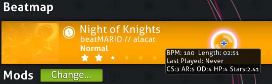
:::

光标悬停在谱面上时，会出现一个弹出框，显示谱面相关信息，如下所示：

| 值 | 描述 |
| :-: | :-- |
| `BPM` | 每分钟拍数 |
| `Length` | 谱面长度 |
| `Last Played` | 上次游玩谱面的时间 |
| `CS` | 圆圈大小 |
| `AR` | 缩圈速度 |
| `OD` | 判定严度 |
| `HP` | 掉血速度 |
| `Star Rating` | 星数评价 |

如果玩家没有对应谱面，则会给出如下状态之一：

| 谱面状态 | 描述 |
| :-: | :-- |
| `Ranked` / `Approved` / `Pending` / `Graveyard` | [谱面类别](/wiki/Beatmap/Category)。点击谱面卡片后会打开谱面信息页，可以在这里[下载](/wiki/Beatmap#下载谱面)它。若玩家拥有活跃的 [osu! 支持者](/wiki/osu!supporter)标签，则会使用 [osu!direct](/wiki/osu!supporter#osu!direct) 下载谱面。 |
| `Not uploaded or not up-to-date（未上传或非最新）` | 无法下载此谱面。如果问题无法解决，房主应该帮玩家找到（[谱面列表](https://osu.ppy.sh/beatmapsets)中的）链接。 |
| `Cannot update the beatmap（无法更新谱面）` | 房主选择了已经修改的谱面。 |

#### 模组

::: Infobox
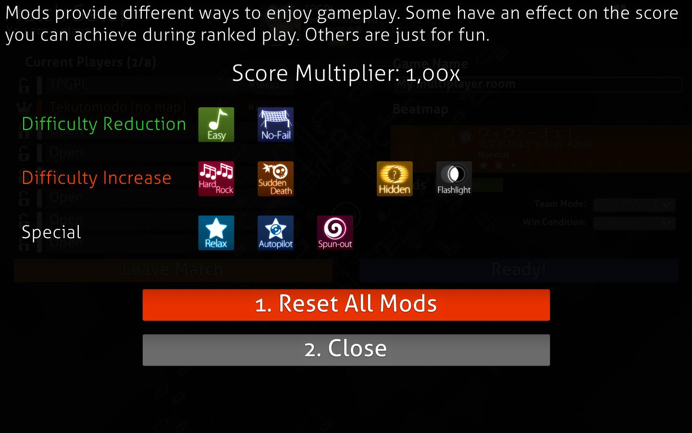
:::

此区域显示比赛使用的[游戏模组](/wiki/Gameplay/Multiplayer#mods)。房主可以在模组选择页进行选择，也可以启用 `Free Mods（允许自由选择 Mod）`，让玩家自行选择模组。

#### 组队模式与获胜条件

底部的两个下拉框用于设置比赛的[组队模式](/wiki/Gameplay/Multiplayer#team-modes)，以及决定获胜方的[获胜条件](/wiki/Gameplay/Multiplayer#win-conditions)。

##### Tag 颜色

::: Infobox
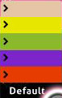
:::

如果组队模式是 `Tag co-op` 或 `Tag-team VS`，则会显示 `Tag Colour（Tag 颜色）: (combo colour)` 选项，让每位玩家可以选择自定义颜色。如果颜色设置为 `Default（默认）`，则会使用谱面原有的连击颜色。

### 比赛设置按钮

[聊天面板](/wiki/Client/Interface/Chat_console)上方有两个大按钮，分别是橙色和蓝色的。

左边的橙色 `离开房间` 按钮的作用显而易见。当房主离开房间时，房主资格会按槽位自动转移给剩余玩家。房间里没有剩余玩家时会自动关闭，但由 [`!mp` 命令](/wiki/osu!_tournament_client/osu!tourney/Tournament_management_commands)建立的房间除外，这类房间会在 30 分钟后关闭。

蓝色按钮用于控制玩家的准备状态，以及开始比赛。

| 名称 | 描述 |
| :-: | :-- |
| `准备！` | 将玩家标记为已准备好（在玩家列表中显示为绿色），此后按钮会变为 `取消准备`。对房主来说，则会变为 `开始游戏！` 或是 `强制开始游戏！`（房间里有其他玩家时）。 |
| `取消准备` | 将玩家标记为未准备好（在玩家列表中显示为白色），此后按钮会变为 `准备！`。 |
| `开始游戏！` | 开始比赛。此按钮仅房主可见，且在所有玩家都准备好时才会显示。 |
| `强制开始游戏！({准备好玩家数}/{总玩家数})` | 即使有玩家未准备好也开始比赛。此按钮仅房主可见，且在部分玩家准备好时才会显示。括号里会显示已准备好的玩家数与总玩家数比较值。 |

### 聊天面板

屏幕底部是[聊天面板](/wiki/Client/Interface/Chat_console)。每个比赛房间都有单独的聊天频道，显示在 `#multiplayer` 标签页中。[BanchoBot](/wiki/BanchoBot) 会在此频道发送第一条消息，给出[比赛历史](/wiki/Gameplay/Multiplayer#match-history)的链接。

## 游玩时

多人游戏时的游玩页面与单人游戏基本相同。除此之外，还会在右下角显示玩家的当前排名，以及显示多人游戏排行榜，和组队模式特有的组件。

在比赛将开始时，将光标移动到屏幕底部会唤起[视觉设置](/wiki/Client/Interface/Visual_settings)面板，以便进行视觉方面的自定义。

### 多人游戏排行榜

取决于比赛设置，屏幕一侧的排行榜会实时显示每位玩家不同的统计数据。

对于 `Head-to-head` 和 `Team VS` 模式的比赛：

| 获胜条件 | 显示的统计数据 |
| :-- | :-- |
| `Score` / `Score v2` | 玩家分数、连击数、判定 |
| `Accuracy` | 准确率、玩家分数、连击数、判定 |
| `Combo` | 当前连击数 |

对于 `Tag co-op` 和 `Tag-team VS` 模式：

| 获胜条件 | 显示的统计数据 |
| :-- | :-- |
| `Score` / `Score v2` | 队伍分数、玩家分数、判定 |
| `Accuracy` | 队伍平均准确率、玩家分数、判定 |
| `Combo` | 当前连击数、玩家分数、判定 |

失败或已退出的玩家位于排行榜底部，其分数与其他玩家分开排列。

游玩时，排行榜中玩家的背景颜色指示其状态。

| 图例 | 状态 | 描述 |
| :-: | :-: | :-- |
| 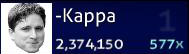 | 正常 | 玩家剩余血量大于一半。颜色会根据血量变为亮蓝色或亮红色。 |
|  | 危险 | 玩家剩余血量少于一半。颜色会根据血量变为亮蓝色或亮红色。 |
| 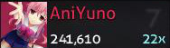 | 失败 | 玩家血量为零，处于[失败状态](/wiki/Gameplay/Multiplayer#health-and-failing)。 |
|  | 接力 | 在 `Tag co-op` 和 `Tag-team VS` 模式中，玩家框总是绿色的。发微弱白光的绿色箭头会指着当前正在接力的玩家。 |
|  | 已跳过 | 玩家请求跳过谱面前奏部分（如果有）。当所有玩家都已请求，则会跳过前奏。 |
|  | 已退出 | 玩家按了两次 `Esc` 键或者是与 [Bancho](/wiki/Bancho_(server)) 断开了连接，已经退出比赛。玩家名字的颜色会由白变红，末尾加上 `[Quit]`。玩家框的颜色显示玩家退出房间前的状态。 |

### 组队模式界面

界面的剩余部分由比赛的[组队模式](/wiki/Gameplay/Multiplayer#team-modes)决定。

::: Infobox
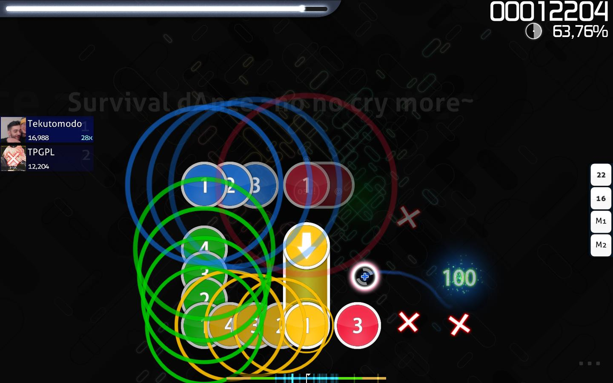
:::

在 `Head-to-head` 模式中，除了排行榜不会添加其他组件。

::: Infobox
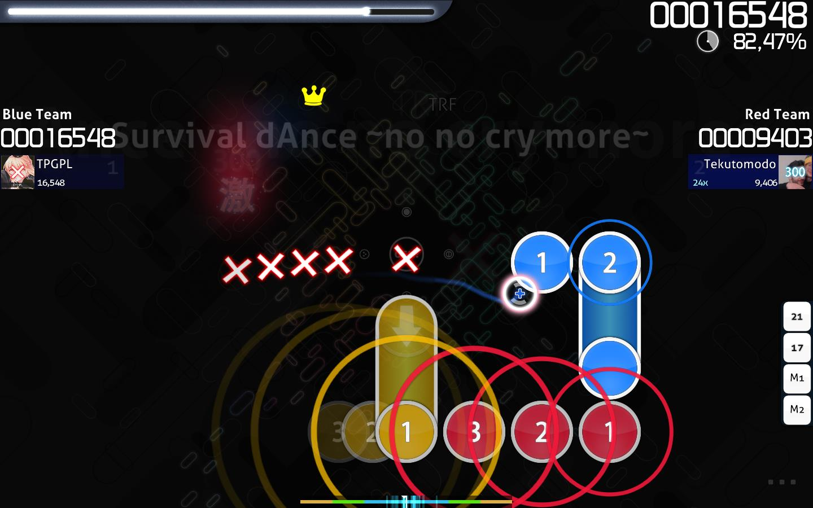
:::

在 `Team VS` 模式中，蓝队玩家列表位于屏幕左侧，红队位于右侧。屏幕中央的皇冠左右移动，显示目前领先的队伍。

::: Infobox
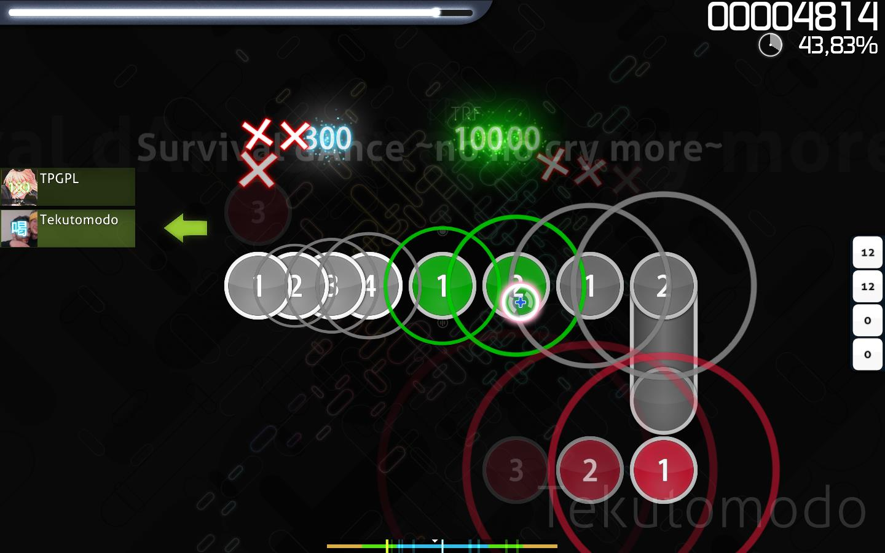
:::

::: Infobox
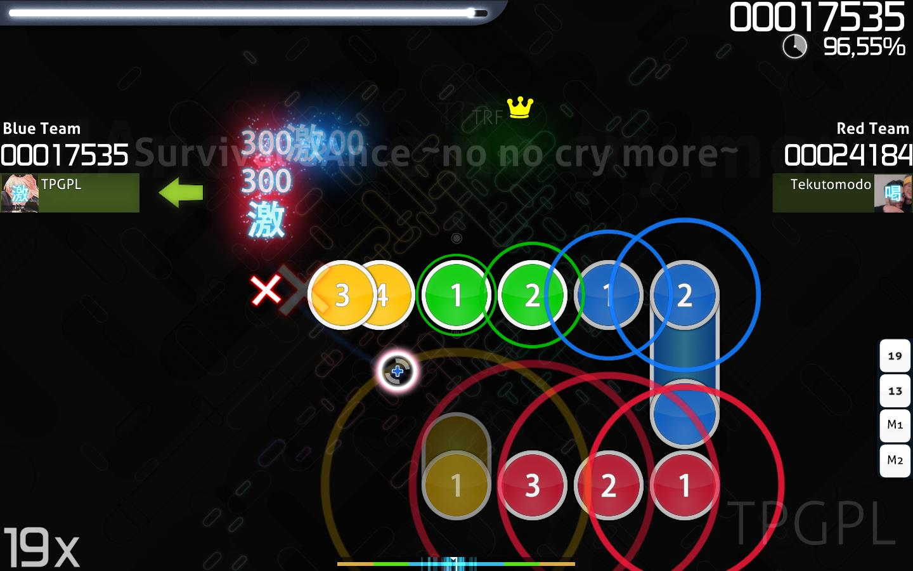
:::

在 `Tag co-op` 与 `Tag-team VS` 模式中，绿色箭头会指示目前正在游玩的玩家，其用户名显示在右下角。当将要轮到玩家时，会显示警告箭头，此时连击组中的打击物件会使用玩家所属的 [Tag 颜色](#tag-颜色)。

## 结算屏幕

与单人游戏不同，多人游戏的结算屏幕不会显示[在线排行榜区域](/wiki/Client/Interface#在线排行榜)。除 `Tag co-op` 与 `Tag-team VS` 模式外，可以使用 `F2` 导出分数对应的回放。

::: Infobox
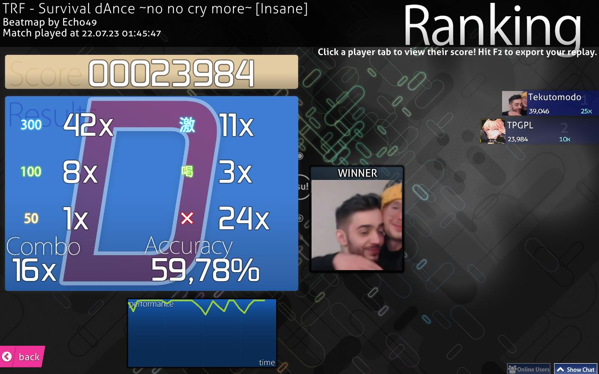
:::

在 `Head-to-head` 模式比赛结束后，获胜者的头像会显示在大框中，右侧显示比赛排行榜。本次游玩的[评级](/wiki/Gameplay/Grade)会以类似于水印的形式显示在结果下层。点击排行榜中其他玩家的面板，即可查看其分数。

::: Infobox
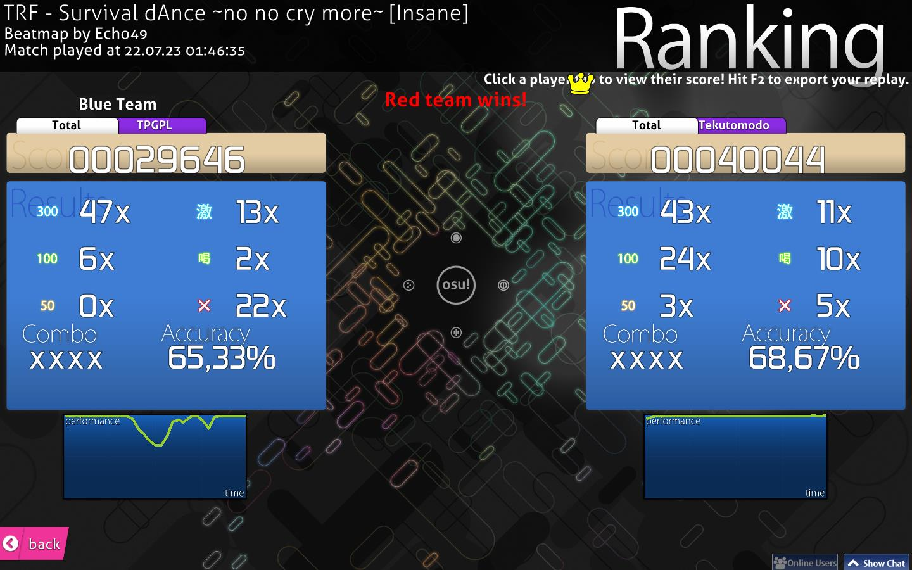
:::

在 `Team VS` 模式中，获胜的队伍会在结算屏幕顶部显示。两边的面板的不同标签页分别显示两队各玩家的分数，而 `Total` 标签页显示队伍的[判定](/wiki/Gameplay/Judgement)总数与平均准确率。

::: Infobox
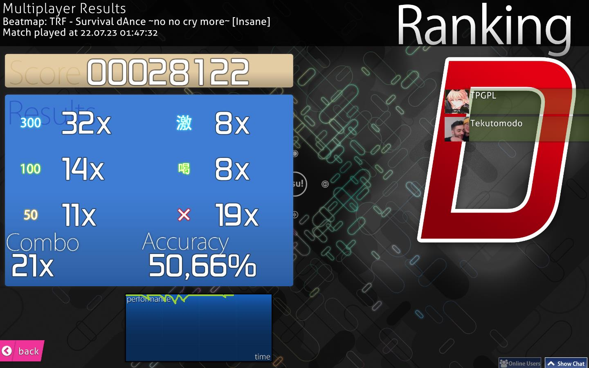
:::

::: Infobox
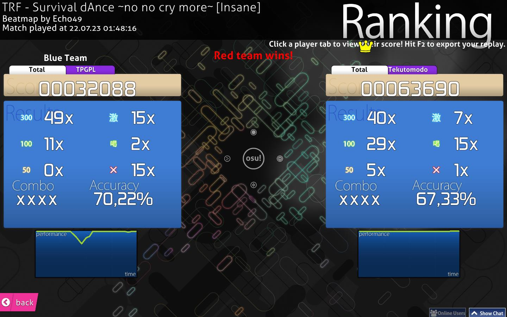
:::

`Tag co-op` 模式下的结算屏幕显示队伍的总分、[判定](/wiki/Gameplay/Judgement)与准确率，而不会单独显示每位玩家的结果（仅在[比赛历史](/wiki/Gameplay/Multiplayer#match-history)中显示）。与其他组队模式不同，，只有成功完成了谱面，才会显示结算屏幕。`Tag-team VS` 模式的结算屏幕与 `Team VS` 相同。但在 `Team VS` 模式中，两支队伍的不同标签页下会单独显示所有玩家的结果。
