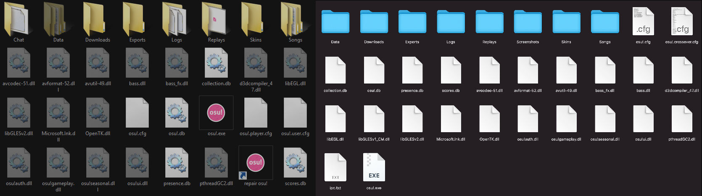

# osu! program files

::: alert-note
**See also:** [osu! file formats](/wiki/Client/File_formats)
:::

The **osu! program files** are a set of files that osu! uses to run the game and keep track of different user activities. These files come prepackaged with osu!'s installation and are crucial for the game's routine operations.

## Location

All of osu!'s program files are present in the game's installation folder, which by default can be found in the following locations:

| Windows | macOS |
| :-- | :-- |
| `C:\Users\<Username>\AppData\Local\osu!` | `/Applications/osu!.app/Contents/Resources/drive_c/osu!` |

## Files

::: alert-caution
**Caution**
Make sure to backup these files before changing their contents manually, as you might break the game if you are not careful.
:::

### .cfg (configuration files)

Configuration files store game settings. Unlike other program files, they are human-readable and can be opened and modified by using a text editor.

| File name | Function |
| --: | :-- |
| `osu!.cfg` | Stores security information about the osu! application files and the current [release stream](/wiki/Client/Release_stream) *(should never be modified manually unless absolutely necessary)* |
| `osu!.<operating system username>.cfg` | Stores [game options](/wiki/Client/Options) and other settings. See also: [User configuration file](/wiki/Client/Program_files/User_configuration_file) |
| `tournament.cfg` | Stores data related to [osu!tourney](/wiki/osu!_tournament_client/osu!tourney) and the [osu! tournament client](/wiki/osu!_tournament_client) |

### .db (database files)

Database files contain information needed for running the game, such as saved scores and the cached list of [beatmaps](/wiki/Beatmap) saved on the player's device.

| File name | Function |
| --: | :-- |
| `collection.db` | Stores locally created beatmap collections |
| `osu!.db` | Stores osu!'s database of beatmaps |
| `presence.db` | Stores the list of players logged into the chat console in the form of a cache |
| `scores.db` | Stores imported and locally achieved records |

### .dll (application extension)

`.dll` files, or [dynamic-link library](https://en.wikipedia.org/wiki/Dynamic-link_library) files, are files that constitute osu!'s components and dependencies. Except for the `.dll` files that are attributed to osu!, these files all originated from a third-party source and were subsequently integrated into the game's framework.

| File name | Function |
| --: | :-- |
| `avcodec-51.dll` | Allows osu! to encode/decode audio and video files |
| `avformat-52.dll` | Allows osu! to read different audio and video formats |
| `avutil-49.dll` | Provides core utilities for osu! to handle the processing of multimedia files |
| `bass.dll` | Allows osu! to play audio |
| `bass_fx.dll` | An add-on for `bass.dll` that allows osu! to run signal processing functions, such as [tempo](/wiki/Music_theory/Tempo) quantisation and reverse playback |
| `d3dcompiler_47.dll` | Allows osu!'s shader codes to be processed by the player's GPU/graphics card |
| `libEGL.dll` | Allows osu!'s display to be natively rendered over different operating systems |
| `libEGLESv2.dll` | Helps osu! in processing hardware-accelerated 3D graphics rendering |
| `Microsoft.Ink.dll` | Shared code module that osu! uses to perform certain system tasks in parallel with other applications |
| `OpenTK.dll` | Allows osu! to utilise various [OpenGL](https://en.wikipedia.org/wiki/OpenGL) functions such as keyboard and mouse input handling |
| `osu!auth.dll` | Handles osu!'s client-side player authorisation |
| `osu!gameplay.dll` | Various modules related to osu!'s gameplay features |
| `osu!seasonal.dll` | Stores information related to osu!'s seasonal backgrounds |
| `osu!ui.dll` | Various modules related to osu!'s user interface display |
| `pthreadgc2.dll` | Allows osu! to use [multithreading support](https://en.wikipedia.org/wiki/Multithreading_(computer_architecture)) |

### .exe (application files)

Application files are osu!'s main user-facing components. These files are safe to run assuming the player obtained the game from the official [download page](https://osu.ppy.sh/home/download).

| File name | Function |
| --: | :-- |
| `osu!.exe` | Starts osu! |
| `osume.exe` | Allows players to update and repair osu! installations manually *(deprecated in favour of `osu!.exe`'s own built-in updater)* |

## Folders

### Chat

The `Chat` folder stores chat logs. It will only appear if the player has the `Automatically log private messages` option enabled, or if they have run the `/savelog` command in the [chat console](/wiki/Client/Interface/Chat_console) at least once.

Chat logs are named following the `{Tab_name}-{YYYYMMDD}-{HHMMSS}` format, and are preserved in a plain text (`.txt`) format that can be opened in any text editor. For example, a chat log with the name `#multiplayer-20121115-040845.txt` indicates that it originates from the `#multiplayer` chat and was saved on Thursday, 15 November 2012 at 04:08:45 local time. Chat logs of private messages are also stored in plain text files and use the `{username}` format. For example, messages exchanged between the player and ::{ flag=AU }:: [peppy](https://osu.ppy.sh/users/2) would be stored in a file named `peppy.txt`.

### Downloads

The `Downloads` folder stores the beatmap files that are being process by [osu!direct](/wiki/osu!supporter#osu!direct) (requires [osu!supporter](/wiki/osu!supporter)). These files are transferred to the `Songs` folder once the download is finished.

### Exports

The `Exports` folder stores the beatmaps and skins the player has exported from the game client. This folder will only appear if the player has used the [skin selector's `Export as .osk`](/wiki/Client/Options#skin.1) or the [beatmap editor's `Export Package`](/wiki/Client/Beatmap_editor/Menu#file) option at least once.

### Localisation

The `Localisation` folder stores downloaded game translations. This folder will only appear if the player has switched their language in the options at least once.

### Logs

The Logs folder stores osu!'s [log files](/wiki/Help_centre#log-files), which are mainly used to [troubleshoot problems](https://github.com/ppy/osu/discussions/15188) as needed. This folder will only appear if the player has run the game at least once.

### Replays

::: alert-notice
**Notice**
Certain older replay files may not play as smoothly during playback, as they were recorded at a lower sample rate.
:::

The `Replays` folder stores local [replay](/wiki/Gameplay/Replay) files, which contain score data and the player's cursor movement and clicks during gameplay. Replays can be saved by pressing `F2` at the results screen or by right-clicking on any score in the local leaderboard and selecting `2. Export replay`. They cannot be imported into the client when the corresponding beatmap is missing.

Replays are named following the `{Local player name} - {Artist} - {Title} {[Difficulty]} {(YYYY-MM-DD)} {Game Mode}` format. For example, a replay with the name `dummytest1 - Loituma - Ievan Polkka [SPINNER-MADNESS] (2013-08-12) OsuMania.osr` indicates that it originates from a play on the beatmap [Loituma - Ievan Polkka](https://osu.ppy.sh/beatmapsets/36323) on Monday, 12 August 2013 in the [osu!mania](/wiki/Game_mode/osu!mania) game mode.

### Screenshots

The `Screenshots` folder stores screen captures taken in osu! by pressing the screenshot key (`F12` by default).

Screenshots are named following the `screenshot###` format, where "###" is the screenshot number count. By default, all screenshots taken will be saved as `.jpg`, although this can be changed to `.png` in the Options menu.

### Skins

::: alert-note
**See also:** [Skinning](/wiki/Skinning)
:::

The `Skins` folder stores user-created [skins](/wiki/Skin), which can be used to customise [interface](/wiki/Client/Interface) and gameplay elements. Players can download skins as `.osk` files from the [Skinning subforum](https://osu.ppy.sh/community/forums/15) or other websites and install them by double-clicking the file or dragging it into the game window.

The built-in skin, *Default*, does not have its own folder and cannot be deleted.

### Songs

The `Songs` folder stores the player's beatmaps, which consist of `.osu` ([difficulties](/wiki/Beatmap/Difficulty)), `.mp3`/`.ogg` (audio) and `.jpg`/`.png`/`.gif` ([background](/wiki/Beatmap/Background)) files at the very least. Certain beatmaps may also include `.wav`/`.ogg` ([hitsounds](/wiki/Beatmapping/Hitsound)), `.osb` ([storyboard](/wiki/Storyboard)) and `.mp4`/`.flv` (video) files, as well as additional subfolders for storyboard assets and/or custom beatmap skins.

By default, beatmap folders are named following the `{BeatmapSetID} {Artist} - {Song Title}` format. For example, a beatmap folder with the name `57950 SOUND HOLIC - Drive My Life` indicates that it belongs to the beatmap [SOUND HOLIC - Drive My Life](https://osu.ppy.sh/beatmapsets/57950). Please note that certain very old beatmaps (as well as unsubmitted beatmaps) do not necessarily follow this format.

## Hidden folders

Folders below are hidden because any modifications made to them could prevent osu! from starting correctly (or at all).

### Data

The `Data` folder stores all of the local replay data as well as some of osu!'s most important system files. It also contains some of osu!'s cache files, such as the beatmap background cache and the avatar caches. These files should **not** be deleted while osu! is running, as they may be in use by osu! at any point.
