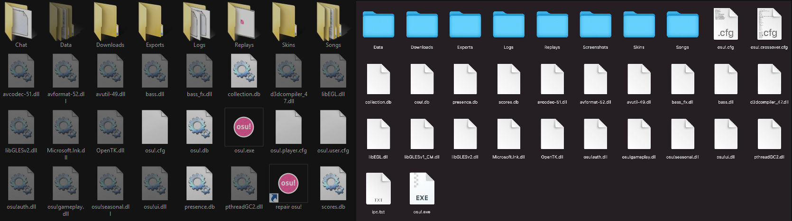

# osu! 目录文件

::: alert-note
**另见:** [osu! 文件格式](/wiki/Client/File_formats)
:::

**osu! 目录文件** 是 osu! 使用的一系列文件，用于运行游戏并跟踪不同的用户活动。这些文件由 osu! 安装自带，对游戏的例行操作至关重要。

## 位置

osu! 的所有文件都存放在游戏安装目录。默认情况下，可在以下位置找到：

| Windows | macOS |
| :-- | :-- |
| `C:\Users\<Username>\AppData\Local\osu!` | `/Applications/osu!.app/Contents/Resources/drive_c/osu!` |

## 文件

::: alert-caution
**注意**
在手动修改下列文件的内容前，请确保进行备份。若不谨慎操作，可能会破坏游戏。
:::

### .cfg （配置文件）

配置文件储存了 osu! 的游戏设置。与其他文件不同，这些文件人类可读，并可以通过记事本打开：

| 文件名 | 作用 |
| --: | :-- |
| `osu!.cfg` | 存储关于 osu! 应用文件的安全信息和当前的[更新通道](/wiki/Client/Release_stream)*（除非确有必要，否则不应被人为修改）* |
| `osu!.<操作系统用户名>.cfg` | 存储[游戏设置](/wiki/Client/Options)与其他配置。另见：[用户配置文件](/wiki/Client/Program_files/User_configuration_file) |
| `tournament.cfg` | 存储与 [osu!tourney](/wiki/osu!_tournament_client/osu!tourney) 及 [osu! 比赛客户端](/wiki/osu!_tournament_client)相关的数据 |

### .db （数据库文件）

数据库文件包含游戏运行所需的信息，例如保存的分数，以及在玩家设备上缓存的[谱面](/wiki/Beatmap)列表。

| 文件名 | 作用 |
| --: | :-- |
| `collection.db` | 存储本地创建的谱面收藏夹 |
| `osu!.db` | 存储 osu! 谱面数据库 |
| `presence.db` | 以缓存的形式，存储聊天面板的玩家信息 |
| `scores.db` | 存储导入成绩与本地历史成绩 |

### .dll （应用程序扩展）

`.dll` 文件（又称[动态链接库](https://zh.wikipedia.org/wiki/%E5%8A%A8%E6%80%81%E9%93%BE%E6%8E%A5%E5%BA%93)文件）构成了 osu! 的组件与依赖。除了归 osu! 所有的 `.dll` 文件，其余文件均源于第三方，随后被整合进游戏框架中。

| 文件名 | 作用 |
| --: | :-- |
| `avcodec-51.dll` | 使 osu! 能够编码、解码音视频文件 |
| `avformat-52.dll` | 使 osu! 能够读取不同的音视频格式 |
| `avutil-49.dll` | 为 osu! 提供多媒体文件的核心处理功能 |
| `bass.dll` | 使 osu! 能够播放音频 |
| `bass_fx.dll` | `bass.dll` 的加载项，使 osu! 能够进行信号处理，例如[曲速](/wiki/Music_theory/Tempo)量化与倒放 |
| `d3dcompiler_47.dll` | 使玩家的显卡能够处理 osu! 的着色器代码 |
| `libEGL.dll` | 使 osu! 的显示内容在不同操作系统下能被原生渲染 |
| `libEGLESv2.dll` | 辅助 osu! 利用硬件加速渲染 3D 图形 |
| `Microsoft.Ink.dll` | osu! 使用的共享代码模块，用于与其他应用程序并行执行某些系统任务 |
| `OpenTK.dll` | 使 osu! 能够使用各种 [OpenGL](https://zh.wikipedia.org/wiki/OpenGL) 功能，例如键鼠输入处理 |
| `osu!auth.dll` | 处理 osu! 的客户端侧玩家认证 |
| `osu!gameplay.dll` | 与 osu! 游戏功能相关的若干模块 |
| `osu!seasonal.dll` | 存储与 osu! 季节背景相关的信息 |
| `osu!ui.dll` | 与 osu! 用户界面显示相关的若干模块 |
| `pthreadgc2.dll` | 使 osu! 支持[多线程](https://zh.wikipedia.org/wiki/%E5%A4%9A%E7%BA%BF%E7%A8%8B) |

### .exe （应用程序文件）

应用程序文件是 osu! 主要面向用户的组件。只要玩家从官方[下载页](https://osu.ppy.sh/home/download)获取游戏，即可安全运行它们。

| 文件名 | 作用 |
| --: | :-- |
| `osu!.exe` | 启动 osu! |
| `osume.exe` | 让玩家能够手动更新与修复 osu! 安装 *（现已被 `osu!exe` 内置更新工具取代）* |

## 文件夹

### Chat

`Chat` 文件夹存储聊天日志。该文件夹只会在玩家启用了`保存私聊记录`设置后，或者在[聊天面板](/wiki/Client/Interface/Chat_console)中运行过 `/savelog` 命令后出现。

聊天日志按 `{Tab_name}-{YYYYMMDD}-{HHMMSS}` 格式命名，使用纯文本 (`.txt`) 格式保存，可使用各种文本编辑器打开。举个例子，名为 `#multiplayer-20121115-040845.txt` 的聊天日志来自 `#multiplayer` 频道，本地保存时间为 2012 年 11 月 15 日（周四）04:08:45。私聊日志也以纯文本格式保存，文件名即为 `{username}`。例如，玩家与 ::{ flag=AU }:: [peppy](https://osu.ppy.sh/users/2) 间的对话内容保存在名为 `peppy.txt` 的文件中。

### Downloads

`Downloads` 文件夹存储 [osu!direct](/wiki/osu!supporter#osu!direct)（需要 [osu! 支持者](/wiki/osu!supporter)）正在处理的的谱面文件。谱面下载结束后，这些文件会被移动到 `Songs` 文件夹。

### Exports

`Exports` 文件夹存储玩家从客户端导出的谱面与皮肤。该文件夹只会在玩家用过[皮肤选择器的`导出 .osk`](/wiki/Client/Options#皮肤)，或[谱面编辑器的`导出图包`](/wiki/Client/Beatmap_editor/Menu#文件)后出现。

### Localisation

`Localisation` 文件夹存储已下载的游戏翻译。该文件夹只会在玩家从设置切换过语言后出现。

### Logs

`Logs` 文件夹存储 osu! 的[日志文件](/wiki/Help_centre#log-files)，主要用于按需[排查问题](https://github.com/ppy/osu/discussions/15188)。该文件夹只会在玩家使用`测试版 (Cutting Edge)` [更新通道](/wiki/Client/Release_stream)运行过游戏后出现。

### Replays

::: alert-notice
**备注**
由于录制采样率较低，某些早期的回放文件在播放时可能不会很流畅。
:::

`Replays` 文件夹存储本地[回放](/wiki/Gameplay/Replay)文件。回放文件包含分数数据，以及玩家游戏期间的光标移动与点击事件。可以通过在结算页面按 `F2`，或者在本地排行榜右键点击分数，并选择 `2. 导出回放`来保存回放。当回放对应的谱面不存在时，无法导入回放。

回放文件按 `{本地玩家名} - {艺术家} - {标题} {[难度]} {(YYYY-MM-DD)} {游戏模式}` 格式命名。举个例子，名为 `dummytest1 - Loituma - Ievan Polkka [SPINNER-MADNESS] (2013-08-12) OsuMania.osr` 的回放表明，其来自 [Loituma - Ievan Polkka](https://osu.ppy.sh/beatmapsets/36323) 谱面的一次游玩，使用 [osu!mania](/wiki/Game_mode/osu!mania) 模式游玩，游玩时间为 2013 年 8 月 12 日（周一）。

### Screenshots

`Screenshots` 文件夹存储 osu! 中使用截图快捷键（默认是 `F12`）截取的屏幕截图。

截图的命名格式是 `screenshot###`，其中“###”是截图编号。默认情况下，所有截图以 `.jpg` 格式保存，但也可以在设置菜单中更改为 `.png`。

### Skins

::: alert-note
**另见:** [皮肤制作](/wiki/Skinning)
:::

`Skins` 文件夹存储用户创建的[皮肤](/wiki/Skin)，可用于定制[游戏界面](/wiki/Client/Interface)与游戏元素。玩家可以从[皮肤制作子论坛](https://osu.ppy.sh/community/forums/15)或其他网站下载 `.osk` 皮肤文件，双击打开或者将其拖入游戏窗口来安装它们。

内置皮肤 *Default* 没有对应的文件夹，且无法被删除。

### Songs

`Songs` 文件夹存储玩家的谱面，其中至少含有 `.osu`（[难度](/wiki/Beatmap/Difficulty)）、`.mp3`/`.ogg`（音频）与 `.jpg`/`.png`/`.gif`（[背景](/wiki/Beatmap/Background)）文件。某些谱面也会带有 `.wav`/`.ogg`（[打击音效](/wiki/Beatmapping/Hitsound)）、`.osb`（[故事板](/wiki/Storyboard)）与 `.mp4`/`.flv`（视频）文件，也会有用于存储故事板资源与自定义谱面皮肤的子文件夹。

默认情况下，谱面文件夹按 `{BeatmapSetID} {艺术家} - {标题}` 格式命名。举个例子，名为 `57950 SOUND HOLIC - Drive My Life` 的谱面文件夹表明其属于  [SOUND HOLIC - Drive My Life](https://osu.ppy.sh/beatmapsets/57950) 谱面。但请注意，某些很旧的谱面（以及未提交谱面）不一定会遵循这种格式。
