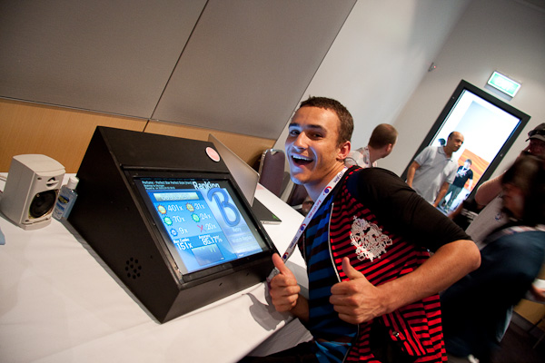
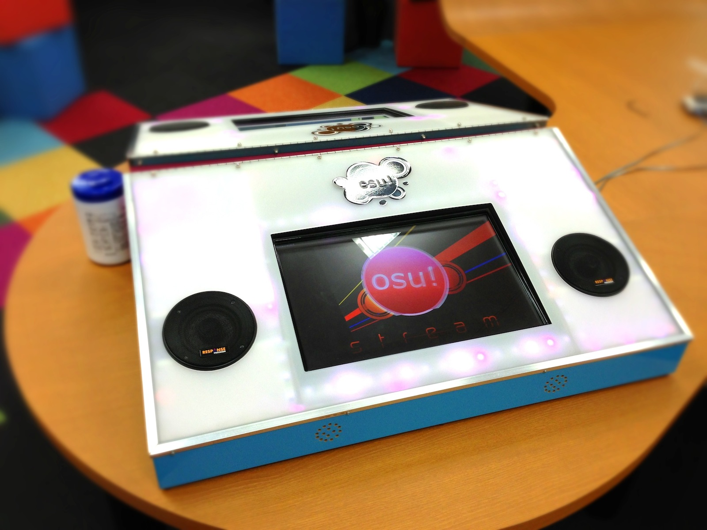

# osu!arcade

Die **osu!arcade** war ein Prototyp eines Spielautomaten, der von ::{ flag=AU }:: [peppy](https://osu.ppy.sh/users/2) entwickelt wurde. Er bestand aus einem selbstgefertigten Gehäuse und einem eingebauten Touchscreen, auf dem eine Touch-Version von osu! lief.

Obwohl *arcade* im Namen steckt, wurden typische Funktionen von Arcade-Automaten, wie beispielsweise Münzschlitze, zwar in Betracht gezogen, beim Bau des Prototyps jedoch nie hinzugefügt.[^rfid]

## Erster Prototyp

::: Infobox

:::

Für die Anime-Convention [Wai-con](https://en.wikipedia.org/wiki/Wai-Con) in Perth im Januar 2010 wollte peppy eine Präsentation für osu! schaffen, mit dem Ziel, das Spiel in der lokalen Community bekannter zu machen.[^wai-con] Obwohl es eine relativ spontane Idee war, richtete peppy erfolgreich den ersten Prototyp eines Arcade-Automaten ein. Es war ein schräger Kasten mit seitlich angebrachten externen Lautsprechern, auf dem eine modifizierte Version von osu!(stable) lief.[^wai-con-video][^kingking9-profile]

Während der zweitägigen Convention versuchte peppy Feedback zu erhalten, indem er sowohl Anfängern, als auch [Ouendan](https://en.wikipedia.org/wiki/Osu!_Tatakae!_Ouendan)- und [Elite Beat Agents](/wiki/iNiS_games#elite-beat-agents)-Veteranen beim Spielen zusah.

Viele Besucher der Convention wollten den Arcade-Automaten ausprobieren, so sehr, dass es aufgrund der konstanten Menschenmenge um das Gerät zumeist schwierig war, den Bildschirm zu sehen. Insgesamt kam der Arcade-Automat bei der Community gut an, wobei manche Spieler darauf hinwiesen, dass man wunde Finger bekam, wenn man zu lang spielte.[^sore-fingers]

## Zweiter Prototyp

::: Infobox

:::

Etwa Anfang bis Mitte 2012 wurde ein zweiter Prototyp entwickelt.[^tweet-1][^tweet-2] Er enthielt zwei Lautsprecher, die in das Gerät eingebaut waren. Der Touchscreen verwendete ein präzises, optisches System.[^optical] Außerdem steuerte ein [Arduino](https://de.wikipedia.org/wiki/Arduino_(Plattform))-[Mikrocontroller](https://de.wikipedia.org/wiki/Mikrocontroller) LED-Leuchten, die passend zur Musik blinkten.[^music-light][^design-documents]

Auf dem Prototyp lief [osu!stream](/wiki/osu!stream), eine osu!-Variante für Touch-Geräte. Er wurde der Öffentlichkeit auf mehreren Veranstaltungen, wie beispielsweise dem "Red Flag LAN Fest" in Perth, vorgestellt.[^rflan][^oneup]

Im August 2012 wurde in osu!stream speziell für den Arcade-Automaten ein lokaler Mehrspielermodus hinzugefügt.[^local-multi] Enthalten waren ein eigener Server und in Echtzeit synchronisierte Cursor, ein exklusives Feature, das in keiner anderen Variante von osu! vorhanden ist.[^multi-arcade]

Später im selben Jahr experimentierte peppy damit, [osu!](/wiki/Game_mode/osu!)-[Beatmaps](/wiki/Beatmap) in Beatmaps für osu!stream zu konvertieren, damit auf dem Arcade-Automaten eine größere Vielfalt an Beatmaps gespielt werden konnte.[^conversion]

## Zukunft

In den folgenden Jahren setzte peppy seine Arbeit an der osu!arcade nicht fort. Durch die Veröffentlichung des [Designdokuments](https://osu.ppy.sh/community/forums/topics/163062?n=1) im Oktober 2013 wollte er jedoch andere dazu inspirieren, ihren eigenen Arcade-Automaten zu bauen oder ähnliche Projekte umzusetzen.

## Referenzen

[^rfid]: [GitHub-Kommentar von peppy (07.05.2026)](https://github.com/ppy/osu-wiki/pull/14697/changes#r3201675470)
[^wai-con]: [Forumsbeitrag von peppy (27.01.2010) "osu!arcade at Wai-con 2010"](https://osu.ppy.sh/community/forums/topics/23392?n=1)
[^wai-con-video]: [YouTube-Video von shigeru miyamoto (23.01.2010) "osu! at Waicon 2010"](https://www.youtube.com/watch?v=WKvm975bmj0)
[^kingking9-profile]: [osu!-Profil von kingking9, auf dem sich viele Bilder des Prototyps befinden](https://osu.ppy.sh/users/1277097)
[^sore-fingers]: [Tweet von @ppy (04.07.2010)](https://twitter.com/ppy/status/17689427400)

[^tweet-1]: [Tweet von @ppy (15.05.2012)](https://twitter.com/ppy/status/202271556498505729)
[^tweet-2]: [Tweet von @ppy (13.06.2012)](https://twitter.com/ppy/status/212795116774109184)
[^optical]: [YouTube-Kommentar von Dean Herbert (2013) unter "[osu!stream/osu!arcade] OK Go - This Too Shall Pass"](https://www.youtube.com/watch?v=LQjYwpDnBec&lc=Ugz7J0_hFd-DXQHN5Gl4AaABAg)
[^design-documents]: [Forumsbeitrag von peppy (01.11.2013) "osu!arcade design documents"](https://osu.ppy.sh/community/forums/topics/163062?n=1)
[^music-light]: [YouTube-Video von Dean Herbert (03.06.2012) "osu!arcade lighting #2 (wip)"](https://www.youtube.com/watch?v=CjXqPZXbnHU)
[^local-multi]: [Tweet von @ppy (24.08.2012)](https://twitter.com/ppy/status/239027656476213249)
[^multi-arcade]: [GitHub-Kommentar von peppy (07.05.2026)](https://github.com/ppy/osu-wiki/pull/14697/changes#r3201696782)
[^rflan]: [YouTube-Video von Dean Herbert (17.10.2012) "osu!arcade @ RFLAN (highlights #1)"](https://www.youtube.com/watch?v=3RZ0e5QxUj8)
[^oneup]: [YouTube-Video von Dean Herbert (19.09.2012) "osu!arcade @ OneUp Microcinema"](https://www.youtube.com/watch?v=aIDqzD09Sus)
[^conversion]: [Blogbeitrag von peppy (17.12.2012) "This Week in osu!"](https://blog.ppy.sh/post/38114063519/this-week-in-osu-5)
