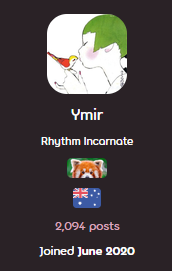
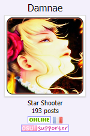

---
tags:
  - forum title
  - forum titles
  - rank
  - titles
  - user color
  - user colour
  - título del foro
  - títulos del foro
  - rango
  - clasificación
  - títulos
  - color de usuario
---

# Título de usuario

::: alert-note
**Nota:** Para obtener una lista de personas que han obtenido títulos de usuario especiales, véase [Usuarios con títulos únicos](/wiki/People/Users_with_unique_titles).
:::

Un **título de usuario** es una etiqueta corta en la página de perfil de un usuario establecida por el [osu! team](/wiki/People/osu!_team). La mayoría de los títulos indican la pertenencia a un [grupo de usuarios](/wiki/People/User_groups), pero algunos usuarios han obtenido [títulos más únicos](/wiki/People/Users_with_unique_titles) por logros o contribuciones específicas.

El color del título de un usuario es el mismo que el color del usuario, que también suele establecerse por la pertenencia a un grupo. Si el usuario no tiene un color establecido, el título será blanco.

## Títulos por número de publicaciones

En los [foros de osu!](https://osu.ppy.sh/community/forums), los usuarios pueden obtener títulos al alcanzar determinados hitos en el número de publicaciones, tal y como se indica a continuación:

| Título del foro | Número total de publicaciones |
| :-: | :-- |
| Rhythm Rookie | 0-4 |
| Tempo Trainee | 5-14 |
| Whistle Blower | 15-29 |
| Cymbal Sounder | 30-49 |
| Beat Clicker | 50-79 |
| Slider Savant | 80-119 |
| Spinner Sage | 120-179 |
| Star Shooter | 180-259 |
| Combo Commander | 260-499 |
| Rhythm Incarnate | 500+ |

Estos títulos solo son visibles en las barras laterales de las publicaciones del foro (no en los perfiles de los usuarios) y no se muestran si ya hay otro título personalizado establecido.

## Historia

Durante un tiempo, los títulos por número de publicaciones solo estaban disponibles en el [antiguo sitio web de osu!](https://old.ppy.sh), con los mismos requisitos en cuanto a hitos. Se eliminaron cuando osu! cambió a un nuevo diseño. En septiembre de 2026, se volvieron a introducir los títulos por número de publicaciones.

## Curiosidades

::: Infobox

:::

- Los títulos de usuario se denominan «títulos de rango» en todo el código del juego. Este es un nombre sobrante de cuando osu! fue construido sobre [phpBB](https://www.phpbb.com/).
- A partir de marzo de 2021, a los usuarios que obtienen varios títulos generalmente se les asigna un título que los une todos con barras. Anteriormente, era más común mostrar solo el título más significativo o más reciente.
