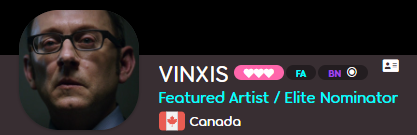

---
tags:
  - forum title
  - forum titles
  - rank
  - titles
  - титул
  - титулы
  - user color
  - user colour
---

# Титул

::: alert-note
**Примечание:** список игроков, получивших уникальные титулы, см. в [Игроки с уникальными титулами](/wiki/People/Users_with_unique_titles).
:::

**Титул** — это короткая строка в профиле игрока, устанавливаемая [командой osu!](/wiki/People/osu!_team). Большинство титулов указывают на принадлежность к определённой [группе пользователей](/wiki/People/User_groups), но некоторые игроки получают [более уникальные титулы](/wiki/People/Users_with_unique_titles) за выдающиеся достижения или значимый вклад в развитие osu!.

Цвет титула совпадает с цветом игрока, который определяется членством в группе пользователей. Если у игрока нет особого цвета, то титул будет белым.

## Титулы на форуме

<!-- Image from https://osu.ppy.sh/community/forums/topics/145250?n=58271, previous user has a non-forum title -->

На [форуме](https://osu.ppy.sh/community/forums) игрокам выдаются титулы в зависимости от набранного ими числа форумных постов:

| Титул | Число постов |
| :-: | :-- |
| Rhythm Rookie | 0–4 |
| Tempo Trainee | 5–14 |
| Whistle Blower | 15–29 |
| Cymbal Sounder | 30–49 |
| Beat Clicker | 50–79 |
| Slider Savant | 80–119 |
| Spinner Sage | 120–179 |
| Star Shooter | 180–259 |
| Combo Commander | 260–499 |
| Rhythm Incarnate | 500+ |

Эти титулы видны только в левой части постов на форуме (не в профилях игроков), а также не отображаются, если ранее игроку был присвоен групповой или уникальный титул.

### История

<!-- the bottom post on https://web.archive.org/web/20131107133826/https://osu.ppy.sh/forum/t/141240 -->

Какое-то время титулы на форуме были доступны только на [старом сайте](https://old.ppy.sh)<!-- TODO: wiki page -->, с теми же требованиями к их получению.<!-- https://osu.ppy.sh/community/forums/posts/2306316 --> Они были убраны вместе с переходом osu! на новый дизайн, но в сентябре 2026 их снова вернули.

## Интересные факты

::: Infobox

:::

- В коде игры титулы называются "ранговыми титулами" (англ. *rank titles*). Это название осталось с тех времён, когда сайт osu! был написан на [phpBB](https://www.phpbb.com/).
- С марта 2021 года игрокам, получившим несколько титулов, теперь присваивается титул, перечисляющий их все через косую черту (до этого отображался только самый почётный или самый новый титул).
