# FAQ

## Wprowadzenie

### Nigdy nie grałem w tego całego „Ouendana” — co to jest?

*[Osu! Tatakae! Ouendan](https://en.wikipedia.org/wiki/Osu!_Tatakae!_Ouendan)* to gra rytmiczna stworzona na konsolę *Nintendo DS*. Rozgrywka składa się jedynie z trzech elementów: naciskaniu kółek na ekranie dotykowym, przeciąganiu piłki po określonej ścieżce oraz jak najszybszym kręceniu spinnera. Wszystkie te elementy wykonujemy słuchając (coverów) popularnych japońskich piosenek. Na *Nintendo DS* gra wygląda następująco:

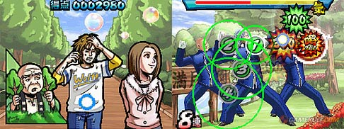

Na dolnym ekranie mamy wspomniane wcześniej kółka, na górnym zaś przedstawiona jest historia. Każdy poziom jest w zasadzie opowieścią o osobie, która ma jakiś problem. To jest właśnie moment, w którym *Ouendan* (drużyna pocieszająca) wkracza do gry. Przy użyciu magicznej mocy męskiego cheerleadowania gracz musi pomóc innym osobom w potrzebie.

### Jak w to się gra?

*Pełne wyjaśnienie: [osu!](/wiki/Game_mode/osu!)*

Większość użytkowników komputera nie ma posiada ekranu dotykowego, dlatego gra została stworzona z myślą o grze myszką, jak i również najróżniejszymi innymi kontrolerami. Różne style gry są opisane w [tym artykule](/wiki/Gameplay/Play_style). Niektóre piosenki wystawiają na próbę możliwości grania myszką, jednak wszystkie rankingowe oraz zatwierdzone beatmapy zostały sprawdzone i większość z nich można przejść jedynie przy użyciu myszki.

#### Podstawy rozgrywki

*Tutorial: [Tutorial osu! (new beginnings)](https://osu.ppy.sh/beatmapsets/1011011)*

Rozgrywka stawia nacisk na:

- zdolność adaptacji i reagowania na bodźce (to znaczy na elementy rozgrywki, które pojawiają się z dużą prędkością)
- rozumienie rytmu i struktury piosenki
- kontrolowanie urządzenia do sterowania
- trafianie obiektów zgodnie z rytmem
- umiejętność szybkiego kręcenia kółek myszką (lub rysikiem w przypadku tabletu) podczas spinnerów
- fizyczną i mentalną wytrzymałość (zwłaszcza przy długich piosenkach)
- odpowiednie ustawienie ręki i koordynację ręka-oko

Są to niektóre z umiejętności, które są niezbędne do zostania *mistrzem rytmu osu!*. Pierwszym krokiem jest jednak nauczenie się podstaw (oraz teorii) elementów rozgrywki.

##### Kółka

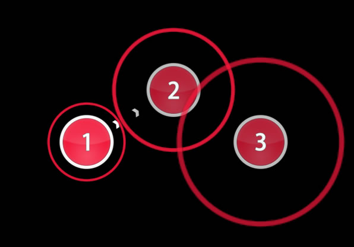

Wąska otoczka o podobnym do kółka kolorze będzie się z czasem zmniejszać. Kliknij dokładnie wtedy, gdy dotknie ona białej krawędzi kółka. Po kliknięciu pojawi się ilość punktów za trafienie oraz otrzymanych punktów życia, które zależą od tego, jak celne było trafienie. Następnie kółko zniknie.

Żeby zrozumieć ukryty urok kółek, powinieneś skupiać się nie tylko na wzroku; poczuj rytm piosenki. Pomoże ci to w trafianiu bardziej skomplikowanych układów kółek, które można znaleźć na wyższych poziomach trudności.

##### Slidery

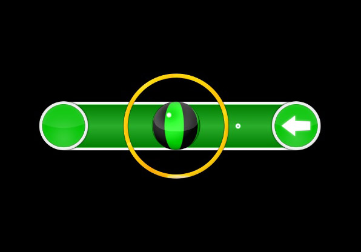

Na początek kliknij kółko w odpowiednim momencie, jednak na tym nie koniec — piłka zacznie się poruszać po wyznaczonej trasie. Przytrzymaj przycisk myszki/klawisz na klawiaturze (lub palec/rysik na tablecie) i podążaj za nią, utrzymując swój kursor w obrębie grubego pomarańczowego okręgu otaczającego piłkę. Okrąg ten pojawi się, gdy będziesz podążać za piłką i zniknie, gdy ją puścisz.

Jak widać na powyższym zrzucie ekranu, czasem piłka może zacząć poruszać się z powrotem po swojej trasie. Informuje o tym strzałka, która znajduje się na końcu lub początku slidera.

##### Spinnery

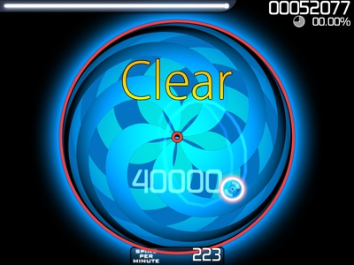

Kliknij przycisk myszy lub naciśnij klawisz na klawiaturze i przytrzymaj, a następnie kręć spinnerem za pomocą okrężnych ruchów kursora (w dowolną stronę), dopóki koło spinnera nie osiągnie maksymalnego rozmiaru. Po ukończeniu spinnera pojawi się napis *Clear*. Jeżeli zostanie on ukończony przed czasem, kontynuuj kręcenie, aby zdobyć dodatkowe punkty i odzyskać trochę punktów życia.

Zewnętrzny biały okrąg spinnera pokazuje, ile czasu pozostało na jego ukończenie. Okrąg zmieni swój kolor na czerwony, jeżeli czas będzie bliski wyczerpaniu. Spinnery w starszych beatmapach, używające *wersji 1.0 skórki*, posiadają paski postępu po jego bokach.

Małe okno pod spinnerem pokazuje ilość kręceń na minutę. Liczba ta określa, ile kółek wykonałbyś, gdybyś kręcił spinnerem z taką szybkością przez minutę. Jeżeli puścisz przycisk myszki/klawisz (lub rysik przestanie dotykać ekranu), gra przestanie rejestrować obroty.

W wersji gry na *Nintendo DS* szybko prowadziło to do powstawania rys na ekranie (lub folii ochronnej), szczególnie na wyższych poziomach trudności. W osu! spinnery zostały zaimplementowane tak, aby nie były aż tak wymagające do ukończenia. Maksymalna możliwa do osiągnięcia liczba obrotów na minutę wynosi 477. Z taką samą szybkością będzie kręcony spinner w przypadku użycia moda [Auto](/wiki/Gameplay/Game_modifier/Auto). W przypadku moda [Spun Out](/wiki/Gameplay/Game_modifier/Spun_Out) szybkość będzie wolniejsza, równa 287 obrotów na minutę.

#### Interfejs gry

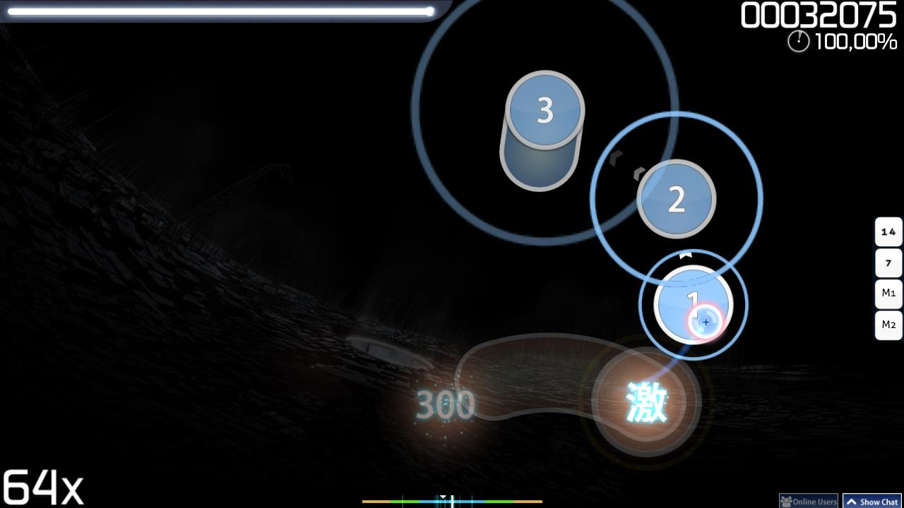

W prawym górnym rogu znajduje się pasek zdrowia. Podczas rozgrywki będziesz stopniowo tracić punkty życia (szybkość zależy od ustawień beatmapy), jednak można je odzyskać poprzez trafianie obiektów zgodnie z rytmem piosenki lub kręcenie spinnerów. Idealne trafienie (300 czy też Geki) odnowi więcej zdrowia niż złe trafienie (50). Nietrafienie obiektu spowoduje utratę znacznej ilości punktów życia.

Po prawej stronie paska punktów życia wyświetla się łączny wynik, a pod nią celność. Kółko znajdujące się obok celności (oraz pod liczbą punktów) pokazuje, ile procent beatmapy pozostało do końca. Liczba w lewym dolnym rogu to combo/mnożnik punktów.

#### Sterowanie

Domyślne ustawienia sterowania w osu! to:

| Mysz | Klawiatura | Tablet/ekran dotykowy |
| :-- | :-- | :-- |
| Lewy przycisk (M1) / Prawy przycisk (M2) | `Z` (K1) / `X` (K2) | Dotknięcie ekranu (M1) |

Elementy rozgrywki przyjmą jakikolwiek sygnał zarejestrowany przez urządzenie, o ile obiekt został trafiony na czas.

W przypadku użycia moda [Relax](/wiki/Gameplay/Game_modifier/Relax) jedynie kursor będzie działać. Podążaj za obiektami, a gra automatycznie je kliknie w odpowiednim momencie. Nie powoduje to automatycznego ukończenia spinnerów.

W przypadku użycia moda [Auto Pilot](/wiki/Gameplay/Game_modifier/Autopilot) będą działać jedynie urządzenia wejścia. Klikaj w odpowiednim momencie, podczas gdy gra automatycznie będzie celować w obiekty. Spinnery będą kręcone z taką samą szybkością jak w przypadku użycia moda [Spun Out](/wiki/Gameplay/Game_modifier/Spun_Out).

---

## Alternatywne tryby gry

### Zmiana trybu gry

")

Kliknij na przycisk z napisem `Mode`, aby **otworzyć listę trybów gry dostępnych w osu!.** Kliknij na wybrany tryb gry, a osu! się na niego przełączy oraz zacznie wyświetlać jego tabele wyników. Możesz też użyć skrótów klawiszowych `Ctrl` + `1` (![][osu! icon] *[osu!](/wiki/Game_mode/osu!))* / `2` ( ![][osu!taiko icon] *[osu!taiko](/wiki/Game_mode/osu!taiko)*) / `3` (![][osu!catch icon] *[osu!catch](/wiki/Game_mode/osu!catch)*) / `4` (![][osu!mania icon] *[osu!mania](/wiki/Game_mode/osu!mania)*), aby szybko przełączać się pomiędzy trybami gry.

### Czym jest osu!taiko?

*Pełny artykuł: [osu!taiko](/wiki/Game_mode/osu!taiko)*

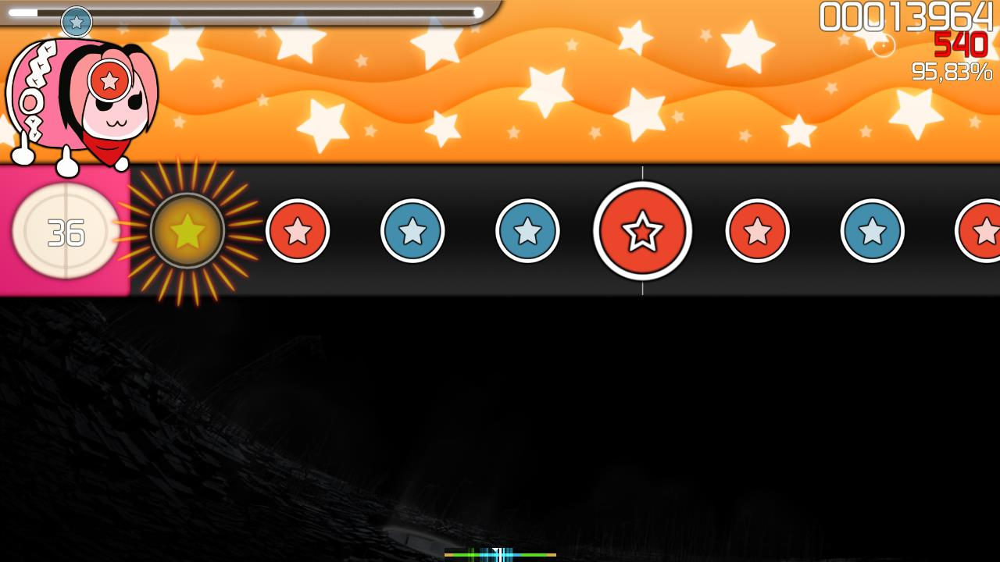

*[Taiko no Tatsujin](https://en.wikipedia.org/wiki/Taiko_no_Tatsujin)* to gra rytmiczna stworzona przez *Namco* (obecnie Namco Bandai). Jest to symulacja grania na bębnie taiko w rytm muzyki. W osu! beatmapy można grać w stylu *Taiko no Tatsujin* w trybie osu!taiko.

#### Wprowadzenie

##### Pole gry

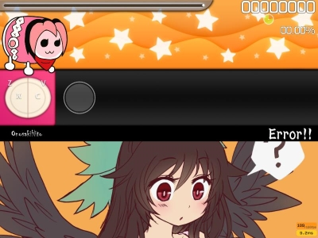

Informacje dla graczy zaznajomionych z *Taiko no Tatsujin*:

- Na dole ekranu nie ma małych i uroczych tancerzy (trzeba je dodać za pomocą storyboarda)
- Pasek zdrowia musi być pełen przynajmniej w 50%, aby przejść beatmapę (nie jest to zbyt oczywiste na domyślnej skórce – sprawdź [kompendium skórek](https://osu.ppy.sh/community/forums/topics/686664), aby znaleźć lepszą)
- *Czas kiai* aktywuje *„Go-Go Time”*
  - Różne nietypowe elementy rozgrywki, takie jak balony lub dzielenie pola gry nie zostały zaimplementowane (jedynie podstawowe elementy)
- Różnice w wyświetlaniu tła
  - Beatmapy przeznaczone dla trybu osu!taiko zwykle posiadają swoje własne tło, które jest puste w górnej części
  - Wideo lub zwykłe tło będzie wyświetlane jedynie w dolnej części ekranu
  - Elementy storyboardów będą wyświetlane w każdym miejscu ekranu z wyłączeniem pola gry

Dla osób nowych w osu!taiko: podczas gry ekran jest podzielony na dwie części. Górna zawiera elementy rozgrywki, podczas gdy dolna jest przeznaczona na tło lub wideo beatmapy. W górnej części znajduje pasek zdrowia, który w przeciwieństwie do innych trybów gry jest na początku pusty. Aby przejść beatmapę, trzeba wypełnić go przynajmniej w połowie. Bliżej środka po lewej znajduje się bęben taiko, a obok niego pas, po którym od prawej do lewej poruszają się obiekty. Na końcu pasa obok bębna znajduje się podwójny biały okrąg, który określa moment, w którym trzeba je kliknąć. Nad bębnem znajduje się animowana maskotka taiko, która będzie reagować na trafienia w parze ze zmianami koloru tła górnej części ekranu. W prawym górnym rogu wyświetlany jest łączny wynik, celność oraz miernik pokazujący, ile procent beatmapy pozostało.

Pamiętaj, że w osu!taiko nie ma utraty życia – na pasek zdrowia wpływa jedynie trafianie obiektów. Naciskanie klawiszy w momencie, gdy nie ma żadnych obiektów do trafienia nie prowadzi do przerwania combo. W przeciwieństwie do osu!, dodatkowe efekty podkreślające osiągnięte combo pojawiają się co 50 uderzeń. Bazowa ilość zdobywanych punktów zostanie zwiększona po osiągnięciu combo, które jest mnożnikiem liczby 10, aż do 100 combo (maksymalny możliwy mnożnik). Jeśli combo zostanie przerwane, mnożnik powróci do bazowej wartości. Podczas *czasu kiai* za każde trafienie gracz otrzyma o 20% więcej punktów niż zwykle.  Otrzymaną ilość punktów można zobaczyć pod celnością w prawym górnym rogu.

##### Kółka w osu!taiko

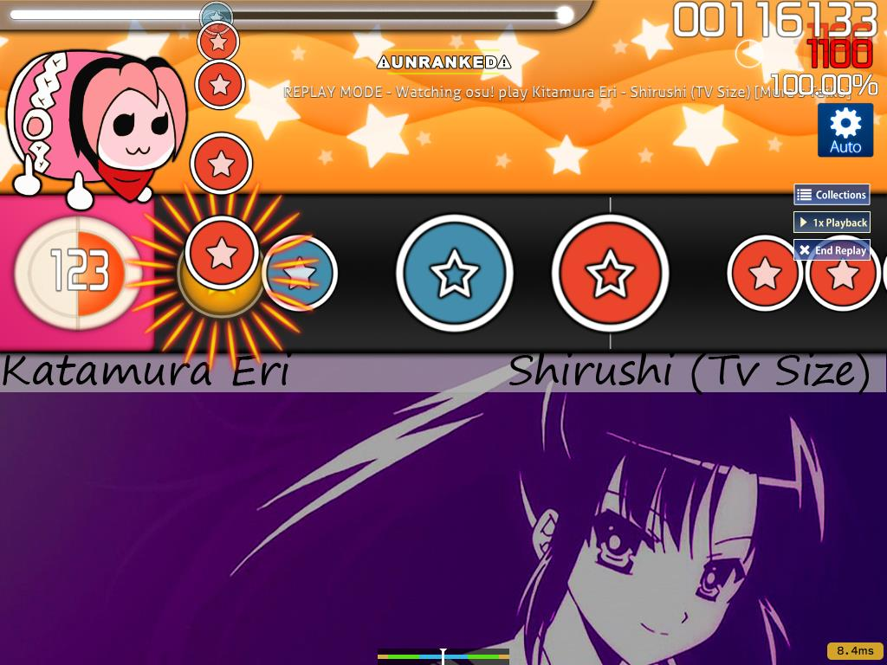

Kółka w osu!taiko mogą mieć jeden z dwóch kolorów: czerwony lub niebieski. Mają one swoje własne nazwy: czerwone kółko nazywamy Don, a niebieski Katu.

W przypadku małego czerwonego kółka, naciśnij przycisk przypisany do wewnętrznej części bębna taiko lub uderz w środek *bębęnka TaTaCon*. W przypadku małego niebieskiego kółka, naciśnij przycisk przypisany do zewnętrznej części bębna taiko lub uderz w krawędź *bębęnka TaTaCon*. Jeśli kółko jest **DUŻE**, naciśnij lub uderz obydwie części środka lub krawędzi bębna, aby otrzymać dwa razy więcej punktów niż za zwykłe trafienie. Za pojedyncze uderzenie dostaniesz normalną ilość punktów.

Kółka należy trafić, gdy znajdą się w małym białym okręgu obok bębna. Trafienie złego koloru lub środka i krawędzi bębna w tym samym czasie będzie liczyć się jako nietrafienie.

##### Drumrolle

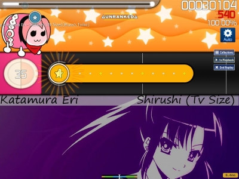

Stale uderzaj środek bębna (lub jego krawędzie) aż do końca drumrolla, aby zdobyć punkty. W przypadku **DUŻYCH** drumrolli, uderzaj jednocześnie środek oraz krawędź bębna.** W grze zaimplementowano limit trafień – punkty można zdobyć jedynie za trafienia małych kółek znajdujących się na drumrollu. W *Taiko no Tatsujin* taki limit nie istnieje, zmuszając do uderzania bębna tak szybko, jak to tylko możliwe.

Drumrolle można zignorować, gdyż ich trafianie nie odnawia punktów życia – pozbawi to jednak możliwości zdobycia dodatkowych punktów. Za każde trafione małe kółko gracz otrzymuje 300 punktów, które nie skaluje się z uzyskanym combo.

##### Dendeny

")

**Naprzemiennie** uderzaj środek i krawędź bębna (czerwony, niebieski, czerwony, niebieski, czerwony, niebieski, ...), aż licznik dendena osiągnie wartość 0. Nie ma znaczenia, od którego koloru zaczniesz (jeśli wolisz, możesz zacząć od niebieskiego). Nieukończenie dendena spowoduje utratę punktów życia, jednak nie przerwie combo. Uderzanie tego samego koloru nie będzie zmniejszać wartości licznika, dopóki nie zostanie trafiony inny kolor.

Ukończenie dendena nie zwiększa combo ani nie odnawia punktów życia. Za każde uderzenie dendena gracz otrzymuje 300 punktów, które nie skaluje się z uzyskanym combo. Jego ukończenie liczy się jako idealne (GREAT) trafienie dużego kółka.

#### Sterowanie

Domyślne ustawienia sterowania w osu!taiko to:

| Kolor kółka | Mysz | Klawiatura | TaTaCon |
| :-- | :-- | :-- | :-- |
| Czerwony | Lewy przycisk myszy (L) | `X` (L) / `C` (R) | Płaska powierzchnia bębęnka |
| Niebieski | Prawy przycisk myszy (L) | `Z` (L) / `V` (R) | Krawędź bębęnka |

Położenia kursora w grze nie ma żadnego wpływu na rozgrywkę.

W przypadku użycia moda [Relax](/wiki/Gameplay/Game_modifier/Relax) ważne jest jedynie trafianie obiektów zgodnie z rytmem. Nawet jeśli zostanie użyty zły kolor, gra zaliczy trafienie jako poprawne.

Kontrolery *TaTaCon* zostały stworzone przede wszystkim z myślą o domowych portach gier *Taiko no Tatsujin* oraz *Taiko: Drum Master.*

### Czym jest osu!catch?

*Pełny artykuł [osu!catch](/wiki/Game_mode/osu!catch)*

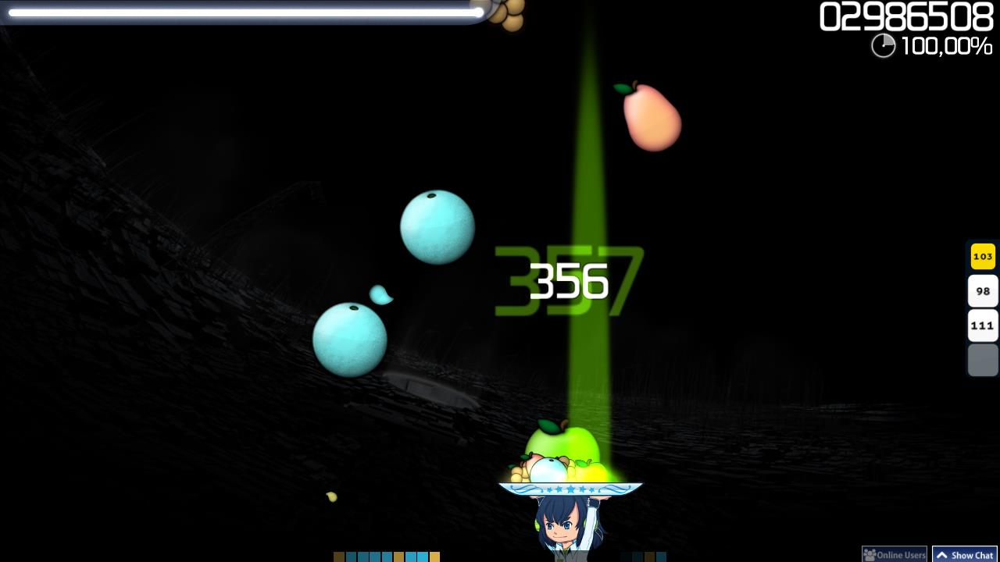

osu!catch (dawniej znane jako *Catch the Beat*) jest drugim po osu!taiko trybem gry dodanym do osu!.

Zamiast klikać kółka w rytm muzyki, gracz musi poruszać łapaczem znajdującym się na dole ekranu, podczas gdy z góry spadają owoce.

#### Wprowadzenie

##### Pole gry

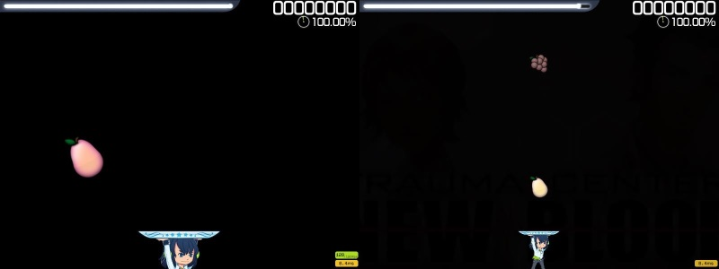

Przybliżenie pola gry jest zależne od ustawionej wartości CS (Circle Size), gdzie niższe wartości oznaczają znacznie większe przybliżenie oraz mniejszą ilość miejsca, a wyższe wartości większe oddalenie oraz większą ilość miejsca na poruszanie się.

Łapacz może poruszać się od lewej do prawej, podczas gdy owoce spadają z góry na dół. Nie może on przekroczyć lewej oraz prawej granicy pola gry.

Wszystkie owoce pozostaną na talerzu, dopóki gracz nie dojdzie do nowego combo. Nie ma znaczenia, kiedy owoc zostanie złapany, ani na którą część talerza spadnie – albo został złapany, albo nie.

##### Owoce

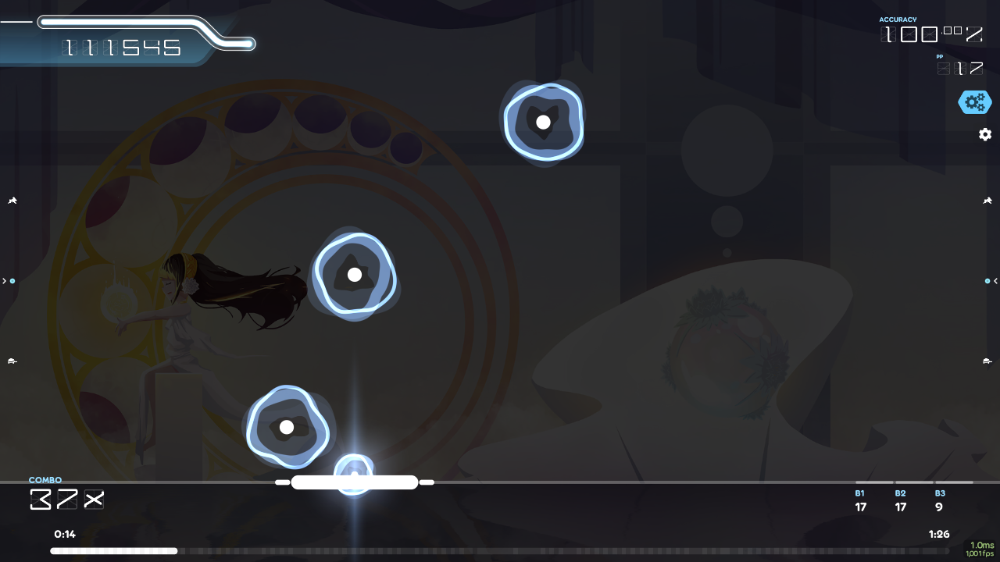

Aby złapać owoc upewnij się, że spada na talerz. Złapanie owocu jest zawsze warte 300 punktów, a ponadto zwiększa combo o 1. Na ekranie wyniku liczba złapanych owoców jest wyświetlane jako liczba 300-tek.

##### Slidery

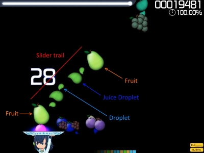

Typowy slider będzie składać się z dwóch owoców (jeden na początku, drugi na końcu), pestek (ang. *droplets*; ścieżka slidera) oraz dużych pestek (ang. *juice drop*; ticki slidera). Jeśli slider ma strzałki powrotu, owoców będzie więcej. Za złapanie pestki gracz otrzymuje 10 punktów, a na ekranie wyniku ich ilość jest wyświetlana jako liczba 50-tek. Za złapanie dużej pestki gracz otrzymuje 30 punktów, a na ekranie wyniku ich ilość jest wyświetlana jako liczba 100-tek.

Niezłapanie zwykłej pestki nie powoduje przerwania combo, ale dużej pestki już tak (tak samo, jak w przypadku ticku slidera). Liczba niezłapanych zwykłych pestek nie jest wyświetlana na ekranie wyniku. Inaczej jest w przypadku strony internetowej – w jej rankingach pojawia się jako *Miss Droplet*, co znacząco wpływa na osiągniętą celność (gra traktuje je jako 50-tki) oraz wynik (10 punktów mniej za każdą niezłapaną).

##### Banany

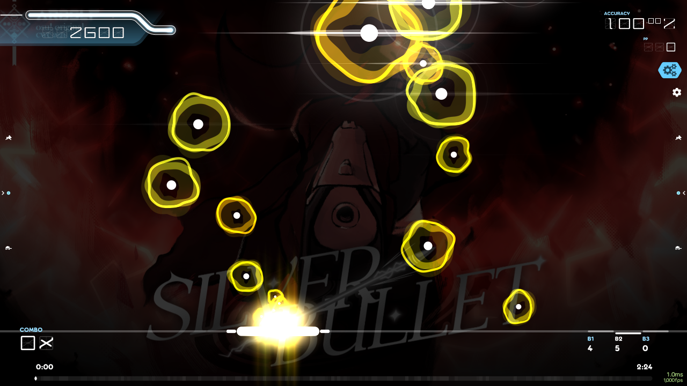

Banany będą spadać z góry na dół i stopniowo zmniejszać podczas swojej drogi na talerz (lub poza niego). Za każdego złapanego banana gracz otrzyma 1100 punktów, które nie skalują się z mnożnikiem punktów.

Niezłapanie bananów nie powoduje utraty punktów życia, jednak pozbawi gracza możliwości zdobycia dodatkowych punktów oraz odzyskania zdrowia.  Mod [Auto](/wiki/Gameplay/Game_modifier/Auto) łapie *wszystkie* banany, bez wyjątku.

##### Hyperowoce

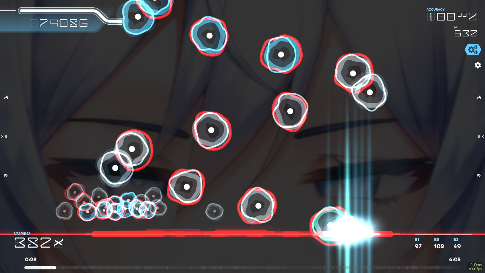

Hyperowoce to specjalny rodzaj owoców. Pojawiają się, aby pomóc graczowi złapać kolejny owoc w przypadku, gdy jest niemożliwe dotarcie do niego na czas za pomocą zwykłego dasha. Możne je poznać po otaczającym je czerwonym kolorze.

Złapanie hyperowocu ulepszy dash do *hyperdasha* (przyspieszając łapacza na tyle, aby był w stanie dobiec do kolejnego owocu) oraz pozostawi w miejscu złapania czerwoną poświatę, dopóki nie zostanie złapany lub ominięty kolejny owoc. Następnie łapacz powróci do domyślnego stanu.

#### Poruszanie łapaczem

- Domyślnie gracz steruje łapaczem za pomocą strzałki w lewo (L) oraz w prawo (R).
- Przytrzymanie lewego klawisza `Shift` razem z jedną ze strzałek spowoduje, że łapacz zacznie dashować z podwójną szybkością, co sygnalizuje pojawienie się wokół niego jasnej poświaty.
  - Można w tym celu użyć również lewego przycisku myszy (D).

Położenia kursora w grze nie ma żadnego wpływu na rozgrywkę. W przypadku użycia moda [Relax](/wiki/Gameplay/Game_modifier/Relax) gracz będzie sterować łapaczem za pomocą ruchów myszki. Takie przejście mapy jednak nie będzie liczyć się do żadnych rankingów online, gdyż pozbyto się jedynych ograniczeń osu!catch, którymi są stała szybkość poruszania się łapacza oraz umiejętne kontrolowanie położeniem talerza.

### Czym jest osu!mania?

*Pełny artykuł [osu!mania](/wiki/Game_mode/osu!mania)*

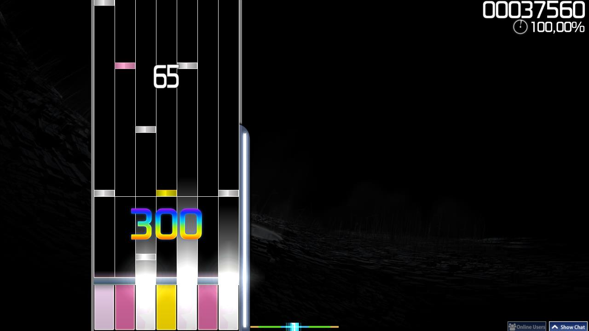

osu!mania jest trzecim po osu!taiko i osu!catch trybem gry dodanym do osu!.

Większość popularnych gier rytmicznych posiada tryb oparty na podobnych mechanikach, wymagając dobrej koordynacji rąk i/lub nóg, podczas gdy nuty poruszają się po polu gry w linii prostej. Ich ilość jest zależna od tempa piosenki oraz poziomu trudności. Zadaniem gracza jest naciskanie odpowiednich klawiszy w rytm muzyki. Ten tryb gry oryginalnie miał być imitacją *Beatmanii*, jednak przez możliwość wyboru ilości klawiszy oraz zmianę orientacji pola gry możliwe jest również imitowanie innych gier, takich jak na przykład *Guitar Hero* (5 klawiszy) czy *Dance Dance Revolution* (4 klawisze).

Przekonwertowane beatmapy, które nie zostały stworzone specjalnie dla osu!manii, będą wymagały różnych ilości klawiszy (od 4 do 7).

Używając moda [xK](/wiki/Gameplay/Game_modifier/xK) gracz może samodzielnie wybrać ilość klawiszy z zakresu od 1 do 9. Powoduje to również redukcję mnożnika punktów. Należy pamiętać, że wybranie tego moda jest możliwe jedynie w przypadku grania przekonwertowanych beatmap.

Przy użyciu moda [Co-Op](/wiki/Gameplay/Game_modifier/Co-op) pole gry zostanie podzielone na dwie części, a układ sterowania zmieni się na ten przeznaczony dla trybu kooperacyjnego, pozwalając graczowi na grę przy użyciu od 2 do 18 klawiszy. Wybranie moda spowoduje redukcję mnożnika punktów. W przypadku beatmap stworzonych specjalnie dla osu!manii liczba klawiszy nie zostanie podwojona, jednak pole gry wciąż zostanie podzielone na dwie części (w przypadku nieparzystej ilości klawiszy, lewa część będzie mieć przypisaną ich większą ilość), a układ sterowania zmieni się na ten przeznaczony dla trybu kooperacyjnego. Użycie moda Co-Op w tym przypadku nie spowoduje redukcji mnożnika punktów.

#### Wprowadzenie

##### Pole gry

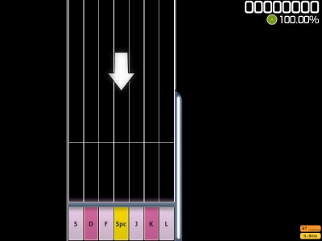

Domyślnie nuty będą poruszać się po polu gry z góry na dół (na początku gry pojawi się strzałka pokazująca ich kierunek poruszania się). Na dole pola gry znajdują się przyciski, a tuż nad nimi linia wskazująca moment, w którym trzeba nacisnąć przycisk. Kierunek poruszania się nut można odwrócić w `Opcjach`: kliknij na przycisk `Styl osu!mania`, aby zmienić przypisane klawisze i włączyć opcję `Odwróc obszar gry w pionie (w stylu DDR)`.

Pasek zdrowia znajduje się po prawej stronie pola rozgrywki. Pamiętaj, że w osu!manii nie ma utraty życia – na pasek zdrowia wpływa jedynie trafianie obiektów. Naciskanie klawiszy w momencie, gdy nie ma żadnych obiektów do trafienia nie prowadzi do przerwania combo.

**Szybkość przewijania** można zmienić przy użyciu skrótu klawiszowego `Ctrl` (lub `Shift`) + `+` (szybsza) / `-` (wolniejsza), lub za pomocą klawiszy `F3` (szybsza) / `F4` (wolniejsza).

##### Nuty

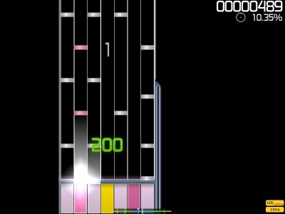

Nuty to odpowiednik kółek w osu!manii. Poruszają się one w kierunku klawiszy, obok których znajduje się linia wskazująca, kiedy należy nacisnąć klawisz odpowiadający danej nucie. W przypadku kilku nut poruszających się jednocześnie, należy użyć wszystkich przypisanych im klawiszy. Po trafieniu nuty pojawi się ilość punktów zdobytych za trafienie, pokazując zarazem, jak celnie graczowi udało się to zrobić.

##### LN-y

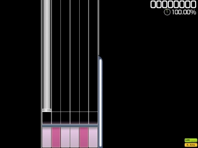

LN-y to odpowiednik sliderów i spinnerów w osu!manii. Gdy LN dotrze do linii, naciśnij odpowiadający danej kolumnie przycisk, a następnie przytrzymaj go aż do końca LN-a.

Trzymanie LN-ów powoli odnawia punkty życia. Na niektórych mapach może się zdarzyć, że podczas trzymania LN-a trzeba będzie jednocześnie trafić obiekty również w innych kolumnach.

#### Sterowanie

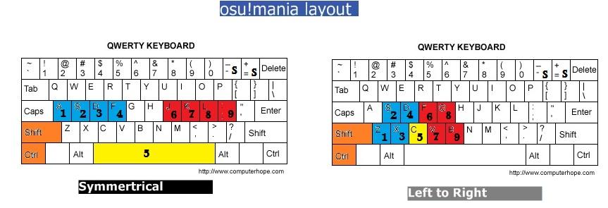

osu!mania posiada dwa różne układy klawiszy: *symetryczny* oraz *od lewej do prawej.*

- Styl *symetryczny* naśladuje układ przycisków z gier *DJMAX*. `Spacja` jest środkowym klawiszem, aby imitować uczucie naciskania pedału podczas gry na automacie.
  - Środkowy klawisz jest przypisany środkowej kolumnie (tylko w przypadku beatmap o nieparzystej ilości klawiszy), a reszta kolumn jest przypisana pozostałym klawiszom.
- Styl *od lewej do prawej* naśladuje układ przycisków z gier z serii *Beatmania IIDX*. Pierwsza kolumna jest przypisana do *klawisza 1*, druga kolumna do *klawisza 2*, i tak dalej.

Układ klawiszy dla stylu *symetrycznego* (gry *DJMAX*)

- Klawisze *lewej* ręki — (K1) `A`, (K2) `S`, (K3) `D`, (K4) `F`
- Klawisze *prawej* ręki — (K6) `J`, (K7) `K`, (K8) `L`, (K9) `;`.
- Klawisz *środkowy* — (K5) `Spacja`. (tylko dla beatmap o nieparzystej ilości klawiszy)
- Klawisz *specjalny* — `lewy Shift` oraz `lewy Ctrl`.

| Ilość klawiszy | Lewa strona | Środek | Prawa strona |
| :-: | :-- | :-: | --: |
| 4K | K3, K4 | - | K6, K7 |
| 5K | K3, K4 | K5 | K6, K7 |
| 6K | K2, K3, K4 | - | K6, K7, K8 |
| 7K | K2, K3, K4 | K5 | K6, K7, K8 |
| 8K | K1, K2, K3, K4 | - | K6, K7, K8, K9 |

Układ klawiszy dla stylu *od lewej do prawej* (gry *Beatmania *IIDX**)

- Z dołu do góry, potem znowu z dołu do góry, i tak dalej: (K1) `Z`, (K2) `S`, (K3) `X`, (K4) `D`, (K5) `C`, (K6) `F`, (K7) `V`, (K8) `G`, (K9) `B` \[K9 nie jest używany\]
- Klawisz *specjalny* — `lewy Shift` oraz `lewy Ctrl`.

| Ilość klawiszy | Klawisze |
| :-: | :-- |
| 4K | K1, K2, -, K4, K5 |
| 5K | K1, K2, K3, K4, K5 |
| 6K | K1, K2, K3, K4, K5, K6 |
| 7K | K1, K2, K3, K4, K5, K6, K7 |
| 8K | K1, K2, K3, K4, K5, K6, K7, K8 |

---

## Punktacja

*Szczegółowe informacje na temat punktacji można znaleźć w artykułach poświęconym konkretnym trybom gry lub w artykule dotyczącym [punktów](/wiki/Gameplay/Score).*

*Szczegółowe informacje na temat celności można znaleźć w artykułach poświęconym konkretnym trybom gry lub w artykule dotyczącym [celności](/wiki/Gameplay/Accuracy).*

### Oceny

#### ![][osu! icon] osu!

| Ocena | Wymagania |
| :-: | :-- |
| SS | 100% celności |
| S | Ponad 90% 300-tek, mniej niż 1% 50-tek oraz 0 nietrafień |
| A | Ponad 80% 300-tek oraz 0 nietrafień **LUB** ponad 90% 300-tek |
| B | Ponad 70% 300-tek oraz 0 nietrafień **LUB** ponad 80% 300-tek |
| C | Ponad 60% 300-tek |
| D | Pozostałe wyniki |

#### ![][osu!taiko icon] osu!taiko

| Ocena | Wymagania |
| :-: | :-- |
| SS | 100% celności |
| S | Ponad 95% celności (ponad 90% GREAT lub mniej niż 1 GOOD na każde 10 obiektów) |
| A | Ponad 90% celności (ponad 80% GREAT lub mniej niż 1 GOOD na każde 5 obiektów) |
| B | Ponad 80% celności (ponad 70% GREAT lub mniej niż 1 GOOD na każde 3,33 obiektów) |

#### ![][osu!catch icon] osu!catch

| Ocena | Wymagania |
| :-: | :-- |
| SS | 100,00% celności |
| S | Od 98,01% do 99,99% celności (ocenę 'S' można zdobyć nawet po niezłapaniu wielu owoców, podobnie jak w osu!manii) |
| A | Od 94,01% do 98,00% celności |
| B | Od 90,01% do 94,00% celności |
| C | Od 85,01% do 90,00% celności |
| D | Każda inna celność poniżej 85,00% |

#### ![][osu!mania icon] osu!mania

| Ocena | Wymagania |
| :-: | :-- |
| SS | 100% celności (same MAX oraz 300-tki) |
| S | Ponad 95% celności (ocenę 'S' można zdobyć nawet po nietrafieniu wielu nut, podobnie jak w osu!catch) |
| A | Ponad 90% celności |
| B | Ponad 80% celności |
| C | Ponad 70% celności |
| D | Pozostałe wyniki |

#### Wszystkie tryby gry

**Specjalne oceny:**

- Srebrne SS (SSH) = Zwykła ocena SS przy użyciu moda *[Hidden](/wiki/Gameplay/Game_modifier/Hidden)* i/lub *[Flashlight](/wiki/Gameplay/Game_modifier/Flashlight)*.
- Srebrne SS (SH) = Zwykła ocena S przy użyciu moda *[Hidden](/wiki/Gameplay/Game_modifier/Hidden)* i/lub *[Flashlight](/wiki/Gameplay/Game_modifier/Flashlight)*.

**Informacje dotyczące sekcji *Oceny* na profilu gracza:**

- Uzyskane oceny będą zliczane na profilu gracza w sekcji Ogólne->Oceny, o ile klient gry był połączony z serwerem Bancho podczas ich uzyskania.
  - **Wyniki osiągnięte offline**, nawet jeśli gracz był zalogowany, **nie będą zliczane na profilu**.
- **Do licznika ocen liczy się najlepszy osiągnięty wynik osiągnięty na każdym z poziomów trudności beatmapy.**
  - Jeżeli beatmapa zawiera trzy rankingowe poziomy trudności, a gracz zdobędzie na każdym z nich ocenę SS w trybie osu!catch, to trzy oceny SS zostaną dodane do licznika ocen trybu osu!catch, a nie tylko jedna.
  - W przypadku osiągnięcia nowego, lepszego wyniku na jednym z tych poziomów trudności z oceną S (np. poprzez wykonanie większej ilości obrotów spinnera) licznik SS zmniejszy się o 1, podczas gdy licznik S zwiększy się o 1.

## Punkty pp

*Pełny opis: [Punkty pp](/wiki/Performance_points)*

Punkty pp stanowią podstawę rankingu graczy, mając na celu dokładniej reprezentować faktyczne umiejętności gracza w ciągle zmieniającym się środowisku osu! niż system oparty na ilości godzin spędzonych w grze. System ten jest oparty głównie na trudności danej mapy, określanej za pomocą specjalnego algorytmu, w oparciu o który każdemu osiągniętemu wynikowi zostanie przypisana wartość pp. Miejsce w rankingu opiera się przede wszystkim na wynikach osiągniętych na poszczególnych mapach. Najprostszym sposobem, aby rozwijać swoje umiejętności, jest osiąganie dobrych wyników na trudnych mapach oraz granie wielu różnych utworów. Należy pamiętać, że każdy z trybów gry jest liczony oddzielnie. Oznacza to, że osiągnięcie pewnego wyniku w jednym z nich zwiększy ilość pp tylko i wyłącznie dla tego trybu gry.

Jeżeli masz jakieś pytania odnośnie pp, zapoznaj się najpierw z [artykułem dotyczącym pp](/wiki/Performance_points).

---

## Częste problemy i pytania

### Ogólne

#### Wydaje mi się, że znalazłem błąd! Gdzie mogę go zgłosić?

Jeśli napotkałeś techniczny problem lub nie masz pewności, czy napotkany przez ciebie problem jest błędem, możesz utworzyć post na [forum Help](https://osu.ppy.sh/community/forums/5). Jeśli wydaje ci się, że znalazłeś w osu! krytyczny błąd, możesz go zgłosić na [repozytorium GitHub osu-stable-issues](https://github.com/ppy/osu-stable-issues/issues). Przed napisaniem upewnij się, że nikt wcześniej nie zgłosił tego samego błędu co ty.

#### Gdzie mogę znaleźć i pobrać beatmapy?

*Szczegółowy opis beatmap: [Beatmapy](/wiki/Beatmap)*

Na głównej stronie, w zakładce [beatmapy](https://osu.ppy.sh/beatmapsets). Pamiętaj, aby najpierw zalogować się za pomocą swojego *konta osu!*, aby mieć możliwość pobierania beatmap.

#### Czy mogę wyłączyć czas kiai?

**Nie**, ponieważ w przeciwieństwie do wideo jest integralną częścią beatmapy (na równi z obiektami). Z tego powodu nie można go wyłączyć.

#### Te mapy są zbyt trudne! Gdzie mogę znaleźć jakieś łatwiejsze?

W przypadku osu!, użytkownik **Pokebis** przygotował zestaw beatmap odpowiednich dla początkujących graczy. Można go znaleźć [tutaj](https://osu.ppy.sh/community/forums/topics/5456).

W przypadku osu!taiko, użytkownik **OnosakiHito** przygotował zestaw beatmap przeznaczony dla początkujących graczy osu!taiko. Można go znaleźć [tutaj](https://osu.ppy.sh/community/forums/topics/175867).

W przypadku osu!catch, użytkownik **Kingkevin30** przygotował niezły zestaw beatmap oraz podstawowe informacje na temat tego trybu. Można go znaleźć [tutaj](https://osu.ppy.sh/community/forums/topics/131067).

W przypadku osu!manii, użytkownik **Entozer** przygotował listę posortowaną według poziomu trudności, a użytkownik **Drace** stworzył poradnik na temat tego, jak stać się lepszym graczem osu!manii. Poradnik dotyczący beatmap można znaleźć [tutaj](https://osu.ppy.sh/community/forums/topics/147552), a ten dotyczący poprawiania swoich umiejętności [tutaj](https://osu.ppy.sh/community/forums/topics/146615).

Możesz również użyć dostępnej w wyszukiwarce funkcji [sortowania rankingowych beatmap według poziomu trudności](https://osu.ppy.sh/beatmapsets?sort=difficulty_asc). Najłatwiejsze beatmapy będą pojawiać się na samej górze listy.

Dodatkowo, użytkownik **Rivenation** stworzył [zaawansowaną wyszukiwarkę beatmap](https://osu.ppy.sh/community/forums/topics/380485) o nazwie [osu!search](http://osusearch.com), który poza standardowymi funkcjami wyszukiwarki posiada również parę innych niezłych opcji zawężania wyników. Tę nieoficjalną wyszukiwarkę beatmap można znaleźć [tutaj](http://osusearch.com).

#### Co tak właściwie robi poziom?

**Absolutnie nic**. Nie ma żadnej różnicy pomiędzy graczem o poziomie 100 a graczem o poziomie 1, nie licząc ich umiejętności oraz doświadczenia w danym trybie gry. Niski poziom nie wiąże się z ograniczeniami rozgrywki, a wysoki poziom nie daje jakiejkolwiek przewagi.

Poziom jest zależny od łącznego wyniku zdobytego podczas gry online przy użyciu konta. Do łącznego wyniku liczą się wszystkie wyniki gracza – również te, które nie zakończyły się przejściem beatmapy. [Tutaj można znaleźć wzór służący do obliczania poziomu.](/wiki/Gameplay/Score)

#### Czemu moje statystyki w kliencie gry różnią się od tych na stronie?

Pamiętaj, że osu! posiada cztery tryby gry – możliwe, że porównujesz statystyki różnych trybów.

#### Jak zmienić domyślne klawisze przypisane do danego trybu gry?

*Pełne wyjaśnienie: [Opcje](/wiki/Client/Options)*

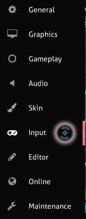

Kliknij ikonę sekcji *„Sterowanie”* znajdującą się w *opcjach* (pokazane wyżej), a następnie zjedź do ustawień **klawiatury**, widocznych na poniższym zrzucie ekranu.

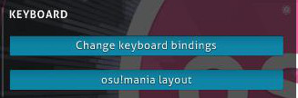

#### Game over? W którym momencie zrąbałem/am?

*Pełne wyjaśnienie: [Powtórka](/wiki/Gameplay/Replay)*

Po nieudanej próbie przejścia beatmapy naciśnij klawisz `F1`, aby obejrzeć jej powtórkę. Powtórka zakończy się przyciemnieniem ekranu i pojawieniem się loga osu! pośrodku zamiast ekranem „Game over”. Aby obejrzeć powtórkę ponownie, przytrzymaj chwilę klawisz grawisu/tyldy (\`/~) (można to zmienić w opcjach: otwórz *Ustawienia klawiatury*, a następnie przypisz nowy klawisz opcji **Quick Retry (hold briefly)**) lub skrót klawiszowy `Ctrl` + `R`.

Aby powrócić do ekranu wyboru piosenki i zagrać beatmapę ponownie, użyj klawisza `Esc`, gdyż jest to niestandardowy ekran powtórki. Można to zrobić jedynie w trybie jednoosobowym po wyświetleniu się ekranu „Game over”. Dnia 24 sierpnia 2020 wprowadzono do gry możliwość zapisywania powtórek nieudanych prób przejścia beatmapy za pomocą klawisza `F2`.

#### Czy w osu! istnieją skróty klawiszowe?

*Pełna lista: [Skróty klawiszowe](/wiki/Client/Keyboard_shortcuts)*

Naciśnięcie klawisza `Insert` spowoduje wyciszenie gry, spauzowanie (jeśli zostanie wciśnięty w środku rozgrywki) oraz zminimalizowanie okna do paska zadań *Windows*. Aby przywrócić grę do pierwotnego stanu, znajdź *logo osu!* na pasku zadań *Windows* i je kliknij. Jest to tak zwany **boss key**. Przypisany mu klawisz można zmienić w `Ustawieniach klawiatury` (sekcja *Klawiatura* w `Opcjach`). Znajduje się on na samym końcu sekcji *Universal*.

Innym ciekawym skrótem klawiszowym jest `Alt` + `Enter`, który włącza tryb pełnoekranowy. Działa on jedynie w `Options` – użycie podczas rozgrywki czy w trybie wieloosobowym nie będzie miało żadnego efektu.

#### Kopię których plików należy wykonać podczas instalacji osu! na nowym urządzeniu?

Krótka odpowiedź brzmi: cały folder `osu!`, w tym znajdujące się w nim ukryte pliki. Po uruchomieniu `osu!install.exe` oraz ukończeniu instalacji osu! na nowym urządzeniu zastąp folder `osu!` wykonaną wcześniej kopią. Jeśli eksplorator plików spyta o zastąpienie plików `.dll` lub `.exe`, zignoruj zapytanie. Wszystkie inne rodzaje plików można zastąpić – w tym pliki z rozszerzeniem `.cfg` lub `.db`.

#### Czy mogę grać w osu! na moim urządzeniu mobilnym?

*Pełna lista: [Tryby gry](/wiki/Game_mode)*

Na chwilę obecną osu! nie wspiera oficjalnie żadnej platformy mobilnej.

Istnieją jednak nieoficjalne porty gry oraz oficjalny spin-off dostępny na urządzenia iOS, które posiadają swoje własne tabele wyników oraz konta.

Do najbardziej znanych z nich należą:

- ![][osu! icon] opsu! (Windows/OS X/ Linux/Android): Port osu! napisany w Javie przez użytkownika **itdelatrisu**, ze wsparciem ze strony **fluddokt** przy tworzeniu wersji na Androida.
- ![][osu!taiko icon] T-Aiko! v2 (Android/iOS): Port osu!taiko stworzony przez **zespół low.moe (Guy-kun)**. Zawiera system dziennych wyzwań oraz doszlifowaną tabelę wyników T-Aiko!.
- ![][osu! icon] osu!stream (iOS): Doświadcz nowego spin-offu osu! stworzonego od zera przez zespół osu!, przeznaczonego na urządzenia z systemem iOS.

### osu!

#### Czemu podczas rozgrywki na ekranie pojawiają się losowe białe linie?

Upewnij się, że klawisz przypisany rysowaniu (ang. *smoke*, *skywriting*) jest inny niż ten używany do klikania obiektów w grze.

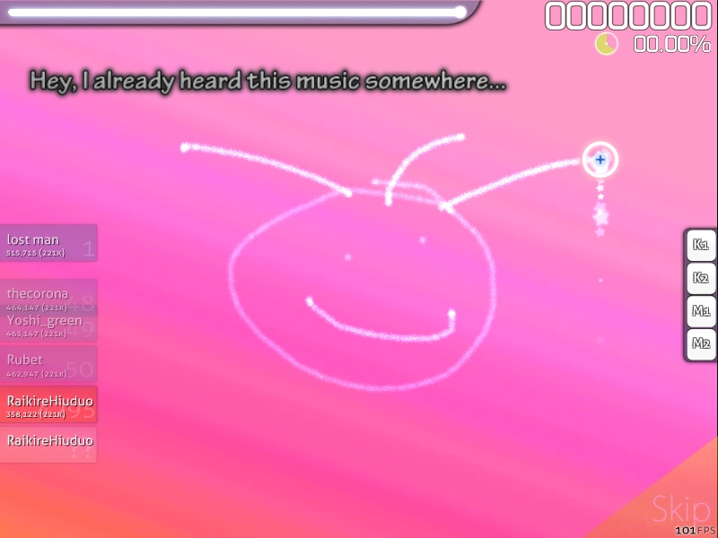

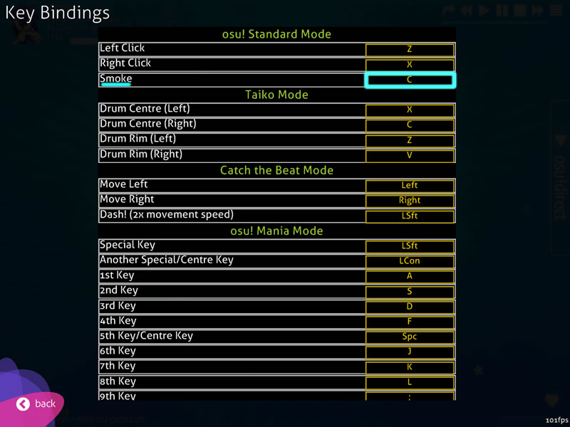

#### Dlaczego nie uzyskałem maksymalnego możliwego combo, mimo że trafiłem wszystkie obiekty?

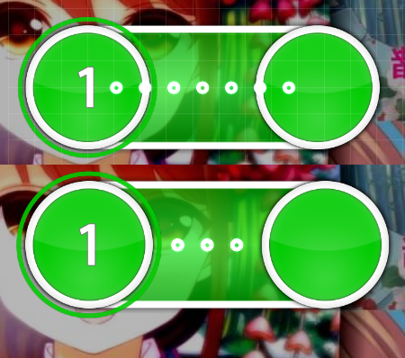

**Klawisz użyty do kliknięcia slidera został puszczony zbyt szybko, czyli zanim piłka dotarła do końca slidera.**

Slider składa się z kółka początkowego, umieszczonych w równych odstępach mniejszych kółek nazywanych tickami slidera, strzałki powrotnej (jeśli zostanie użyta, będzie traktowana jak początkowe kółko – tak, jakby gracz musiał trafić nowy slider o odwrotnej ścieżce) oraz kółka końcowego. Każdy z tych elementów slidera będzie zwiększać combo o 1. Kółko początkowe jest warte 30 punktów, każdy z ticków slidera 10 punktów, każda ze strzałek 30 punktów, a kółko końcowe – 300 (geki), 100 (katu) lub 50, w zależności od celności trafienia.

Ticki slidera będą widoczne jedynie na ścieżce slidera. Oznacza to, że zostaną ukryte, jeśli będą położone zbyt blisko kółka początkowego lub końcowego (tak, jak na zdjęciu wyżej). Ukryte ticki slidera, tak samo jak te widoczne, liczą się do combo oraz wyniku, dlatego nie mogą zostać pominięte. Jeśli slider posiada jedną lub więcej strzałek, po jej trafieniu ticki slidera pojawią się ponownie w odwrotnej kolejności.

Niekliknięcie na czas kółka początkowego lub ominięcie ticków slidera czy strzałki spowoduje przerwanie combo (jeśli combo jest dostatecznie wysokie, powinieneś usłyszeć sygnalizujący to efekt dźwiękowy), jednak nie zwiększa licznika licznika nietrafionych obiektów. Ominięcie kółka końcowego sprawi, że combo nie zwiększy się, jednak nie prowadzi do jego przerwania. Nie liczy się to również jako nietrafienie, lecz jako 100 (katu), o ile kółko początkowe zostało trafione na czas i nie ominięto żadnych ticków slidera ani strzałek powrotnych. Warto wspomnieć, że mod [Sudden Death](/wiki/Gameplay/Game_modifier/Sudden_Death) nie aktywuje się podczas nietrafienia kółka końcowego, gdyż jak wspomniano, nie prowadzi to do przerwania combo.

Wszystkie tego typu sytuacje nazywamy **sliderbreakami**. Osiągnięcie maksymalnego możliwego combo będzie sygnalizowane na ekranie wyniku wyświetleniem napisu *Perfect* na wykresie wyniku. Jeśli nie widać tam napisu *Perfect* (szczególnie w przypadku, gdy nie ma żadnych nietrafionych obiektów), zwykle oznacza to, że doszło do slidebreaka.

[Źródło odpowiedzi (razem z przykładem) w sekcji dotyczącej gier na stackexchange](https://gaming.stackexchange.com/questions/221663/i-fcd-a-song-why-is-my-combo-lower-than-people-on-the-high-scores)

### osu!taiko

#### Co robi znajdująca się w ustawieniach opcja „Używaj skórki Taiko dla tego trybu gry”?

Ta opcja działa jedynie, gdy w folderze `Skins` znajduje się folder o nazwie `taiko` (wielkość liter nie ma znaczenia).

Po włączeniu podczas gry w osu!taiko gra będzie używać elementów skórek znajdujących się w folderze `taiko` zamiast elementów osu!taiko aktualnie wybranej skórki. Jeśli gra nie będzie mogła znaleźć folderu `taiko` lub opcja ta zostanie wyłączona, podczas gry w osu!taiko zostaną użyte elementy aktualnie wybranej skórki (lub te z domyślnej skórki, jeśli obecnie wybrana skórka nie posiada niektórych grafik wymaganych podczas gry w tym trybie).

**Ciekawostka:** Dawniej w folderze `taiko` znajdowała się skórka [*Taiko autorstwa użytkownika LuiginHann*](https://osu.ppy.sh/community/forums/topics/41319)

### Tworzenie beatmap

#### „Beatmapa, którą próbujesz przesłać nie należy do ciebie!”

*Jedynie dla nierankingowych map.*

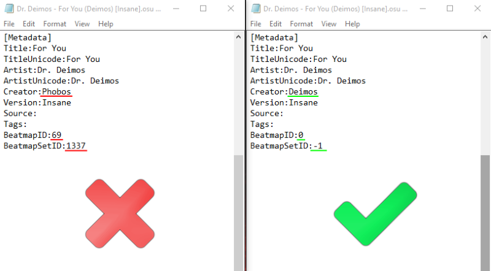

Wykonaj poniższe kroki:

1. Wyjdź z edytora (lub zamknij osu!), aby mieć pewność, że zmiany zostaną prawidłowo zapisane.
2. Sprawdź nazwę folderu beatmapy.
   - Jeśli rozpoczyna się od cyfr, usuń je, w przeciwnym razie gra będzie je traktować jako BeatmapSetID.
3. Upewnij się, że nazwa pliku `.mp3` nie rozpoczyna się od cyfr. Jeśli tak jest, zmień nazwę pliku oraz umieść nową nazwę w pliku `.osu` obok słowa Audio.
4. Otwórz wszystkie pliki `.osu` w programie do edycji tekstu, na przykład w *Notatniku*.
   - Zamień znajdującą się obok słowa Creator nazwę użytkownika na swoją (zrób to samo dla tej znajdującej się w nazwie pliku).
   - Zmień BeatmapID na 0.
   - Zmień BeatmapSetID na -1.

## Źródła

- Nieaktualne FAQ autorstwa peppy’ego (`/p/faq/`, na którym to bazowany był ten artykuł; obecnie usunięte)
- Wątek „Beginner's Training” autorstwa Pokebis [\[1\]](https://osu.ppy.sh/community/forums/topics/5456 "Beginner Training autorstwa Pokebis")
- Wątek „TBT Project \[Training Manual For Taiko Beginner v2\]” autorstwa OnosakiHito [\[2\]](https://osu.ppy.sh/community/forums/topics/175867 "Projekt TBT [Training Manual For Taiko Beginner v2] autorstwa OnosakiHito")
- Wątek „CBT Project” autorstwa Kingkevin30 [\[3\]](https://osu.ppy.sh/community/forums/topics/131067 "Projekt CBT autorstwa Kingkevin30")
- Wątek „osu!mania maps, sorted by difficulty” autorstwa Entozer [\[4\]](https://osu.ppy.sh/community/forums/topics/147552 "Lista map dla trybu osu!mania autorstwa Entozer, posortowana według poziomu trudności")
- Wątek „\[GUIDE\] How to improve in osu!mania autorstwa” Drace [\[5\]](https://osu.ppy.sh/community/forums/topics/147552 "Poradnik, jak poprawić swoje umiejętności w trybie osu!mania autorstwa Drace")
- Wątek „osu!search - Advanced beatmap searching” autorstwa Rivenation [\[6\]](https://osu.ppy.sh/community/forums/topics/380485 "Zaawansowana wyszukiwarka beatmap autorstwa Rivenation")
- Wikipedia [\[7\]](https://en.wikipedia.org/wiki/Osu!_Tatakae!_Ouendan), [\[8\]](https://en.wikipedia.org/wiki/Taiko_no_Tatsujin)

[osu! icon]: /wiki/shared/mode/osu.png
[osu!taiko icon]: /wiki/shared/mode/taiko.png
[osu!catch icon]: /wiki/shared/mode/catch.png
[osu!mania icon]: /wiki/shared/mode/mania.png
