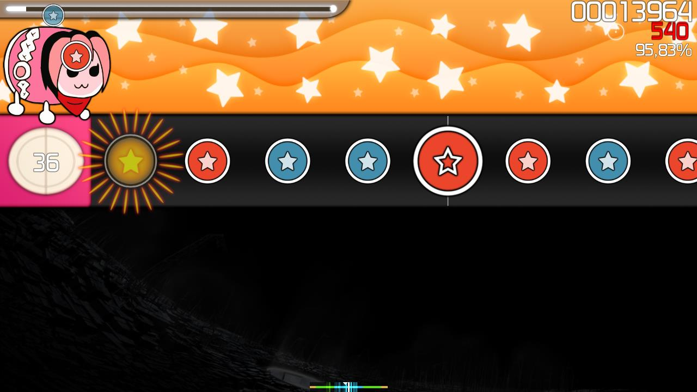
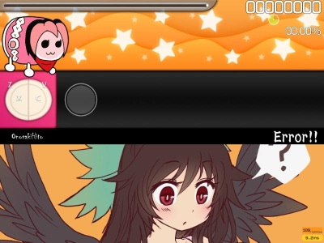
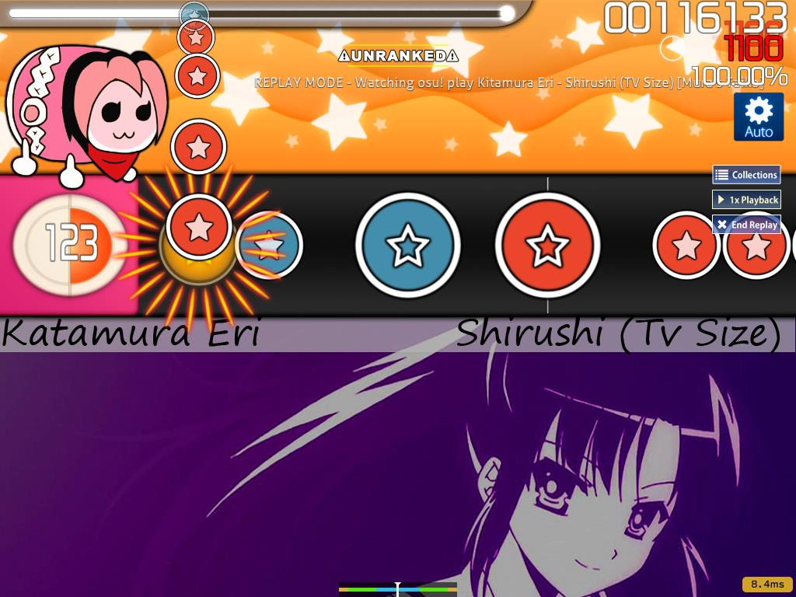
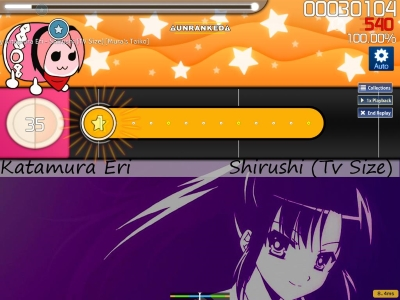
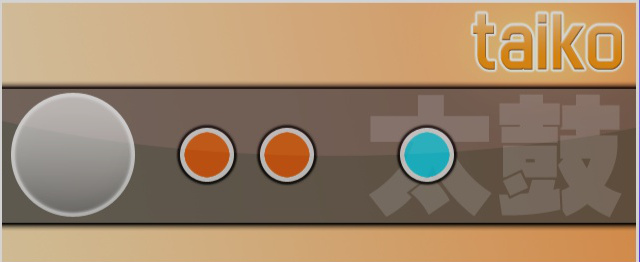

# osu!taiko

osu!taiko — игровой режим osu!, основанный на японской серии ритм-игр [Taiko no Tatsujin](https://en.wikipedia.org/wiki/Taiko_no_Tatsujin) (в Северной Америке выходила под названием [Taiko: Drum Master](http://en.wikipedia.org/wiki/Taiko:_Drum_Master)).

##  Геймплей

### Выбор песни

Чтобы переключиться в режим osu!taiko, нажмите `Ctrl` + `2`.

Также можно нажать на кнопку `Mode` и выбрать `osu!taiko`.

### Основы геймплея

#### Игровое поле

Для тех, кто уже играл в *Taiko no Tatsujin*:

- Внизу экрана нет танцующих чиби-персонажей (их можно добавить только сторибордом).
- Для прохождения песни шкала здоровья должна быть заполнена хотя бы наполовину.
- Киаи (англ. *kiai time*) соответствует *Go-Go Time*.
  - Реализованы только базовые механики. Воздушных шаров, разветвлений карты и других особенностей нет.
- Фон устроен иначе:
  - Если у карты есть только видео или статичная картинка, они занимают нижнюю часть экрана.
  - Если у карты есть сториборд, он занимает весь экран, но остаётся позади игрового поля.

Для новичков в osu!taiko:

Экран разделён на две части: в верхней находятся игровые элементы, а в нижней показывается картинка, видео или сториборд карты. Вверху расположена шкала здоровья. В отличие от других режимов, в начале игры шкала пуста, и для прохождения карты её нужно заполнить хотя бы наполовину. Под шкалой здоровья слева находится барабан, а рядом с ним расположен конвейер, по которому игровые объекты едут справа налево в сторону круга оценки, расположенного рядом с барабаном. Над барабаном находится анимированный маскот (англ. pippidon или просто *дон*), который реагирует на киаи, круглые значения комбо и промахи во время киаи. Там же прокручивается фоновая полоса, которая меняет цвет при промахах. Наконец, справа вверху, как обычно, показываются очки, точность и прогресс прохождения карты.

В osu!taiko здоровье само по себе не убывает, и шкала меняется только при действиях над игровыми объектами. В отличие от osu!, круглыми значениями комбо считаются каждые 50 попаданий подряд. Каждый раз, когда комбо достигает числа, кратного 10, очки за попадание растут, но только до 100 комбо, дальше прибавка не увеличивается. При сбросе комбо очки за попадание возвращаются к базовому значению. Во время киаи каждое попадание приносит на 20% больше очков. Количество очков за последнее попадание можно увидеть справа вверху под точностью (красным цветом).

#### Ноты

Ноты в osu!taiko бывают красными и синими. Красные называются **донами** (англ. *don*), а синие — **катами** (англ. *katsu* или *kat*).

Чтобы отбить маленький дон, нажмите клавишу, назначенную на центр барабана, или ударьте по плоской середине барабана-контроллера *TaTaCon*. Маленький кат отбивается клавишей, назначенной на обод барабана, или ударом по краю *TaTaCon*. **Большие** ноты нужно отбивать двумя клавишами нужного цвета одновременно, чтобы получить вдвое больше очков. Удар одной клавишей допустим, но очки при этом начислятся как за маленькую ноту.

Ноту нужно отбить, когда она проходит через маленький белый круг оценки рядом с барабаном. Удар не того цвета, как и одновременное нажатие красного и синего, засчитывается как промах.

#### Барабанная дробь

**Барабанная дробь** (англ. *drumroll*, жарг. *драмролл*) — длинная жёлтая нота. Чтобы получить за неё очки, бейте по любой области барабана, пока она не закончится. На **большой** барабанной дроби нажимайте обе клавиши центра или обода одновременно. Число ударов ограничено, а засчитываются только удары, которые приходятся на маленькие кружки внутри дроби, в отличие от *Taiko no Tatsujin*, где по барабанной дроби можно стучать как угодно быстро.

Барабанную дробь можно пропустить без штрафа по здоровью (поскольку она на него не влияет), но при этом вы недополучите очки: каждый засчитанный удар по кружку приносит фиксированные 300 очков.

#### Дендены

 в osu!taiko")

**Денден** (англ. *denden*, или *shaker*, рус. *шейкер*) — аналог спиннера. Чтобы его пройти, бейте по центру и ободу барабана **по очереди** (красный, синий, красный, синий, ...), пока счётчик в центре дендена не дойдёт до нуля. Начинать можно с любого цвета. Если не успеть, вы потеряете здоровье, как при промахе, но комбо не сбросится. Удары одного и того же цвета подряд не сработают: счётчик сдвинется только после удара другим цветом.

Дендены не увеличивают комбо и не восстанавливают здоровье. Каждый засчитанный удар приносит фиксированные 300 очков, а за пройденный денден начисляется столько же, сколько за идеально отбитую большую ноту (`GREAT`).

## Стили игры

::: alert-note
**Примечание:** Подробнее см. [Стили игры § osu!taiko](/wiki/Gameplay/Play_style#osu!taiko).
:::

## Управление

Управление в osu!taiko по умолчанию (Л и П — левая и правая половины барабана):

| Нота | Мышь | Клавиатура | TaTaCon |
| :-- | :-- | :-- | :-- |
| Дон (красная) | Левая кнопка (Л) | `X` (Л) / `C` (П) | Центр барабана |
| Кат (синяя) | Правая кнопка (Л) | `Z` (Л) / `V` (П) | Обод барабана |

Положение курсора на игру не влияет.

С модом [Relax](/wiki/Gameplay/Game_modifier/Relax) оценивается только время нажатия, а нужный цвет мод подбирает сам.

Барабан-контроллер *TaTaCon* создавался для домашних версий *Taiko no Tatsujin* и *Taiko: Drum Master* и в osu!taiko встречается нечасто. Тем не менее, в [настройках](/wiki/Client/Options#другое) есть флажок `Поддержка Wiimote/TaTaCon Drum`.

## Подсчёт очков

Число [игровых очков в osu!taiko](/wiki/Gameplay/Score/ScoreV1/osu!taiko) — взвешенная сумма нескольких игровых компонентов, на которую влияют следующие вещи:

- [Оценка](/wiki/Gameplay/Judgement/osu!taiko) (англ. *judgement*) определяет базовую стоимость игрового объекта (300, 100 или 0 при промахе). Стоимость маленьких и больших нот зависит от того, насколько вовремя по ним попали, у остальных объектов она постоянна.
- [Точность](/wiki/Gameplay/Accuracy#osu!taiko) зависит от оценок и показывает, насколько выверены нажатия. Поздние и ранние нажатия, как и промахи, понижают общую точность.
- [Комбо](/wiki/Gameplay/Combo_(score_multiplier)) работает как множитель очков: при большом комбо объекты приносят больше очков, и наоборот. Комбо [сбрасывается](/wiki/Gameplay/Judgement/Combobreak) при промахе. В osu!taiko множитель от комбо ограничен и влияет на итоговые очки не так сильно, как в osu! или osu!catch.
- [Киаи](/wiki/Gameplay/Kiai_time): в osu!taiko во время киаи очков начисляется на 20% больше, как и в оригинальной серии *Taiko no Tatsujin*.

Помимо очков, каждый отбитый объект немного пополняет [шкалу здоровья](/wiki/Client/Interface/Health_bar). Для прохождения карты она должна быть заполнена хотя бы **наполовину**.

После прохождения карты рекорду присваивается [оценка](/wiki/Gameplay/Grade#osu!taiko) — краткая характеристика точности в виде одной буквы. Золотая или серебряная SS означает стопроцентную точность, а все остальные, от S до D, зависят от числа попаданий на 300 и 100 и промахов.

## Скиннинг

::: alert-note
**Примечание:** Подробнее см. [Скиннинг osu!taiko](/wiki/Skinning/osu!taiko).
:::

## Маппинг для osu!taiko

- Красная нота — обычная нота без дополнительных хитсаундов;
  - для большой красной ноты нужна тарелка (финиш).
- Синяя нота — нота со свистком или хлопком;
  - для большой синей ноты нужны тарелка и свисток/хлопок одновременно.
- Слайдер становится длинной жёлтой нотой (барабанной дробью).
- Спиннер становится денденом.

Положение нот на игровом поле не имеет значения.

### Особенности конвертации из osu!

При конвертации (когда карта для osu! запускается в режиме osu!taiko) очень короткие слайдеры — обычно короче одной доли — автоматически превращаются в красные или синие ноты в зависимости от хитсаунда.

На картах с BPM 125 и ниже тики барабанной дроби идут с шагом 1/8, а не 1/4.

Ритм 1/8 в музыке встречается редко, поэтому слайдеры, которые превратятся в барабанную дробь с шагом 1/8, ставить не рекомендуется.

Если частота слайдертиков равна **3**, тики барабанной дроби идут с шагом 1/6.

## Факты

### Геймплей

- Удары по барабану, когда на поле нет нот, не считаются промахами.
- Максимальное число ударов по барабанной дроби:
  - в 4 раза больше длины слайдера;
  - в 8 раз больше длины слайдера, если BPM песни не превышает 125.
- В отличие от других режимов, киаи влияет на очки, поскольку основан на *Go-Go Time* из *Taiko no Tatsujin*. Пока идёт киаи, барабан слева вверху (в osu!taiko его зовут *pippidon*, а в *Taiko no Tatsujin* — *Don* или *Katsu*) меняет анимацию, у игрового поля появляется фоновый градиент, а зону попадания окружает огонь.
  - Кроме того, все отбитые ноты, включая длинные жёлтые, получают множитель 1.2x. Исключение — удары по дендену (но последний удар всё равно умножается).
- У osu!taiko есть свои маскоты — [pippidon](/wiki/Mascots#pippi) и [Mocha](/wiki/Mascots#mocha).
- При игре с модом [Auto](/wiki/Gameplay/Game_modifier/Auto) вместо ника игрока показывается *mekkadosu!*.

### История

- Флажок `Свой скин для тайко` в разделе настроек `Скин` заставляет игру брать элементы скина для osu!taiko из папки `taiko`, независимо от того, какие элементы есть в текущем скине. Раньше в этой папке лежал скин *[Taiko от LuiginHann](https://osu.ppy.sh/community/forums/topics/41319)*, который можно было скачать на вкладке `Skin` в ныне устаревшем `osume.exe` (изначальной системе обновлений, которую позже встроили в игру).
- Первая ранкнутая карта, содержащая сложность для osu!taiko, — [Taiko no Tatsujin - Saitama2000](https://osu.ppy.sh/beatmapsets/210) от [Kharl](https://osu.ppy.sh/users/452).
- Первая ранкнутая карта исключительно для osu!taiko — [Mutsuhiko Izumi - Red Goose](https://osu.ppy.sh/beatmapsets/55920) от [lepidopus](https://osu.ppy.sh/users/194807).
