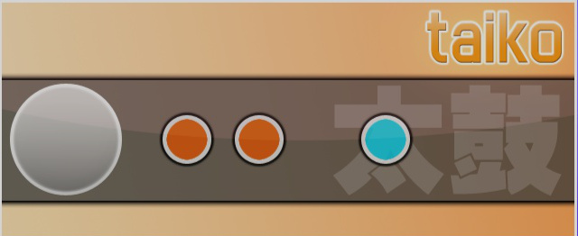

# osu!taiko

osu!taiko - это игровой режим в osu!, основанный на серии японских ритм-игр [Taiko no Tatsujin](https://en.wikipedia.org/wiki/Taiko_no_Tatsujin) (выпущено в Северной Америке под названием [Taiko: Drum Master](http://en.wikipedia.org/wiki/Taiko:_Drum_Master)).

##  Геймплей

### Выбор песни

Чтобы выбрать режим osu!taiko, нажмите `Ctrl` + `2` одновременно.

К тому же, вы можете нажать кнопку `Mode` и выбрать `osu!taiko`

### Основы геймплея

#### Игровое поле

Для игроков с опытом игры в *Taiko no Tatsujin*:

- Чиби-танцоры снизу отсутствуют (должны быть в сториборде)
- Шкала здоровья должна быть заполнена хотя бы на 50% для прохождения
- *Kiai Time* активирует режим *"Go-Go Time"*
  - Игровые механики, такие как воздушные шары или разветвления путей, не реализованы (только их основы)
- Задний фон отличается
  - В картах с видео или статичной картинкой фон будет занимать лишь нижнюю часть экрана
  - Если в карту включен сториборд, он будет занимать весь экран, но при этом будет позади игрового поля

Для новичков в режиме osu!taiko:

Экран разделён на две части; на верхней части содержатся игровые элементы, в то время как на нижней показывается картинка, видео или сториборд, принадлежащие карте. В верхней части отображается шкала здоровья, которая, в отличие от других режимов, с начала игры пуста и должна быть заполнена хотя бы на 50% для прохождения карты. Ниже шкалы здоровья, слева находится барабан тайко и двигающаяся конвейерная лента, по которой справа налево едут игровые объекты через круг оценки рядом с барабаном тайко. Над барабаном тайко расположен анимированный маскот тайко (также известный как Пиппидон или Дон) который будет реагировать на секции *Kiai Time*, достижения комбо и промахи по нотам во время *Kiai Time*. Кроме того, цвет движущейся дорожки выше конвеерной ленты меняется из-за промаха игрока. Напоследок, здесь есть привычные счетчик очков, аккуратность и прогресс карты справа сверху.

Важно подметить, что в osu!taiko шкала здоровья не уменьшается самостоятельно, то есть на нее влияют только игровые объекты. В отличие от режима osu!, достижения комбо возникают каждые 50 успешных нажатий подряд. Базовое количество очков за ноту будет увеличиваться каждый раз при достижении комбо кратного 10, но остановится на 100 (максимальный лимит комбо для увеличения очков). Если комбо прервалось, увеличение очков сбрасывается до базового значения. Во время *Kiai Time*, каждое успешное попадание дает игроку на 20% больше очков от стоимости ноты. Количество очков, полученное за попадание, можно увидеть под аккуратностью справа сверху, написанное красным цветом.

#### Ноты тайко

Ноты тайко могут быть либо красными, либо синими кругами. Эти круги называются Дон (для красных нот) и Кацу или Кат (для синих нот) соответственно.

Если перед вами красная нота, нажмите кнопку, отвечающую за удар по внутренней части барабана тайко или ударьте по большой плоской части (центру) *ТаТаКона*. Если перед вами синяя нота, нажмите кнопку, отвечающую за удар по внешней части барабана тайко или ударьте по краю *ТаТаКона*. Если перед вами **БОЛЬШОЙ** круг, нажмите или ударьте по обеим внутренним или внешним частям барабана в зависимости от цвета ноты для двойных очков (при правильном нажатии по одной части очки не умножатся).

Ноты должны быть нажаты при их попадании в белый круг оценки, находящийся перед барабаном тайко. Нажатие на непраильный цвет или нажатие на оба цвета сразу будет считаться промахом.

#### Драмроллы

Для получения очков, нажимайте внутренние (или внешние) части барабана до конца драмролла. Можно нажимать как левую, как правую, так и обе части по очереди. Если перед вами **БОЛЬШОЙ** драмролл, нужно нажимать одновременно две стороны внутренней (или внешней) части барабана. Заметьте, что вы можете ударить по драмроллу ограниченное количество раз. Счетчик повышается только если вы ударили по маленькому кругу, в отличии от *Taiko no Tatsujin*, где вы можете нажимать по драмроллу так быстро, как можете.

Вы можете пропустить драмролл без последующей потери здоровья, при этом вы не восстановите здоровье. Игнорирование драмролла будет стоить вам очков, которые вы могли бы заработать. Каждое успешное нажатие по драмроллу добавляет фиксированные 300 очков.

#### Дендены

 в osu!taiko")

**Поочередно** нажимайте внешнюю и внутреннюю части барабана (например: красная, синяя, красная, синяя, ...), пока счетчик денден не достигнет 0. Цвет, с которого вы начали денден, не важен (вы можете начать как с красного, так и с синего), и неудача в прохождении дендена повлечет за собой потерю здоровья, но не сброс комбо. Если нажимать один и тот же цвет несколько раз во время дендена, его счетчик не понизится, пока другой цвет не будет нажат.

Дендены не повышают счетчик комбо и не восстанавливают здоровье. Каждое успешное нажатие во время дендена дает фиксированные 300 очков, а прохождение дендена оценивается как отличное (GREAT) попадание по большой ноте.

## Стили игры

*См. [раздел osu!taiko на странице о стилях игры](/wiki/Gameplay/Play_style).*

## Управление

По умолчанию, для режима osu!taiko установлены следующие настройки:

| Вид ноты | Мышь | Клавиатура | ТаТаКон |
| :-- | :-- | :-- | :-- |
| Красная | Левая кнопка(Л) | `X` (Л) / `C` (П) | Плоская поверхность барабана |
| Синяя | Правая кнопка(П) | `Z` (Л) / `V` (П) | Внешняя поверхность барабана |

Положение курсора во время игры ни на что не влияет.

Если включен модификатор [Relax](/wiki/Gameplay/Game_modifier/Relax), оцениваться будет только точность нажатия по времени (модификатор автоматически подстраивает нажатие под нужный цвет).

Барабан-контроллер ТаТаКон изначально создавался для домашних версий игр *Taiko no Tatsujin* и *Taiko: Drum Master*, но в osu!taiko он используется не так часто. Несмотря на это, в меню [настроек](/wiki/Client/Options#другое) присутствует функция `Поддержка Wiimote/TaTaCon Drum`.

## Подсчет очков

[Счет в osu!taiko](/wiki/Gameplay/Score/ScoreV1/osu!taiko) - это взвешенная сумма множества игровых компонентов. Счет зависит от следующих факторов:

- [Оценка](/wiki/Gameplay/Judgement/osu!taiko) определяет стоимость игрового объекта (300, 100 или 0 при промахе). Стоимость обычных и больших нот зависит от точности нажатия, в то время как стоимость остальных игровых объектов статична.
- [Аккуратность](/wiki/Gameplay/Accuracy#osu!taiko) зависит от оценки и показывает, насколько точны нажатия. поздние или ранние нажатия, как и промахи, понижают аккуратность.
- [Комбо](/wiki/Gameplay/Combo_(score_multiplier)) - это множитель очков: успешное исполнение игрового объекта приносит тем больше очков, чем больше комбо и наоборот. Комбо может быть [прервано](/wiki/Gameplay/Judgement/Combobreak) из-за промаха. В osu!taiko, множитель очков от комбо ограничен и не влияет на итоговый результат так сильно, как в режимах osu! или osu!catch.
- [Kiai time](/wiki/Gameplay/Kiai_time): в osu!taiko, kiai time увеличивает получаемые очки на 20%, то же самое происходит и в играх *Taiko no Tatsujin*.

Помимо добавления очков, каждый исполненный игровой объект немного повышает [шкалу здоровья](/wiki/Client/Interface/Health_bar), которая должна быть хотя бы **наполовину полная**для успешного прохождения игроком карты.

После прохождения карты, счет закрепляется [оценкой](/wiki/Gameplay/Grade#osu!taiko), коротким показателем точности в виде одной буквы. Золотая/серебряная SS выдается при аккуратности, равной 100%, а все другие оценки, от S до D, зависят от количества оценок 300, 100 и промахов.

## Скиннинг

*См. [страницу скиннинга osu!taiko](/wiki/Skinning/osu!taiko) для полной информации*

## Маппинг osu!taiko

- Красная нота представляет собой обычный круг,
  - большая красная нота требует финишный хитсаунд.
- Синяя нота требует свист/хлопок на круге,
  - большая синяя нота требует свист/хлопок и финишный хитсаунд одновременно.
- Слайдер означает длинную желтую ноту (драмролл)
- Спиннер означает денден.

Расположение ноты на игровом поле не имеет значения.

### Особенности конвертации из osu!

Когда происходит конвертация (запуск карты режима osu! в режиме osu!taiko), очень короткие слайдеры (как правило, меньше одной доли) автоматически превращаются в синие/красные ноты в зависимости от хитсаунда.

В картах с темпом 125 ударов в минуту и меньше, вместо драмроллов с шагом 1/4 будут использоваться драмроллы с шагом 1/8.

Имейте в виду, что ритм 1/8 редко используется в музыке. Нежелательно использовать слайдеры при таком темпе.

Помимо этого, обратите внимание, что будут даваться драмроллы с шагом 1/6 если использована частота тиков слайдера равная **трем**.

## Интересные факты

### Геймплей

- Игра на пустом игровом поле не приведет к промахам.
- Драмролл: максимальное число ударов по слайдеру:
  - В 4 раза больше длины слайдера, или
  - в 8 раз больше длины слайдера в песнях с темпом 125 ударов в минуту и менее.
- В отличие от других игровых режимов, *Kiai Time* увеличивает получаемые очки, потому что эта механика основана на *Go-Go Time* из *Taiko no Tatsujin*. Пока *Kiai Time* активен, барабан слева сверху (которого зовут *пиппидон* в osu!taiko или *Дон*/*Кацу* в *Taiko no Tatsujin*) меняет анимацию, у игрового поля появляется фоновый градиент и вокруг области нажатия возникает светящийся эффект.
  - К тому же, стоимость всех нот умножается на 1.2x, включая длинные желтые ноты, но не нажатия во время спиннера (последнее нажатие все еще умножается).
- У osu!taiko есть маскоты: [пиппидон](/wiki/Mascots#pippi) и [Мокко](/wiki/Mascots#mocha).
- Когда играет [Auto](/wiki/Gameplay/Game_modifier/Auto), имя игрока будет *mekkadosu!*.

### История

- При включенной в меню настроек функции `Свой скин для тайко` под секцией настроек скина будет использовать элементы скина из папки `taiko` при игре в osu!taiko, независимо от элементов текущего скина. Раньше там находился скин *[Taiko от LuiginHann](https://osu.ppy.sh/community/forums/topics/41319)*, который можно было скачать из устаревшего `osume.exe` (старая система обновлений, использовавшаяся до интеграции ее в игру) во вкладке `Skin`.
- Первой рейтинговой картой, содержащей сложность в режиме osu!taiko стала [Taiko no Tatsujin - Saitama2000](https://osu.ppy.sh/beatmapsets/210) от [Kharl](https://osu.ppy.sh/users/452)
- Первой рейтинговой картой, созданной специально для режима osu!taiko, стала [Mutsuhiko Izumi - Red Goose](https://osu.ppy.sh/beatmapsets/55920) от [lepidopus](https://osu.ppy.sh/users/194807)
