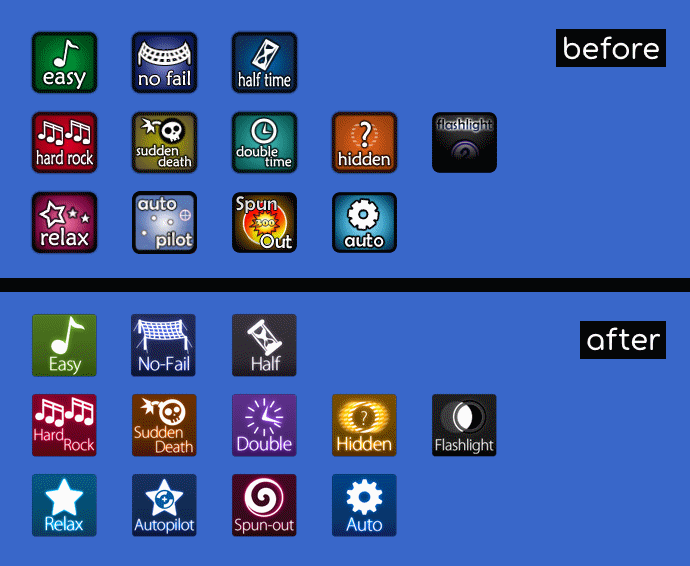
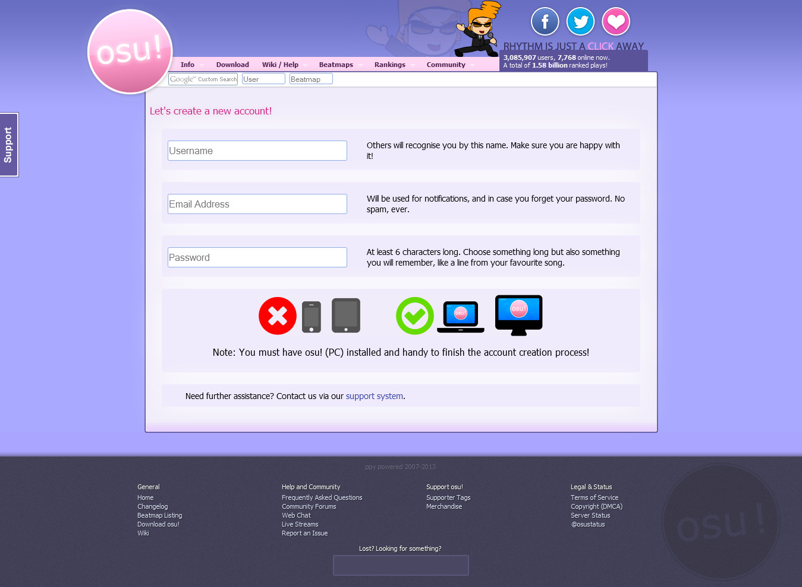
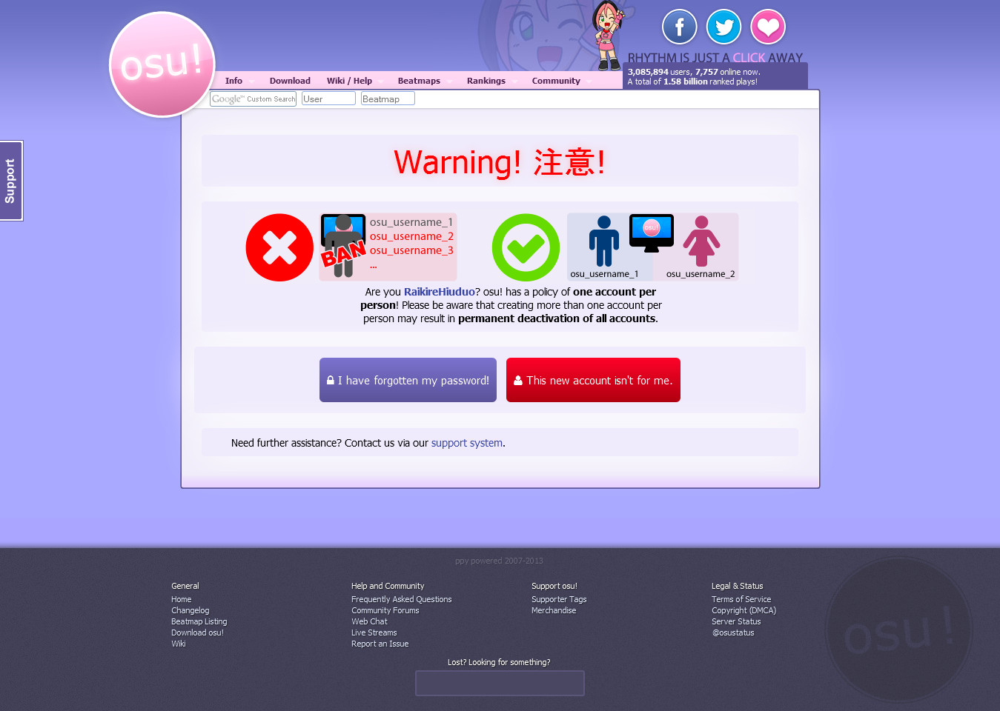
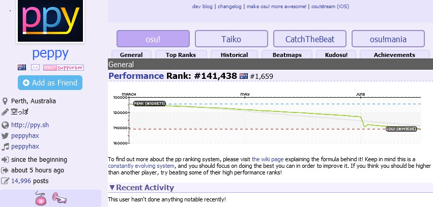
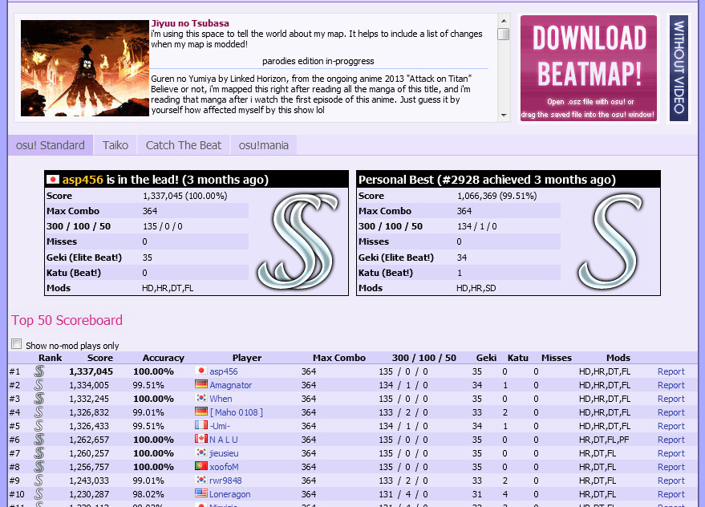
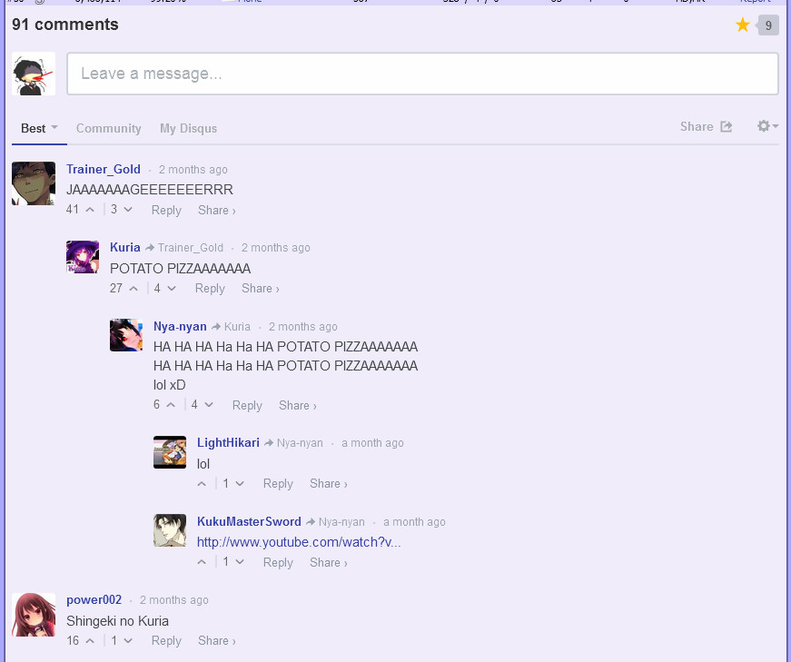
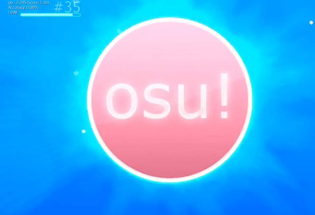
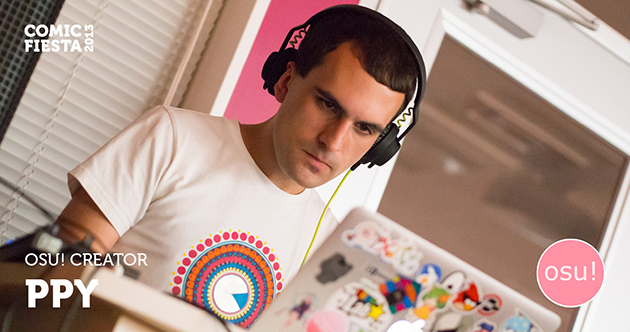

# History of osu! 2013

## January

Widescreen support was added to all [game modes](/wiki/Game_mode), including the [beatmap editor](/wiki/Client/Beatmap_editor). Users became able to reset the key bindings to their defaults. Issues with the hyperdash algorithm in Catch the Beat[^catch] causing [fruits](/wiki/Gameplay/Hit_object/Fruit) to not be catchable in some edge cases were fixed.[^hyperdash-issues] By removing legacy data and checking for optimal table usage, ::{ flag=AU }:: [peppy](https://osu.ppy.sh/users/2) was able to reduce the database's size.[^week-in-osu-8] While updating the main menu's copyright graphic to 2013, the copyright text was removed to make the graphic more compact and user-friendly.[^week-in-osu-9]

[Psy - Gangnam style](https://osu.ppy.sh/beatmapsets/55799#osu/169697) mapped by ::{ flag=US }:: [yeahyeahyeahhh](https://osu.ppy.sh/users/58042) was voted to be the most favourite [beatmap](/wiki/Beatmap) of 2012. The top 100 beatmaps are detailed in [this spreadsheet](https://docs.google.com/a/ppy.sh/spreadsheet/ccc?key=0AlsSAL_F7-xDdDRDSjNMN3o3Y1Z6UzA0QUpFNzdlNUE#gid=0).[^best-of-2012]

## February

After the osu! wiki had been tailored to fit the main page design, the old [FAQ](/wiki/FAQ) was superseded by it as a result.[^week-in-osu-10]

::{ flag=CN }:: [woc2006](https://osu.ppy.sh/users/1105845) created an improved version of the [osu!mania](/wiki/Game_mode/osu!mania) editor. A "metadata" bar was added to the [Taiko template background](/wiki/Beatmap/Background/Taiko_template_background) for displaying the song title and the artist below the [playfield](/wiki/Client/Playfield). To hide other metadata in the background, the Taiko[^taiko] playfield was made intransparent. Furthermore, the playfield bar would fade in and out of [kiai time](/wiki/Gameplay/Kiai_time).[^stable-b20130220][^week-in-osu-10]

The in-game chat bot [BanchoBot](/wiki/BanchoBot) received its proper [profile](https://osu.ppy.sh/users/3) and the `!faq` chat command became translatable via [a spreadsheet](https://docs.google.com/a/ppy.sh/spreadsheet/ccc?key=0AlsSAL_F7-xDdHhUUjNSa19QendtcTdYUjE2S2hnVHc#gid=24).[^week-in-osu-11]

A new feature in osu!mania made it possible to flip the playfield vertically which would make gameplay similar to that of DDR/o2jam.[^stable-b20130220][^week-in-osu-12]

Furthermore, the [Hidden](/wiki/Gameplay/Game_modifier/Hidden) and [FadeIn](/wiki/Gameplay/Game_modifier/Fade_In) mods became ranked in osu!mania.[^stable-b20130220]

In addition, [skins](/wiki/Skin) would support double-resolution sprites when the window width was greater than 1600 pixels. To add support to a skin, images with double the width/height required `@2x` as the suffix before the file extension (e.g. `cursor@2x.png`).[^stable-b20130220][^week-in-osu-12]

Lastly, widescreen support was tweaked to allow mappers to place and select objects in the beatmap editor with less limitations, and the online user panels would adjust dynamically to display four columns on all widescreen modes.[^stable-b20130220][^week-in-osu-12]

## March

On 20 March, ::{ flag=AU }:: [Ephemeral](https://osu.ppy.sh/users/102335) announced that the osu! staff had been restructured internally to clearly define roles and responsibilities amongst all staff members. The [Language Surveillance Division](/wiki/People/Language_Surveillance_Division) was renamed to "Chat Moderators". The [Support Team](/wiki/People/Technical_Support_Team) was formed as a proper group to help users with technical issues. The "Administrators" group was replaced with the [Global Moderation Team](/wiki/People/Global_Moderation_Team) to solely focus on in-game and forum moderation. For this reason, the BAT map management options became unavailable to GMT members.[^staff-restructure]

::: Infobox

:::

osu!'s user interface was completely redesigned with the help of ::{ flag=US }:: [RBRat3](https://osu.ppy.sh/users/307202), including the beatmap editor controls, [game modifier](/wiki/Gameplay/Game_modifier) icons and the main menu. Additionally, these notable changes were made:[^stable-20130319]

- The osu! game mode's leitmotif symbol was tweaked by changing the "osu!" text in the middle of the circle to a "1".
- The special mode selection accessible in the main menu was moved to the [song select](/wiki/Client/Interface#song-select) screen, allowing players to switch game modes quicker and more intuitively.
- [Combo fire](/wiki/Gameplay/Combo_fire) was removed due to performance concerns.
- The result screen would show the beatmap's background image rather than the user skin's result background.
- Hit explosions became visually smaller, improving readability especially on [streams](/wiki/Beatmap/Pattern/osu!/Stream).

To accommodate the major interface overhaul, "osu!default by peppy" was replaced with "osu! by peppy" as the new default skin. Since osu! received support for both widescreen HD and standard resolution, a new setting was added to the `Skins` tab in the options menu. By default, old skin behaviour was used for compatibility and enabling this setting would force the new skin behaviour (e.g. animations) to be in effect instead.

In the [multiplayer](/wiki/Client/Interface/Multiplayer) mode, hosts became able to activate `Free Mods`, allowing players to freely choose any mod combination, except ones that change gameplay speed. The "Game Style" was removed (Host can adjust the Game Style in Song Selection now under "Mods"). The `#userlog` channel was introduced to display the player's recent match result privately.

When hovering over the [performance graph](/wiki/Gameplay/Accuracy#performance-graph) in the [results screen](/wiki/Client/Interface#results-screen), players became able to know how far off their early hits and their late hits were on average. Do note that these values will disappear and can not be saved. Online leaderboard information in the ranking popup dialog became part of the extended results screen which can be reached by scrolling down in the results screen, or by clicking the button at the bottom of the screen.[^week-in-osu-13]

At the end of March, "unified scoreboards" were added which displayed plays with the same mods, scores from friends and local scores in consecutive sections directly below each other in a scrollable list. This feature was only available to [osu!supporters](/wiki/osu!supporter), as peppy wanted to test how the server performance would be affected. The difference between scores was displayed below the accuracy in the respective score panel.

After a lot of people criticised the new leaderboard design for being too cluttered and for the inability to scroll to see more top scores from other players, the scoreboard received a second revision just days later. As a result, players became able to choose between the several leaderboards via a dropdown menu. However, the `Global (Selected Mod)`, `Friend` as well as the per-beatmap `Country` ranking added in the same update stayed limited to osu!supporters. Though, the score difference display was kept.[^stable-20130325][^stable-20130328]

Lastly, the player's profile picture had been added beside the [grade](/wiki/Gameplay/Grade) mark in the ranking scoreboard. When hovering over the score, the profile picture would become darker to show the placement number.

## April

Besides publishing patches for the previous major update, the initial support for "collections" enabled users to group beatmaps in as many batches as they wanted, instead of just two like in the "Favourites A/B" feature. This also made it simpler for users to share their favorite beatmaps with others.

The shortcuts `Ctrl` + `1`, `2`, `3` or `4` were added to easily switch in the song select screen to the [osu!](/wiki/Game_mode/osu!), [Taiko](/wiki/Game_mode/osu!taiko), [osu!mania](/wiki/Game_mode/osu!mania) or [Catch the Beat](/wiki/Game_mode/osu!catch) [game mode](/wiki/Game_mode) respectively. osu!mania received the game modifier [Random](/wiki/Gameplay/Game_modifier/Random), which would shuffle the note placement every time a beatmap is played. When using the `Quick Join` button in the multiplayer mode, the room selection was adjusted to take the average pp of all room participants in comparison to the player into consideration.

Comments in beatmap [replays](/wiki/Gameplay/Replay) were styled as [danmaku subtitles](https://en.wikipedia.org/wiki/Danmaku_subtitling) where they would move across the screen in accordance to when they were made, similar to the video sharing platform [Niconico](https://en.wikipedia.org/wiki/Niconico). osu!supporters received the ability to set a custom colour for their comments.

All [Mapping Assistance Team](/wiki/People/Mapping_Assistance_Team) (*MAT*) members became [Beatmap Appreciation Team](/wiki/People/Beatmap_Appreciation_Team) (*BAT*) members as the MAT was officially dissolved due to responsibilities and permissions being too similar between the two.[^mat-end]

peppy released one of the [initial osu! builds](https://osu.ppy.sh/community/forums/topics/130144) from September 2007, the one he had hoped to release for osu!'s 5th anniversary.

## May

On 5 May, the number of users being connected simultaneously exceeded 10,000 for the first time.[^may-june-in-osu]

Following the promotion of all active members of the MAT to the BAT in April, three individuals were appointed as BAT managers to administer the major geographical regions, where ::{ flag=CN }:: [NatsumeRin](https://osu.ppy.sh/users/151679) represented Asia/Oceania, ::{ flag=FR }:: [Kurai](https://osu.ppy.sh/users/77089) represented Europe and ::{ flag=US }:: [Garven](https://osu.ppy.sh/users/244216) represented America. Together, they were responsible for overseeing all major changes to the [ranking criteria](/wiki/Ranking_criteria), and also handling the recruitment of new modders and mappers into the BAT.[^regional-team]

Game modifiers were shortened to their two-letter acronym (e.g. [Hard Rock](/wiki/Gameplay/Game_modifier/Hard_Rock) became "HR") in the result screen to not clutter the limited space too much. A bug in replays causing misses to be displayed incorrectly was fixed. The spectator system was improved by allowing the user to follow the spectated person if they were spectating someone else. Unless required, the game would no longer force a restart when updating.[^stable-b20130509]

When watching [replays](/wiki/Gameplay/Replay), users received the ability to set the playback speed to 50% by clicking the speed button twice. The playfield would not flash out the background anymore when fully dimmed. [Catch the Beat](/wiki/Game_mode/osu!catch) received joystick support in the song selection menu (`Up`/`Down`: Change song, `Right`: Select, `Left`: Exit).

To address glaring issues in the [forum-based modding](/wiki/Modding/Forum_modding) threads, such as beatmaps becoming [Ranked](/wiki/Beatmap/Category#ranked) even though they were not adhering to the [ranking criteria](/wiki/Ranking_criteria), peppy started working on a new [ranking/modding system](https://osu.ppy.sh/community/forums/topics/129625), which would later become known as [Modding v2](/wiki/Beatmap_discussion).

In the multiplayer mode, players became able to use mods from the `Special` category ([Relax](/wiki/Gameplay/Game_modifier/Relax), [Autopilot](/wiki/Gameplay/Game_modifier/Autopilot), [SpunOut](/wiki/Gameplay/Game_modifier/Spun_Out) and [ManiaKeys](/wiki/Gameplay/Game_modifier/xK)) when Free Mod was enabled by the host. Widescreen default sprites (`@2x`) were added to the Taiko game mode. The "Favourites A/B" feature was completely removed in favor of collections.

Three new dedication [achievements](/wiki/Medals) were released for osu!mania that required the player to press 40,000, 400,000, and 4,000,000 keys respectively. Furthermore, the user profile was redesigned, e.g. a user's last visit would be based on when they last signed into the game rather than visits to the web forum.[^may-highlights]

## June

To discourage players from creating several accounts for personal reasons, potential consequences for them were made more prominent and clear. Furthermore, an infographic showing that it is not possible to register from mobile devices was added.

Users became able to choose their primary game mode which would be shown by default when visiting their profile. Additionally, a new feature allowed users to link their [last.fm](https://last.fm) account on their osu! profile. Moreover, a country performance rank and a pp graph visualising the player performance in the last 90 days was added.

If available, the personal best rank would be shown in the leaderboard section on the [beatmap information](/wiki/Beatmap_information) page next to the first place score.[^best-rank-comparison] A Disqus comment feature coupled with [single sign-on](https://en.wikipedia.org/wiki/Single_sign-on) was added to the beatmap information page, allowing for a simple and integrated way of exchanging ideas and opinions about a beatmap.[^may-june-in-osu]

In the main menu, a flare was added around the [osu! cookie](/wiki/Client/Interface/Cookie) which would become brighter depending on the song's intensity. The performance in the song select screen was optimised for users that had more than 10,000 beatmaps loaded in-game.[^may-june-in-osu]

::: Infobox

:::

The [lead-in time](/wiki/Beatmap/Lead-in_time) was automatically added to any beatmap that would start abruptly to allow for enough time to adjust the [visual settings](/wiki/Client/Interface/Visual_settings). A new feature made it possible to view the total press counts for each key in the input overlay. Furthermore, quick repeat sliders not reaching their maximum combo were fixed.

An update in osu!(stable) enabled score submission for osu!mania charts.[^june-highlights] peppy moved replay information to the hosting service [Amazon S3](https://en.wikipedia.org/wiki/Amazon_S3) which allowed him to store replay information for the top 50 scores on a beatmap, instead of the previous 40.[^may-june-in-osu]

With ::{ flag=AR }:: [Antoneko](https://osu.ppy.sh/users/2772600) uploading [Otokaze - Mallow Flower](https://osu.ppy.sh/beatmapsets/100000#osu/265570), the number of submitted beatmaps reached 100,000.[^june-highlights]

## July

On 2 July, peppy made the [osu!api](/wiki/osu!api) open to the public, which was previously available only through private requests. This allowed independent developers to work on third party services for osu!.[^api-beta]

The applications for becoming a member of the BAT was opened in July to look for new volunteers, especially people that want to put a focus on the game modes Taiko, Catch the Beat or osu!mania, as those were becoming more and more popular.[^new-bat]

On 11 July, a bug was fixed that caused the osu! website to not send any password reset e-mail.

An update to osu!(stable) added a toggle for storyboards in the song setup dialog to remove the [pillarboxes](https://en.wikipedia.org/wiki/Pillarbox) from the sides of the [playfield](/wiki/Client/Playfield) if the screen's aspect ratio was higher than `4:3`. Two new in-game overlays were added, allowing users to track the accuracy while playing or spectating other players. In the hit error overlay, [judgements](/wiki/Gameplay/Judgement) would be visualised on a time-based graph, while in the colour overlay, they were shown as a coloured square.[^july-highlights]

In the fourth iteration of the [osu! Beatmapping Contest](https://osu.ppy.sh/community/forums/topics/134515?n=1) through June and July, participants were required to create 3 difficulties in the osu! game mode to 1 out of 3 songs of their choice. For each song, the winner would receive the "Elite Mapper" title, a $50 Amazon gift card and one year of osu!supporter, whereas the second place would receive three months of osu!supporter. On 29 July, ::{ flag=AU }:: [Ephemeral](https://osu.ppy.sh/users/102335) announced the following finalists:[^BC4-results]

| Song | 1st place | 2nd place |
| :-- | :-- | :-- |
| Tomoya Ohtani - Rooftop Run | ::{ flag=NL }:: [Kyshiro](https://osu.ppy.sh/users/640611) | ::{ flag=KR }:: [Sonnyc](https://osu.ppy.sh/users/11771) |
| Infected Mushroom - Pink Nightmares | ::{ flag=US }:: [RLC](https://osu.ppy.sh/users/1047883) | ::{ flag=US }:: [Charles445](https://osu.ppy.sh/users/85000) |
| Kurosaki Maon - Fuss Fuzz | ::{ flag=SE }:: [Xgor](https://osu.ppy.sh/users/98661) | ::{ flag=NL }:: [Lesjuh](https://osu.ppy.sh/users/44308) |

## August

Since the osu!(stable) update on 8 August, players were no longer required to pass a beatmap before being able to adjust the [visual settings](/wiki/Client/Interface/Visual_settings).[^stable-b20130801]

Several people received the newly created community contributor badge to commend them for their outstanding contributions to the community.[^contributors-2013]

To make updating osu! more user-friendly, the external updater `osume.exe` was deprecated in favor of an in-game update system. A message in the bottom-left corner would inform users that an update was being installed in the background. Instead of being forced to restart their game immediately, users became able to continue playing on the old version, and apply the update later.[^deployment]

While still being limited to [osu!supporters](/wiki/osu!supporter), the "osu!test" build[^osu-test] was integrated into the main [Bancho](/wiki/Bancho_(server)) server, so that volunteers could help test new features more easily.[^osu-test-thread]

Several people voiced an interest in osu! stickers, so peppy made two options available in the store, the first being five different designs measuring 7.6x7.6cm, and the second being ten osu! logo stickers measuring 5x5cm in size.[^stickers]

## December

::: Infobox

:::

From 21 to 22 December, peppy was invited as a guest speaker to the 2013's [Comic Fiesta](https://en.wikipedia.org/wiki/Comic_Fiesta) in Malaysia.[^CF-announcement] On the first day, the four different [game modes](/wiki/Game_mode) were presented as a stage event, where live gameplay was projected onto a big screen. In a presentation on the second day, peppy gave an insight into osu!'s origins, the early-stage development, the natural growth of its community, the server infrastructure, along with detailing his future update plans and answering various community questions.[^CF-schedule][^CF-panel]

One topic heavily discussed at the time was a potential fifth game mode. peppy teasered in his presentation that he was testing a proof of concept inspired by the [Touhou Project](https://en.wikipedia.org/wiki/Touhou_Project), where players would be required to dodge lots of small projectiles, basically the inverse of [Catch the Beat](/wiki/Game_mode/osu!catch).[^CF-new-mode] Many users had voiced over the years that they would like to see such a concept being implemented.[^touhosu]

Furthermore, peppy gave several interviews at the convention,[^CF-interview-1][^CF-interview-2] and showcased the [osu!tablet](/wiki/Past_osu!store_items#osu!tablet) to the public, an [input device](/wiki/Gameplay/Input_device) which would be used to control the in-game cursor movement.

## Notes and references

[^catch]: At the time, the [osu!catch](/wiki/Game_mode/osu!catch) [game mode](/wiki/Game_mode) was called Catch the Beat.
[^hyperdash-issues]: [Blog post by peppy (2013-01-07) "Getting Hyperdash Right"](https://blog.ppy.sh/post/39917651337/getting-hyperdash-right)
[^week-in-osu-8]: [Blog post by peppy (2013-01-06) "This Week in osu!"](https://blog.ppy.sh/post/39831318171/this-week-in-osu-8)
[^week-in-osu-9]: [Blog post by peppy (2013-01-20) "This Week in osu!"](https://blog.ppy.sh/post/41003637501/this-week-in-osu-9)
[^best-of-2012]: [Forum thread by peppy (2013-01-09) "Best of 2012 Results"](https://osu.ppy.sh/community/forums/posts/2042263?n=1)

[^week-in-osu-10]: [Blog post by peppy (2013-02-13) "This Week in osu!"](https://blog.ppy.sh/post/42178900910/this-week-in-osu-10)
[^week-in-osu-11]: [Blog post by peppy (2013-02-15) "This Week in osu!"](https://blog.ppy.sh/post/43136384020/this-week-in-osu-11)
[^week-in-osu-12]: [Blog post by peppy (2013-02-23) "This Week in osu!"](https://blog.ppy.sh/post/43823357969/this-week-in-osu-12)
[^stable-b20130220]: [Forum thread by peppy (2013-02-20) "osu! release b20130220"](https://osu.ppy.sh/community/forums/posts/2134063?n=1)
[^taiko]: At the time, the [osu!taiko](/wiki/Game_mode/osu!taiko) [game mode](/wiki/Game_mode) was called Taiko.

[^stable-20130319]: [Forum thread by peppy (2013-03-19) "osu! Public Release (b20130319)"](https://osu.ppy.sh/community/forums/topics/123276?n=1)
[^stable-20130325]: [Forum thread by peppy (2013-03-25) "osu! Public Release (b20130325)"](https://osu.ppy.sh/community/forums/topics/124366?n=1)
[^stable-20130328]: [Forum thread by peppy (2013-03-28) "osu! Public Release (b20130328)"](https://osu.ppy.sh/community/forums/topics/124848?n=1)
[^week-in-osu-13]: [Blog post by peppy (2013-04-02) "This week (month) in osu!"](https://blog.ppy.sh/post/46924535831/this-week-month-in-osu-13)
[^staff-restructure]: [Forum thread by Ephemeral (2013-03-20) "2013 Staff Restructuring"](https://osu.ppy.sh/community/forums/topics/123510?n=1)

[^mat-end]: [Forum thread by Ephemeral (2023-04-23) "The end of the MAT"](https://osu.ppy.sh/community/forums/topics/129165?n=1)

[^stable-b20130509]: [Forum thread by peppy (2013-05-09) "osu! Public Release (b20130509)"](https://osu.ppy.sh/community/forums/topics/131611?n=1)
[^may-highlights]: [Forum thread by MillhioreF (2013-05-31) "May 2013 Highlights + Map of the Month"](https://osu.ppy.sh/community/forums/posts/2334705?n=1)
[^regional-team]: [Forum thread by Ephemeral (2013-05-15) "Regional Team Management"](https://osu.ppy.sh/community/forums/topics/132667?n=1)

[^may-june-in-osu]: [Blog post by peppy (2013-07-03) "The Last Two Months in osu!"](https://blog.ppy.sh/post/54501455726/the-last-two-months-in-osu)
[^june-highlights]: [Forum thread by MillhioreF (2013-07-01) "June 2013 Highlights + Map of the Month"](https://osu.ppy.sh/community/forums/posts/2400775?n=1)
[^best-rank-comparison]: [Forum comment by peppy (2013-06-16) in "Can't see my rank in Beatmap Listing Page. [resolved]"](https://osu.ppy.sh/community/forums/topics/137952?n=5)

[^api-beta]: [Forum thread by peppy (2013-07-02) "osu!api open beta"](https://osu.ppy.sh/community/forums/topics/141240?n=1)
[^new-bat]: [Forum thread by Kurai (2013-07-11) "Summer 2013 NewBAT Applications"](https://osu.ppy.sh/community/forums/topics/142864?n=1)
[^BC4-results]: [Forum thread by Ephemeral (2013-07-29) "osu! Beatmapping Contest \#4 Results"](https://osu.ppy.sh/community/forums/topics/145908?n=1)
[^july-highlights]: [News post by osu!news team (2013-07-31) "Highlights of July"](https://osu.ppy.sh/home/news/2013-07-31-highlights-of-july)

[^stable-b20130801]: [Forum thread by peppy (2013-08-01) "Public Release (b20130801)"](https://osu.ppy.sh/community/forums/topics/146484?n=1)
[^contributors-2013]: [News post by Ephemeral (2013-08-08) "osu! community contributors"](https://osu.ppy.sh/home/news/2013-08-08-osu-community-contributors)
[^deployment]: [Blog post by peppy (2013-08-27) "Frictionless Updates"](https://blog.ppy.sh/post/59476446944/frictionless-updates)
[^osu-test]: At the time, the `Beta`/`Cutting Edge` [release stream](/wiki/Client/Release_stream) was called osu!test.
[^osu-test-thread]: [Forum thread by peppy (2013-08-07) "osu!test now more usable"](https://osu.ppy.sh/community/forums/topics/147744?n=1)
[^stickers]: [Forum thread by peppy (2013-08-01) "Poll 20: Interested in osu! stickers?"](https://osu.ppy.sh/community/forums/topics/146524?n=1)

[^CF-announcement]: [Forum thread by peppy (2013-11-01) "I will be in malaysia (December)"](https://osu.ppy.sh/community/forums/topics/163121)
[^CF-schedule]: [Schedule | Comic Fiesta 2013](https://web.archive.org/web/20131222065744/http://comicfiesta.org/2013/info/event/schedule/)
[^CF-panel]: [YouTube video by Dean Herbert (2013-12-28) "osu! panel at Comic Fiesta 2013"](https://www.youtube.com/watch?v=IjuaFiLia6w)
[^CF-new-mode]: [Forum thread by BlackMidKnight (2014-01-02) "New osu! mode announced on CF2013?"](https://osu.ppy.sh/community/forums/topics/176000?n=1)
[^touhosu]: [Forum thread by Yasa (2009-10-29) "Touhosu! / Dodge the Beat"](https://osu.ppy.sh/community/forums/topics/19307)

[^CF-interview-1]: [YouTube video by Metanorn (2014-01-14) "Metanorn Exclusive Interview: PPY @ Comic Fiesta 2013"](https://www.youtube.com/watch?v=TpmQQdkUzSA)
[^CF-interview-2]: [YouTube video by CalvinJustOtaku (2014-01-12) "CosNews 1 | Peppy (PPY) - Osu! Interview (Comic Fiesta)"](https://www.youtube.com/watch?v=83y5EEm-2dk)
