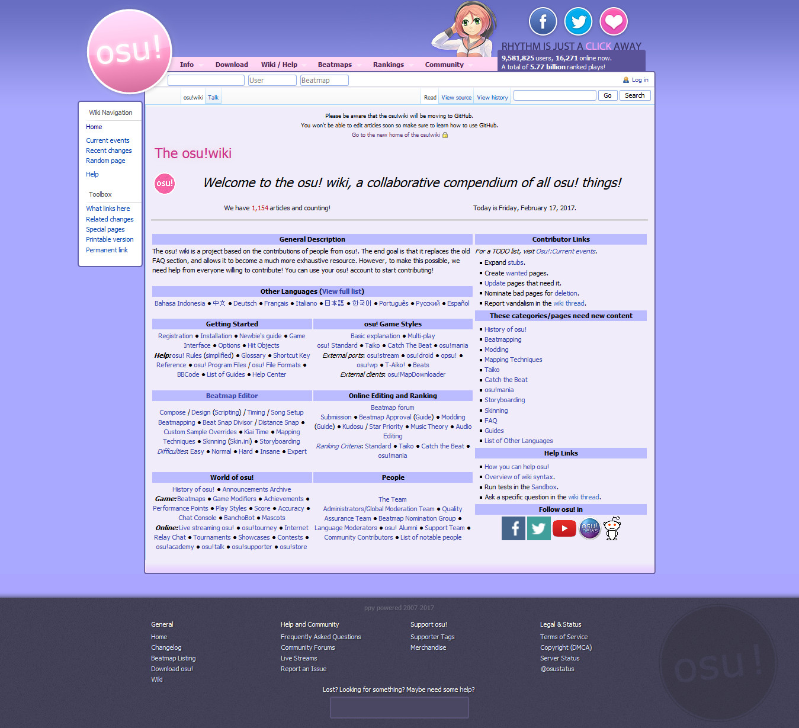
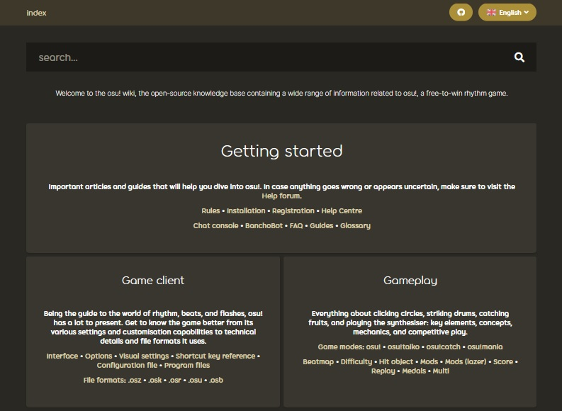

# История osu! wiki

::: alert-note
**См. также:** [Администраторы osu! wiki](/wiki/People/osu!_wiki_maintainers)
:::

В этой статье описаны основные события **истории osu! wiki** от эпохи MediaWiki до настоящего времени.

<!--Документация за период с 2018 по 2021 год отсутствует.-->

## MediaWiki (2011 — 2017)

### 2011

#### Декабрь

- **2011-12-05:** Заложены основы osu! wiki. ::{ flag=AU }:: [Ephemeral](https://osu.ppy.sh/users/102335) вносит первые правки.
- **2011-12-06:** osu! wiki [открывается для широкой публики](https://osu.ppy.sh/community/forums/topics/68525).

### 2012

#### Ноябрь

- **2012-11-29:** ::{ flag=MX }:: [Repflez](https://osu.ppy.sh/users/201392) и ::{ flag=RU }:: [Dellirium](https://osu.ppy.sh/users/519032) становятся администраторами MediaWiki osu! wiki.

### 2013

#### Январь

- **2013-01-27:** ::{ flag=AU }:: [peppy](https://osu.ppy.sh/users/2) [приводит оформление osu! wiki в соответствие с дизайном основного сайта](https://osu.ppy.sh/community/forums/posts/2082803).

### 2014

#### Декабрь

- **Неизвестная дата:** osu! wiki становится полноценным информационным центром osu! после переноса в неё таких ключевых страниц, как [команда osu!](/wiki/People/osu!_team) и [Правила](/wiki/Rules).
- **Неизвестная дата:** ::{ flag=NZ }:: [deadbeat](https://osu.ppy.sh/users/128370) и ::{ flag=DE }:: [Loctav](https://osu.ppy.sh/users/71366) становятся администраторами MediaWiki osu! wiki.

### 2015

#### Декабрь

- **Неизвестная дата:** В osu! wiki приходит много новых участников, которые переводят статьи на родные языки.
- **Неизвестная дата:** ::{ flag=FR }:: [Shiro](https://osu.ppy.sh/users/113005) сменяет ::{ flag=RU }:: [Dellirium](https://osu.ppy.sh/users/519032) на посту администратора.

### 2016

#### Февраль

- **2016-02-22:** ::{ flag=PL }:: [Ukami](https://osu.ppy.sh/users/820865) и ::{ flag=PL }:: [Galkan](https://osu.ppy.sh/users/169570) становятся администраторами MediaWiki osu! wiki.

#### Апрель

- **2016-04-01:** ::{ flag=PH }:: [Nathanael](https://osu.ppy.sh/users/2295078) становится администратором MediaWiki osu! wiki.

#### Август

- **2016-08-30:** Начинается постепенный переход osu! wiki с MediaWiki на версию в репозитории GitHub. Старая версия остаётся доступной, пока все страницы и изображения не перенесут в новую версию и её не подготовят к запуску.

### 2017

#### Июнь

- **2017-06-26:** osu! wiki на базе MediaWiki [официально прекращает работу](https://discord.com/channels/188630481301012481/218677502141399041/328851556453711872). Ссылки на старую вики теперь перенаправляют на новую версию на базе GitHub. [Снимок старой вики без функций MediaWiki можно найти здесь](https://web.archive.org/web/20171115173938/https://osu.ppy.sh/old-wiki/Main_Page).

## Репозиторий GitHub (2016 — настоящее время)

### 2016

#### Август

- **2016-08-26:** ::{ flag=AU }:: [peppy](https://osu.ppy.sh/users/2) [создаёт репозиторий osu-wiki](https://github.com/ppy/osu-wiki/tree/3433cbeeda9303a470647cad1c338d43f4272a2e).

#### Сентябрь

- **2016-09-02:** ::{ flag=US }:: [craftu](https://osu.ppy.sh/users/16468119) и ::{ flag=US }:: [XYLOO](https://osu.ppy.sh/users/27809907) завершают перенос большей части содержимого старой osu! wiki из MediaWiki в репозиторий. Остаётся перенести изображения и исправить некоторые ошибки разметки, возникшие из-за различий между [Wikitext](https://en.wikipedia.org/wiki/Help:Wikitext) в MediaWiki и [Markdown](https://en.wikipedia.org/wiki/Markdown) на GitHub.

### 2017

#### Январь

- **2017-01-26:** ::{ flag=AU }:: [Ephemeral](https://osu.ppy.sh/users/102335) рассказывает о предстоящей интеграции репозитория GitHub с самим сайтом osu! в [публикации о встрече разработчиков](https://blog.ppy.sh/post/156390386433/2017-01-dev-meeting).
- **Неизвестная дата:** ::{ flag=JP }:: [nanaya](https://osu.ppy.sh/users/2387883) завершает работу над серверной частью новой osu! wiki, что позволяет полностью интегрировать вики с сайтом osu!.

#### Май

- **2017-05-22:** [Архив osu!news](https://osunews.tumblr.com/), ранее размещавшийся на Tumblr, переносится в osu! wiki.
- **2017-05-30:** В вики появляется возможность [перенаправлять страницы](https://github.com/ppy/osu-web/pull/1144).

#### Июнь

- **Неизвестная дата:** ::{ flag=PL }:: [TPGPL](https://osu.ppy.sh/users/3944705) получает особые права на запись в репозитории osu! wiki.
- **2017-06-19:** В вики была добавлена [функция поиска](https://github.com/ppy/osu-web/pull/1259).

### 2018

#### Февраль

- **2018-02-07:** В вики появляются [теги статей](https://github.com/ppy/osu-web/pull/2331), помогающие улучшить результаты поиска.

### 2021

#### Май

- **2021-05-12:** В вики появляются [инфобоксы](https://github.com/ppy/osu-web/pull/7546).

#### Июнь

- **2021-06-01:** ::{ flag=ID }:: [GPR](https://osu.ppy.sh/users/10721349) добавляет [оверлей osu! wiki](https://github.com/ppy/osu/pull/12950) в [osu!(lazer)](/wiki/Client/Release_stream/Lazer), благодаря которому некоторые страницы вики можно открывать непосредственно из клиента osu!(lazer).

#### Август

- **2021-08-08:** В вики появляется [поддержка галерей](https://github.com/ppy/osu-web/pull/8126).
- **2021-08-12:** В вики появляется [поддержка сносок](https://github.com/ppy/osu-web/pull/8125).

### 2026

#### Июль

- **2026-07-06:** Чтобы сделать вводные пояснения более заметными, в вики появляются [стилизованные выноски](https://github.com/ppy/osu-web/pull/13079), которые выделяются значком и цветной вертикальной линией слева.
- **2026-07-30:** В вики появляется [компонент карточки пользователя](https://github.com/ppy/osu-web/pull/13125), который при наведении на ссылку профиля показывает карточку со статистикой пользователя — аналогично тегу `[profile]` [BBCode](/wiki/BBCode).
