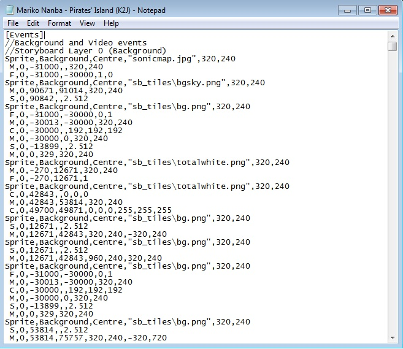
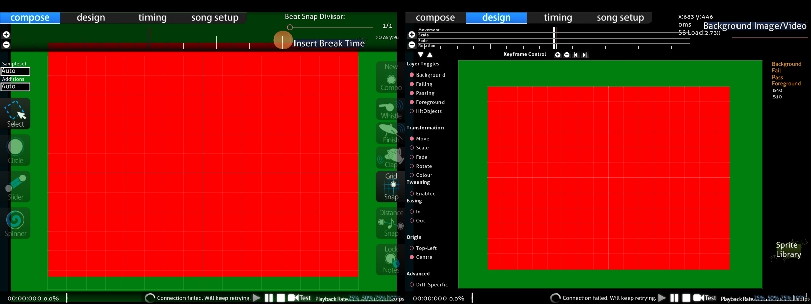
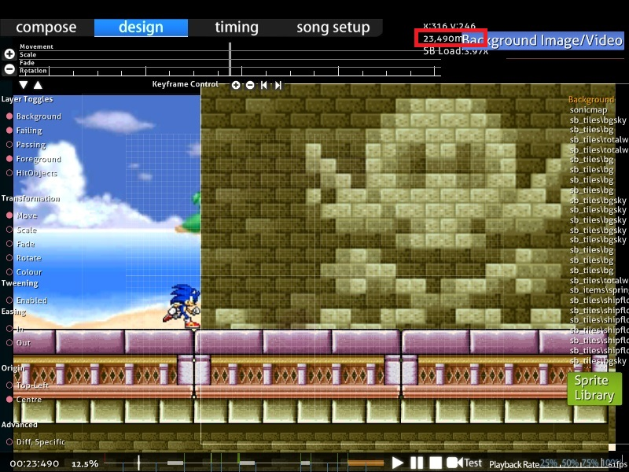

# Allgemeine Regeln für Storyboarding

Diese Anleitung beschreibt den geskripteten Code unter `[Events]` in einer `.osb`- oder `.osu`-Datei. Die Befehle in der `.osb`-Datei der [Beatmap](/wiki/Beatmap) werden in allen [Schwierigkeitsstufen](/wiki/Beatmap/Difficulty) verwendet, während die in der `.osu`-Datei nur auf die jeweilige Schwierigkeitsstufe angewendet werden.

## Grundregeln

### Objekte

::: alert-note
**Anmerkung:** Für Objekte in [osu!](/wiki/Game_mode/osu!) und im [Beatmapping](/wiki/Beatmapping), siehe [Hit-Objekte](/wiki/Gameplay/Hit_object)
:::

Ein [Storyboard-Objekt](/wiki/Storyboard/Scripting/Objects) ist eine Instanz eines [Sprites](https://de.wikipedia.org/wiki/Sprite_(Computergrafik)) oder eine Animation in einem [Storyboard](/wiki/Storyboard). Storyboards können auch Ton enthalten, siehe den [Audio-Leitfaden](/wiki/Storyboard/Scripting/Audio) für mehr Details.

Nur PNG und JPEG werden als Bildformate für Objekte akzeptiert.	JPEGs sind verlustreich, d. h. sie haben eine kleinere Dateigröße, speichern jedoch nicht jeden Pixel präzise ab. Außerdem unterstützen sie keine Transparenz. Daher eignen sie sich gut als Hintergrundbilder sowie für quadratische oder fotorealistische Bilder. PNGs sind verlustlos, d. h. alle Pixel werden exakt abgespeichert, was zu einer größeren Dateigröße im Vergleich zum JPEG führt. Da sie Transparenz unterstützen, sind sie für Objekte oder Text im Vordergrund üblicherweise am besten eignet.

Die Animationen werden in der Engine erstellt, d.h. PNG-Ebenen oder Animationensfunktionen sollten nicht verwendet werden. Speichere stattdessen jeden Frame als einzelne Datei ab und füge eine Dazimalzahl zum Dateinamen hinzu, z. B. "sample0.png" und "sample1.png" für eine Animation "sample.png" bestehend aus 2 Frames).

### Bildschirmgröße

Der Editor ist 640 x 480 Pixel groß und der allgemeine Spielbereich ist 510 x 385 Pixel groß.

Koordinaten werden angegeben durch positive `X`-Werte nach **rechts** und positive `Y`-Werte nach **unten** mit dem Ursprung (0,0) in der linken oberen Ecke des Bildschirms. Es ist auch möglich, Koordinaten außerhalb dieses Bereichs zu verwenden (z. B. für Sprites, die sich von außerhalb des Bildschirms ins Bild bewegen).

#### Editor-Koordinaten

| Bildfläche | x | y |
| :-: | :-: | :-: |
| Editor | 0 – 640 | 0 – 480 |
| Spielbereich | 60 – 570 | 55 – 440 |

### Ebenen

Mit Ausnahme des Overlays (welches unterhalb des [Skins](/wiki/Skin) platziert wird) werden alle Storyboard-Sprites unterhalb der [Hit-Objekte](/wiki/Gameplay/Hit_object) platziert. Daher liegt selbst die "höchste" Ebene (Overlay) im Storyboard immer noch über den Hit-Objekten, aber unter der [Lebensleiste](/wiki/Client/Interface/Health_bar), dem Cursor, etc.

Dies sind die fünf Storyboard-Ebenen, in aufsteigender Reihenfolge nach Priorität:

- Hintergrund
- Fail (erscheint nur, wenn der Spieler im "Fail-Zustand" ist, siehe [Spielzustand](#spielzustand) weiter unten)
- Pass (erscheint nur, wenn der Spieler im "Pass-Zustand" ist, siehe [Spielzustand](#spielzustand) weiter unten)
- Vordergrund
- Overlay (wird oberhalb der Hit-Objekte angezeigt, mit Vorsicht zu verwenden)

Beachte, dass die "Fail"- und "Pass"-Ebenen im Spiel nie gleichzeitig angezeigt werden, im Gegensatz zum [Tab "Design"](/wiki/Client/Beatmap_editor/Design).

Standardmäßig wird das Vorschau-[Hintergrundbild](/wiki/Beatmap/Background) der Beatmap (das Hintergrundbild, das in der [Songauswahl](/wiki/Client/Interface#songauswahl) angezeigt wird) unter allen anderen Ebenen platziert. Wird dassselbe Bild als Objekt im Storyboard verwendet, wird es unmittelbar nach dem Laden der Beatmap verschwinden. Es ist üblich, das Vorschau-Hintergrundbild der Beatmap als erstes Objekt festzulegen (zeitlich und in Bezug auf die Sprites) und den "fade out"-Befehl (aufhellen) zu verwenden, um dem Publikum den Hintergrund "vorzustellen".

#### Regeln für Überlappungen

- Objekte, die sich in **verschiedenen** Ebenen überlappen, werden in der oben angegebenen Reihenfolge gezeichnet (z. B. wird ein Objekt der Vordergrund-Ebene immer über den Objekten der Background-, Fail- und Pass-Ebenen angezeigt).
- Objekte, die sich auf **derselben** Ebene überlappen, werden in der Reihenfolge gezeichnet, in der sie angegeben werden (wird in der `.osb`- oder `.osu`-Datei z. B. Objekt 1 vor Objekt 2 angegeben, und befinden sich beide in derselben Ebene, so wird Objekt 2 über Objekt 1 angezeigt).
- Innerhalb der Ebenen haben Befehle der `.osb`-Datei gegenüber denen der `.osu`-Datei Vorrang, als wären die Befehle der `.osb`-Datei ans Ende der Befehle der `.osu`-Datei angehängt. Die Prioritäten der oben genannten fünf Ebenen werden dadurch nicht außer Kraft gesetzt. Für ein Beispiel siehe [diesen Forumsbeitrag](https://osu.ppy.sh/community/forums/topics/1869?start=469997).

### Spielzustand

Die Idee hinter der Verwendung eines Storyboards anstatt eines Videos ist **die Möglichkeit, Elemente dynamisch an das Gameplay anzupassen**. osu! zeigt entweder die Pass- oder die Fail-Ebene an, abhängig von der Leistung des Spielers. Diese Zustände werden als *Fail-Zustand* und *Pass-Zustand* bezeichnet.

Der Zustand **vor der ersten [Drain-Zeit](/wiki/Beatmap/Drain_time)** (z. B. vor dem ersten [Hit-Circle](/wiki/Gameplay/Hit_object/Hit_circle), [Slider](/wiki/Gameplay/Hit_object/Slider) oder [Spinner](/wiki/Gameplay/Hit_object/Spinner), nicht unbedingt vor dem Beginn der Audiodatei):

- Immer der Pass-Zustand, die Fail-Ebene wird nie angezeigt. Es wird empfohlen, an dieser Stelle der Beatmap weder die Pass-Ebene, noch die Fail-Ebene zu verwenden, da man zu diesem Zeitpunkt nicht wirklich von "passen" sprechen kann.

Der Zustand **während der Drain-Zeit** (während der der Spieler auf Objekte klicken muss, um zu verhindern, dass sich die Lebensleiste leert):

- Pass-Zustand, falls dies die erste [Combo](/wiki/Beatmapping/Combo) ist oder wenn die vorherige Combo mit einem [Geki](/wiki/Gameplay/Judgement/Geki) endete.
- Andernfalls Fail-Zustand. Beachte, dass es keinen Zustand für [Katu](/wiki/Gameplay/Judgement/Katu) gibt, im Gegensatz zu den DS-Spielen (in denen es drei Zustände gab).
  - In [osu!taiko](/wiki/Game_mode/osu!taiko) ist es der Fail-Zustand, falls der Spieler die letzte Note verfehlt hat und ansonsten der Pass-Zustand.
  - In [osu!catch](/wiki/Game_mode/osu!catch) wird stets der Zustand der vorherigen Pause übernommen. Der erste spielbare Abschnitt hat immer den Pass-Zustand.

Der Zustand **während den Pausen** (zwischen den Drain-Zeiten):

- Pass-Zustand, wenn die Lebensleiste zum Ende der vorherigen Drain-Zeit mehr als zur Hälfte gefüllt war (d. h. wenn das Symbol "O" erscheint).
- Andernfalls Fail-Zustand (d. h. wenn das Symbol "X" erscheint).
  - In [osu!taiko](/wiki/Game_mode/osu!taiko), wenn zu einem bestimmten Zeitpunkt eine gewisse Quote erreicht wurde. Siehe die beiden folgenden Beispiele:
    - Erreicht man eine Genauigkeit von 96,5 %, während die Lebensleiste nur zu 40 % gefüllt ist, tritt der Pass-Zustand anstatt des Fail-Zustands ein.
	- Bei zu vielen 100ern in etwa 30 Noten oder einem D, während die Lebensleiste noch bei etwa 30 % ist, tritt der Fail-Zustand anstatt des Pass-Zustands ein (in diesem Fall, siehe [ZUN - Maiden's Cappricio ~ Dream Battle](https://osu.ppy.sh/beatmapsets/18005#taiko/69556)).

Der Zustand **nach der letzten Drain-Zeit**, wenn die Beatmap mindestens eine [Pause](/wiki/Beatmap/Break) hatte:

- Pass-Zustand, wenn mindestens die Hälfte aller Pausen im Pass-Zustand waren.
- Andernfalls Fail-Zustand.

Der Zustand **nach der letzten Drain-Zeit**, wenn die Beatmap keine Pausen hatte:

- Stimmt mit den Pausen überein.

### Zeit

- Die Zeit wird in Millisekunden gemessen ab dem Beginn der Audiodatei (`.mp3`/`.ogg`) der Beatmap, wobei auch negative Werte für Intros möglich sind.
- Die Zeit im Storyboard hängt nicht vom [Timing](/wiki/Beatmapping/Timing) (z. B. die Anzahl [Takte](/wiki/Music_theory/Measure) oder die BPM) der Beatmap ab. Daher wird empfohlen, sicherzustellen, dass das Timing der Beatmap einigermaßen gut eingestellt ist, bevor am Storyboard gearbeitet wird, da es sonst schwieriger wird, diese Zeiten später anzupassen.
- Die Zeit ist nicht auf die Länge des Songs beschränkt. Die Verwendung von negativen Werten für Ereignisse vor dem Song (Intro), und Werten, die über den letzten spielbaren Abschnitt oder sogar über das Ende der Audiodatei hinausgehen (Outro), ist möglich.
- Sobald sie geladen ist, startet die Beatmap zum Zeitpunkt des ersten Ereignisses oder bei 0 ms, je nachdem was zuerst eintritt.
  - Im ersten Fall wird dem Benutzer der `Skip`-Button angezeigt. Durch Anklicken dieses Buttons oder durch Drücken der Leertaste wird zum Zeitpunkt 0 ms gesprungen. Das Spiel kehrt zum normalen Skip-Verhalten vor der Beatmap zurück (z. B. `Skip` erneut drücken, um direkt zum Countdown zu springen — im Gegensatz zu [Elite Beat Agents](https://de.wikipedia.org/wiki/Elite_Beat_Agents), wo das Neustarten einer Beatmap den Spieler nicht zum Zeitpunkt 0 ms, sondern zum Anfäng zurückbringt).
- Das Spiel wird zur [Ergebnisanzeige](/wiki/Client/Interface#ergebnisanzeige) übergehen, sobald das letzte Ereignis eingetreten ist oder der Benutzer den `Skip`-Button anklickt oder die Leertaste drückt.
  - Dies enthält Ereignisse, die sich sowohl auf der Pass- als auch der Fail-Ebene befinden, obwohl nur eine der beiden angezeigt wird.
    - Beispiel: Wenn das Fail-Storyboard bei 20.000 ms endet und das Pass-Storyboard bei 25.000 ms endet, wird das Spiel bis zum Zeitpunkt 25.000 ms warten, selbst wenn sich der Spieler im Fail-Zustand befindet (alle Objekte werden verschwinden). Daher sollte man am besten sicherstellen, dass die Pass- und Fail-Varianten des Endes gleich lang sind.
  - Die Ereignisse werden fortgesetzt, selbst wenn der Spieler frühzeitig zur Ergebnisanzeige gesprungen ist, und die Audioeffekte des Storyboards werden weiterhin abgespielt.
- Im Tab "Design" des Beatmap-Editors wird die aktuelle Zeit in Millisekunden angezeigt. Drücke `Strg` + `C`, um sie in die Zwischenablage zu kopieren.

## Kommentare

Einzeilge Kommentare im Stil von C können hinzugefügt werden, aber beachte, dass sie möglicherweise entfernt werden, wenn die Beatmap über den Editor im Spiel gespeichert wird. Standardmäßig werden einige Kommentare verwendet, um die Befehle in die fünf Ebenen zu unterteilen.

`// Das ist ein Kommentar.`

Im Gegensatz zu C/C++/C#/Java können Kommentare nicht in einer Zeile platziert werden, in der schon ein gültiger Befehl vorhanden ist. Blockkommentare sind ebenfalls nicht verfügbar.
