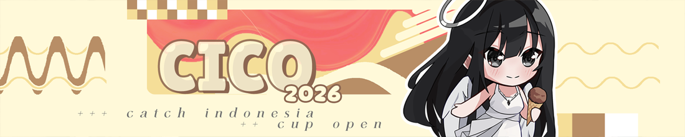
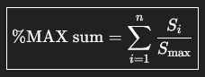

---
tags:
  - CICO
  - CICO 2026
---

# Catch Indonesia Cup Open 2026

The **Catch Indonesia Cup Open 2026** (***CICO 2026***) is a double-elimination 1v1 osu!catch tournament hosted by ::{ flag=ID }:: [Intel21](https://osu.ppy.sh/users/1272422), ::{ flag=SG }:: [Ekseff](https://osu.ppy.sh/users/13966422), ::{ flag=ID }:: [Madoka Ayukawa](https://osu.ppy.sh/users/1595221), ::{ flag=ID }:: [Zvenx](https://osu.ppy.sh/users/14613788), and ::{ flag=ID }:: [Constantine](https://osu.ppy.sh/users/3221898). Despite its name, the tournament is open to all osu!catch players from the around the world regardless of geographical location. It is the fourteenth iteration of the Catch the Beat Indonesia Cup, as well as the fourth one to be held under the "Open" format.

## Tournament schedule

| Event | Timestamp |
| --: | :-- |
| Registration phase | 2026-09-17/2026-09-30 |
| Screening phase | 2026-10-01/2026-10-18 |
| Qualifiers | 2026-10-19/2026-10-25 |
| Round of 32 | 2026-10-26/2026-11-01 |
| Round of 16 | 2026-11-02/2026-11-08 |
| Quarterfinals | 2026-11-09/2026-11-15 |
| Semifinals | 2026-11-16/2026-11-22 |
| Finals (week 1) | 2026-11-23/2026-11-29 |
| Finals (week 2) | 2026-11-30/2026-12-06 |

## Prizes

The Catch Indonesia Cup Open 2026 offers an initial prize pool of $50 as generously donated by ::{ flag=ID }:: [Intel21](https://osu.ppy.sh/users/1272422) and ::{ flag=SG }:: [Ekseff](https://osu.ppy.sh/users/13966422). This prize pool are to be increased from community donations through [Ko-Fi](https://ko-fi.com/oci).

| Placing | Prize(s) |
| :-: | :-- |
|  | 55% of the accumulated prize pool, unique profile badge |
|  | 30% of the accumulated prize pool |
|  | 15% of the accumulated prize pool |

## Organisation

The Catch Indonesia Cup Open 2026 is run by various osu! community members from Indonesia and beyond.

| Position | Member(s) |
| :-- | :-- |
| Host | ::{ flag=ID }:: [Intel21](https://osu.ppy.sh/users/1272422), ::{ flag=SG }:: [Ekseff](https://osu.ppy.sh/users/13966422), ::{ flag=ID }:: [Madoka Ayukawa](https://osu.ppy.sh/users/1595221), ::{ flag=ID }:: [Zvenx](https://osu.ppy.sh/users/14613788), ::{ flag=ID }:: [Constantine](https://osu.ppy.sh/users/3221898) |
| Mappool selector | ::{ flag=ID }:: [Madoka Ayukawa](https://osu.ppy.sh/users/1595221), ::{ flag=ID }:: [Zvenx](https://osu.ppy.sh/users/14613788), ::{ flag=ID }:: [dika312](https://osu.ppy.sh/users/741613), ::{ flag=KR }:: [Spectator](https://osu.ppy.sh/users/702598), ::{ flag=TW }:: [Beepu](https://osu.ppy.sh/users/4958376), ::{ flag=TN }:: [-Ken](https://osu.ppy.sh/users/4430811) |
| Custom mapper | ::{ flag=ID }:: [Madoka Ayukawa](https://osu.ppy.sh/users/1595221), ::{ flag=ID }:: [Zvenx](https://osu.ppy.sh/users/14613788), ::{ flag=ID }:: [dika312](https://osu.ppy.sh/users/741613), ::{ flag=ID }:: [Sololiquy](https://osu.ppy.sh/users/4350087), ::{ flag=ID }:: [EpanPan](https://osu.ppy.sh/users/13194580), ::{ flag=VN }:: [-Miya](https://osu.ppy.sh/users/5978981), ::{ flag=KR }:: [Spectator](https://osu.ppy.sh/users/702598), ::{ flag=TW }:: [Beepu](https://osu.ppy.sh/users/4958376), ::{ flag=KR }:: [My Angel RangE](https://osu.ppy.sh/users/6336713), ::{ flag=AT }:: [Daletto](https://osu.ppy.sh/users/7592136), ::{ flag=FR }:: [Natsuko](https://osu.ppy.sh/users/8266817), ::{ flag=DE }:: [DizzyOracel](https://osu.ppy.sh/users/32159666), ::{ flag=ES }:: [Alepe](https://osu.ppy.sh/users/15273403), ::{ flag=ES }:: [Race-](https://osu.ppy.sh/users/18660354), ::{ flag=US }:: [Yoshi\_green](https://osu.ppy.sh/users/1035891), ::{ flag=CO }:: [\[ Azu- \]](https://osu.ppy.sh/users/8290364), *more TBA* |
| Hitsounder | ::{ flag=ID }:: [Niva](https://osu.ppy.sh/users/197805), ::{ flag=ID }:: [ArXe](https://osu.ppy.sh/users/14013313), ::{ flag=PH }:: [midorijeon](https://osu.ppy.sh/users/10969875), ::{ flag=IT }:: [Leomine](https://osu.ppy.sh/users/13277919) |
| Playtester | ::{ flag=SG }:: [\[Eun\]](https://osu.ppy.sh/users/3788536), ::{ flag=FR }:: [Nelys](https://osu.ppy.sh/users/8422828), ::{ flag=FR }:: [Natsuko](https://osu.ppy.sh/users/8266817), ::{ flag=FI }:: [Veeti](https://osu.ppy.sh/users/12863098), ::{ flag=US }:: [Blushing](https://osu.ppy.sh/users/5927823), ::{ flag=US }:: [Elux](https://osu.ppy.sh/users/12004983), ::{ flag=CL }:: [Pekorrat](https://osu.ppy.sh/users/1250096) |
| Streamer | ::{ flag=SG }:: [Ekseff](https://osu.ppy.sh/users/13966422), ::{ flag=FI }:: [kimi321](https://osu.ppy.sh/users/6962961), ::{ flag=DE }:: [Gomen Yuuka](https://osu.ppy.sh/users/14050018) |
| Commentator | ::{ flag=SG }:: [Ekseff](https://osu.ppy.sh/users/13966422), ::{ flag=ID }:: [dika312](https://osu.ppy.sh/users/741613), ::{ flag=SG }:: [\[Eun\]](https://osu.ppy.sh/users/3788536), ::{ flag=SG }:: [QuailLover](https://osu.ppy.sh/users/26383230), ::{ flag=IN }:: [Pilot\_BFFRI](https://osu.ppy.sh/users/27266540), ::{ flag=DE }:: [Heam](https://osu.ppy.sh/users/4705120) |
| Referee | ::{ flag=ID }:: [Azel69](https://osu.ppy.sh/users/35659235), ::{ flag=PH }:: [MapleSyrup12](https://osu.ppy.sh/users/34222047), ::{ flag=VN }:: [Beegamer](https://osu.ppy.sh/users/14827521), ::{ flag=IN }:: [Pilot\_BFFRI](https://osu.ppy.sh/users/27266540), ::{ flag=KR }:: [Discord](https://osu.ppy.sh/users/16194858), ::{ flag=US }:: [Blushing](https://osu.ppy.sh/users/5927823), ::{ flag=BR }:: [\[MG\] ExRoiBoi](https://osu.ppy.sh/users/25147371) |
| Design coordinator | ::{ flag=MY }:: [mochasan\_](https://osu.ppy.sh/users/23804364) |
| Graphic designer | ::{ flag=ID }:: [Niva](https://osu.ppy.sh/users/197805), ::{ flag=ID }:: [Zavier](https://osu.ppy.sh/users/11379592), ::{ flag=ID }:: [smsrdzc](https://osu.ppy.sh/users/38505034), ::{ flag=ID }:: [CubeixID200](https://osu.ppy.sh/users/10678919), ::{ flag=IN }:: [rrex](https://osu.ppy.sh/users/16827064), ::{ flag=CA }:: [Aquatic\_3](https://osu.ppy.sh/users/22711091) |
| Illustrator | ::{ flag=ID }:: [Dreamxiety](https://osu.ppy.sh/users/13103233), ::{ flag=ID }:: [Rezukitazu](https://osu.ppy.sh/users/2499880), ::{ flag=SG }:: [Hecatia](https://osu.ppy.sh/users/8244635), ::{ flag=GB }:: [pericrayola](https://osu.ppy.sh/users/31184671), ::{ flag=ID }:: Minato [(↗)](https://twitter.com/minato28507), ::{ flag=ID }:: Reminisensi [(↗)](https://twitter.com/Reminisensi_), ::{ flag=ID }:: Ueha10 [(↗)](https://twitter.com/Ueha10), ::{ flag=VN }:: Utopia [(↗)](https://twitter.com/_Utopia_Hope) |
| Musician | ::{ flag=ID }:: sheirara [(↗)](https://twitter.com/sheirara), ::{ flag=ES }:: Primbe [(↗)](https://soundcloud.com/primbe), trailmix37 [(↗)](https://twitter.com/trailmix37), *more TBA* |
| Statistician | ::{ flag=SG }:: [lovemathboy](https://osu.ppy.sh/users/4220829), ::{ flag=PH }:: [MapleSyrup12](https://osu.ppy.sh/users/34222047) |
| Wiki and newspost | ::{ flag=ID }:: [Niva](https://osu.ppy.sh/users/197805), ::{ flag=SG }:: [Ekseff](https://osu.ppy.sh/users/13966422), ::{ flag=AT }:: [Daletto](https://osu.ppy.sh/users/7592136) |

## Links

- **[Official website](https://wybin.xyz/cico2026)**
- [Forum thread](https://osu.ppy.sh/community/forums/topics/2241677)
- [Discord server](https://discord.gg/YwAYbPa)
- [Challonge brackets](https://challonge.com/CICO2026)
- [Livestream channel](https://www.twitch.tv/osucatchid)
- [Pick'ems page](https://pickem.hoaq.works/tournament/19) hosted by ::{ flag=VN }:: [Hoaq](https://osu.ppy.sh/users/7696512)

## Participants

Listed below are the players who managed to qualify into the Round of 32 (along with their respective seed number and `%MAX` sum across all nine Qualifier beatmaps) out of 96 participating players in total.

The complete list of player registrations can be found [here](https://wybin.xyz/cico2026/players).

| Seed no. | Player | `%MAX` sum |
| :-- | :-- | :-- |
| 1 | ::{ flag=AR }:: [SirGonzaxz](https://osu.ppy.sh/users/17309439) | 8.887 |
| 2 | ::{ flag=KR }:: [qwhj79](https://osu.ppy.sh/users/7547506) | 8.807 |
| 3 | ::{ flag=PE }:: [Boltico](https://osu.ppy.sh/users/5297904) | 8.743 |
| 4 | ::{ flag=CN }:: [- N a g i -](https://osu.ppy.sh/users/2956936) | 8.706 |
| 5 | ::{ flag=CO }:: [Juansy-](https://osu.ppy.sh/users/12588215) | 8.691 |
| 6 | ::{ flag=CO }:: [HelpMePleasee](https://osu.ppy.sh/users/10835397) | 8.532 |
| 7 | ::{ flag=CL }:: [Stark](https://osu.ppy.sh/users/1565036) | 8.530 |
| 8 | ::{ flag=CL }:: [Aryssiel](https://osu.ppy.sh/users/2389481) | 8.515 |
| 9 | ::{ flag=PH }:: [-Rustyy](https://osu.ppy.sh/users/16355636) | 8.446 |
| 10 | ::{ flag=TW }:: [eauikk](https://osu.ppy.sh/users/1177233) | 8.444 |
| 11 | ::{ flag=BE }:: [ElSkeffe](https://osu.ppy.sh/users/6283136) | 8.362 |
| 12 | ::{ flag=GR }:: [\[Romanos\]](https://osu.ppy.sh/users/4682813) | 8.360 |
| 13 | ::{ flag=PL }:: [madcin](https://osu.ppy.sh/users/2957534) | 8.349 |
| 14 | ::{ flag=CN }:: [dazzulay](https://osu.ppy.sh/users/1948043) | 8.277 |
| 15 | ::{ flag=PE }:: [Lunati1kid](https://osu.ppy.sh/users/25723773) | 8.268 |
| 16 | ::{ flag=MX }:: [Firu](https://osu.ppy.sh/users/10516547) | 8.243 |
| 17 | ::{ flag=ES }:: [Sprint](https://osu.ppy.sh/users/13845399) | 8.224 |
| 18 | ::{ flag=RU }:: [Nerris](https://osu.ppy.sh/users/11202866) | 8.214 |
| 19 | ::{ flag=HR }:: [doddo](https://osu.ppy.sh/users/5166056) | 8.182 |
| 20 | ::{ flag=ID }:: [Keita](https://osu.ppy.sh/users/3355617) | 8.181 |
| 21 | ::{ flag=CL }:: [Smukur](https://osu.ppy.sh/users/6434318) | 8.125 |
| 22 | ::{ flag=TW }:: [- S H -](https://osu.ppy.sh/users/2548278) | 8.079 |
| 23 | ::{ flag=US }:: [trooperr](https://osu.ppy.sh/users/32028459) | 8.061 |
| 24 | ::{ flag=BG }:: [Azakriel](https://osu.ppy.sh/users/30653081) | 8.038 |
| 25 | ::{ flag=RU }:: [smelly DVD box](https://osu.ppy.sh/users/6647589) | 8.001 |
| 26 | ::{ flag=MX }:: [Niisan](https://osu.ppy.sh/users/19515018) | 7.965 |
| 27 | ::{ flag=CN }:: [Cornet](https://osu.ppy.sh/users/18468376) | 7.958[^qualifiers-tie-note] |
| 28 | ::{ flag=TR }:: [shimu](https://osu.ppy.sh/users/14318796) | 7.958[^qualifiers-tie-note] |
| 29 | ::{ flag=ES }:: [MusicDropZ](https://osu.ppy.sh/users/12759554) | 7.944 |
| 30 | ::{ flag=HK }:: [my angel auto](https://osu.ppy.sh/users/29503627) | 7.881 |
| 31 | ::{ flag=FI }:: [ES Jonne](https://osu.ppy.sh/users/7024526) | 7.839 |
| 32 | ::{ flag=NZ }:: [Cipse](https://osu.ppy.sh/users/7928880) | 7.811 |

## Mappools

### Quarterfinals

**[Download the mappack here! (139 MB)](https://drive.google.com/file/d/1I7OJEjr1MSRNploPF1UnU5_2AZj-DeK2/view)**

- No Mod
  1. [m108 - Shining Stella (Spectator) \[Deluge\]](https://osu.ppy.sh/beatmapsets/2651463#osu/5993909)
  2. [DJ Noriken vs. MASAKI - QiXiN MAdN3ss 2153 (Jemzuu) \[ULTRA\]](https://osu.ppy.sh/beatmapsets/1784525#osu/3654761)
  3. [The Flashbulb - Coinage (Alepe) \[Numismatics\]](https://osu.ppy.sh/beatmapsets/2651330#osu/5993597)
  4. [solfa feat. KOTOKO - affection (Madoka Ayukawa) \[Harmonious\]](https://osu.ppy.sh/beatmapsets/2651308#osu/5993529)
- Hidden
  1. [Rigel Theatre - ECLIPSE (F D Flourite) \[I prefer VSCode\]](https://osu.ppy.sh/beatmapsets/2000364#osu/4158940)
  2. [KAKU P-MODEL - Sore ike! Halycon (Deif) \[Go for it!\]](https://osu.ppy.sh/beatmapsets/1463986#osu/3007125)
  3. [Primbe - Caelion (Race-) \[Race & Alepe's Heavenly Battle\]](https://osu.ppy.sh/beatmapsets/2651306#osu/5993527)
- Hard Rock
  1. [Fuki - Zinger Ringer Gang Love (-Luminate) \[Zvenx's Deluge\]](https://osu.ppy.sh/beatmapsets/2320439#osu/5031230)
  2. [Fractal Dreamers - Ex Nihilo (wonjae) \[Genesis\]](https://osu.ppy.sh/beatmapsets/1254879#osu/2607991)
  3. [trung-nova - Prism of Chroma (Natsuko) \[Metamorphopsia\]](https://osu.ppy.sh/beatmapsets/2651310#osu/5993532)
- Double Time
  1. [MYTH & ROID - shadowgraph (DizzyOracel) \[can you see the meaning inside yourself?\]](https://osu.ppy.sh/beatmapsets/2651847#osu/5995389)
  2. [DJ Genki - RAVE BUSTERS (Zvenx) \[Nagi ask for Nilou bg in dt\]](https://osu.ppy.sh/beatmapsets/2651438#osu/5993862)
  3. [u's - LOVELESS WORLD (Wyuuji) \[Rain (CICO Edit)\]](https://osu.ppy.sh/beatmapsets/2651752#osu/5995127)
- Free Mod
  1. [FARUCO - Oshikatsu Angel Miss Vivian (feat. Mustard and beatMARIO) (Sololiquy) \[VIVIAN\]](https://osu.ppy.sh/beatmapsets/2651301#osu/5993517)
  2. [Dictate - Militant (DizzyOracel) \[\_/-\\\_/\>0\<\\_/-\\\_\]](https://osu.ppy.sh/beatmapsets/2651321#osu/5993576)
- Tiebreaker
  1. **[trailmix37 - Achamoth (Zvenx) \[Divine Light\]](https://osu.ppy.sh/beatmapsets/2651476#osu/5993943)**

### Round of 16

**[Download the mappack here! (116 MB)](https://drive.google.com/file/d/1-UsReW-fkHN2qT9tewkiweRoBvU12lrD/view)**

- No Mod
  1. [void - Dedication (Beepu) \[Hollow Vow\]](https://osu.ppy.sh/beatmapsets/2647441#fruits/5979022)
  2. [DJ Raisei - ReDIVE NEURON (Jemzuu) \[Unlucky\_w's Overdose\]](https://osu.ppy.sh/beatmapsets/2321611#fruits/5017095)
  3. [meganeko - Moonflowers (DizzyOracel) \[fall into the night\]](https://osu.ppy.sh/beatmapsets/2647443#fruits/5979024)
  4. [bibuko - Homework Crisis (Spectator) \[Let's Dash!!\]](https://osu.ppy.sh/beatmapsets/2647648#fruits/5979752)
- Hidden
  1. [YOASOBI - UNDEAD (Spectator) \[Crowley's Overdose\]](https://osu.ppy.sh/beatmapsets/2243054#fruits/4950436)
  2. [Shikata Akiko - METHOD\_METAFALICA/. (Madoka Ayukawa) \[Mir\]](https://osu.ppy.sh/beatmapsets/2647422#fruits/5978979)
  3. [YUC'e - POISON -KO3 Remix- (My Angel RangE) \[POISON -5- (CICO edit)\]](https://osu.ppy.sh/beatmapsets/2647408#fruits/5978926)
- Hard Rock
  1. [Mimori Suzuko - Light for Knight (-Miya) \[White Knight (HR Edit)\]](https://osu.ppy.sh/beatmapsets/2647424#fruits/5978981)
  2. [Nanatsukaze - Sakura Rain (Sololiquy) \[Overdose\]](https://osu.ppy.sh/beatmapsets/2647428#fruits/5978992)
  3. [seatrus - Ataraxia (2020 Rework) (EpanPan) \[Eudaimonia\]](https://osu.ppy.sh/beatmapsets/2647427#fruits/5978988)
- Double Time
  1. [kessoku band - Re:Re: (Yumeno Himiko) \[atomic's Rain\]](https://osu.ppy.sh/beatmapsets/2330599#fruits/5002103)
  2. [EmoCosine - Love Pills (Zvenx) \[Addiction\]](https://osu.ppy.sh/beatmapsets/2647438#fruits/5979014)
  3. [Halozy - Three Magic (DiGiTAL WiNG TRANCE Remix) (BoberOfDarkness) \[rinkiha & Bober's Enchanted Love (CICO Edit)\]](https://osu.ppy.sh/beatmapsets/2647862#fruits/5981269)
- Free Mod
  1. [My Chemical Romance - Na Na Na (Na Na Na Na Na Na Na Na Na) (Zvenx) \[Overdose\]](https://osu.ppy.sh/beatmapsets/2647440#fruits/5979020)
  2. [\*wakadori - NightTheater (Yoshi\_green) \[WinterRain\]](https://osu.ppy.sh/beatmapsets/2647442#fruits/5979023)
- Tiebreaker
  1. **[Helblinde - The Solace of Oblivion (Daletto) \[Daletto & Spec's Salvation in Bloodshed\]](https://osu.ppy.sh/beatmapsets/2647537#fruits/5979309)**

### Round of 32

**[Download the mappack here! (113 MB)](https://drive.google.com/file/d/1CYfPV4hVFKiQUiZf6EXFYkx2f8CT2fXX/view)**

- No Mod
  1. [sheirara - RARARA (EpanPan) \[Overdose\]](https://osu.ppy.sh/beatmapsets/2643612#fruits/5966053)
  2. [ak+q - Excelsia (EpanPan) \[Elysium\]](https://osu.ppy.sh/beatmapsets/2643620#fruits/5966078)
  3. [XL Project - THE DAMNED STALKERS (hy1hy1hy) \[Steven's ctb\]](https://osu.ppy.sh/beatmapsets/22037#fruits/77930)
  4. [yanaginagi - landscape (Spectator) \[overdose\]](https://osu.ppy.sh/beatmapsets/2644065#fruits/5967481)
- Hidden
  1. [Isekaijoucho - To the endless sky (Sololiquy) \[Memories\]](https://osu.ppy.sh/beatmapsets/2643627#fruits/5966096)
  2. [Boom Kitty - Cord Cutter (Zvenx) \[Epan say this is easy\]](https://osu.ppy.sh/beatmapsets/2643902#fruits/5967007)
- Hard Rock
  1. [solfa feat. Ceui - Natsuiro Yakimochi Koi Moyou (ItzFfas) \[Precious Feeling\]](https://osu.ppy.sh/beatmapsets/2611984#fruits/5850788)
  2. [DOT96 - MAKE IT FUNKY NOW (hiroshiki) \[MAKE IT CATCH NOW\]](https://osu.ppy.sh/beatmapsets/2469196#fruits/5407397)
- Double Time
  1. [ClariS - Colorful -season 03- (Fisicia) \[Vibrant Colors\]](https://osu.ppy.sh/beatmapsets/2643757#fruits/5966484)
  2. [Frums - the end of this world, and the girl who crossed the moon's oceans. (Cut Ver.) (fayew) \[rain\]](https://osu.ppy.sh/beatmapsets/2154917#fruits/4541816)
  3. [-45 - Guinevere (Madoka Ayukawa) \[Crystal Violet\]](https://osu.ppy.sh/beatmapsets/2643915#fruits/5967036)
- Free Mod
  1. [Tokyo Jihen - Sounan (Dedot) \[Lost\]](https://osu.ppy.sh/beatmapsets/2067609#fruits/4325523)
  2. [Mitsukiyo - Luminous Memory (Sololiquy) \[Memory [CICO edit]\]](https://osu.ppy.sh/beatmapsets/1927452#fruits/5966129)
- Tiebreaker
  1. **[Pratanallis feat. KOKOMI - Black Berserker (\[ Azu- \]) \[Darkness in Grace\]](https://osu.ppy.sh/beatmapsets/2643642#fruits/5966131)**

### Qualifiers

**[Download the mappack here! (58 MB)](https://drive.google.com/file/d/18kD4tjWmEOHe_n5uKoANbueoUGZfnm3M/view)**

- No Mod
  1. [LV.4 feat. Yuu Ikeba - Sentimental Surge (Mojotax) \[Sensation\]](https://osu.ppy.sh/beatmapsets/2599185#fruits/5809669)
  2. [ARForest - Final Resonance (Sololiquy) \[Overdose\]](https://osu.ppy.sh/beatmapsets/2639271#fruits/5948755)
  3. [Shounen Radio - neu (AnApple7) \[smile and cry; you and me!\]](https://osu.ppy.sh/beatmapsets/2337190#fruits/5018067)
- Hidden
  1. [Mitsukiyo - Mikansei Romantic (feat. kotono) (sawarabi) \[Dramatic Love\]](https://osu.ppy.sh/beatmapsets/2464646#fruits/5394778)
  2. [Tanchiky - TouchDown (autofanboy) \[KickOff (CICO Edit)\]](https://osu.ppy.sh/beatmapsets/2639255#fruits/5948698)
- Hard Rock
  1. [Imy - Countdown (EpanPan) \[Eternal Time\]](https://osu.ppy.sh/beatmapsets/2639244#fruits/5948656)
  2. [NewJeans - Right Now (Spectator) \[Overdose (CICO Ver.)\]](https://osu.ppy.sh/beatmapsets/2639588#fruits/5951344)
- Double Time
  1. [yanaginagi - Outsider (Spectator) \[Lumi's Rain\]](https://osu.ppy.sh/beatmapsets/2271671#fruits/4882744)
  2. [YUC'e - Cappuchino (dika312) \[Cozy Rain\]](https://osu.ppy.sh/beatmapsets/2639250#fruits/5948691)

## Match results

### Round of 16

Saturday, 7 November 2026:

| Bracket | Player 1 |  |  | Player 2 | Match link |
| :-: | --: | :-: | :-: | :-- | :-- |
| Upper | **[qwhj79](https://osu.ppy.sh/users/7547506)** ::{ flag=KR }:: | **6** | 0 | ::{ flag=RU }:: [Nerris](https://osu.ppy.sh/users/11202866) | [#1](https://osu.ppy.sh/community/matches/122127519) |
| Lower | [ES Jonne](https://osu.ppy.sh/users/7024526) ::{ flag=FI }:: | 3 | **6** | ::{ flag=PE }:: **[Lunati1kid](https://osu.ppy.sh/users/25723773)** | [#1](https://osu.ppy.sh/community/matches/122130464) |
| Lower | **[Niisan](https://osu.ppy.sh/users/19515018)** ::{ flag=MX }:: | **6** | 0 | ::{ flag=US }:: [trooperr](https://osu.ppy.sh/users/32028459) | [#1](https://osu.ppy.sh/community/matches/122131092) |
| Lower | [Cipse](https://osu.ppy.sh/users/7928880) ::{ flag=NZ }:: | 4 | **6** | ::{ flag=ES }:: **[Sprint](https://osu.ppy.sh/users/13845399)** | [#1](https://osu.ppy.sh/community/matches/122127751) |
| Upper | [Stark](https://osu.ppy.sh/users/1565036) ::{ flag=CL }:: | 4 | **6** | ::{ flag=TW }:: **[eauikk](https://osu.ppy.sh/users/1177233)** | [#1](https://osu.ppy.sh/community/matches/122129108) |
| Lower | [MusicDropZ](https://osu.ppy.sh/users/12759554) ::{ flag=ES }:: | 1 | **6** | ::{ flag=PL }:: **[madcin](https://osu.ppy.sh/users/2957534)** | [#1](https://osu.ppy.sh/community/matches/122129804) |
| Upper | **[Boltico](https://osu.ppy.sh/users/5297904)** ::{ flag=PE }:: | **6** | 2 | ::{ flag=HR }:: [doddo](https://osu.ppy.sh/users/5166056) | [#1](https://osu.ppy.sh/community/matches/122130475) |
| Upper | **[Aryssiel](https://osu.ppy.sh/users/7547506)** ::{ flag=CL }:: | **6** | 0 | ::{ flag=PH }:: [-Rustyy](https://osu.ppy.sh/users/16355636) | *win by default* |

Sunday, 8 November 2026:

| Bracket | Player 1 |  |  | Player 2 | Match link |
| :-: | --: | :-: | :-: | :-- | :-- |
| Upper | **[HelpMePleasee](https://osu.ppy.sh/users/10835397)** ::{ flag=CO }:: | **6** | 1 | ::{ flag=TW }:: [- S H -](https://osu.ppy.sh/users/2548278) | [#1](https://osu.ppy.sh/community/matches/122132291) |
| Lower | [my angel auto](https://osu.ppy.sh/users/29503627) ::{ flag=HK }:: | 1 | **6** | ::{ flag=CN }:: **[dazzulay](https://osu.ppy.sh/users/1948043)** | [#1](https://osu.ppy.sh/community/matches/122130464) |
| Upper | **[- N a g i -](https://osu.ppy.sh/users/2956936)** ::{ flag=CN }:: | **6** | 1 | ::{ flag=ID }:: [Keita](https://osu.ppy.sh/users/3355617) | [#1](https://osu.ppy.sh/community/matches/122134179) |
| Lower | [Cornet](https://osu.ppy.sh/users/18468376) ::{ flag=CN }:: | 3 | **6** | ::{ flag=BE }:: **[ElSkeffe](https://osu.ppy.sh/users/6283136)** | [#1](https://osu.ppy.sh/community/matches/122134514) |
| Upper | **[SirGonzaxz](https://osu.ppy.sh/users/17309439)** ::{ flag=AR }:: | **6** | 0 | ::{ flag=MX }:: [Firu](https://osu.ppy.sh/users/10516547) | [#1](https://osu.ppy.sh/community/matches/122135734) |
| Lower | **[smelly DVD box](https://osu.ppy.sh/users/6647589)** ::{ flag=RU }:: | **6** | 5 | ::{ flag=BG }:: [Azakriel](https://osu.ppy.sh/users/30653081) | [#1](https://osu.ppy.sh/community/matches/122135115) |
| Lower | [shimu](https://osu.ppy.sh/users/14318796) ::{ flag=TR }:: | 0 | **6** | ::{ flag=GR }:: **[\[Romanos\]](https://osu.ppy.sh/users/4682813)** | *win by default* |

### Round of 32

Saturday, 31 October 2026:

| Bracket | Player 1 |  |  | Player 2 | Match link |
| :-: | --: | :-: | :-: | :-- | :-- |
| Upper | [dazzulay](https://osu.ppy.sh/users/1948043) ::{ flag=CN }:: | 0 | **5** | ::{ flag=HR }:: **[doddo](https://osu.ppy.sh/users/5166056)** | [#1](https://osu.ppy.sh/community/matches/122095956) |
| Upper | **[Firu](https://osu.ppy.sh/users/10516547)** ::{ flag=MX }:: | **5** | 3 | ::{ flag=ES }:: [Sprint](https://osu.ppy.sh/users/13845399) | [#1](https://osu.ppy.sh/community/matches/122096977) |
| Upper | [\[Romanos\]](https://osu.ppy.sh/users/4682813) ::{ flag=GR }:: | 3 | **5** | ::{ flag=CL }:: **[Smukur](https://osu.ppy.sh/users/6434318)** | [#1](https://osu.ppy.sh/community/matches/122097332) |
| Upper | **[Juansy-](https://osu.ppy.sh/users/12588215)** ::{ flag=CO }:: | **5** | 0 | ::{ flag=TR }:: [shimu](https://osu.ppy.sh/users/14318796) | [#1](https://osu.ppy.sh/community/matches/122095955) |
| Upper | [ElSkeffe](https://osu.ppy.sh/users/6283136) ::{ flag=BE }:: | 1 | **5** | ::{ flag=TW }:: **[- S H -](https://osu.ppy.sh/users/2548278)** | [#1](https://osu.ppy.sh/community/matches/122094485) |
| Upper | **[Boltico](https://osu.ppy.sh/users/5297904)** ::{ flag=PE }:: | **5** | 0 | ::{ flag=HK }:: [my angel auto](https://osu.ppy.sh/users/29503627) | [#1](https://osu.ppy.sh/community/matches/122096271) |
| Upper | **[SirGonzaxz](https://osu.ppy.sh/users/17309439)** ::{ flag=AR }:: | **5** | 0 | ::{ flag=NZ }:: [Cipse](https://osu.ppy.sh/users/7928880) | [#1](https://osu.ppy.sh/community/matches/122098676) |
| Upper | [Lunati1kid](https://osu.ppy.sh/users/25723773) ::{ flag=PE }:: | 1 | **5** | ::{ flag=RU }:: **[Nerris](https://osu.ppy.sh/users/11202866)** | [#1](https://osu.ppy.sh/community/matches/122096597) |
| Upper | **[-Rustyy](https://osu.ppy.sh/users/16355636)** ::{ flag=PH }:: | **5** | 4 | ::{ flag=BG }:: [Azakriel](https://osu.ppy.sh/users/30653081) | [#1](https://osu.ppy.sh/community/matches/122096263) |
| Upper | **[Aryssiel](https://osu.ppy.sh/users/2389481)** ::{ flag=CL }:: | **5** | 3 | ::{ flag=RU }:: [smelly DVD box](https://osu.ppy.sh/users/6647589) | [#1](https://osu.ppy.sh/community/matches/122097330) |
| Upper | [madcin](https://osu.ppy.sh/users/2957534) ::{ flag=PL }:: | 0 | **5** | ::{ flag=ID }:: **[Keita](https://osu.ppy.sh/users/3355617)** | *win by default* |

Sunday, 1 November 2026:

| Bracket | Player 1 |  |  | Player 2 | Match link |
| :-: | --: | :-: | :-: | :-- | :-- |
| Upper | **[eauikk](https://osu.ppy.sh/users/1177233)** ::{ flag=TW }:: | **5** | 1 | ::{ flag=US }:: [trooperr](https://osu.ppy.sh/users/32028459) | [#1](https://osu.ppy.sh/community/matches/122099593) |
| Upper | **[Stark](https://osu.ppy.sh/users/1565036)** ::{ flag=CL }:: | **5** | 1 | ::{ flag=MX }:: [Niisan](https://osu.ppy.sh/users/19515018) | [#1](https://osu.ppy.sh/community/matches/122101813) |
| Upper | **[- N a g i -](https://osu.ppy.sh/users/2956936)** ::{ flag=CN }:: | **5** | 1 | ::{ flag=ES }:: [MusicDropZ](https://osu.ppy.sh/users/12759554) | [#1](https://osu.ppy.sh/community/matches/122100726) |
| Upper | **[qwhj79](https://osu.ppy.sh/users/7547506)** ::{ flag=KR }:: | **5** | 1 | ::{ flag=FI }:: [ES Jonne](https://osu.ppy.sh/users/7024526) | [#1](https://osu.ppy.sh/community/matches/122100547) |
| Upper | **[HelpMePleasee](https://osu.ppy.sh/users/10835397)** ::{ flag=CO }:: | **5** | 3 | ::{ flag=CN }:: [Cornet](https://osu.ppy.sh/users/18468376) | [#1](https://osu.ppy.sh/community/matches/122099442) |

## Ruleset

### General rules

1. Match lobbies across the tournament will adhere to the following room settings:
   - Team Mode: `Head-to-head`
   - Win Condition: [`ScoreV2`](/wiki/Gameplay/Score#scorev2)
2. The mappools for each round will be announced by the tournament management in advance before the actual matches take place.
3. Match schedules will be predetermined by the tournament management. If there are players who are unable to attend the current schedule for any reason, all affected players may apply and settle for a reschedule at the `#reschedule-request` channel in the tournament's Discord server.
4. A referee will create a multiplayer room ten minutes in advance and will start to send out invites.
5. If a player does not show up within **fifteen minutes** of the start time, their opponent gets to win by default.
6. If no staff or referee is available, the match will be postponed.
7. **No Fail will be enforced in all beatmaps.** This is to ensure that the points are to be awarded more fairly towards players who perform better in general during the course of the beatmap regardless of their remaining health at the end.
8. If a player disconnects, it will be treated as if they had failed the beatmap.
   - A match can be rematched for disconnects that occur within at most 30 seconds after it has been started or 25% of the beatmap's length, whichever happens first.
9. Lag is not a valid reason to nullify a beatmap.
10. If any problems during the match occur, the tournament management will make a decision based on the referee's report.
11. It is expected that players be polite and respectful to each other. Penalties will be given upon violation.
    - If a player is found to be engaging in an act that is deemed to be distasteful or provocative, the corresponding player may be disqualified right away from the tournament and/or blacklisted from future iterations of the tournament by the tournament management.
    - Usage of any tools or programs that are against the [osu! community rules](/wiki/Rules#community-rules) is strictly prohibited and will be reported to the [Tournament Committee](/wiki/People/Tournament_Committee).
12. The tournament management reservers the right to request for liveplays or recordings of individual players, as well to modify the rules (within reason) at any point which will be announced in advance.

### Tournament registration

1. Players are required to register into the tournament individually through [the tournament's official website](https://wybin.xyz/cico2026).
   - While the tournament is open to anyone, given the tournament's difficulty, players are recommended to have a strong proficiency in the osu!catch game mode upon entry.
2. To ensure that all incoming registrations are serious and valid, every registered player will be checked in detail by the tournament management.
3. The list of players who are deemed to be eligible to compete in the tournament will be published by the tournament management after the registration phase has ended.
4. Testplayers, referees, custom mappers, mappool selectors, and replayers may not participate as players in the tournament.
   - Eliminated players are free to enlist in any of these roles for the later stages of the tournament in accordance with the [official tournament support guidelines](/wiki/Tournaments/Official_support#staff).

### Round-specific rules

#### Qualifier rules

1. Players will have to sign up to one of the Qualifier lobbies that have been scheduled and prepared by the tournament management in advance.
2. In the lobby, players will have to consecutively play all of the Qualifier beatmaps in the order of NM1 -> NM2 -> NM3 -> HD1 -> HD2 -> HR1 -> HR2 -> DT1 -> DT2 twice for a total of two playthroughs.
   - An optional three minute break will be offered between the first and second playthrough of the mappool.
3. Players **are not allowed** to ban any beatmaps in the Qualifiers.
4. Players **are not allowed** to join (or register for) more than one Qualifier lobby.
5. Based on their performance in the Qualifier, players will be ranked based on their `%MAX` sum combined from each individual Qualifier beatmap as follows:

   - Where:
   - `Si` = score achieved by player `i` on the beatmap
   - `Smax` = highest score achieved by any player on that beatmap

6. The 32 players with the **highest `%MAX` sum** across all the Qualifier beatmaps will advance to the knock-out stages.
   - If there are two (or more) players who share the same `%MAX` sum, the player that holds the higher total raw score will be placed in the higher seed.
7. Failure to attend in any of the Qualifier lobbies will result in immediate elimination.

#### Knock-out stage rules

1. Players will be matched against each other based on their Qualifier seedings.
2. Players will compete against each other using the double-elimination system.
3. The double-elimination system works as follows:
   - Players that lose in the upper bracket can still play again in the lower bracket.
   - Players that lose in the lower bracket will be eliminated from the tournament.
   - In the Grand Final match, the winner of the upper bracket will only need to win a single match in order to claim the championship title. The winner of the lower bracket, however, will need to win two matches and enforce a *bracket reset* in order to clinch the championship title.
4. Players that can compete in the next round are determined by:
   - In the Round of 32, each player needs to win 5 points in order to win a match. (Best of 9)
   - In the Round of 16, the Quarterfinals and the Semifinals, each player needs to win 6 points in order to win a match. (Best of 11)
   - In both of the Finals weeks, each player needs to win 7 points in order to win a match. (Best of 13)
   - Whether there are players that are declared to win the match by default.
   - Whether there are players that are disqualified from the tournament.

### Match regulations

1. Prior to starting the match, players must run the `!roll` command once in the multiplayer lobby in order to determine the banning and picking order. 
   - The winner of the `!roll` gets to determine who gets the first pick and the second ban.
   - The loser of the `!roll` gets the opposite by default.
   - This rule does not apply in the Qualifier lobbies.
2. Players will have to ban **two beatmaps** from the corresponding mappool. These beatmaps will not be allowed to be picked by any player during the entire match. 
   - Barring the tiebreaker, there are no restrictions as to which beatmaps may and may not be banned in a match.
   - Banning does not apply in the Qualifier lobbies.
3. **There will be no warm-up beatmaps to be played in the multiplayer lobby**. Players who are looking to warm up before the match are expected to do so by their own before the match commences.
4. Players are expected to exercise common sense in the pick time and ready time windows.
   - Depending on the severity and frequency, players will be punished for their misdemeanours during these time windows. For the list of all the possible punishments, please refer to [this screenshot](https://leopard.hosting.pecon.us/dl/hzlkt).
5. Maps from the same mod pool **may not be picked by the same player twice in a row**.
   - For example, following a NM1 pick, the same player may not pick another map from the No Mod pool on their next picking turn.
6. In a Hard Rock or Double Time pick, the Hidden mod may optionally be used by players on top of the respective mods.
7. In a Free Mod pick, players have to apply at least one mod to play the beatmap with. Allowed mods include Hidden, Hard Rock, or both.
   - Playing a Free Mod pick without any mods applied is not allowed.
8. In the case of a tiebreaker, the tiebreaker map will be played with the Free Mod option enabled. Players are free to play the tiebreaker map with the Hidden mod should they wish to.
   - Playing the tiebreaker map with a mod is *not* mandatory.
9. The results of each match and any other relevant information regarding the match will be noted by the referee after the match has been concluded.

## Notes

[^qualifiers-tie-note]: Average score: ::{ flag=CN }:: [Cornet](https://osu.ppy.sh/users/18468376) 892,098, ::{ flag=TR }:: [shimu](https://osu.ppy.sh/users/14318796) 891,703.
