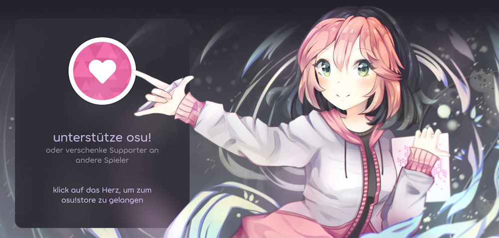
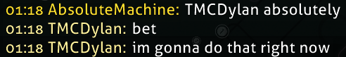
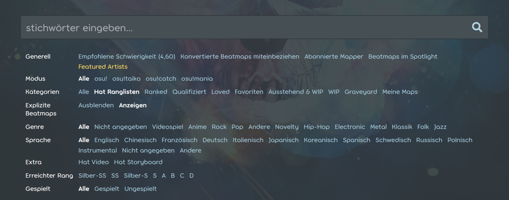
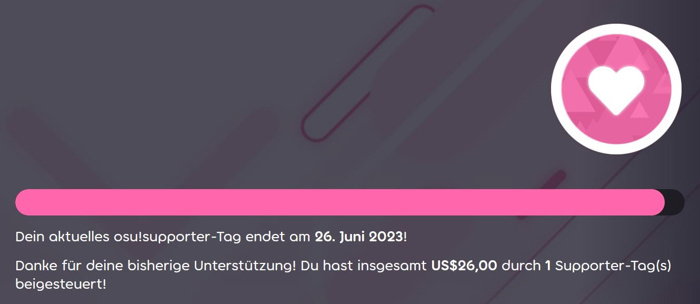
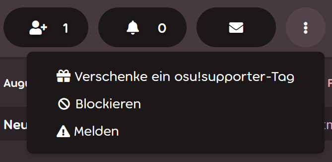

---
tags:
  - supporter tag
  - osu!supporter tag
  - Unterstützung
outdated_translation: true
outdated_since: 26b4a6dcf86a0df96bed2c328f27ddec739ebd74
---

# osu!supporter

**osu!supporter** (oder das ***osu!supporter-Tag***) ist ein zeitlich begrenzter Titel, der Spielern verliehen wird, die osu! durch eine freiwillige Geldspende unterstützen, um das Spiel zu fördern. Unterstützer erhalten eine Handvoll kosmetischer und technischer Vorteile, von denen die meisten nur aktiv sind, wenn der Titel vorhanden ist. Die zusätzlichen Features des osu!supporter-Tags verschaffen keinen Vorteil im Gameplay, in der Leistung oder in der Punktzahl und werden es auch nie.

Das osu!supporter-Tag kann über die [osu!supporter-Seite des Stores](https://osu.ppy.sh/store/products/supporter-tag) erworben werden.

## Features

### Herzabzeichen

::: Infobox

:::

::: Infobox

:::

Unterstützer bekommen ein Abzeichen mit Herzen darauf, das auf der Webseite üblicherweise neben ihrem Benutzernamen angezeigt wird. Die Anzahl der Herzen hängt davon ab, wie lang der Nutzer osu!supporter insgesamt erworben oder erhalten hat:

- weniger als ein Jahr: ein Herz
- zwischen einem und fünf Jahren: zwei Herzen
- mehr als fünf Jahre: drei Herzen

### Farbe des Nutzernamens

::: Infobox

:::

Nutzernamen von aktiven Unterstützern erscheinen leuchtend gelb im [Chat](/wiki/Client/Interface/Chat_console) für andere Benutzer.

### Editierbarer Profilabschnitt

Unterstützer erhalten einen neuen Profilabschnitt namens `ich!`, welcher oft als Benutzerseite bezeichnet wird. Die Benutzerseite dient als persönlicher, editierbarer Bereich, in dem Text mit [BBCode](/wiki/BBCode) formatiert wird. Dieses Feature ist permanent und bleibt bearbeitbar, selbst nachdem das osu!supporter-Tag ausläuft.

Der `ich!`-Abschnitt könnte ein guter Ort sein für:

- Banner, Kollaborationen und Infografiken, um das Profil aufzuhübschen
- einige Absätze oder Einträge, die Einblicke in das Leben des Spielers gewähren
- eine Vorstellung der beliebtesten Beatmaps, Mapper oder alles andere, das als wichtig erachtet wird

### Profilbanner

Unterstützer können ihr Profil außerdem durch ein Titelbild anpassen:

- Klicke auf das Stiftsymbol in der rechten, unteren Ecke des Cover-Platzhalters.
- Wähle ein neues Titelbild aus den vorgegebenen Optionen oder lade ein eigenes Bild hoch (die Abmessungen sollten 2400 x 640 betragen).

Sobald osu!supporter ausläuft, wird das Titelbild bestehen bleiben, kann aber nicht mehr geändert werden.

### Profilfarbe

Ähnlich zu Profilbannern können Unterstützer die Farbe ihres Profils ändern:

- Klicke auf das Stiftsymbol in der rechten, unteren Ecke des Profilbanners.
- Die Profilfarbe einzustellen verändert die Farbe von fast allem. Dazu gehören der Banner, Buttons, Links und Text.

Sobald osu!supporter ausläuft, bleibt die Farbanpassung erhalten, kann aber nur auf den Standard zurückgesetzt werden.

### Eine kostenlose Änderung des Benutzernamens

::: alert-notice
**Hinweis**
Kleinere Namensänderungen können beim Account-Support-Team kostenlos beantragt werden — siehe [Hilfecenter/Account § Kann ich den Benutzernamen meines Accounts ändern?](/wiki/Help_centre/Account#name-changes).
:::

Mit osu!supporter darf der Benutzername gemäß den [üblichen Bedingungen](/wiki/Help_centre/Account#name-changes) beim ersten Mal kostenlos geändert werden.

### osu!direct

osu!direct ist das Such- und Downloadmodul für Beatmaps im Spiel, welches nur für Unterstützer verfügbar ist. Es kann über das Hauptmenü erreicht werden, indem man auf das vertikale Label `osu!direct` auf der rechten Seite des Bildschirms klickt. Zusätzlich zu einer eingebauten Beatmap-Auflistung bietet osu!direct andere Wege, an neue Beatmaps zu gelangen, ohne das Spiel zu verlassen:

- Beatmap-Links im Chat, die auf Beatmaps auf der osu!-Webseite verweisen, lösen jetzt im Spiel eine Aufforderung zum Herunterladen aus
- automatisches Herunterladen von Beatmaps während des Spielens in einer [Mehrspieler](/wiki/Gameplay/Multiplayer)-Lobby oder beim [Zuschauen](/wiki/Gameplay/Spectating) eines anderen Spielers, als eine [Opt-out-Einstellung](/wiki/Client/Options#integration)
- automatische Verlinkung von aktuell gespielten Beatmaps für Zuschauer im Chat-Tab `#spectator`, als eine [Opt-out-Einstellung](/wiki/Client/Options#mitteilungen-und-privatsphäre)

### Erweiterte Ranglisten

Unterstützer haben Zugriff auf mehrere beatmapspezifische [Ranglisten](/wiki/Beatmap#ranglisten), die sowohl im Spiel als auch auf der Webseite verfügbar sind:

- globale Ranglisten für jede Kombination an [Spielmodifikationen](/wiki/Gameplay/Game_modifier)
- länderspezifische Ranglisten von Spielern, die dieselbe Flagge tragen
- Freundesranglisten, die die Position eines Spielers auf einer Beatmap verglichen mit seinen Freunden zeigen

### Erhöhte Grenzwerte

osu! bietet Untersützern eine Lockerung der Grenzwerte für verschiedene Online-Features:

| Wert | Normales Limit | osu!supporter-Limit |
| :-- | :-: | :-: |
| [Ausstehende Beatmaps](/wiki/Beatmap/Category#wip-and-pending) | `4 + min(gerankte Beatmaps, 4)`, bis zu **8**[^pending-beatmaps-ref] | `8 + min(gerankte Beatmaps, 12)`, bis zu **20**[^pending-beatmaps-ref] |
| Teamgröße | 8 | `8 + 4 * Teammitglieder mit osu!supporter`, bis zu **256** |
| Online-Beatmap-Favoriten | 100 | 1000 |
| Anzahl der Freunde | 500 | 1000 |

Des Weiteren werden Besitzern von osu!supporter weniger strenge Download-Beschränkungen gewährt.

### Zusätzliche skinbare Elemente

Nach Erhalt eines osu!supporter-Tags können einige visuelle und akustische Elemente der osu!-Benutzeroberfläche angepasst werden:

| Element | Beschreibung |
| :-- | :-- |
| `menu-background.jpg` | Der Hintergrund des Hauptmenüs |
| `welcome_text.png` | Der Text "welcome", der beim Starten des Spiels erscheint |
| `welcome.wav` | Das Sample "welcome to osu!", das beim Starten des Spiels abgespielt wird |
| `seeya.wav` | Das Sample "see ya next time", das beim Beenden des Spiels abgespielt wird |

Für mehr Details, siehe [Skinning/Benutzeroberfläche § Hauptmenü](/wiki/Skinning/Interface#main-menu) und [Skinning/Sounds § Hauptmenü](/wiki/Skinning/Sounds#main-menu).

### Erweiterte Suche

::: Infobox

:::

Unterstützer haben Zugang zu weiteren [Beatmap-Suchfiltern](https://osu.ppy.sh/beatmapsets):

- Beatmaps, die gespielt (oder nicht gespielt) wurden
- Beatmaps, auf denen ein Score mit einer bestimmten [Note](/wiki/Gameplay/Grade) erreicht wurde

### Mehrspieler in experimentellen Builds von osu!

Unterstützer können auf der Early-Access-Updatequelle "cutting edge" auf den Mehrspielermodus zugreifen.

## Verbleibende Dauer

::: Infobox

:::

Die verbleibende Dauer des osu!supporter-Tags sowie die Gesamtzahl an Beiträgen, Tag-Käufen und Geschenken ist oben auf der [osu!supporter-Werbeseite](https://osu.ppy.sh/home/support) verfügbar.

## osu!supporter kaufen

Um osu!supporter zu kaufen, besuche die [osu!supporter-Shop-Seite](https://osu.ppy.sh/store/products/supporter-tag) und passe die Dauer des Supporter-Tags mithilfe des Schiebereglers oder den Buttons mit der darunter befindlichen Anzahl an Monaten an. Alle Preise sind in United States Dollar (USD) angegeben und enthalten keine möglichen Gebühren des Bezahlungssystems.

Klicke danach auf `Zum Warenkorb hinzufügen`, um das Supporter-Tag in den osu!store-Einkaufswagen zu legen. Gehe zum Abschluss des Kaufs zum [Warenkorb](https://osu.ppy.sh/store/cart), klicke auf `Zur Kasse` und folge anschließend den Anweisungen auf dem Bildschirm.

### osu!supporter verschenken

::: Infobox

:::

osu!supporter kann auch an andere Spieler verschenkt werden, indem ihr Nutzername in die graue Box unter der Benutzerkarte eingegeben wird, oder durch Klicken des Buttons `Verschenke ein osu!supporter-Tag` auf ihrer Profilseite. Weitere Personen können hinzugefügt werden, indem man zur Shop-Seite oder zum Profil eines Spielers zurückgeht und den Prozess wiederholt.

Der Empfänger wird nicht darüber informiert, von wem das Tag kam, aber beim Verschenken von osu!supporter kann eine optionale Nachricht angehängt werden, die zusammen mit der E-Mail-Benachrichtigung versendet wird.

### Bestätigung

Nachdem die Transaktion abgeschlossen wurde, taucht ein neues Ereignis in der Sektion `Neulich` im Profil des Schenkenden und des Beschenkten auf:

- `{Benutzername} hat osu! unterstützt - vielen Dank für deine Großzügigkeit!`, wenn es das erste Mal ist, dass sich der Nutzer osu!supporter kauft oder es einer anderen Person schenkt.
- `{Benutzername} hat sich erneut dazu entschieden, osu! zu unterstützen - vielen Dank für deine Großzügigkeit!`, wenn der Nutzer bereits zuvor ein Unterstützer war oder osu!supporter verschenkt hat.
- `{Benutzername} hat osu!supporter als Geschenk erhalten!`, für den Fall, dass das Tag verschenkt wurde.

Der Schenkende kann dieses Ereignis auf seinem eigenen Profil verbergen, indem er während des Bezahlvorgangs `Alle osu!supporter-Tags in dieser Bestellung aus meiner Aktivität ausblenden` aktiviert. Dies ist nützlich für anonyme Geschenke, weil es verhindert, dass der Empfänger die Profilaktivität abgleichen kann.

Des Weiteren werden der Schenkende und der Empfänger eine E-Mail-Benachrichtigung erhalten, die den Kauf erwähnt.

## Referenzen

[^pending-beatmaps-ref]: [Forumsbeitrag von peppy (14.09.2021) in "Increase the number of pending beatmap slots"](https://osu.ppy.sh/community/forums/topics/1388182?n=34)
