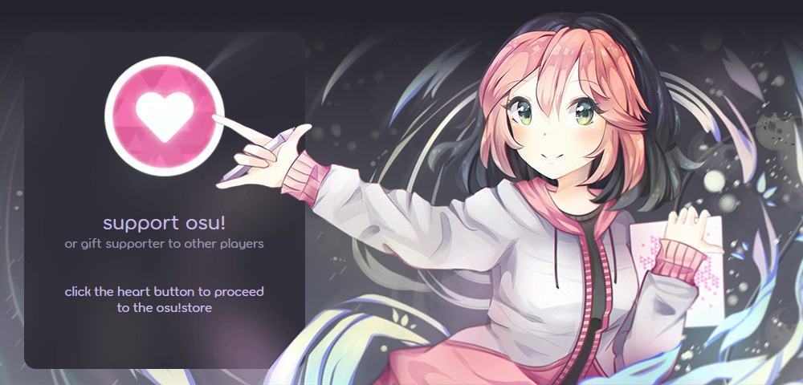
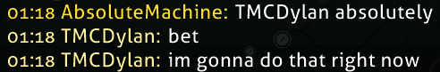
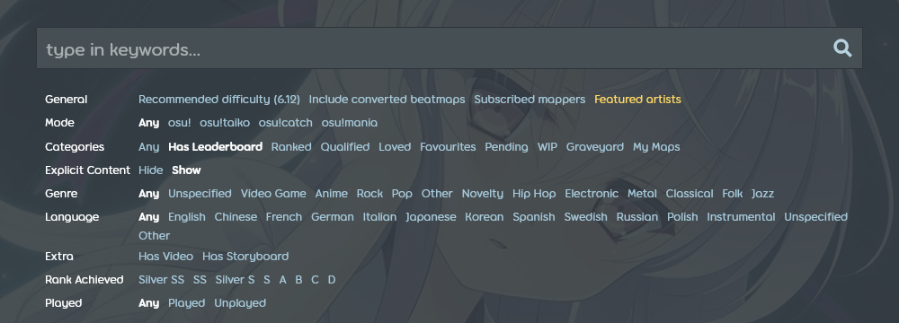
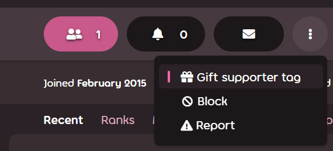

---
tags:
  - supporter tag
  - osu!supporter tag
---

# osu!supporter

**osu!supporter** (hoặc ***danh hiệu osu!supporter***) là một danh hiệu tạm thời được trao cho những người chơi ủng hộ osu! bằng cách đóng góp tiền tự nguyện để giúp trò chơi phát triển. Những người ủng hộ sẽ nhận được một số quyền lợi về mặt giao diện và kỹ thuật, hầu hết trong số đó chỉ có hiệu lực khi danh hiệu này đang được kích hoạt. Các tính năng bổ sung từ osu!supporter không mang lại bất kỳ lợi thế nào về lối chơi, hiệu quả hay điểm số, và sẽ không bao giờ như vậy.

Bạn có thể nhận danh hiệu osu!supporter tại [trang cửa hàng osu!supporter](https://osu.ppy.sh/store/products/supporter-tag).

## Các tính năng

### Huy hiệu trái tim

::: Infobox

:::

::: Infobox

:::

Người ủng hộ sẽ nhận được một huy hiệu có hình trái tim, thường hiển thị bên cạnh tên người dùng của họ trên trang web. Số lượng trái tim phụ thuộc vào tổng thời gian sử dụng osu!supporter mà người dùng đã mua hoặc được tặng<!-- source: https://github.com/ppy/osu-web/blob/ac227d6abbd48630ebbf428c4e3372f388004ee5/app/Models/User.php#L1733-L1750 -->:

- Dưới 1 năm: 1 trái tim
- Từ 1 đến 5 năm: 2 trái tim
- Hơn 5 năm: 3 trái tim

### Màu tên người dùng

::: Infobox

:::

Tên người dùng của những người đang có gói supporter hoạt động sẽ hiển thị màu vàng sáng trong [khung trò chuyện](/wiki/Client/Interface/Chat_console) đối với những người chơi khác.

### Mục hồ sơ có thể chỉnh sửa

Người ủng hộ sẽ nhận được một mục hồ sơ mới có tiêu đề `tôi!`, thường được gọi là trang người dùng. Trang người dùng đóng vai trò là không gian cá nhân có thể chỉnh sửa, nơi văn bản được định dạng bằng [BBCode](/wiki/BBCode). Tính năng này là vĩnh viễn và vẫn có thể chỉnh sửa ngay cả sau khi hết hạn osu!supporter.

Mục `tôi!` là một nơi lý tưởng để đặt:

- Ảnh bìa trang trí, các dự án hợp tác và đồ họa thông tin để làm nổi bật hồ sơ
- Một vài đoạn văn hoặc danh sách chia sẻ về cuộc sống của người chơi
- Nơi trưng bày các beatmap yêu thích, các mapper yêu thích hoặc bất cứ thứ gì họ coi là quan trọng

### Ảnh bìa hồ sơ

Người ủng hộ có thể tùy chỉnh thêm cho hồ sơ của mình bằng cách đặt ảnh bìa:

- Nhấn vào biểu tượng cây bút chì ở góc dưới bên phải của khung ảnh bìa.
- Chọn một ảnh bìa mới từ một vài tùy chọn có sẵn hoặc tải lên hình ảnh tùy chỉnh (kích thước nên là 2400x640).

Khi osu!supporter hết hạn, ảnh bìa vẫn sẽ được giữ nguyên nhưng không thể thay đổi được nữa.

### Màu sắc hồ sơ

Tương tự như ảnh bìa hồ sơ, người ủng hộ có thể thay đổi màu sắc cho trang hồ sơ của mình:

- Nhấn vào biểu tượng cây bút chì ở góc dưới bên phải của ảnh bìa hồ sơ.
- Việc điều chỉnh màu sắc hồ sơ sẽ thay đổi màu của hầu hết mọi thứ, bao gồm ảnh bìa, các nút bấm, liên kết và văn bản.

Khi osu!supporter hết hạn, các tùy chỉnh màu sắc vẫn sẽ được giữ nguyên, nhưng chỉ có thể đặt lại về mặc định chứ không thể đổi sang màu khác.

### Một lần đổi tên người dùng miễn phí

::: alert-notice
**Lưu ý**
Các thay đổi nhỏ về tên có thể được yêu cầu miễn phí từ đội ngũ hỗ trợ tài khoản — xem [Trung tâm trợ giúp/Tài khoản § Tôi có thể đổi tên người dùng của tài khoản không?](/wiki/Help_centre/Account#name-changes).
:::

Việc sở hữu osu!supporter đi kèm với quyền đổi tên người dùng miễn phí cho lần đầu tiên, tuân theo [các điều kiện thông thường](/wiki/Help_centre/Account#name-changes).

### osu!direct

osu!direct là công cụ tìm kiếm và tải xuống beatmap ngay trong trò chơi dành riêng cho người ủng hộ. Bạn có thể truy cập tính năng này từ menu chính bằng cách nhấp vào nhãn dọc `osu!direct` ở phía bên phải màn hình. Ngoài danh sách beatmap tích hợp sẵn, osu!direct còn cung cấp các cách khác để tải beatmap mới mà không cần rời khỏi trò chơi:

- Các liên kết beatmap trong khung trò chuyện trỏ đến trang web osu! giờ đây sẽ kích hoạt hộp thoại tải xuống ngay trong trò chơi
- Tự động tải xuống beatmap khi đang chơi trong phòng [chơi mạng](/wiki/Gameplay/Multiplayer) hoặc [theo dõi](/wiki/Gameplay/Spectating) người chơi khác, dưới dạng một [tùy chọn có thể tắt](/wiki/Client/Options#integration)
- Tự động gửi liên kết của beatmap đang chơi vào thẻ trò chuyện `#spectator` cho người theo dõi, dưới dạng một [tùy chọn có thể tắt](/wiki/Client/Options#alerts-and-privacy)

### Bảng xếp hạng mở rộng

Người ủng hộ có quyền truy cập vào nhiều [bảng xếp hạng](/wiki/Beatmap#các-bảng-xếp-hạng) riêng biệt cho từng beatmap, khả dụng cả trong trò chơi lẫn trên trang web:

- Bảng xếp hạng toàn cầu cho mọi tổ hợp [chế độ điều chỉnh lối chơi](/wiki/Gameplay/Game_modifier)
- Bảng xếp hạng theo quốc gia của những người chơi mang cùng quốc kỳ
- Bảng xếp hạng bạn bè hiển thị vị trí của người chơi trên một beatmap so với bạn bè của họ

### Tăng các giới hạn {id=tăng-các-giới-hạn}

osu! cung cấp các giới hạn thoải mái hơn cho nhiều tính năng trực tuyến đối với người ủng hộ:

| Thông số | Giới hạn thường | Giới hạn osu!supporter |
| :-- | :-: | :-: |
| [Beatmap đang chờ duyệt](/wiki/Beatmap/Category#wip-and-pending) | `4 + tối thiểu(beatmap đã xếp hạng, 4)`, tối đa **8**[^pending-beatmaps-ref] | `8 + tối thiểu(beatmap đã xếp hạng, 12)`, tối đa **20**[^pending-beatmaps-ref] |
| Quy mô đội | 8 | `8 + 4 * số supporter trong đội` tối đa **256** |
| Beatmap yêu thích trực tuyến | 100 | 1000 |
| Số lượng bạn bè | 500 | 1000 |
| Điểm số được ghim trên hồ sơ | 10 | 50 |
| Danh sách phát mở cùng lúc | 1 | 5 |
| Thời hạn danh sách phát | 14 ngày (2 tuần) | 93 ngày (~3 tháng) |

Ngoài ra, những người sở hữu osu!supporter cũng được nới lỏng giới hạn tải xuống beatmap.

### Các thành phần giao diện bổ sung có thể tùy chỉnh

Sau khi nhận được osu!supporter, một số yếu tố hình ảnh và âm thanh của giao diện osu! sẽ có thể được tùy chỉnh bằng skin:

| Thành phần | Mô tả |
| :-- | :-- |
| `menu-background.jpg` | Hình nền của menu chính |
| `welcome_text.png` | Dòng chữ "welcome" xuất hiện khi khởi động trò chơi |
| `welcome.wav` | Âm thanh "welcome to osu!" phát ra khi khởi động trò chơi |
| `seeya.wav` | Âm thanh "see ya next time" phát ra khi tắt trò chơi |

Để biết thêm chi tiết, hãy xem [Tùy chỉnh giao diện/Giao diện § Menu chính](/wiki/Skinning/Interface#main-menu) và [Tùy chỉnh giao diện/Âm thanh § Menu chính](/wiki/Skinning/Sounds#main-menu).

Trong osu!(lazer), người ủng hộ cũng có thể chọn hiển thị hình nền hoặc video của beatmap đang phát ở menu chính thông qua tùy chọn `Nguồn hình nền` trong phần cài đặt.

### Tìm kiếm mở rộng

::: Infobox

:::

Người ủng hộ có quyền truy cập vào bộ lọc [tìm kiếm beatmap](https://osu.ppy.sh/beatmapsets) mở rộng:

- Các beatmap đã chơi (hoặc chưa chơi)
- Các beatmap đã đạt được điểm số với một mức [xếp hạng](/wiki/Gameplay/Grade) nhất định

### Chơi mạng trên các bản dựng thử nghiệm của osu!

Người ủng hộ có thể truy cập chế độ chơi mạng từ các bản dựng thuộc nhánh phát hành trải nghiệm sớm "cutting edge".

## Thời hạn còn lại

::: Infobox

:::

Thời hạn osu!supporter còn lại, cũng như tổng số tiền đóng góp, số lần mua danh hiệu và quà tặng, được hiển thị ở đầu [trang giới thiệu osu!supporter](https://osu.ppy.sh/home/support).

## Cách nhận osu!supporter

Để nhận osu!supporter, hãy truy cập [trang cửa hàng osu!supporter](https://osu.ppy.sh/store/products/supporter-tag) và điều chỉnh thời hạn của danh hiệu bằng thanh trượt hoặc các nút chọn số tháng bên dưới. Tất cả giá đều được tính bằng đô la Mỹ (USD) và chưa bao gồm các khoản phí có thể phát sinh từ cổng thanh toán.

Sau đó, nhấp vào `Thêm vào giỏ` để thêm danh hiệu supporter vào giỏ hàng osu!store. Để hoàn tất giao dịch, hãy đi tới [giỏ hàng](https://osu.ppy.sh/store/cart) và nhấp vào `Thanh toán`, sau đó làm theo hướng dẫn trên màn hình.

### Tặng osu!supporter

::: Infobox

:::

Bạn cũng có thể tặng osu!supporter cho người chơi khác bằng cách nhập tên người dùng của họ bên dưới thẻ người dùng, hoặc nhấp vào `Tặng danh hiệu supporter` trên trang hồ sơ của họ. Bạn có thể thêm nhiều người nhận hơn bằng cách quay lại trang cửa hàng hoặc trang hồ sơ của người khác và lặp lại quy trình trên.

Người nhận sẽ không được thông báo ai là người đã tặng danh hiệu cho họ, nhưng khi tặng osu!supporter, bạn có thể đính kèm một lời nhắn tùy chọn để gửi cùng với email thông báo.

### Xác nhận

Sau khi giao dịch hoàn tất, sẽ có một sự kiện mới xuất hiện trong mục `Hoạt động gần đây` trên hồ sơ của cả người tặng và người nhận:

- `{username} đã ủng hộ osu! - cảm ơn sự hào phóng của bạn!` nếu đây là lần đầu tiên người dùng nhận osu!supporter hoặc tặng nó cho người khác.
- `{username} lại một lần nữa chọn ủng hộ osu! - cảm ơn sự hào phóng của bạn!` nếu người dùng đã từng là osu!supporter hoặc đã từng tặng trước đó.
- `{username} đã nhận được món quà osu!supporter!` trong trường hợp danh hiệu được tặng.

Người tặng cũng có thể ẩn sự kiện này khỏi hồ sơ của chính họ bằng cách đánh dấu vào ô `Ẩn tất cả danh hiệu osu!supporter khỏi hoạt động của tôi theo thứ tự này` trong quá trình thanh toán. Tính năng này rất hữu ích khi muốn tặng ẩn danh vì nó ngăn người nhận đối chiếu hoạt động trên hồ sơ.

Ngoài ra, cả người tặng và người nhận đều sẽ nhận được email thông báo về giao dịch này.

## Tham khảo

[^pending-beatmaps-ref]: [Bài đăng trên diễn đàn của peppy (14-09-2021) trong chủ đề "Increase the number of pending beatmap slots"](https://osu.ppy.sh/community/forums/posts/8294132)
